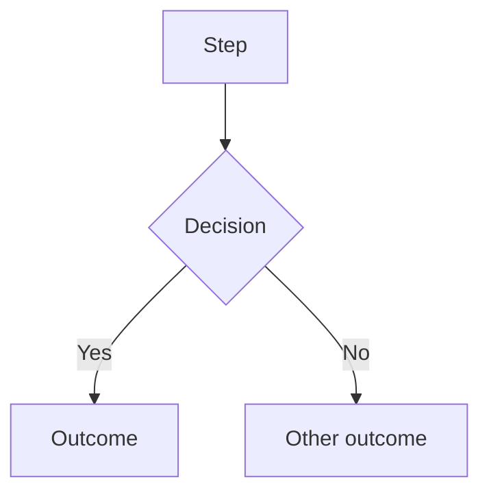

# Journey documentation

Every flow in this system is documented as a Mermaid flowchart. This is how a non-coder sees what the system actually does. Keeping it accurate is part of the work, not a nice-to-have.

## Location and format

`docs/journeys/`, one pair of files per journey:

* `<name>-intended.md` — hand-authored. What should happen. Source of truth. Agents do not edit this file.
* `<name>-actual.md` — generated from code. What does happen. Agents maintain this.

One-time exception (2026-08-02): `docs/journeys/README.md` says the existing `-intended.md` files were generated once, as a starting draft for a human to revise.

Mermaid goes inside fenced blocks in `.md` files so GitHub renders it:

````

````

A standalone `.mermaid` file will not render. Always `.md`.

## Journeys tracked

`client`, `role-owner`, `role-sales-manager`, `role-closer`, `role-funding-advisor`, `role-inquiry-remover`, `role-csm`, `affiliate`, `white-label`

## Rules

* Read before you build. Intended journey first, every time a flow is in scope.
* If code requires a step not in the intended journey — STOP AND ASK. Do not add the step. Do not edit the intended file to match your code. This is the single most important rule in this document.
* Update `-actual.md` in the same commit as the code change. Never a follow-up commit. A stale journey is worse than no journey.
* Generate `-actual.md` from code, never from the spec or from memory. If you cannot trace a path in the code, mark it `UNVERIFIED` in the diagram. Do not draw what you assume.
* Gaps between intended and actual are findings. Report them in your summary. Do not silently reconcile them.

## Changelog

Append one line to `docs/journeys/CHANGELOG.md` for every journey change:

```
YYYY-MM-DD | <journey> | <what changed> | <why> | <commit>
```

Newest at top. This is the human-readable record. Keep it honest — including when a change made a journey worse.
