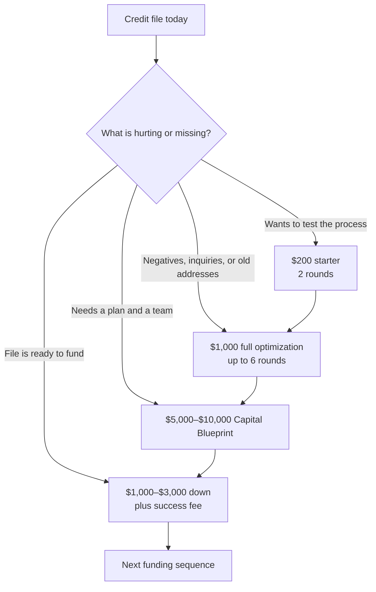

# Fundhub offers review and financial model

Date: 2026-10-11  
Source reviewed: `marketing/offers/fundhub-offers-2026-10-10.pdf`  
Source of financial model: screenshot supplied in chat, 2026-10-11  
Audience: internal

## Offer map from the PDF

The PDF describes four main offers. The $32 soft pull is a call-level entry
step, not one of the four main offers.

| Offer | Price | Best starting point | Main job |
|---|---:|---|---|
| Credit optimization starter | $200 | Person wants to test the process | Two rounds of dispute work and portal proof |
| Full credit optimization | $1,000 | Negatives, inquiries, or old addresses are hurting the file | Up to six rounds to prepare the file for funding |
| Capital Blueprint | $5,000–$10,000 | Person wants a written plan plus a team to keep the work moving | Credit analysis, roadmap, tasks, dispute pack, funding snapshot, lender match, CSM support |
| Funding, done for you | $1,000–$3,000 down plus success fee | File is ready and the person wants Fundhub to run the funding sequence | Planned bank rounds, inquiry work between rounds, and funding support |

### Call-level entry step

- **$32 soft pull / file read:** The call uses the person's real file to decide
  which path fits. It is not a bank application and is not an approval.
- **$200 starter credit:** The person can also test the work through the first
  two rounds of the starter.

## Offer path



The closer confirms the right starting point on the call. The table is a map,
not a promise that a score alone decides the offer.

## Financial model addition from the supplied screenshot

This is the model exactly as shown. The screenshot labels the values as a
single campaign model, not as measured results.

| Input or output | Value |
|---|---:|
| Ad spend | $15,000 |
| Cost per call, worst case | $345 |
| Total calls | 43 |
| Show rate, first call | 50% |
| First calls shown | 22 |
| Book second call | 100% |
| Second calls booked | 22 |
| Show rate, second call | 100% |
| Second calls shown | 22 |
| Close rate | 20% |
| Sales shown | 4 |
| Cash collected per sale | $7,000 |
| Cash collected | $30,435 |
| ROAS | 2.03 |
| Fixed costs | $10,000 |
| Team costs | $0 |
| Sales cost | $4,565 |
| Total cost | $29,565 |
| Net profit | $10,870 |
| Net ROAS | 1.03 |

## Math check

The sheet uses unrounded values in the money math and rounded whole numbers in
the visible call and sale counts:

```text
calls = $15,000 / $345 = 43.4783
first calls shown = 43.4783 × 50% = 21.7391
second calls shown = 21.7391 × 100% = 21.7391
sales = 21.7391 × 20% = 4.3478
cash collected = 4.3478 × $7,000 = $30,434.78 → $30,435
sales cost = $30,434.78 × 15% = $4,565.22 → $4,565
total cost = $15,000 + $10,000 + $4,565.22 = $29,565.22
net profit = $30,434.78 − $29,565.22 = $10,869.56 → $10,870
ROAS = $30,434.78 / $15,000 = 2.03
net ROAS = $30,434.78 / $29,565.22 = 1.03
```

The math works if **sales cost is 15% of collected cash** and **net ROAS means
revenue divided by total cost**. That is different from net profit divided by
ad spend, which would be `0.72` in this model.

## What the $7,000 line means

The screenshot calls this **cash collected per sale**. It does not say whether
the $7,000 is:

- the full cash collected from the funding deposit plus success-fee money;
- the average amount collected at the first sale;
- a blended average across several offers; or
- a planning assumption.

The PDF lists the funding offer as **$1,000–$3,000 down plus a success fee**.
The $7,000 model input must stay marked as a financial-model assumption until
it is tied to a real payment definition.

## Repo comparison

The offer PDF and the GitHub offer markdown match on these public prices:

- $200 starter
- $1,000 full credit optimization
- $5,000–$10,000 Capital Blueprint
- $1,000–$3,000 funding deposit plus success fee

The repo also records these internal economics in existing finance documents:

- A separate SLO model uses a $297 front-end blueprint and a $3,000 funding
  deposit. That is a different funnel model from this four-offer PDF.
- Existing funding code and verification docs use a 10% success-fee rule and
  a $3,000 deposit in some funding paths.
- The PDF's $7,000 cash-per-sale figure is not the same field as the offer
  price. It should not overwrite the offer prices.

## Recommended label for this model

Use this name in internal planning:

> **$15,000 ad campaign — 2.03 gross ROAS / 1.03 total-cost ROAS model**

Keep it separate from the client offer map. It is a forecast built from:

- $345 cost per call
- 50% first-call show rate
- 100% second-call booking rate
- 100% second-call show rate
- 20% close rate
- $7,000 cash collected per sale
- $10,000 fixed cost
- 15% sales cost

