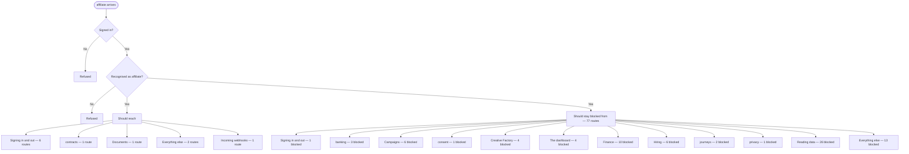

# affiliate — intended

> ⚠️ **WRITTEN AFTER THE FACT, NOT BEFORE IT.** CLAUDE.md §4 calls this file the
> hand-authored source of truth, checked against the code — and says agents do
> not write it, because an agent writing it would be authoring the very thing
> its own work is supposed to be checked against. This one is an explicit,
> one-time exception: the owner directed it be created from current behavior
> because none existed at all (`docs/journeys/README.md` recorded that gap
> from 2026-07-31 to 2026-08-02). It was generated on 2026-08-02 from the same
> extracted route data as [`affiliate-actual.md`](./affiliate-actual.md) —
> not from a product spec, a ticket, or anyone's independent judgment of what
> *should* happen. A match against `-actual.md` right now proves only that
> this file was copied from it, not that either one is correct. Replace this
> page's judgment calls with a human's the next time this journey changes on
> purpose — that is the point of having two files at all.

What a principal of kind `affiliate` should be able to do.

> **Who this is, in the code:** src/auth/account-session.mjs — PRINCIPAL_KINDS includes 'affiliate'

## In one picture

## Should be able to reach

- **Signing in and out** (6 routes) — should be reachable.
- **contracts** (1 route) — should be reachable.
- **Documents** (1 route) — should be reachable.
- **Everything else** (2 routes) — should be reachable.
- **Incoming webhooks** (1 route) — should be reachable.

## Should stay blocked from

- **Signing in and out** (1 route) — should stay blocked.
- **banking** (3 routes) — should stay blocked.
- **Campaigns** (6 routes) — should stay blocked.
- **consent** (1 route) — should stay blocked.
- **Creative Factory** (4 routes) — should stay blocked.
- **The dashboard** (4 routes) — should stay blocked.
- **Finance** (10 routes) — should stay blocked.
- **Hiring** (6 routes) — should stay blocked.
- **journeys** (2 routes) — should stay blocked.
- **privacy** (1 route) — should stay blocked.
- **Reading data** (26 routes) — should stay blocked.
- **Everything else** (13 routes) — should stay blocked.

## Comparing this against reality

Run `npm run journeys` and read [`affiliate-actual.md`](./affiliate-actual.md). There is no automated
diff between the two files — CLAUDE.md §4 describes intended vs. actual as a human
comparison, and this repository has never built a machine check for it. Read both,
side by side, and treat any difference between them as a finding to report, not
something to silently fix in either file.

## Scoped full Blueprint sale handoff — owner GO 2026-11-06

Only an explicitly enabled active affiliate account may save its buyer for the full Blueprint at exactly $30,000. The company and affiliate come from the session, never the request. Canonical client identity and immutable first-touch ownership stay in place. Conflicting request ids, another referrer's client and incompatible staff/partner/affiliate login emails are refused before an order.

A buyer without a real staff-issued exact-price full Blueprint agreement reads `needs_contract`; no handoff or financing checkout is returned. Automatic affiliate contract issuance requires the separately requested audit-actor approval; the build must not name an owner or fabricated employee as the affiliate's action. Once the real matching agreement exists, the permanent Fundhub handoff pins one company, buyer, seller, agreement and preallocated order. Retries preserve that order and Whop idempotency key. The provider must confirm explicit ClarityPay configuration; this is not customer financing approval.

The permanent outer URL renews the inner signing door without sending an expiring link. After the whole agreement is signed it opens the same verified checkout. Only a matched paid provider transaction with full Blueprint entitlement opens the normal portal sign-in. No self-reported payment grants access. Attribution and sales stay recorded while the seller commission remains uncalculated; this change sets no rate and pays nobody. Saved handoff integrity and paid-access checks run in the existing Whop heartbeat.
