# Affiliate payout flow — earned to paid

Built 2026-10-20 for Set B item B4. Board: `ops/workflows/affiliate-payout-plaid-2026-10-20.md`.
Database: `db/migrations/033_affiliates.sql` + `db/migrations/495_affiliate_payout_rail.sql`.
Code: `src/affiliates/payout-rail.mjs` (autopay and everything after), `src/affiliates/payouts.mjs` (the older monthly run, now a backstop).

**Owner-set 2026-10-20 (Chris):** "Plaid's going to take care of everything. ... Paid them out immediately
upon receiving the money. Once it clears, we just pay it."

## In plain words

1. A referred client pays. The payment is saved (the card processor said it went through).
   The affiliate earns 20% (direct) or 5% (downline). That is the commission. It is set once, on that first payment.
2. Within 15 minutes, the autopay job puts that commission on its own payout. No $50 minimum. No monthly wait.
3. No signed partner license, no tax form, or no linked bank? The payout is **held**. It goes out by itself the moment
   the last one is done.
4. Autopay sends it to the affiliate's bank with Plaid. No one has to click approve.
5. Every 15 minutes we ask Plaid what happened. Settled means paid. Failed means back to pending, with the reason,
   and the next pass sends it again.
6. Each payout is due the **day after** the client's money cleared. If it has not gone out by then, the pulse goes red.

Test money (Plaid sandbox) can only pay a **test** affiliate. Until Plaid gives Fundhub live access, a real affiliate's
payout waits with that reason written on it, and finance staff can pay by hand and press **Mark paid** with the
bank trace or check number. The database refuses anything else.

## States of one payout run

```mermaid
stateDiagram-v2
    [*] --> pending: autopay, client payment cleared, affiliate all set
    [*] --> held: autopay, license unsigned / no tax form / no bank linked
    held --> pending: license stamped, tax form recorded or bank linked (by itself) / staff Release
    pending --> held: staff Hold (reason required)
    pending --> processing: autopay sends through Plaid Transfer (no click) / staff Send now / Mark paid step 1
    processing --> paid: Plaid says settled (autopay sync) / Mark paid step 2 (reference required)
    processing --> pending: Plaid declined, failed, cancelled or returned (reason saved, sent again next pass)
    pending --> void: staff Cancel (reason required; commission owed again)
    held --> void: staff Cancel
    paid --> [*]
    void --> [*]
```

## What fires each move

| Move | Fired by | Where |
|---|---|---|
| → pending / held | cron `affiliate-payout-autopay` `*/15 * * * *`, step build | `buildImmediateRuns` |
| held → pending | `record_tax_form` / `stamp_license` / bank linked / `release` | `releaseCleared`, `POST /api/affiliates/payouts`, `POST /api/affiliates/payout-account` |
| pending → processing (Plaid) | cron, step send (or staff `send`) | `autoSendPending` → `sendPayoutViaPlaid` → Plaid `/transfer/authorization/create` + `/transfer/create` |
| processing → paid / pending | cron, step sync | `syncPayoutTransfers` → Plaid `/transfer/get` |
| pending → paid (by hand) | staff `mark_paid` with method + reference | `markPayoutPaid` (two steps, one transaction) |
| pending/held → void | staff `void` | `voidPayout` |
| bank linked | affiliate, `link_token` then `exchange` | `POST /api/affiliates/payout-account` (Plaid Link, product `transfer`) |
| (backstop) monthly run | cron `affiliate-payout-run` `0 3 1 * *` | `buildPayoutRun` — finds nothing once autopay has lined everything |

## Rules the database enforces (not the screen)

- Only the moves in the picture. A paid run is frozen. One commission line per referral, ever.
- processing or paid needs a signed partner license (033) **and** a tax form (495).
- paid needs a method and a reference (495).
- A Plaid payout is paid only when Plaid says `settled`, and a sandbox transfer can never pay a real affiliate (495).
- A paid run marks its referrals `paid` (495).

## The heartbeat

| Row | What goes red |
|---|---|
| `partners:payout-overdue` (morning) | A payout still not sent past its due day, or earned money with no payout record after a day. Waiting on the affiliate (license, tax form, bank) is listed as a reminder, not failed. |
| `partners:payout-returned` (morning) | A paid Plaid payout came back from the bank. |
| `partners:payout-stuck` (morning) | A payout in processing more than 7 days. |
| `trip:partner` (hourly) | A payout ready over a day and not sent, held over a day, or stuck. Covers the 3 payout doors and the autopay job. |
| job `affiliate-payout-autopay` | The 15-minute job has not run in 45 minutes. |

## Who decided what

- Paid as soon as the client's money clears, Plaid does it all, no approval wait: **owner-set 2026-10-20**.
- Rates (20% / 5%), held-not-skipped for an unsigned license: owner-set (2026-08-24, 2026-09-21).
- Agent-set 2026-10-20 inside that (Chris: "no preference" on mechanics): the affiliate links the bank with Plaid
  Link; due the day after it clears; the tax form and a linked bank hold a payout like the license does; test money
  pays only test affiliates; finance staff (owner, admin, sales manager) can hold, release, cancel or mark paid.
