# Affiliate payout flow — earned to paid

Built 2026-10-20 for Set B item B4. Board: `ops/workflows/affiliate-payout-plaid-2026-10-20.md`.
Database: `db/migrations/033_affiliates.sql` + `db/migrations/492_affiliate_payout_rail.sql`.
Code: `src/affiliates/payouts.mjs` (the monthly run) and `src/affiliates/payout-rail.mjs` (everything after).

## In plain words

1. A referred client pays. The affiliate earns 20% (direct) or 5% (downline). That is the commission.
2. On the 1st of each month, the payout run puts last month's commissions on one payout per affiliate.
   Under $50 waits for next month.
3. No signed partner license, or no tax form? The payout is **held**. It is counted, but it cannot leave.
4. The affiliate links their own bank with Plaid. That proves the account is real and theirs.
5. Finance staff press **Send**. Plaid pays the affiliate's bank. Or staff pay by hand and press **Mark paid**
   with the bank trace or cheque number.
6. Every 15 minutes we ask Plaid what happened. Settled means paid. Failed means back to pending, with the reason.
7. Every payout is due on the **15th of the month after** the month it was earned.
   If it is not paid by then, the morning pulse goes red.

Test money (Plaid sandbox) can only pay a **test** affiliate. A real affiliate is paid by hand until Plaid
gives Fundhub live access. The database refuses anything else.

## States of one payout run

```mermaid
stateDiagram-v2
    [*] --> pending: monthly run, gates open (1st, 03:00 UTC)
    [*] --> held: monthly run, license unsigned or tax form missing
    held --> pending: license stamped from a signed contract, or tax form recorded (auto) / staff Release
    pending --> held: staff Hold (reason required)
    pending --> processing: staff Send (Plaid Transfer credit) / staff Mark paid (step 1 of 2)
    processing --> paid: Plaid says settled (15-min sync) / Mark paid (step 2 of 2, reference required)
    processing --> pending: Plaid declined, failed, cancelled or returned (reason saved)
    pending --> void: staff Void (reason required; lines detached, commission owed again)
    held --> void: staff Void
    paid --> [*]
    void --> [*]
```

## What fires each move

| Move | Fired by | Where |
|---|---|---|
| → pending / held | cron `affiliate-payout-run` `0 3 1 * *` | `src/affiliates/payouts.mjs` `buildPayoutRun` |
| held → pending | `record_tax_form` / `stamp_license` / `release` | `POST /api/affiliates/payouts` |
| pending → processing (Plaid) | `send` | `sendPayoutViaPlaid` → Plaid `/transfer/authorization/create` + `/transfer/create` |
| processing → paid / pending | cron `affiliate-payout-autopay` `*/15 * * * *` | `syncPayoutTransfers` → Plaid `/transfer/get` |
| pending → paid (by hand) | `mark_paid` with method + reference | `markPayoutPaid` (two steps in one transaction) |
| pending/held → void | `void` | `voidPayout` |
| bank linked | affiliate, `link_token` then `exchange` | `POST /api/affiliates/payout-account` (Plaid Link, product `transfer`) |

## Rules the database enforces (not the screen)

- Only the moves in the picture. A paid run is frozen. One commission line per referral, ever.
- processing or paid needs a signed partner license (033) **and** a tax form (492).
- paid needs a method and a reference (492).
- A Plaid payout is paid only when Plaid says `settled`, and a sandbox transfer can never pay a real affiliate (492).
- A paid run marks its referrals `paid` (492).

## The heartbeat

| Row | What goes red |
|---|---|
| `partners:payout-overdue` | An earned commission is past its due day and not paid — on an open run, or with no payout record at all. Held-for-paperwork is listed as a reminder, not failed. |
| `partners:payout-returned` | A paid Plaid payout came back from the bank. |
| `partners:payout-stuck` | A run in processing more than 7 days. |
| `partners:commission-payable` | Payable commission on no run after the 1st. |
| job `affiliate-payout-autopay` | The 15-minute sync has not run in 45 minutes. |

## Who decided what

- Rates, monthly cadence, $50 minimum, held-not-skipped: owner-set (2026-08-24, 2026-09-21).
- How Plaid is used, the 15th due day, test money for test affiliates only, finance staff (owner, admin, sales manager)
  approve: agent-set 2026-10-20. Chris answered "no preference".
