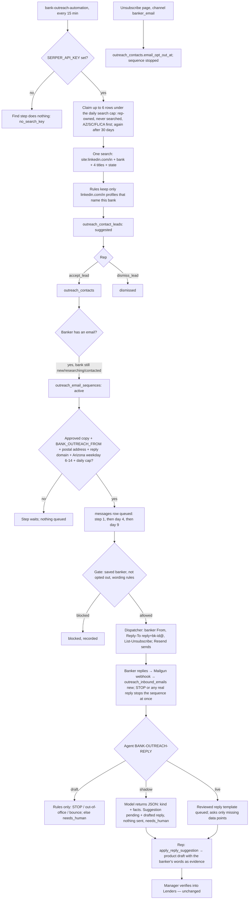
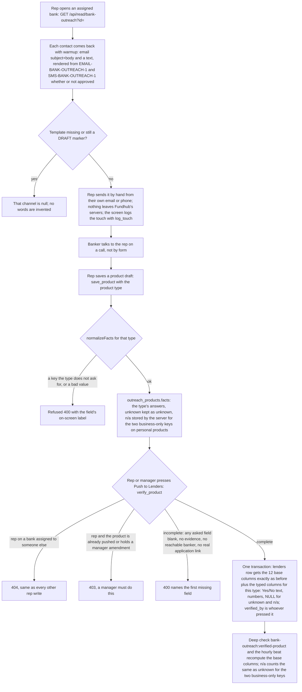

# Bank outreach — actual implementation

Implemented against the owner-approved [intended journey](bank-outreach-intended.md). Build branch: `codex/bank-relationship-outreach`, [PR #77](https://github.com/ZootimusMaximusSupreme/fundhub-platform/pull/77). This is not a production launch claim.

1. Managers import official FDIC/NCUA CSV files through the workspace. The parser retains institution IDs, state and website, accepts official aliases including `WEBADDR` and `CU_NUMBER`, filters to AZ/SC/FL/CA and deduplicates targets without clearing prior work.
2. Managers assign active same-company staff. `outbound_rep` gets only this workspace; the shared session resolver denies unrelated staff API paths. The store re-reads active role/company identity and applies assignment/company scope even on direct calls.
3. Reps save banker details, manually open LinkedIn/email/phone links, and log touches with a next action. One transaction appends the activity and moves the queue due time; an omitted due time means now. Active banks sort ahead of paused/closed banks before pagination, so old inactive work cannot hide the next banker. UI dates and scheduling explicitly use Arizona time.
4. Product facts preserve typed numbers, booleans, arrays and explicit unknowns. Verification needs evidence, a reachable banker and an application path. Only a manager can verify into the existing Lenders sheet. Lender locks recheck company, product category and active state before promotion.
5. Published facts remain live during manager amendments. Reps cannot read pending draft facts or their audit snapshots. Verification saves prior product/lender facts into append-only history, promotes the candidate atomically and keeps the original verified-week date. Unverified lender selections can be corrected; published links cannot be repointed.
6. Active/quiet partners receive monthly/quarterly next actions. The shared Inngest daily job fills missing reminders idempotently; it does not send external messages.
7. Deep morning checks and hourly read-only checks compare published product facts, evidence/paper link, banker and same-company active lender. The job has a stale-receipt check. The hourly read door requires sign-in once deployed; a predeploy proof explicitly leaves that live-door check pending.

## Observable proof and limits

- Real PostgreSQL tests exercise the migration, production-like default grants, app-role history mutation refusals, two-company/rep boundaries, HTTP handlers, promotion rollback, category races, amendments and reminder idempotency. They refuse a non-scratch database and skip plainly when no database URL is present.
- GPT-6 Astra Extra High finished the original, pre-alignment UX after backend/API proof. Browser fixtures prove controls and requests, not real bank facts or production writes: 37/37 cases at 1440/390/320 (all 32 retained plus five regressions), with the existing eight shared-sidebar role cases also passing. Manual email/phone actions never send from Fundhub; unanswered facts remain distinct from unknown/zero/no; filtered-empty and paused/closed views have correct recovery and labels. Marked evidence is saved in `ops/workflows/build-evidence/bank-outreach/`.
- Original pre-alignment mobile Lighthouse 13.5.0: score 100, LCP 1.398s, CLS 0.00202, TBT 0ms, JavaScript 197289 transfer bytes and total page 340818 bytes at 390x844/Slow4G/4x CPU. Historical source/report hashes were verified. These numbers do not describe the later aligned source; its fresh result is below. The local synthetic lab does not measure field INP or live-server response time.
- Full scratch integration, updated PostgreSQL regressions and built morning/hourly function proofs run in `.github/workflows/bank-outreach-proof.yml`. Current run results are linked in the PR; unrun/skipped checks are not green evidence.
- Dedicated proof 39385636240 on dab1b7505 passed 84 saved-result checks, 286 shared integration checks (zero skips), 40 outreach/sidebar browsers and 16 full-harness browsers. Strict scratch reported 478 PASS, 0 FAIL, 1 SILENT and 99 UNVERIFIED. Morning outreach passed; hourly outreach passed in 40ms with its live read-door pending. That run's full hourly gate failed on an eight-second public checkout GET abort.
- A controlled same-provider comparison answered 48/48 requests on Mac versus 40/48 on Ubuntu. The unchanged full hourly proof then passed on the canonical Mac release environment in run 39386629761: real migrated PostgreSQL 17.11/app role, 17 actual-bundle beats, 777ms, 47 successful read-only database reads and zero commits. This supports moving only the hourly proof to ship.yml's existing runner, not a transport or deadline change. Empty-scratch operational findings remain red, live doors remain pending, and the final-head full release checks remain required.
- All three dedicated jobs in run 39390457606 on final Astra UI commit 870d2a8dd passed after runner alignment. The separate full matrix found a required contract-send test interaction race; its test-only repair passed all eight Chromium cases and independent review, including a broken-lock negative proof. The repaired final head still requires complete GitHub checks. After the marked preview, owner explicitly approved **Publish after final checks pass**; no repeat go-live approval is needed, and no publication is claimed yet.
- The existing gated demo switcher includes the outbound role through the shared roster and additive migration 484; no demo-login flag is enabled and existing credentials are never overwritten. This demo seat is not a real outbound hire.
- Owner then required comparison with the current dashboard overhaul. Its independent Astra review found a missing shared opt-in and measured phone text/native-control/menu sizing gaps. The earlier 37-case/Lighthouse 100 result did not cover this addendum. Parent integrated canonical PR81 merge `f78f6b8b9` as `8fc8eb335`; all shared Astra stylesheet bytes remain unchanged. Later canonical `9cb7abc55` adds only its successful ship log. Bank opts into foundation/staff styles after legacy CSS, gives its existing sidebar link the shell-recognized ID to prevent a duplicate late include, and applies a page-specific 48px primary rule. No hierarchy, role gate, API contract or manual-only outreach behavior changed.
- Aligned local proof: **41/41 Chromium and 27/27 WebKit**, zero skips/retries. All original 37 test bodies and fixture function remain intact; four added Chromium cases measure 768/1024. WebKit covers manager/rep flows and full/loading/empty/error at 390x844, 440x763 and 838x390. Native fields/body meet 16px, captions 13px, targets 44px and primary 48px, with contained expanded menus and scroll-reachable saves. A measured Bank-only focus repair returns Safari from closed native dialogs to the actual opener, replacement bank-row button or visible work/import control after saved data repaints the queue. Permanent assertions include hidden connected rows during a pending refresh and a replaced empty-import opener. Original failing receipts remain identified in the aligned evidence report.
- Fresh aligned Lighthouse 13.5.0 at 390x844/Slow4G/4x CPU: **98**, LCP **1.889s**, CLS **0.02331**, TBT **23.6ms**, JavaScript **198533 bytes**, total page **420724 bytes**. Parent verified five Bank/shared source SHA256 values and the raw report's hash/size. Marked phone/landscape examples were independently inspected; technical review found no blocker in the named cascade/focus cases. These are local fictional-fixture results, not physical-device certification, field INP, production TTFB or live banker-to-lender proof.
- Parent independently passed eight shared-sidebar browser cases, the local actual-browser redirect negative control, full lint (4030 file/inline blocks), TypeScript, frozen-source syntax, 37 source/guard/font checks, 22 focused backend/monitoring checks, 83 monitoring-registration/integration checks and 143 boundary/catalog/portal checks. Catalog regeneration matches 3976 map rows/3943 unique; this wiring result is not a claim that live operational findings are green. Fresh complete remote checks on the final integrated release head remain required.
- The manual signed-in live-read lane is prepared with 16 offline guard tests. It requires an exact canonical release SHA, hashes actual deployed assets, permits one ordinary existing manager login, and blocks all other writes and all redirect traversal. A real local browser negative test proves the old redirect escape and the new exact-response/cookie behavior. Valid password symbols are not mistaken for complete mask placeholders, and the credential is returned unchanged; the existing CI secret was confirmed by name only, never read or revealed. Actual execution waits for publication; real record values, credentials, browser storage and screenshots are not retained. An empty workspace cannot prove a saved product journey or another rep's isolation.
- Pre-alignment f97bc66ac completed all14 full PR checks in run39392526856. Dedicated run39392520939 still failed the morning timing limit at32.1seconds while its actual outreach checks passed2/2 and hourly proof passed. The unchanged morning command now follows the same canonical Mac/scratch-app-role proof path as hourly, with safe failure-only request timing added; all17 focused policy/diagnostic tests and independent review pass locally. Its new remote result is still required, and these checks do not cover the pending Astra alignment.
- Pre-alignment `c85208bc2` passed all 14 full checks in run `39395516665` (1699 browser passes, three existing skips retained). Dedicated run `39395509784` passed all three jobs, including the full unchanged morning proof in 9.4 seconds, outreach 2 PASS/0 FAIL and hourly Bank 43ms with its predeploy live door explicitly skipped. All 47 database reads succeeded with read-only rollback/destruction and no commits. This closes the preceding morning-runner failure for that source, not the new alignment or production proof.
- No live rep seats, customer records, external outreach or production deployment were created by this build.

## Automatic half — no Apollo, no Salesforge (2026-10-20, not live)

Owner, 2026-10-20: "make this as automated as possible without paying for those two services". Board: `ops/workflows/bank-outreach-auto-2026-10-20.md`. Traced from `src/outreach/automation.mjs`, `src/outreach/replies.mjs`, `src/outreach/store.mjs`, `src/messaging/gate.mjs`, `src/messaging/dispatch.mjs`, `src/messaging/providers/resend.mjs`, `src/adapters/mailgun.mjs` and migration 495.

What is true in code (none of it is live until migration 495 ships and the settings are set):

1. Search only through `src/messaging/providers/serper-search.mjs` behind the ADAPTERS fence. No LinkedIn or bank website is opened. With no key nothing runs. Default cap 80 searches a day (`BANK_OUTREACH_SEARCHES_PER_DAY`); a fence hold un-marks every claimed row.
2. Found bankers stay suggestions until a rep accepts. The machine replaces only its own next-action wording, never a rep's.
3. Cold email: three reviewed templates seeded `compliance_passed=false`. A step waits (never burns) while copy or settings are missing. Default cap 40 a day (`BANK_OUTREACH_EMAILS_PER_DAY`). Each email carries the mailing address and both ways out.
4. The gate allows the seven bank keys with no client only for a saved banker address in the same company that has not opted out. Resend refuses a From outside its sending domains.
5. Replies: the model never writes words a banker reads. Facts are suggestions a rep applies; Lenders changes only through manager verification. At most 3 automatic answers per banker per 30 days.
6. Machine history rows are `actor='automation'` with no staff id.
7. Monitoring: job heartbeat (`*/15`), morning checks `bank-outreach:email-safety` and `bank-outreach:reply-waiting`, hourly beat step `email-safety`.

Gap with the intended journey (finding, not reconciled): `bank-outreach-intended.md` step 3 says "Fundhub does not send messages, scrape sites or incur data credits" and step 8 says "No automated external sends occur". The owner's 2026-10-20 order asks for automatic finding, email and replies. The intended file is the owner's to update; this build keeps sending behind copy approval, mail settings and the agent switch.

## Manual first — product fields per type, rep push, warm-up (2026-10-21, back end, not live)

Owner, 2026-10-21: "We start manually, we move to AI." Build spec: `docs/specs/bank-outreach-manual-first-2026-10-21.md`. Traced from `src/outreach/model.mjs`, `src/outreach/store.mjs`, `src/outreach/queue.mjs`, `src/outreach/mail.mjs`, `src/outreach/replies.mjs`, `src/pulse/coverage/gap-bank-outreach.mjs`, `src/pulse/beats/beat-bank-outreach.mjs` and migration 503. Nothing is turned on: search is still the key, automatic emails are still template approval, the reply agent is still `draft`. The screen side (product form per type, Push to Lenders, Email/Text banker buttons) is built separately and is UNVERIFIED here.

What is true in code:

1. **Field catalog** (`FIELD_CATALOG`, 29 keys) lives in `model.mjs`. The first nine keys are the original facts and keep their names, types and storage. `productFields()` returns `{ fields, types, notApplicable }` and rides on every read response (list, team, automation, bank detail). Changing the product type changes the list; adding a type (MCA) is one row in `TYPE_ADDS`.
2. **Completeness is per type.** `normalizeFacts(facts, { complete, lenderTable })` needs every field that type asks for answered or `"unknown"`. Without `lenderTable` it behaves exactly as before (the nine keys). `"unknown"` is never turned into zero, false or "all states".
3. **n/a.** Personal cards, lines and loans do not ask the two business-only keys; the server stores `"n/a"` and Lenders keeps NULL. `lenderValues` nulls `"n/a"` for those two keys only; a banker's own typed "n/a" elsewhere stays text.
4. **Push to Lenders.** `verify_product` is allowed for an `outbound_rep` only on a bank assigned to them (the same `account()` scope as every rep write) and only for a product that is not yet pushed and holds no manager amendment. Managers are unchanged. The twelve base columns keep their exact formats; `lenderExtras()` adds one typed column per answer the type asks for (`double_pull`, `relationship_required`, `requires_account_opening`, `minimum_deposit`, `prequal_soft_pull`, `business_bureau_pulled`, `underwriter_interaction`, `intro_offers`, `multiple_llc_allowed`, `application_method`, `typical_approval_range`, `apr_range_pct`, `repayment_terms_months`, `funding_speed`, `average_starting_loc`, `max_known_loc`, `draw_period_renewal`, `docs_requested`, `collateral_required`, `loc_type`) in the same insert or update.
5. **Warm-up.** Migration 503 rewrites `EMAIL-BANK-OUTREACH-1..3` to ask for a call and never for data points, only where the row is unapproved and still holds the exact 495 words, and adds `SMS-BANK-OUTREACH-1` (unapproved, under 300 characters, ends with the opt-out words). Merge tags: `banker.first_name`, `bank.name`, `bank.state_name`, `rep.name` (the assigned rep, else the signed-in staff member). The same `rep.name` tag now signs the automatic emails (assigned rep, else "Fundhub Bank Partnerships") if they are ever approved.
6. **Replies.** `parseModelReply` accepts any valid catalog key and, once the reply names a product type, only that type's keys; `missingQuestions` asks that type's questions when the type is known, the original nine when it is not. `apply_reply_suggestion` drops a suggested key the chosen type does not ask for instead of refusing the save.
7. **Monitoring.** No new route, page, job or send path, so no new registry row. The two verified-product SQL copies (morning check and hourly beat) accept `"n/a"` exactly where they accept `"unknown"` for the two business-only keys and stay identical.
   **Extra-column tripwire (2026-10-22).** Both copies also compare the twenty typed `lenders` columns that `lenderExtras()` fills (the list in item 4) against the product's saved answers, in one more `EXISTS` over a twenty-row key/column list: yes/no `true` is `"Yes"`, `false` is `"No"`; a number equals the numeric column; text equals the text column; `"unknown"`, `"n/a"` and a missing or wrong-typed answer are NULL. A pushed product counts as broken when any column it saved an answer for differs (for example `double_pull` true while Lenders says `"No"`). A key the product never saved (a product verified before manual-first) is not compared, so an old Lenders row with values in those columns stays green. Still one read-only query on the existing joins; no new row, route or job. Proved on a real Postgres engine (PGlite) with shadow tables, not on live data; `src/pulse/coverage/gap-bank-outreach.pg.test.mjs` also runs in CI with `DATABASE_URL`.

Gaps with the intended journey (findings, not reconciled; the intended file is the owner's): `bank-outreach-intended.md` step 6 says a manager verifies, and the roles section says reps collect facts while managers verify; the owner's 2026-10-21 order lets the assigned rep push a complete product to Lenders ("a human in the loop ... that's what the point of these reps are for"). Step 5 says "Unanswered fields remain unanswered or explicitly unknown", which now applies per product type. The model prompt on the `BANK-OUTREACH-REPLY` agent row (495) still lists only the original nine fact keys; it is unchanged because the agent stays `draft`.
