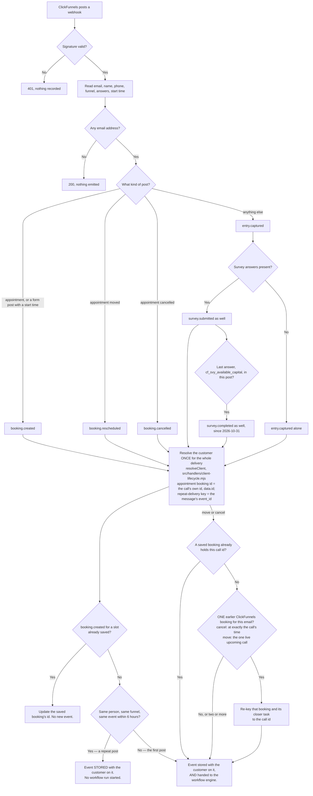
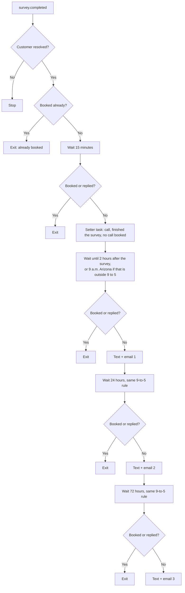
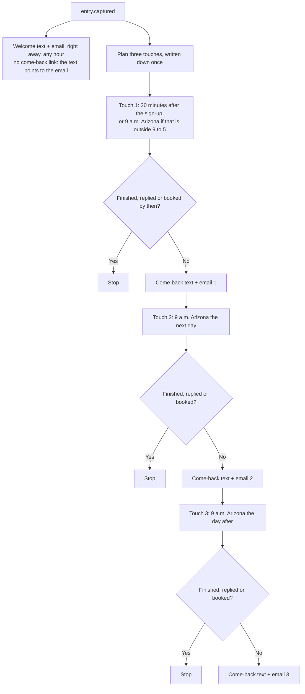
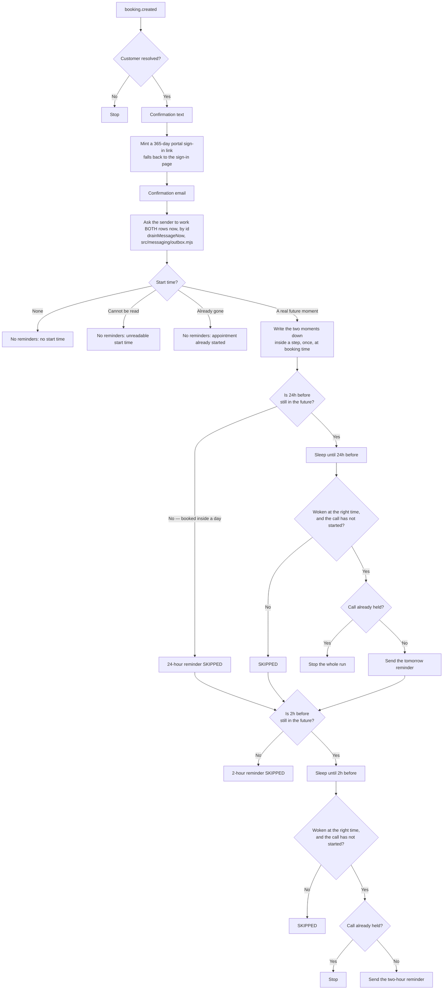
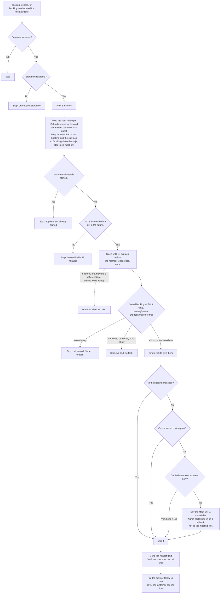
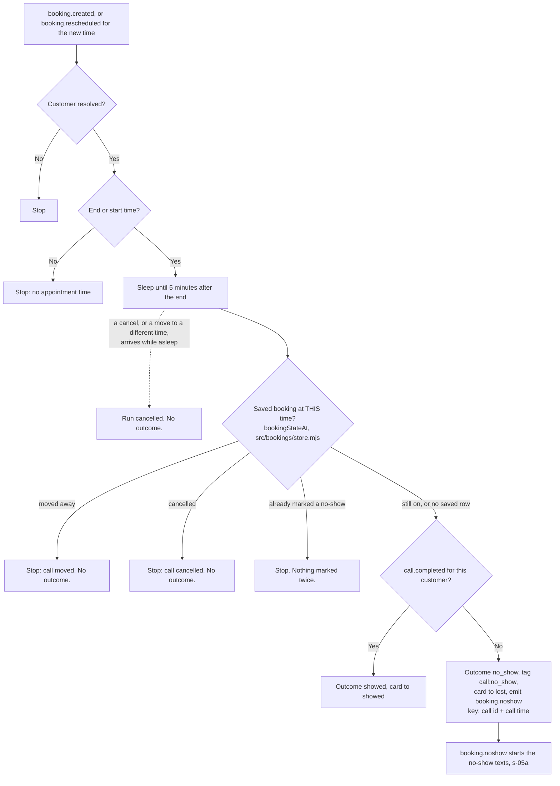
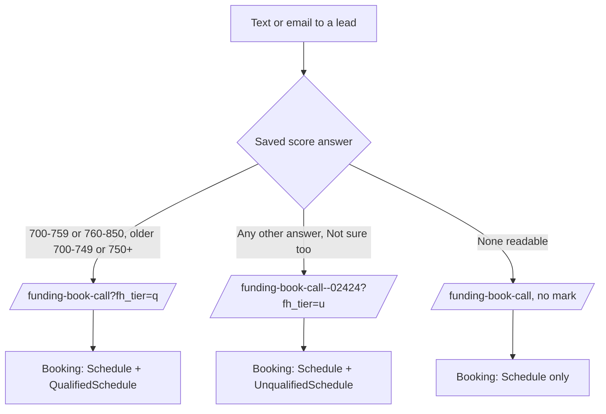

# Booking notifications — what fires, when, and what stops it

Generated by reading the code on 2026-09-04, after the ROUND 2 notification
repair. Every box below names the file it comes from. Nothing here is a plan;
it is what the files do.

This page exists because on 2026-09-03 one phone received 69 texts in two and a
half hours, 46 of them the same message, to customers who had already booked.
Three separate faults stacked up, and no single document showed how the pieces
connected, so nobody could see it coming.

## 1. From the funnel to an event

`src/adapters/clickfunnels.mjs` → `src/events/bus.mjs`



**The two things that changed here.**

**Fresh contact values for a real apply or booking (2026-10-26 branch).** When a
ClickFunnels apply form or booking resolves an existing client by email, its
usable typed name and phone replace older contact values before the booking
confirmation is queued. An unrelated later contact event still fills blanks
only. This keeps the confirmation text aimed at the number on the latest form.

* Every event is now written **with the customer on it**. Before 2026-09-03 the
  adapter passed none, so all 82 survey rows, all 95 lead rows and all 6 booking
  rows in production carried nothing. Any part of the system that looked up a
  customer's history was blind to the entire funnel.
* ClickFunnels posts **once per survey screen, plus retries** — 82 posts for 5
  real surveys. Each post has its own ClickFunnels id, so the ordinary duplicate
  check never collapsed them and each one started its own text cadence. A repeat
  post inside six hours is still stored (the later screens carry answers the
  first post does not have, and the "Survey Complete" stage depends on the last
  one) but it no longer starts a second run.

`booking.created` is deliberately **not** repeat-suppressed: it already has
slot-level dedupe, and a second booking is a real second appointment.

**One booking, two messages, one moment (2026-10-29).** ClickFunnels posts the
calendar form and the scheduled event for one booking a fraction of a second
apart. Each looked for a saved booking at that time before the other had saved
it, so 2 calls were stored twice on 2026-10-29 (two closer tasks, two Cortana
sends each). The slot check and the save now run one at a time for one person at
one call time (`withBookingSlotLock`, `src/adapters/clickfunnels.mjs`); the
second message finds the saved booking and emits nothing. A saved booking is only
ever re-keyed **to** the call's own id, so a form post that lands second no
longer swaps it back. The booking payload also carries the calendar page id
(`calendarPageId`, the message's top-level `page.id`) and the event type name.

**One call, one booking id (2026-10-05).** A real ClickFunnels appointment
message has no top-level `id`. It carries `event_id` (new on every message) and
the call itself in `data`, whose `id` is the call's own id (it equals
`subject_id` on all 5 appointment messages ClickFunnels still lists for this
account). The adapter used to save the booking under `event_id`, so a move made
a second booking and a second closer task, and a cancel closed nothing. Now the
booking id is `data.id` (then `subject_id`), so create, move and cancel of one
call land on one booking row. `event_id` is still the repeat-delivery key, so
two moves of one call are both handled and a re-sent message is not.

Calls booked before this change are saved under a message id. When their move or
cancel arrives, the adapter re-keys that one earlier booking (and its closer task)
to the call id first — a cancel only when one live ClickFunnels booking for that
email sits at exactly the call's time, a move only when that email has exactly
one live upcoming ClickFunnels booking. Anything less certain is left alone.
`src/adapters/clickfunnels.mjs` (`adoptEarlierBooking`).

## 2. What each event starts

| Event | Workflows woken | File |
|---|---|---|
| `entry.captured` | welcome text and email, new-lead intake and immediate owner/setter SMS and native push, assigned closer native push, the come-back flow for an unfinished survey, first-touch capture, referral ownership, one open human setter task per client | `s-00-welcome`, `s-01`, `src/staff/lead-alerts.mjs`, `s-02`, `at-01`, `af-02`, `src/setter/tasks.mjs` |
| `survey.submitted` | no workflow. Fires on every answered survey screen; its answers are saved on the client, and the client's `credit_tier` with them (`onSurveySubmitted`, `src/handlers/client-lifecycle.mjs`) | — |
| `survey.completed` | the never-booked chase and its setter call task. Fires once, when the answers include the last question (`cf_svy_available_capital`, `surveyIsComplete` in `src/survey/cf-question-map.mjs`) | `s-nobook-chase` |
| `setter.no_answer` | the no-answer texts. Fires when a setter saves "No answer" on the setter desk, once per lead per Arizona day | `ai-set-03` |
| `booking.created` | confirm + reminders, one open booking-confirmation setter task per client, the 15-minute handoff, booked-call owner/setter text and push plus assigned closer push, pre-call launcher, call-outcome enforcement, portal invite, no-show recovery | `s-04b`, `src/setter/tasks.mjs`, `ai-set-04`, `s-04c`, `bs-01`, `dpc-02`, `s-portal-invite`, `s-05a` |
| `booking.rescheduled` | confirm + reminders, pre-call launcher, the 15-minute handoff, call-outcome enforcement (each restarts for the new time; the run for the old time is cancelled) | `s-04b`, `bs-01`, `ai-set-04`, `dpc-02` |

The setter dashboard shows the submitted `cf_svy_*` survey answers with stable question keys. During a call, the assigned setter can save corrected answers through `POST /api/setter-dashboard` with `action: "save_survey"`. The corrections live in `clients.custom_fields.setter_survey_edits`; the submitted answers remain unchanged. The dashboard reloads the saved corrections, and the generated closer handoff uses them. Editing a completed handoff refreshes its saved text without resending a message.

**Staff alerts added 2026-10-30.** `s-01` sends each active setter and owner one short lead SMS and native app alert as the lead enters. The text shows first name, phone, email, booking status and available survey answers. The assigned closer gets an app alert on lead entry or booking, without an immediate SMS. Completing the setter handoff sends the closer a text and app alert with the saved setter details and corrected survey answers, including when the owner is both setter and closer. At the current call's 15-minute handoff, the assigned closer (or owner fallback) gets the next-call text and app alert. Internal lead, set, and upcoming staff SMS send immediately, including overnight; client texts and other staff texts keep their existing contact hours. The existing SMS outbox and verified-staff gate still apply. Stable message and push keys prevent replay duplicates. Native app delivery still requires a registered staff device and a live phone test.

The call screen also asks which funding paths were discussed (business, personal, or both), employment, annual personal income, and whether income can be verified. These answers save through the existing checklist action in `clients.custom_fields.setter_handoff`, separately from the submitted survey and its corrections. The funding-path answer is required for an opt-in handoff; the personal employment and income answers are optional. The outgoing handoff text does not include the new personal details.

The event bus keeps each distinct funnel event, including separate survey-screen posts. The local setter handler now reuses an open task for the same client and task type. Once that task is done, a later opt-in or booking can create a new task. The Sales Fulfillment view shows one pill for repeated older setter tasks of the same type; the underlying tasks remain in the task list.

## 3. The never-booked chase

`src/workflows/s-nobook-chase.mjs`

**Since 2026-10-31 the chase starts on `survey.completed`, not `survey.submitted`.**
The `/apply` page posts after every screen, so `survey.submitted` fired after the
first answer and a person who answered one question was chased as if they had
finished. Each message waits for the follow-up hours (9 a.m. to 5 p.m. Arizona,
section 6), and the stop checks run at the moment it really goes out, so a person
who books or replies overnight never gets the 9 a.m. message.



Every link in these messages is `{{custom_values.booking_link}}`, which opens the
person's own calendar (section 7c).

## 3b. The come-back flow for an unfinished survey (2026-10-31)

`src/workflows/s-02-incomplete-survey-nudge.mjs`, `src/survey/resume-link.mjs`,
`api/public/survey-resume.mjs`, `marketing/landing-pages/apply-survey.html`

The `/apply` survey asks for name, email and phone on its first screen, which saves
the lead (`entry.captured`). The welcome text and email go out at once, at any hour,
and send the person back to the survey. Their words no longer say "your application
is in", because the person has not finished.



**The link opens the survey where they stopped.** Every come-back EMAIL carries
`{{survey_resume_link}}`: `https://apply.fundhub.ai/apply?r=<token>`. The token is
signed, names the client and the company and nothing else, and lasts 30 days. The
page asks `GET /api/public/survey-resume?r=<token>` for the contact details and the
answers already saved, fills them in, and opens on the first question with no
answer. An answer that is no longer a choice on the page (an older score range) is
asked again. No token, a bad one, or no answer in 3 seconds: the survey starts at
the top, as before.

**No text ever carries the link (review 2026-10-31).** Whoever holds the link opens
the person's saved answers, and the public form can put any phone on an existing
lead's email, so a text can reach someone else. The email address is the lead's
identity (clients are matched on it), so the email reaches the owner. Each come-back
text points to the email of the same touch, which goes out at the same moment.
`sendTemplated` drops the tag from every text, a test fails if any text template
names it (`src/survey/resume-link-sms.pg.test.mjs`), and the hourly `survey-resume`
beat goes red if any text carries a link (`survey:resume-no-link-in-texts`). The
welcome email links to the plain /apply page (seed 302).

"Finished" means `survey.completed`. A reply means a `message.inbound` event for
the client after the flow started.

**"Booked?" is the question that could only ever answer no.** It asked for
booking events belonging to the customer, and no booking event belonged to
anybody. It now answers yes when **any** of these is true, within the
customer's own company only:

1. the booking event names this customer, or
2. the email address inside the booking event matches theirs, ignoring case, or
3. the last ten digits of the phone number inside the booking event match theirs.

Two and three are what stop the runs that are already asleep in production,
because every booking event they will wake against was written before the
customer was ever attached.

## 4. Confirmation and reminders

`src/workflows/s-04b-booking-reminders.mjs`



**A reminder whose moment has passed is not sent late. It is not sent.** The
subtraction was always right; nothing ever checked that the result was still in
the future. An unreadable start time makes a sleep that ends immediately, and a
call booked twenty hours out has a "24 hours before" that is already four hours
gone — both used to fire at once, and both said "tomorrow". The tolerance either
side of the intended moment is five minutes.

**The two moments are decided once and written down.** The workflow engine does
not run a long job from top to bottom. It runs it from the top, does the next
piece of work it has not done yet, records that piece's answer, and starts the
job again from the top — so anything worked out OUTSIDE a recorded piece of work
is worked out again, against the clock as it is on that later pass. The first
version of this repair worked the plan out in the open, which meant that at the
exact moment each reminder came due the plan was recomputed, decided the moment
had just gone, and sent nothing. Both reminders would have stopped for every
customer. The plan, and the check made on waking, are now each a recorded piece
of work, so the moments chosen when the booking arrived are the moments used.

**The confirmation no longer waits for a clock tick.** The sender sweeps every
five minutes, which is most of the three-minute delay the owner measured. The
two confirmation rows — and only those two — now ask to be worked immediately,
by id, through the same sender. The company pause switch, the daily cap, quiet
hours, opt-out and the compliance screen all still run; the sweep is unchanged
and remains the backstop for these two rows and for everything else.

**The booking email (2026-10-26 branch).** S-04B supplies three distinct paths:
the iPhone app download page, a regular web portal sign-in for Android or a
browser, and a magic sign-in link that opens the portal at its **Confirm my
call** card. The customer presses that card to save the confirmation. The email
does not show an empty meeting-location row when the host's Meet link has not
yet been read. The first-party app page records an Apple-link tap only when the
customer actually presses the Apple button.

In current source, after the confirmation **text** is marked sent, the sender
also tries one native iPhone alert with fixed, detail-free wording: “Please
confirm your upcoming call in FundHub.” It only tries when APNs and encrypted
device storage are configured, and only for an opted-in, eligible native device.
A blocked or deferred text cannot trigger the alert; a deferred text may trigger
it later when the normal sweep actually sends it. APNs failure leaves the text
sent and does not queue a second text. This native alert has not been proved on
a real phone or shipped as live delivery.

## 5. The fifteen-minute handoff

`src/workflows/ai-set-04-3way-handoff.mjs`



**A moved call gets its text at the new time, and only there (2026-10-05).** A
move used to leave the old run asleep, so the customer was told "your call
starts in 15 minutes" at the time they had moved away from. Now a move starts a
run for the new time and cancels any run whose start time differs from the
move's (matched by call id or by email, the same way a cancel is). On waking,
every run also asks the saved booking whether a live booking is still at its
time; moved away, cancelled or already a no-show means no text. If no saved
booking speaks to that time, the text goes as it always did. The text and the
advisor task are keyed on the customer and the call time, not on the event, so
two runs for one call time can never queue two texts.

The text used to end "link: ." — it asked for a meeting location and was given
no context at all, so the tag rendered as nothing. ClickFunnels supplies no
meeting link on any booking it takes.

**Where the real join link comes from (2026-10-20).** ClickFunnels books each
call on the host's Google Calendar, and Google puts a Meet link on that event
and emails the customer the invite. Measured read-only on 2026-10-20: all 11
"Funding Strategy Meeting" events on the host calendar since 2026-09-03 carry a
Meet link, the customer as a guest, and the booking's exact start time. So two
minutes after a booking the run reads that event (one GET, the host's own Google
token, which carries calendar read) and keeps its Meet link on the bookings row
and the closer's call task. The 15-minute text uses it, and reads the calendar
again if the early read missed. The portal sign-in page is now only the last
resort. A miss is recorded on the run as a reason (`no_calendar_scope`,
`no_matching_event`, `token_refused`), and the pulse row
`calls:booked-no-join-link` goes red when a booked call still has no link. Only
the host calendar the token can read is searched; a second host's calls need
that host's calendar shared with the token's account.

**The duplicate calendar event in the 2026-10-26 walk.** A read of the host's
primary calendar found the actual ClickFunnels invite with a guest and Meet,
and a second self-added event at the same time without either. The second event
matched the thank-you page's Google Calendar template and ICS controls. The
2026-10-26 branch removes those duplicate controls and directs the customer to
the emailed invite; the host event reader remains read-only.

**Exact-call fallback repair (2026-10-27; code proof, not provider receipt).**
The saved-booking fallback now requires the same client or booking id, the same
call time and an active booked/rescheduled state. It will not borrow a Meet room
from an older call for that client. When the host Calendar still has no matching
event, the 15-minute message says the Meet link is unavailable and labels the
portal address as sign-in fallback, not as the meeting link. No live customer
message was sent for this proof.

**Three ways this text used to be a lie about the clock, all now refused**: a
start time nothing can read, a call that has already started, and a booking
taken inside the last fifteen minutes. The first was refused before this repair
pass; the other two were not, so a booking carrying yesterday's start time sent
"Your call starts in 15 minutes" the instant it arrived.

## 5b. The no-show check

`src/workflows/dpc-02-call-outcome-enforcement.mjs`



**A cancelled or moved call is never a no-show (2026-10-05).** This check used
to start only on `booking.created` and nothing stopped it, so at the OLD end time
a cancelled or moved call was tagged a no-show, its sales card went to lost and
the no-show texts started. Now a cancel, or a move to a different time, cancels
the run (same rules as the 15-minute text, `src/workflows/booking-cancel-rules.mjs`),
a move starts a check for the new time, and on waking the run asks the saved
booking about its own call time first. If no saved booking speaks to that time,
it decides as before. The `booking.noshow` key now carries the call time,
because the booking id no longer changes when a call moves.

## 6. Where a message actually goes out

Nothing above sends anything. `sendTemplated` writes one queued row.

```
workflow → sendTemplated (src/workflows/messaging.mjs)
             opt-out check → template lookup → draft guard → compliance flag
             writes ONE messages row, status 'queued'
          → src/messaging/dispatch.mjs — the only thing that hands a row to a provider
             driven by the sweep every 5 minutes (message-dispatch-sweeper)
             or, for the two booking confirmations only, immediately by id
          → src/messaging/providers/* — text and email leave here
          → only after a sent booking-confirmation text, optional native APNs alert
```

**Customer send hours (owner-set 2026-10-31).** `src/messaging/send-window.mjs`
sorts every template key into one of three kinds, and both the dispatcher and the
gate read it:

| Kind | Keys | When it goes out |
|---|---|---|
| instant | `SMS-S00-WELCOME`, `EMAIL-S00-WELCOME`, `SMS-S04-01-CONFIRM`, `EMAIL-S04-01-CONFIRM` | right away, at any hour, even midnight |
| drip | the come-back flow (`*-S02-RESUME-*`), the never-booked chase (`*-NOBOOK-*`), the no-answer texts (`SMS-AISET03-*`), no-show recovery (`*-S05A-*`), the pre-call text (`SMS-BS01-02-PRECALL`) | 9 a.m. to 5 p.m. Arizona, text and email; one that comes due outside waits on the queue for 9 a.m. |
| standard | everything else, including the 24-hour and 2-hour call reminders | as before: texts 8 a.m. to 8 p.m. Arizona, email any hour |

The call reminders stay standard on purpose: holding a 2-hour reminder for a 9:30
a.m. call until 9 a.m. would put it after the call. One clock for everybody; there
are no per-person time zones. Plus-tag test files (`+sim-`, `e2e+`) skip both
windows so a night proof can run.

## 7. Cortana's confirmed-booking receipt (2026-10-29)

The ClickFunnels appointment still creates a saved Fundhub booking. The
`cortana-booking-feed` clock reads confirmed ClickFunnels booking rows created
after its cutover and posts each one to the existing **Funding Call** conversion
through `src/messaging/providers/cortana-booking-webhook.mjs`. The
`cortana_booking_sends` row records success or a retryable failure, so a browser
leaving the thank-you page cannot lose the server-side conversion. Company,
demo, and simulated buyer bookings are marked skipped. This is a vendor event,
not a customer text or an eligibility decision; the call copy is unchanged.

## 7b. Set is the setter handoff; call confirmation is separate

`booking.created` moves the Sales card to Booked (`src/workflows/s-04-call-booked.mjs`).
The setter dashboard's **Mark handoff complete** action checks the booking,
call result, call time, problem, goal, and warm-up facts, then saves
`setter_handoff.complete_at` and advances the Sales card to the stage displayed
as **Set** (`src/setter/dashboard.mjs`). A completed handoff already on a later
Sales stage stays there. Migration 507 renames the existing column and moves
older completed handoffs that are still before Set.

A customer's **YES/CONFIRM** text or portal **Confirm my call** click sets
`custom_fields.call_confirmed`; it never moves the Sales card. The Sales card
shows **✓ Call confirmed** only while that flag is true
(`api/dashboard/pipeline.mjs`, `public/app/pipeline.html`). A new or moved
booking clears the flag, so the check disappears until that call is confirmed.
The board's hourly check reports a card on Set without a completed handoff.

## 7c. Two funding calendars (2026-10-29)

`/apply` frames `/funding-book-call` for a 700-and-up score answer (700-759 or
760-850 since 2026-10-31; 700-749 or 750+ on answers saved before then) and the
copy calendar page `/funding-book-call--02424` (funnel 994750, page 25820226) for
every other answer (`showCal`, `marketing/landing-pages/apply-survey.html`). Both
pages show the same words, load the same tracker and one Meta pixel, relay the
booking to `/apply` and move to `/thank-you`. `/funding-book-call` runs event type
14234; the copy runs event type 14959 (set in the ClickFunnels builder 2026-10-30).
Each booking message names its page (`page.id`), which is how the two calendars are
told apart.

**Text and email links (2026-10-30).** Every text and email link to a call is
`{{custom_values.booking_link}}`, filled by `clientContext` in
`src/workflows/messaging.mjs`. It reads the lead's saved score answer
(`cf_svy_self_reported_fico`, or its label): 700 and up (700-759, 760-850, or the
older 700-749 and 750+) gets `/funding-book-call?fh_tier=q`; every other answer,
"Not sure" too, gets
`/funding-book-call--02424?fh_tier=u`; no readable answer keeps
`/funding-book-call` with no mark. A link saved on the lead's file still wins.
Opened straight from a text, either calendar page keeps the mark for that tab, so
its booking sends Schedule plus QualifiedSchedule or UnqualifiedSchedule, browser
and server under one id. The second calendar is on the tracker's and the server's
page lists as step 3 of the watch funnel, and counts the same Cortana booking
steps as the first.

**Setter desk links (2026-10-31).** The setter desk uses the same rule. Each lead
in `GET /api/read/setter-dashboard` carries its own `booking_url`
(`listSetterQueue` in `src/setter/dashboard.mjs`, via `tierBookingLink`), and that
lead's **Open booking calendar** and **Move call time** links open it. A lead with
no readable answer keeps the plain `/funding-book-call` link. So a link a setter
copies into a text sends the lead to their own calendar.

**After a direct booking on the second calendar, and setter corrections
(2026-10-31).** ClickFunnels sends a booker on `/funding-book-call--02424` to the
next step of its own funnel, `/thank-you--80c5a`, a copy of `/thank-you`. The
tracker counts that copy as `/thank-you`, and its booking check accepts the second
calendar as the page the booker came from. When a setter corrects the score answer
on the call (`setter_survey_edits.cf_svy_self_reported_fico`), the correction picks
the calendar: in texts and emails, on the setter desk, and right after the survey
save, which answers with the new `booking_url`.



**The score answers (owner-set 2026-10-30, live 2026-10-31).** The survey offers
500-619, 620-699, 700-759, 760-850 and Not sure (`FICO_BANDS`,
`src/config/survey-qualification.mjs`; the same list in `src/survey/cf-question-map.mjs`,
`marketing/landing-pages/apply-survey.html` and `public/js/homepage-survey.js`). A
score of exactly 620 or exactly 700 starts a range, so both lane lines sit on an
edge. One rule, `creditTierFor`, turns the answer into the owner's two buckets:
"qualified" for 700 and up, "unqualified" for everything else. A setter's correction
wins over the typed answer. It picks the calendar in links, and it is saved on the
person as `custom_fields.credit_tier` when the survey answer arrives and when a
setter corrects it. On the page, the same 700-and-up rule picks the framed calendar
and the `credit_tier` the tracker turns into QualifiedLead / UnqualifiedLead.

## 8. Known gaps, not fixed here

* **The workflow engine's fan-out is fire-and-forget and its failure is
  swallowed** (`src/events/bus.mjs`). If the hand-off fails, nothing anywhere
  records it. Named as W10's first suspect for a different defect; untouched by
  this repair.
* **The six-hour repeat window is a judgement, not a measurement.** A person who
  genuinely re-applies on the same funnel within six hours gets one run, not
  two. Their record is still updated in full; only the second text cadence is
  suppressed.
* **The wording** of these messages is drafted in `docs/ads/sms-copy-2026-09.md`
  and seeded by a commit held for the owner to read first. Every behaviour on
  this page is correct against the wording that is live today.
