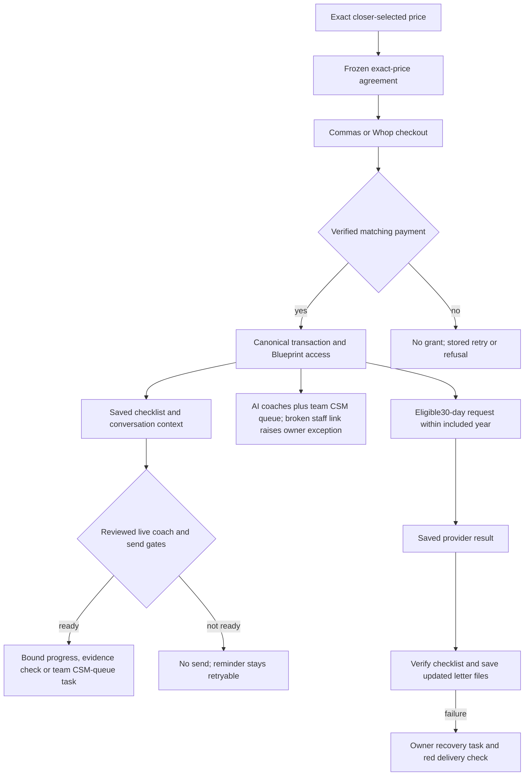

# Capital Blueprint — actual (2026-10-20 repair candidate)

This records repository behavior and safe fixture proof. It is not a live purchase or release claim. Intended source: `capital-blueprint-intended.md`.

- CB-01: existing Present price/provider controls carry validated whole-dollar $5,000–$10,000 Blueprint amounts through `api/closer-deck.mjs` and `sendDeckPayLink`. Other offers retain catalog prices.
- CB-02: shared contract sender forwards a price snapshot. Contract drafts validate/store `_blueprint_amount_cents` and `package_fee`; save/preview/send preserve it. Custom-price sends refuse old fixed-price templates. Migration483 parameterizes two fee clauses; draft migration485 brings three scope clauses into line with the 12-month program. Neither changes previously sent/signed rows.
- CB-03: both provider checkout paths require the latest sent/viewed/signed Blueprint agreement at the exact price with matching frozen hash. Whop reserves the local order before its provider call and verifies returned checkout and variant identity before returning a URL.
- CB-04: `/api/webhooks/whop-billing` verifies account and raw-body signature, saves a durable inbox receipt, and returns. The Inngest and fallback clocks each run every minute and process exact-match receipts into canonical payment events. Inbox retries, duplicate-event handler replay and provider GET reconciliation recover interrupted work. Failed/unmatched receipts grant no access. Every Whop HTTP request uses the existing adapter send lock. Real provider and complete database proof remain pending.
- CB-04 recheck 2026-10-27: a closer's saved call decision is not payment proof. Without a verified matching provider transaction, the Sales card refuses Closed Won and paid fulfillment does not start. The merged payment tests prove the refusal and paid branch in fixtures; no live card, charge or Blueprint desk was created in this recheck.
- CB-05/06: `fetchContext` reads saved cross-channel messages and call history, Blueprint purchase/access/agreement, the team follow-up line (Fundhub team CSM queue; no staff name reaches the model), tasks, proof and open checklist step. Paid active Blueprint clients can use the scoped coach runtime; explicit non-coach conversation assignments remain unchanged. The model chooses a closed intent and bound action, never unchecked customer-facing prose. Replies can answer the saved current step, instructions/deadline, proof requirement, how the Fundhub team follows up, or included program terms; server-owned facts and saved action results form the response. Actions may report an open step in progress/blocked, run existing saved-evidence verification, or save a follow-up task in the team CSM queue (`assignee_role` csm) while the client is told "the Fundhub team will follow up"; they cannot mark work complete on a promise. Proactive check-ins also invoke the same model on saved history to choose a useful question or wait; model failures/8-second cancellation do not fall back to a blind drip or burn an unsent claim. The existing due/day2/day5/day9 ladder retains its timing and caps. Owner-approved calls use the existing hourly clock after two actually sent, distinct-provider-receipt Blueprint texts remain unanswered on the same unchanged open step. A Blueprint-only step5 voice receipt shares the atomic daily/client/destination caps; it is not a new timed ladder rung and does not replace step4's human handoff. Replies, progress, step changes, ended access and contact holds stop stale calls. Ambiguous provider results retain the claim and create advisor recovery work instead of redialing. Staff and automatic Bland calls use the same saved context and reviewed live voice identity. Completed calls preserve words, summary and recording; late transcripts enrich them without repeating workflows. The production clock now gives each model turn and call its own durable step rather than placing200serial decisions in one host request. This is candidate source/fixture behavior, not live delivery proof.
- CB-07 (owner-set 2026-10-20: the CSM is the AI coaches plus the team CSM queue): the purchase hook (`src/blueprint/assign-csm.mjs`) assigns nobody while `BLUEPRINT_CSM_AUTO_ASSIGN` is false and returns reason `ai_csm`; an unassigned buyer raises no owner task. The fewest-clients picker (same-company active, enabled, non-demo CSM) stays behind that switch for when a real CSM is hired. A saved staff link that points at a demo, disabled or other-company person still keeps the link and raises one deduped `blueprint-csm-assignment` owner task. Client-facing coach words say "the Fundhub team"; no person is named. No production assignment was made or verified.
- CB-07 checklist words (owner-set 2026-10-20): migration498 changes the client checklist steps from "your advisor" to "our team" — `no_new_credit` detail ("Talk to our team before you apply for anything."), `personal_loan` title ("Talk to our team about a personal loan") and detail ("Our team will walk you through whether it fits your plan.") — on `waypoint_definitions` and on each client's stored `client_waypoints` copy, only where the text still equals the exact 362 words. `newAccountReason` (`src/waypoints/verify.mjs`) now ends "Let our team know if this is not yours.", and 498 rewrites only stored `no_new_credit` reasons that still have the exact old generated shape. Copy only; the funding-advisor staff role is unchanged.
- CB-08: Closer Dashboard and Present render the same saved context. Fixture browser proof covers both at1440px/390px, matching $7,500 agreement/send/pay requests, Whop choice, first-click agreement, touch targets and scrolling to the last saved task.
- CB-09: the included access year remains 12 months with no automatic renewal charge. The scheduler now checks for no system request in the last30days and uses one idempotency key per30-day window, rather than one key/request for the whole year. Consent, open-request and provider gates remain. Saved results feed checklist verification/reseeding and regenerated letter files. Partial aftercare failures keep the result visible with an owner recovery task; they do not silently mark full delivery successful or request another paid pull. No live credit-pull flag was changed.
- CB-10: daily and hourly read-only checks cover overdue Whop receipts, paid Whop orders missing canonical access, active paid Blueprint clients linked to a demo, disabled or other-company staff person (no staff link is normal and green), unfinished monthly-result delivery, and stuck/unattributed coach-call receipts or unresolved call exceptions. They report saved exceptions, not customer receipt of an alert or live financing success.

Migration488 registers the coach text/voice identities as **draft**, and the three reminder templates as **unapproved**. Existing definitions/status/approvals are preserved on conflict. FOS-01 FinanceOS Money Helper stays unchanged. No new agent or template is activated by this candidate.

Migration490 (owner-set 2026-10-20) rewrites the BP-COACH and BP-COACH-VOICE prompts and `guardrails.block`, and the `EMAIL-BLUEPRINT-COACH-NUDGE-1` body, only where each still equals the exact 488 text, to AI-CSM / "our team" wording. Agent status is untouched. The changed email is switched off like a template-editor save (`compliance_passed=false`, prior approval kept as audit trail) until re-approved. Scratch/CI proof: `src/blueprint/ai-csm-copy.pg.test.mjs`.

Migration489 extends only the existing contact ledger for the owner-approved Blueprint voice receipt. Existing ladder channels/shapes, human handoff, grants/RLS and daily/destination unique caps remain; arbitrary fifth SMS rungs and a sixth step remain invalid. No call is activated by the migration.

Parent's separately approved live setup saved all four Whop settings to production Functions only. The key is named exactly `Consulting Services Package`, scoped to checkout read/create, plan read/create, payment read, refund-change read and dispute read. The v1 webhook at `/api/webhooks/whop-billing` has the six required payment/refund/dispute events and is **disabled**. No credential was saved to a local file. Settings saved is not activation: no checkout, charge, callback, financing approval or deployment was performed by that setup.

Evidence: `ops/workflows/build-evidence/blueprint-price-context-2026-10-20/` (marked fixture drafts), focused unit tests, and the PostgreSQL test `src/payments/whop-blueprint.pg.test.mjs` (requires a safe local scratch/CI database; not run against production).

2026-10-31 #301 repair candidate: signed-in client GETs for FinanceOS overview and bank guidance now require an active paid monthly plan or the valid included Blueprint year before reading premium data. Staff role and org checks remain. A verified full Blueprint refund revokes that purchase's roadmap grant and ends Blueprint-included FinanceOS subscription rows; distinct recorded partial refund events end that grant once their total reaches the purchase amount. A partial total leaves access active, and an older purchase refund cannot close a newer paid Blueprint year or a separate paid monthly plan. The original succeeded transaction remains as historical payment evidence, so a later refund callback still finds its owner. The included-year fallback, coach, call and monthly pull checks use the saved sale-payment time when available, with transaction creation time only for legacy payments without a sale-payment row. These are source and local scratch PostgreSQL test facts; exact-head CI and live customer proof are pending.

## Live state — 2026-10-20 (read back from production)

- Deployed: PR83 is in Netlify deploy `ship 78b08d2f` (published 13:19 MST). Migrations 482, 483, 485, 488 and 489 are applied; `/api/health` pending 0.
- Coaches: `BP-COACH` (text, internal runtime) and `BP-COACH-VOICE` (voice, Bland) are `live` since 13:20 MST. The three Blueprint reminder templates are approved with Chris as approver; their `approved_body_sha` matches the saved copy.
- Owner-set 2026-10-20 (Chris: "Turn on all features. Keep everything on permanently."): `FINANCE_OS_SYSTEM_PULL_LIVE=1` is set on Netlify production, preview and branch contexts. With `CRS_ALLOW_LIVE=1` already on, the monthly sweeper requests real provider pulls for every active finance-os subscriber after the next deploy. UNVERIFIED until that deploy runs and a real request is saved.
- Whop billing: the Fundhub route is configured (an unsigned POST is refused with 401). The v1 webhook in Whop company `biz_Iyh4wHBV0UYvP0` was switched **Active** from the Whop dashboard on 2026-10-20 (owner: "everything needs to be on"), same URL and the same 6 events (payment.succeeded/failed/canceled, refund.created/updated, dispute.created). No real Whop payment has arrived yet, so the purchase-to-access path is configured but not yet proved live.
- Not observed: no real paid Blueprint client exists. The only client with access, FH-000522 "Sim Eleven-Blueprint", has a `+sim-` test email. No coach reply, coach call, Whop payment or monthly pull has run for a real person.
- Live read-only checks: `blueprint:real-advisor`, `blueprint:monthly-delivery` and `blueprint:coach-call-delivery` PASS; hourly beat `blueprint-delivery` GREEN.
