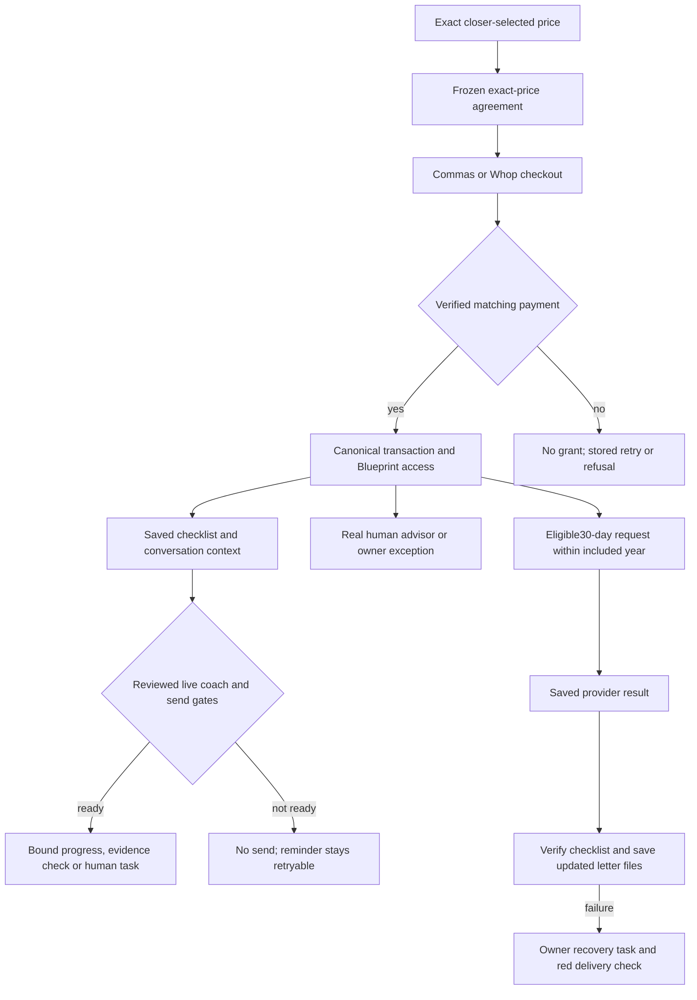

# Capital Blueprint — actual (2026-10-20 repair candidate)

This records repository behavior and safe fixture proof. It is not a live purchase or release claim. Intended source: `capital-blueprint-intended.md`.

- CB-01: existing Present price/provider controls carry validated whole-dollar $5,000–$10,000 Blueprint amounts through `api/closer-deck.mjs` and `sendDeckPayLink`. Other offers retain catalog prices.
- CB-02: shared contract sender forwards a price snapshot. Contract drafts validate/store `_blueprint_amount_cents` and `package_fee`; save/preview/send preserve it. Custom-price sends refuse old fixed-price templates. Migration483 parameterizes two fee clauses; draft migration485 brings three scope clauses into line with the 12-month program. Neither changes previously sent/signed rows.
- CB-03: both provider checkout paths require the latest sent/viewed/signed Blueprint agreement at the exact price with matching frozen hash. Whop reserves the local order before its provider call and verifies returned checkout and variant identity before returning a URL.
- CB-04: `/api/webhooks/whop-billing` verifies account and raw-body signature, saves a durable inbox receipt, and returns. The Inngest and fallback clocks each run every minute and process exact-match receipts into canonical payment events. Inbox retries, duplicate-event handler replay and provider GET reconciliation recover interrupted work. Failed/unmatched receipts grant no access. Every Whop HTTP request uses the existing adapter send lock. Real provider and complete database proof remain pending.
- CB-05/06: `fetchContext` reads saved cross-channel messages and call history, Blueprint purchase/access/agreement, assigned human advisor, tasks, proof and open checklist step. Paid active Blueprint clients can use the scoped coach runtime; explicit non-coach conversation assignments remain unchanged. The model returns only a closed intent and bound action, never customer-facing text. Server-owned questions and saved action results form the reply. Actions may report an open step in progress/blocked, run existing saved-evidence verification, or create an advisor task; they cannot mark work complete on a promise. The existing due/day2/day5/day9 nudge ladder retains its timing and caps, checks readiness before claiming, and releases known unsent holds for retry. Staff-initiated Bland calls use the same saved context and require the reviewed live voice identity. Completed calls preserve words, summary and recording on the scoped voice message; late transcripts enrich it without repeating workflows.
- CB-07: the purchase hook assigns only a same-company active, enabled, non-demo CSM in `assigned_csm_staff_id`. Missing or unavailable assignments create an owner exception instead of substituting a demo advisor. Context shows the real assigned human separately from the AI. No production assignment was made or verified.
- CB-08: Closer Dashboard and Present render the same saved context. Fixture browser proof covers both at1440px/390px, matching $7,500 agreement/send/pay requests, Whop choice, first-click agreement, touch targets and scrolling to the last saved task.
- CB-09: the included access year remains 12 months with no automatic renewal charge. The scheduler now checks for no system request in the last30days and uses one idempotency key per30-day window, rather than one key/request for the whole year. Consent, open-request and provider gates remain. Saved results feed checklist verification/reseeding and regenerated letter files. Partial aftercare failures keep the result visible with an owner recovery task; they do not silently mark full delivery successful or request another paid pull. No live credit-pull flag was changed.
- CB-10: daily and hourly read-only checks cover overdue Whop receipts, paid Whop orders missing canonical access, active paid Blueprint clients missing a real advisor, and unfinished monthly-result delivery. They report saved exceptions, not customer receipt of an alert or live financing success.

Migration488 registers the coach text/voice identities as **draft**, and the three reminder templates as **unapproved**. Existing definitions/status/approvals are preserved on conflict. FOS-01 FinanceOS Money Helper stays unchanged. No new agent or template is activated by this candidate.

Parent's separately approved live setup saved all four Whop settings to production Functions only. The key is named exactly `Consulting Services Package`, scoped to checkout read/create, plan read/create, payment read, refund-change read and dispute read. The v1 webhook at `/api/webhooks/whop-billing` has the six required payment/refund/dispute events and is **disabled**. No credential was saved to a local file. Settings saved is not activation: no checkout, charge, callback, financing approval or deployment was performed by that setup.

Evidence: `ops/workflows/build-evidence/blueprint-price-context-2026-10-20/` (marked fixture drafts), focused unit tests, and the PostgreSQL test `src/payments/whop-blueprint.pg.test.mjs` (requires a safe local scratch/CI database; not run against production).
