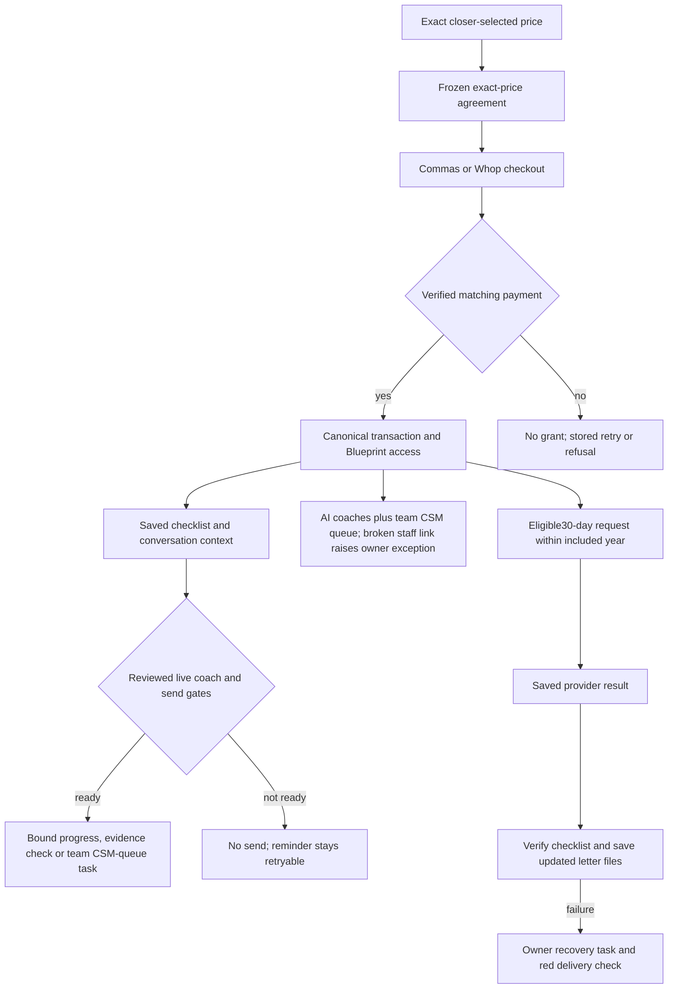

# Capital Blueprint — actual

This records repository behavior, with dated evidence boundaries. Intended source: `capital-blueprint-intended.md`. The current November 2 candidate below is not a deployment or live-buyer claim. Earlier October 20 receipts are historical and were not reverified for this update.

## Real buyer workspace — November 2, 2026 source snapshot

Owner correction: **FinanceOS is NOT LIVE**. This governs the current buyer experience even where older source/configuration notes below mention FinanceOS, subscriptions or live flags. The private Sites simulation is a fictional rehearsal only and does not prove the actual portal. No real entity filing, account opening, transfer, credit application, new provider pull, customer call or merchant approval is established by this build.

The source currently includes the following candidate behavior. Route registration, required checks and deployed authenticated proof remain separate release work; the handler files alone do not make the endpoints live.

| Coverage | Current source behavior and evidence |
|---|---|
| R01, R18 | `public/app/client-portal.html` mounts `public/app/blueprint-plan.js` and its styles. For an authenticated paid buyer, the workspace loads the saved plan, starts with Welcome/Start, asks three setup questions one at a time (existing business, three/four plans, location), then shows Today, Businesses, Step-by-step help, Timeline and Get help. Today selects an actionable saved credit waypoint and shows parallel business/banking work. It skips ongoing/no-new-credit rules as the immediate actionable step. It does not buy a report to begin. |
| R02, R09 | `src/blueprint/client-plan.mjs` aggregates scoped business plans, existing credit progress, the existing bank strategy, guidance, website prompts and the local directory. It excludes demo/simulated credit results, derives AU/thin-file context from a genuine saved result, and retains unknown facts when none is available. Optional reader failures produce explicit warnings; a missing core plan/progress reader stays an error. `src/underwrite/company-audit.mjs` now uses actual activity/state and a three/four-business preparation structure; industry/name flags are review guidance and do not suggest disguising the business or count plans as formed companies. |
| R03, R04, R27 | `src/blueprint/preparation-guidance.mjs` supplies state-aware formation/EIN lessons using Alec's source sequence, single-member LLC/basic-name wording and separate later tax-election guidance. Thirty states have direct official filing destinations; other states use an explicitly identified official state-office lookup fallback. Arizona uses the Corporation Commission. Current fees and processing times are not invented. |
| R05–R08 | `src/blueprint/business-plans.mjs` stores a three/four target and up to four preparation records in `clients.custom_fields.blueprint_business_plans`. It reads canonical existing businesses separately and never inserts a planned company into `businesses`. Separate plan fields cover name, actual activity, formation/operating state, reported formation, formation date, ownership-since, operating-since, website, scoped business/entity links and evidence references. The buyer form now edits name, activity, formation/operating state, website, formation status and the three actual dates, and can link a business already on the client's file. Plans and canonical existing companies remain separate. |
| R10, R11 | The website lesson renders a copyable prompt from the selected business's actual name, activity and state, preserving missing details as questions. It adds the approved lean domain/contact checklist, professional email and intended public contact details; a logo or extra paid tool is optional. Listings guidance links Google Business Profile instructions, Google's local information guidance and Yellow Pages. These are instructions/review steps; the build does not publish a website/listing, scan it or promise search placement. |
| R12 | The optional fuel-credit lesson now uses the approved fuel-only selection from Fundhub's Tradeline Secrets: an actual operating need, only accounts that fit repayment capacity, accurate issuer-required identity/business facts, current terms, actual statement/payment dates and a later reporting check. Official [WEX](https://www.wexinc.com/products/fuel-cards-fleet/select/small-business/), [ExxonMobil](https://www.exxonmobilfleetcards.com/), [AtoB](https://atob.com/fuel-cards), [Phillips 66/Conoco/76](https://www.conocofleet.com/) and [Fuelman](https://www.fuelman.com/faq/) destinations were read November 2. No universal bureau reporting, EIN-only/non-guarantee, revenue threshold, price, card count or approval claim is copied from the course. NAV, Net 30s and DUNS remain absent from buyer guidance/prompts. |
| R13 | `src/blueprint/local-credit-unions.mjs` uses the bundled official NCUA June 30, 2026 directory and Census 2026 ZIP/ZCTA internal points. It returns at most five distinct institutions, nearest branch per institution, within the configured radius. Distances are approximate between ZIP internal points, not street/driving distances; an unmapped ZIP falls back only to exact ZIP/same city when available. No statewide filler is called local. The response carries source dates/method/limitations. The portal shows addresses and labels membership/account fit as needing review. No per-institution current membership/product/deposit fit has been supplied to the aggregator, so the current shortlist is geographic candidates, not five verified eligible accounts or cash-ranked approvals. |
| R14, R16, R22 | ChexSystems/checking-report education links the CFPB opening-issue guide. AU and secured-credit lessons require actual-file review; missing data does not choose removal or a new account. AU removal is conditional, not a blanket instruction. The build does not dispute a checking record, remove an AU, submit a card application or verify those outcomes by clicking a lesson. Existing bureau-evidence verification remains separate. |
| R15, R17 | Buyers can save available cash/monthly income (including zero or unknown), then up to three relationships per business: account type, planned/reported-open/reported-funded status, planned opening date, actual opening/deposit dates and amounts, reviewed seasoning days and next review. Dates/status combinations are validated. The UI saves document-readiness and account-opening-issue answers and points issues to ChexSystems/team help. The store now also saves a cash buffer and one-time paydown reserve; `client-plan.mjs` aggregates these plus all planned deposits into `cashPlan`, showing unknown/overcommitted/ready and remaining reported cash. Existing bank deposit references are compared with that remaining cash only when the figures are known; current terms/eligibility still require review. This is not a complete household budget or automatic bank approval. |
| R19 | Lessons save a personal or per-business `targetDate`; Timeline lists saved step dates and offers Google Calendar event-template links and `.ics` download. The buyer must save/import the event and set reminders. There is no OAuth connection, automatic two-way calendar sync or background reminder-delivery proof. Bank-specific review dates are also saved in relationship records. |
| R20, R21, R29 | Merchant tools are an optional, review-needed lesson and Fundhub handoff naming Whop, Commas and Clarity. The only generic platform destination is official Whop documentation. The owner clarified that the Whop partner account needs setup; actual referral URLs and client-specific onboarding terms remain pending. The lesson does not represent them as configured. Fundhub checkout financing and existing-account merchant read connectors are different functions. |
| R23 | Employment/income guidance follows the real employer/ownership/payment setup and links IRS paying-yourself guidance. It adds the approved financial packet: actual bank statements, profit-and-loss statement, balance sheet and processor statements when applicable, separated by business. Unsupported estimates/checklists are not income evidence. The lesson does not create employment/payroll or replace actual tax treatment with canned application answers. |
| R24, R25 | Formation/EIN uploads use existing `/api/documents-upload` and download handlers, then attach the returned document ID to the selected plan. The store requires a same-company/client `client_upload` with the matching subtype, rejects foreign/cross-business proof and reuse across plans, and requires formation evidence before the EIN attachment. Readback distinguishes `not_added`, `evidence_received`, current same-scope staff `reviewed`/`rejected`, and unavailable evidence. Step updates remain `client_reported`; client writes cannot set verified/reviewed state. The UI retains a returned upload ID for an attachment retry rather than claiming the attachment succeeded. No bank evidence is automatically verified by FinanceOS. |
| R26 | `api/blueprint/business-plans.mjs` derives identity from a client principal, confirms the client/company and active Blueprint gate, refuses staff impersonation and client-supplied identity/review fields, and uses private/no-store responses. Writes lock the scoped client row in a transaction and update only the Blueprint JSON field. `api/blueprint/plan.mjs` reuses this boundary for read aggregation. The UI rereads the server after saves and sends help through existing `/api/chat/portal-message` with an idempotency key. |
| R28 | The actual buyer workspace has no time-warp control and skips the old `?demo=1` portal fixture. Source preview time-warp controls remain isolated in the earlier fictional preview. Saving a date never changes a provider record or establishes readiness. |
| R30 | Focused source/store/HTTP/browser tests exist for this candidate. The executed planner/guidance/directory checks are recorded below; they do not establish SQL persistence, deployment or a real authenticated buyer result. Integration/release evidence must be added after those steps are observed. |
| R31 | `src/blueprint/payoff-plan.mjs` is a pure current-month calculator using the official [CFPB worksheet](https://www.consumerfinance.gov/documents/5782/cfpb_ymyg-toolkit_reducing-debt-worksheet.pdf). `planMonthlyDebtPayments` accepts snowball/avalanche, nullable monthly budget and up to twenty actual debt rows; it returns ordered priorities, capped minimums, monthly allocations and explicit review/shortfall states. Minimums receive funds before extras. Missing minimums/budget, or missing APR for avalanche, produce no guessed allocation; a known shortfall produces no extra or partial-minimum guesses. Zero values remain zero, and surplus after every balance is covered stays unallocated. The store's `save_payoff_plan` action saves inputs; `client-plan.mjs` returns the result as `payoffCalculation`. The budget lesson protects bills/buffer/deposit reserves and explains that a current UnderwriteIQ utilization action may take priority. No payment, payoff-date/interest forecast or credit-score claim is made. |

### Added letter and validation candidate source

- **R32:** The workspace now has Letters and responses, per-file signed-download actions, self-mailing instructions, a link to existing mailing-proof progress and actual bureau-response upload using the existing `bureau_response` kind. `client-plan.mjs` reads the latest fifty scoped response records; review state is accepted only from the exact current-version server verdict. The internal credit-optimization SOP is now written. The existing funding saver produces inquiry-removal/personal-information PDFs; this does not expose staff-only Metro 2 sending to clients.
- **R33:** New `api/blueprint/letter-mailing.mjs` uses the existing paid-buyer gate. `src/blueprint/letter-mailing.mjs`, its scoped provider and migration546 implement explicit selected-document $97 quotes/confirmation, immutable content/return-address snapshots, paid-service ledger state and per-envelope duplicate claims. Source production capability uses secure Commas hosted checkout: the current database has no trustworthy verified Commas customer/current-account binding, so it does not offer automatic saved-card charging. An internal trusted-binding seam is tested but is not an HTTP input. PostGrid accepts a real multipart PDF behind existing send fences. Unknown payment/send outcomes remain held; no live charge or mailing has been tested. The five-minute recovery function is registered on the existing Netlify clock and heartbeat list; it is not added to the event-only Inngest function list.
- **R34:** The existing response reader, parse loop, waypoint verifier and staff inbound-mail/exception paths now require saved current-version validation. The same model/file reader is reused; extracted recipient is compared with the client locally on the server. Invalid/uncertain/wrong-recipient/stale files and pasted text cannot advance. A validated Blueprint response with no repair items creates a team review task, without creating a repair case or round. These checks reduce invalid-document acceptance; they are not a guarantee that every forgery can be detected.

Independent local browser contracts:30 passed, zero retries (offline intercepted APIs). Validator-related run:227 passed, zero failures, four database cases unexecuted (one skipped test plus a three-case skipped suite). Mailing-core independent review:37 focused tests passed, zero skips; database/provider/deployed proof remains separate. Final snapshots, migration execution, protected release and authenticated proof are still pending.

### November 2 integration repairs and actual scratch proof

- Real PostgreSQL16.15 with pgvector and all429 migrations:51 targeted checks passed without skips (business store, mailing, response verification, coach registration and monitoring). This is an isolated scratch database, not production. A JSONB key-ordering bug in mailing confirmation was reproduced and repaired with canonical value hashing; a real address change still refuses payment. Migration547 updates only the exact standard predecessor SMS coach prompt and preserves custom text, states and approvals.
- The native progress read exposes its stable waypoint key. An open mail step now checks current owned checksum-matched PDFs and existing saved requests without constructing payment/mail providers. Missing files show an honest waiting status and Prepare businesses; usable files or saved requests open Letters and responses. Native checklist states are unchanged.
- Actual Chrome login, three setup saves, a planned business save and persistence after reload were observed through the real API and scratch database. The corrected missing-letter next step was also observed. Chrome extension file access refused the local file-picker attachment; that browser upload click remains unverified, and no workaround was performed.
- The owner's screenshot prompted a scoped Astra layout repair: compact offer typography and actions, preserved price/access/course controls, and a full-width responsive support row. Independent actual-HTTP checks passed at2032/1440/390 with five visible offers, hidden controls preserved, no overflow and working mini-course open/close. This remains local candidate proof.
- Final isolated browser contracts:52 passed before the last readiness addition; the updated buyer-only suite then passed34 cases. Independent R07 source checks94 passed. The broader first local suite retained12 failures; the named causes were repaired and focused checks passed. A fresh protected CI run and release receipt are still required; no blanket full-suite or production PASS is inferred from these subsets.

### Included-report presentation and release follow-through

Confirmed active paid-year Blueprint access now marks the existing assessment tile and account entry as included with the report still pending. Access comes only from a structurally valid authenticated plan read, not a roadmap grant. The standalone diagnostic price and all backend gates/grants stay unchanged. Done requires the plan's genuine saved-credit-report context or an actual report document; a payment-only legacy flag cannot create a result. The status action opens existing credit-review instructions. Access denial clears the paid display; other read failures retain the Blueprint error state and hidden FinanceOS links.

The current focused buyer browser suite passed40 cases. A broader legacy run passed32 cases and exposed one stale Coming soon expectation; that exact scenario passed after requiring the real written instructions. Seven affected access/error cases passed after the final catch-only repair. Actual existing-session Chrome readback showed the included/pending report and one received document, with no new login or consent submission.

The isolated software browser also completed a real formation upload, attachment, reload and signed download with matching1051-byte PDF/checksum. Its record stayed planned and evidence_received, without review. Bureau upload remains unproved in that actual session: repeated successful client sign-ins reached the existing login limiter; no limiter reset or bypass occurred. Unit/real-PostgreSQL response checks remain separate evidence.

The owner explicitly approved the exact independently reviewed two-file shared preflight repair after automatic approval initially refused the broader release-control scope. Those two files were committed separately, with matching reviewed hashes and42 passing focused checks. Other ownership/release guards remain in force; production release evidence is still pending.

### Located source, remaining setup and current proof limits

- **Tradeline Secrets located; six useful pieces approved:** after the owner's "tradeline secrets" / "shared with me" clarification, the exact [Fundhub PDF](https://drive.google.com/file/d/1KACNVV12KvKtprwMPJG3Di-PhbElzG8S/view) (Drive modified August 26, 2026), [Tier 1](https://docs.google.com/document/d/1U_T11eZDFK4cVgNCrvK_nDhHrdNc8PLCtip1w2ohTng/edit), [Tier 2](https://docs.google.com/document/d/1kxtZc77wxeV294O4cqAO_IpRtQrcwln3NkbJMDI5n2M/edit), [Unlock Your Credit Profile](https://docs.google.com/document/d/1jHTwFB5Cr2p6vpai5qoFpNr-XJL5qxO1qt0rEllVVjA/edit) and [Business Funding Mastery](https://docs.google.com/document/d/1ZQBOmRGclPP7kbJAV-gwZrjdIKfID3I31gTPBGq1924/edit) were fetched and read. Chris states this is his Fundhub IP and that he taught David, who made a course from it. After extraction/review, his "okay get it all done" resumed implementation of the six selected pieces. These are now included in the existing seventeen topics: identity consistency, per-business document preparation, lean website/contact details, fuel-only account review, bank-selection questions and supported financial evidence/payment-reporting dates. Bank questions cover actual products/industries, financials/history, personal-credit checks, collateral/UCC and existing loans/separate businesses. Course material is no longer reported as missing; no wholesale import or buyer access to internal Drive files is claimed.
- **Owner-selected exclusions:** NAV, Net 30 accounts and DUNS/Dun & Bradstreet setup remain excluded from buyer guidance and website prompts. A regression checks default and formed-business output. This does not alter or delete the original course material. No historical price or universal card-approval/reporting rule has been imported.
- **Whop/Commas/Clarity merchant referral destinations:** the owner says the Whop partner account still needs setup. No actual Fundhub client-merchant partner onboarding/referral URL has been verified. `src/merchant/providers/whop.mjs` and `commas.mjs` read an already-owned merchant account; they do not open one. `docs/sops/weekend-2026-10-24/05-claritypay-financing.md` is a stub about financing the Blueprint purchase inside Whop. Drive partner-platform addenda describe future white-label organizations and supply no relevant merchant referral URL.
- **Source integration and person-usable proof:** at this snapshot, the three Blueprint handler files are registered in `netlify/functions/api.mjs`; the migration manifest, Netlify clock, heartbeat registry and deep tripwires are wired in the same candidate. No release, production database persistence, real upload review, authenticated deployed buyer interaction or external provider approval is claimed here. The earlier private preview's browser checks are not proof of the new authenticated workflow.
- **Deeper automation:** current lessons and manual progress do not establish a live FinanceOS connection, automatic bank/ownership verification, a complete cash-allocation engine, current credit-union eligibility/product fit or a synchronized Google Calendar account.

Candidate checks: `src/blueprint/business-plans.test.mjs`, `src/blueprint/business-plans.pg.test.mjs`, `src/blueprint/client-plan.test.mjs`, `src/blueprint/payoff-plan.test.mjs`, `src/blueprint/preparation-guidance.test.mjs`, `src/blueprint/local-credit-unions.test.mjs`, `src/http/blueprint-business-plans.test.mjs`, `src/http/blueprint-plan.test.mjs` and `e2e/blueprint-client-plan.spec.mjs`. PostgreSQL tests that skip without a safe `DATABASE_URL` remain unproved persistence, not a pass.

Local November 2 verification for the lesson/payoff/directory work: `node --test src/blueprint/payoff-plan.test.mjs src/blueprint/preparation-guidance.test.mjs src/blueprint/local-credit-unions.test.mjs` — 31 passed, zero failed/skipped. `npm run lint` — 4,637 files/inline scripts parse clean. Installed TypeScript: `npx tsc --noEmit` passed. No PostgreSQL, provider or authenticated deployed-buyer proof was exercised by this subset.

## October 20 repair candidate and historical evidence

- CB-01: existing Present price/provider controls carry validated whole-dollar $5,000–$10,000 Blueprint amounts through `api/closer-deck.mjs` and `sendDeckPayLink`. Other offers retain catalog prices.
- CB-02: shared contract sender forwards a price snapshot. Contract drafts validate/store `_blueprint_amount_cents` and `package_fee`; save/preview/send preserve it. Custom-price sends refuse old fixed-price templates. Migration483 parameterizes two fee clauses; draft migration485 brings three scope clauses into line with the 12-month program. Neither changes previously sent/signed rows.
- CB-03: both provider checkout paths require the latest sent/viewed/signed Blueprint agreement at the exact price with matching frozen hash. Whop reserves the local order before its provider call and verifies returned checkout and variant identity before returning a URL.
- CB-04: `/api/webhooks/whop-billing` verifies account and raw-body signature, saves a durable inbox receipt, and returns. The Inngest and fallback clocks each run every minute and process exact-match receipts into canonical payment events. Inbox retries, duplicate-event handler replay and provider GET reconciliation recover interrupted work. Failed/unmatched receipts grant no access. Every Whop HTTP request uses the existing adapter send lock. Real provider and complete database proof remain pending.
- CB-04 recheck 2026-10-27: a closer's saved call decision is not payment proof. Without a verified matching provider transaction, the Sales card refuses Closed Won and paid fulfillment does not start. The merged payment tests prove the refusal and paid branch in fixtures; no live card, charge or Blueprint desk was created in this recheck.
- CB-05/06: `fetchContext` reads saved cross-channel messages and call history, Blueprint purchase/access/agreement, the team follow-up line (Fundhub team CSM queue; no staff name reaches the model), tasks, proof and open checklist step. Paid active Blueprint clients can use the scoped coach runtime; explicit non-coach conversation assignments remain unchanged. The model chooses a closed intent and bound action, never unchecked customer-facing prose. Replies can answer the saved current step, instructions/deadline, proof requirement, how the Fundhub team follows up, or included program terms; server-owned facts and saved action results form the response. Actions may report an open step in progress/blocked, run existing saved-evidence verification, or save a follow-up task in the team CSM queue (`assignee_role` csm) while the client is told "the Fundhub team will follow up"; they cannot mark work complete on a promise. Proactive check-ins also invoke the same model on saved history to choose a useful question or wait; model failures/8-second cancellation do not fall back to a blind drip or burn an unsent claim. The existing due/day2/day5/day9 ladder retains its timing and caps. Owner-approved calls use the existing hourly clock after two actually sent, distinct-provider-receipt Blueprint texts remain unanswered on the same unchanged open step. A Blueprint-only step5 voice receipt shares the atomic daily/client/destination caps; it is not a new timed ladder rung and does not replace step4's human handoff. Replies, progress, step changes, ended access and contact holds stop stale calls. Ambiguous provider results retain the claim and create advisor recovery work instead of redialing. Staff and automatic Bland calls use the same saved context and reviewed live voice identity. Completed calls preserve words, summary and recording; late transcripts enrich them without repeating workflows. The production clock now gives each model turn and call its own durable step rather than placing200serial decisions in one host request. This is candidate source/fixture behavior, not live delivery proof.
- CB-07 (owner-set 2026-10-20: the CSM is the AI coaches plus the team CSM queue): the purchase hook (`src/blueprint/assign-csm.mjs`) assigns nobody while `BLUEPRINT_CSM_AUTO_ASSIGN` is false and returns reason `ai_csm`; an unassigned buyer raises no owner task. The fewest-clients picker (same-company active, enabled, non-demo CSM) stays behind that switch for when a real CSM is hired. A saved staff link that points at a demo, disabled or other-company person still keeps the link and raises one deduped `blueprint-csm-assignment` owner task. Client-facing coach words say "the Fundhub team"; no person is named. No production assignment was made or verified.
- CB-07 checklist words (owner-set 2026-10-20): migration498 changes the client checklist steps from "your advisor" to "our team" — `no_new_credit` detail ("Talk to our team before you apply for anything."), `personal_loan` title ("Talk to our team about a personal loan") and detail ("Our team will walk you through whether it fits your plan.") — on `waypoint_definitions` and on each client's stored `client_waypoints` copy, only where the text still equals the exact 362 words. `newAccountReason` (`src/waypoints/verify.mjs`) now ends "Let our team know if this is not yours.", and 498 rewrites only stored `no_new_credit` reasons that still have the exact old generated shape. Copy only; the funding-advisor staff role is unchanged.
- CB-08: Closer Dashboard and Present render the same saved context. Fixture browser proof covers both at1440px/390px, matching $7,500 agreement/send/pay requests, Whop choice, first-click agreement, touch targets and scrolling to the last saved task.
- CB-09: the included access year remains 12 months with no automatic renewal charge. The scheduler now checks for no system request in the last30days and uses one idempotency key per30-day window, rather than one key/request for the whole year. Consent, open-request and provider gates remain. Only the worker that claims a queued request can order the bureau; another worker seeing or losing to a processing claim skips it. An unknown real provider outcome makes its saved queued or processing request terminal before the next sweep, while preserving the owner exception task; a saved provider exception also excludes the old queued request if the status write failed. A failed real monthly provider request stays on hold across later windows until its matching owner exception task is done; a missing task also keeps the hold. Saved results feed checklist verification/reseeding and regenerated letter files. Partial aftercare failures keep the result visible with an owner recovery task; they do not silently mark full delivery successful or request another paid pull. No live credit-pull flag was changed.
- CB-10: daily and hourly read-only checks cover overdue Whop receipts, paid Whop orders missing canonical access, active paid Blueprint clients linked to a demo, disabled or other-company staff person (no staff link is normal and green), unfinished monthly-result delivery, and stuck/unattributed coach-call receipts or unresolved call exceptions. They report saved exceptions, not customer receipt of an alert or live financing success.

Migration488 registers the coach text/voice identities as **draft**, and the three reminder templates as **unapproved**. Existing definitions/status/approvals are preserved on conflict. FOS-01 FinanceOS Money Helper stays unchanged. No new agent or template is activated by this candidate.

Migration490 (owner-set 2026-10-20) rewrites the BP-COACH and BP-COACH-VOICE prompts and `guardrails.block`, and the `EMAIL-BLUEPRINT-COACH-NUDGE-1` body, only where each still equals the exact 488 text, to AI-CSM / "our team" wording. Agent status is untouched. The changed email is switched off like a template-editor save (`compliance_passed=false`, prior approval kept as audit trail) until re-approved. Scratch/CI proof: `src/blueprint/ai-csm-copy.pg.test.mjs`.

Migration489 extends only the existing contact ledger for the owner-approved Blueprint voice receipt. Existing ladder channels/shapes, human handoff, grants/RLS and daily/destination unique caps remain; arbitrary fifth SMS rungs and a sixth step remain invalid. No call is activated by the migration.

Parent's separately approved live setup saved all four Whop settings to production Functions only. The key is named exactly `Consulting Services Package`, scoped to checkout read/create, plan read/create, payment read, refund-change read and dispute read. The v1 webhook at `/api/webhooks/whop-billing` has the six required payment/refund/dispute events and is **disabled**. No credential was saved to a local file. Settings saved is not activation: no checkout, charge, callback, financing approval or deployment was performed by that setup.

Evidence: `ops/workflows/build-evidence/blueprint-price-context-2026-10-20/` (marked fixture drafts), focused unit tests, and the PostgreSQL test `src/payments/whop-blueprint.pg.test.mjs` (requires a safe local scratch/CI database; not run against production).

## Historical live-state readback — October 20, 2026 (not reverified November 2)

These are earlier dated receipts, not current FinanceOS availability. The November 2 owner correction above controls current buyer wording and delivery claims.

- Deployed: PR83 is in Netlify deploy `ship 78b08d2f` (published 13:19 MST). Migrations 482, 483, 485, 488 and 489 are applied; `/api/health` pending 0.
- Coaches: `BP-COACH` (text, internal runtime) and `BP-COACH-VOICE` (voice, Bland) are `live` since 13:20 MST. The three Blueprint reminder templates are approved with Chris as approver; their `approved_body_sha` matches the saved copy.
- Owner-set 2026-10-20 (Chris: "Turn on all features. Keep everything on permanently."): `FINANCE_OS_SYSTEM_PULL_LIVE=1` is set on Netlify production, preview and branch contexts. With `CRS_ALLOW_LIVE=1` already on, the monthly sweeper requests real provider pulls for every active finance-os subscriber after the next deploy. UNVERIFIED until that deploy runs and a real request is saved.
- Whop billing: the Fundhub route is configured (an unsigned POST is refused with 401). The v1 webhook in Whop company `biz_Iyh4wHBV0UYvP0` was switched **Active** from the Whop dashboard on 2026-10-20 (owner: "everything needs to be on"), same URL and the same 6 events (payment.succeeded/failed/canceled, refund.created/updated, dispute.created). No real Whop payment has arrived yet, so the purchase-to-access path is configured but not yet proved live.
- Not observed: no real paid Blueprint client exists. The only client with access, FH-000522 "Sim Eleven-Blueprint", has a `+sim-` test email. No coach reply, coach call, Whop payment or monthly pull has run for a real person.
- Live read-only checks: `blueprint:real-advisor`, `blueprint:monthly-delivery` and `blueprint:coach-call-delivery` PASS; hourly beat `blueprint-delivery` GREEN.
