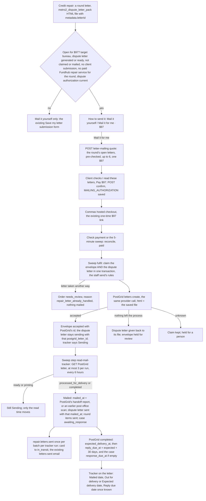
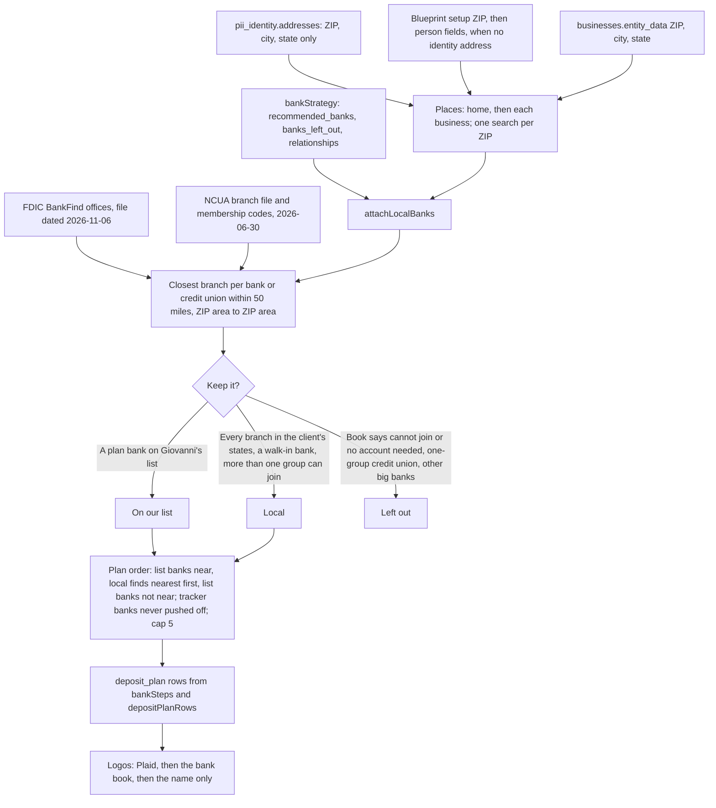
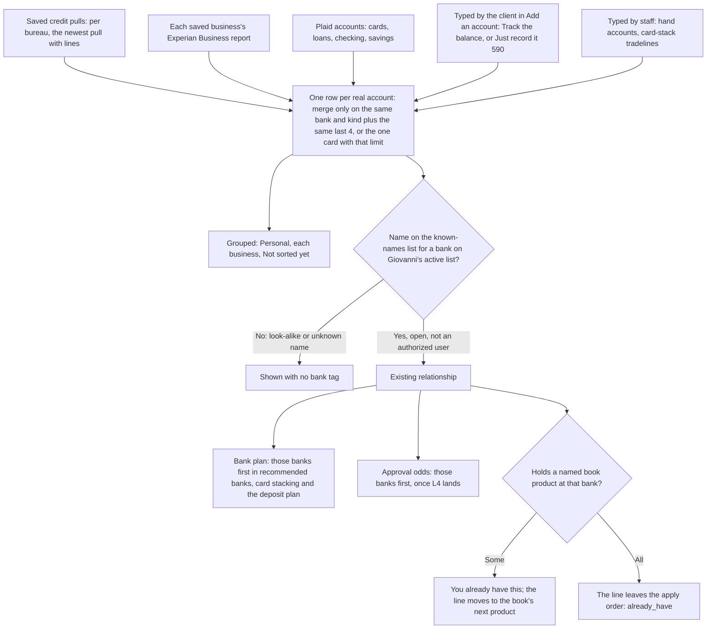
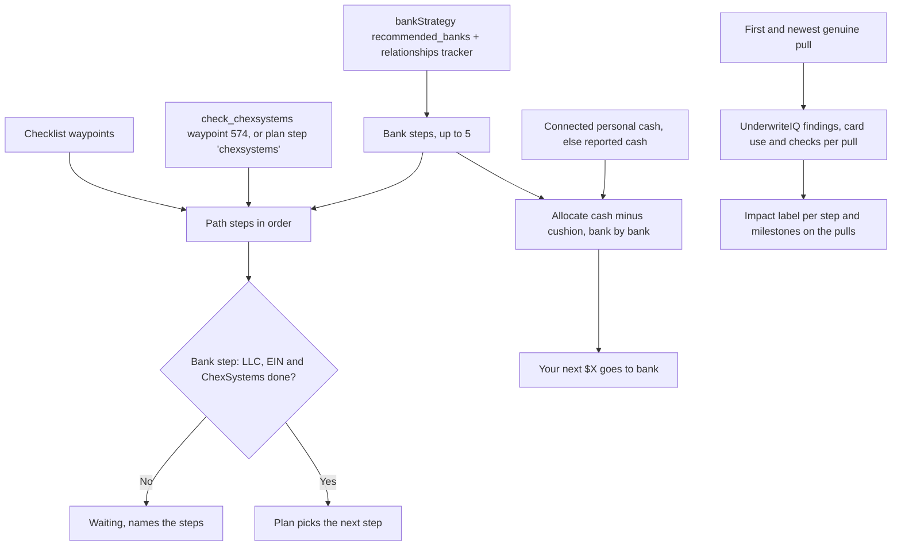
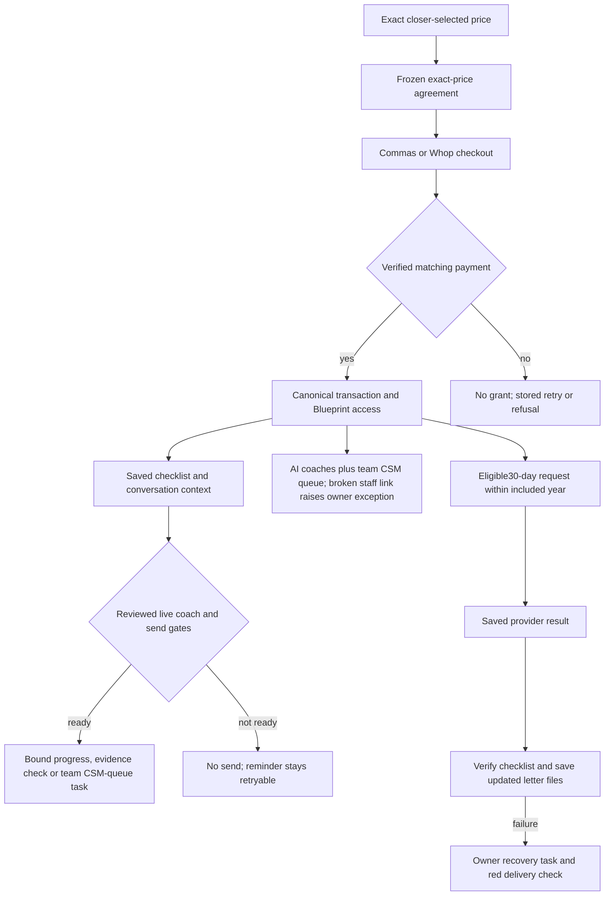

# Capital Blueprint — actual

## November 7 the $97 "we mail it" for repair letters — branch candidate, not live

Source: branch `claude/fos-mail-repair-letters-20261107` (Finance OS unit MAIL), stacked on `claude/fos-cycle-20261107`. Not merged, not shipped. Migration 591 is not applied anywhere yet. Chris (2026-11-07), on repair letters: "if you want us to print, generate and send them, we can do that." The existing $97 batch mailing (`src/blueprint/letter-mailing.mjs`, migration 546) now also takes repair-round bureau letters. No new route, no new price, no new job.



| Piece | What the code does |
|---|---|
| Letters read | `GET /api/blueprint/letter-mailing` lists a repair letter only while it is open for the $97 mailing (`REPAIR_LETTER_OPEN_SQL`) or already in a mailing, with `kind:'repair'`, `round` and `letterId`. Funding letters are unchanged. The readiness count includes open repair letters. |
| Quote and confirm | The same functions and the same $97. A repair file must be the saved HTML (512 KB cap), checksum-matched, bureau target, with its letter id frozen in the snapshot and on the envelope (`dispute_letter_id`). Quote and confirm re-check that the letter is still open; a letter taken another way refuses with "Nothing was charged." |
| Mail | The envelope claim also claims the dispute letter (status `sending`, `send_claimed_at`), in one transaction. The same `sendEnvelope` posts PostGrid's `html` field instead of `pdf`. Acceptance saves PostGrid's id on the envelope and on the dispute letter, which stays `sending`: the mail house has the letter, but it is not mailed yet (Codex CX28). The staff stuck-send list skips a letter that carries a PostGrid id, and migration 334's provider-id rule and migration 591's trigger both refuse a staff clear while the mail house holds it. A send PostGrid never received gives the letter back; an unknown outcome keeps the claim for a person. |
| Self-mail guard | `readClientRepair` closes "Save my letter submission" when a paid Fundhub mailing holds the letter, and `recordClientRepairSubmission` refuses it (`fundhub_mailing_this_letter`). |
| Tracker | `trackLetterMailings` reads PostGrid's `status` and `imbStatus` (GET only, MESSAGING fence, 5-second timeout) and saves dates once. Mailed starts only when PostGrid reports `processed_for_delivery`, its own "handed off to the local postal service" (or the later `completed`); `ready` and `printing` stay Sending (Codex CX28). The mailed date is that report's time, or an earlier post office scan, never before the acceptance. In the same transaction the repair file moves: the dispute letter becomes `sent` with that `mailed_at`, the round's items `sent`, the case `awaiting_response`, and after the run `repair.letters.sent` fires once per batch (card to in transit, the existing letters-sent email), never at acceptance. Returned is saved at "returned_to_sender". PostGrid never confirms delivery and its letter has no estimate field, so its "completed" date (its own "most likely delivered") is saved as `expected_delivery_at` and shown as "Expected delivery <date>", never "Delivered" (Codex CX26). The post office's last scan shows "Out for delivery". The bureau's 30 days start when it gets the letter, so `reply_due_at` = the expected delivery date + 30 days, set when that date first lands, with the same date on the repair case's empty `response_due_at` (the client's progress page shows that one); no reply date shows before then (Codex CX27). `mailTracker()` turns them into the three client steps: Sending, then Mailed with its date; Delivery, Out for delivery, then Expected delivery with its date; Reply due, with its date only once known. |
| One word per envelope | `publicMailingOrder` gives each envelope `mailStatus`, so every screen that counts letters reads "mailed" the same way: `sending` (our call is out, or PostGrid has the letter but has not reported the handoff), `mailed` (PostGrid reported the handoff; `tracker.mail.at` is the date), or null (paid and waiting, held for review, or stopped by the mail house). The order's own `status` of `mailed` still means only that the mail house accepted every envelope. |
| Monitoring | `blueprint:letter-mailing` (morning gap check and hourly beat) now also accepts a repair HTML envelope, and goes red on a stopped or returned letter, a letter never read in its first 2 days, a letter not handed to the post office 7 days after the mail house took it, a letter with no expected delivery date 21 days after the mail house took it (its reply clock would never start), and a paid repair letter whose file does not match its envelope (sending with PostGrid's id before the handoff, sent with a mailed date after it). The last four rules look back 45 days, the tracker's own window. The desk check `fin-b07-row-send` leaves a paid letter to this check while its accepted envelope waits on the handoff or the expected delivery date, and still goes red on any other claim older than a day or any other mailed letter with no bureau clock. |
| Database | Migration 591: the repair envelope rules in the 546 guard, tracker columns (set once, accepted envelopes only; a mailed date only with a handoff status), one live envelope per repair letter, and a staff clear refused while a paid mailing is sending or the mail house holds the letter. |

Screen: `public/app/blueprint-repair-mail.js` (+ `.css`), drawn inside each Credit repair letter by one hook in `blueprint-fulfillment.js`, which also reads the mailing with its other reads. Not done here: the live demo (`blueprint-demo.js`, unit G) has no repair letter in its sample mailing data, so the demo shows only "Mail it yourself" on repair letters.

## November 7 the client fulfillment cycle — branch candidate, not live

Source: branch `claude/fos-cycle-20261107` (Finance OS unit CYCLE), stacked on `claude/fos-wave12-20261107`. Not merged, not shipped. Migration 589 is not applied anywhere yet. Pure functions and reads: `src/blueprint/fulfillment-cycle.mjs`. Screen pieces: `public/app/blueprint-cycle.js` (+ `.css`), mounted by one-line hooks in the existing Blueprint views. No new page and no new route.

```mermaid
flowchart TD
  PULL[Real soft pull: analysis.completed] --> FR[crs-full-report saves a new version of the Complete Credit Report]
  FR --> CR[GET /api/blueprint/plan cycle.fullReports, one row per version]
  CR --> OPEN[Credit and reports: Open, via /api/documents-download?id&version]
  LET[Saved letter version: funding letters and repair round letters] --> TO[Mail to: the bureau address from BUREAU_MAIL_ADDRESSES, or the address on the letter]
  TO --> AP[Approve letter: POST letter-mailing approve_letter, row in 589]
  AP --> PR[Open and print]
  PR --> AD[The address is right: check_address, refused before approval]
  AD --> MAIL[Existing: mail it yourself and save the receipt, or the $97 mailing]
  FUND{UnderwriteIQ fundable on the plan path, and which buyer from the fulfillment engagement}
  FUND -->|preparation and fundable| STOP[Your next step: Book a call with your CSM]
  STOP --> TASK[POST /api/money/ready-to-fund opens the Blueprint closing prep call task for the CSM]
  FUND -->|implementation, funding state ready or awaiting_response| GUIDE[Applications: application guide from income on file]
  CASE[Open inquiry case the client runs] --> CALL[Inquiry removal: Call bureau, number from bureauDialPlan, short script, have ready]

## November 7 premium pass (Finance OS + Blueprint) — branch candidate, not live

Source: branch `claude/fos-prem-polish-20261107` (Finance OS wave 4, unit PREM), stacked on `claude/fos-wave12-20261107`. Not merged, not shipped. No migration, no new route. Traced from `public/app/money-premium.js`, `public/app/money.js`, `api/money/overview.mjs`, `src/finance/monthly-report.mjs`, `src/finance/ready-to-fund.mjs` and `src/blueprint/fulfillment-access.mjs`.

```mermaid
flowchart TD
  FUND["GET /api/money/fundability: opportunity.personal + now N of 6"] --> HERO["Overview hero: Funding you qualify for, counts up, fundability ring"]
  READY["GET /api/money/ready-to-fund: advisor (CSM on the file) + book_url"] --> ADV["Advisor card: name, Book a call"]
  REP["GET /api/blueprint/repair + /letter-mailing"] --> RC["Repair card: one line"]
  FUNDR["GET /api/blueprint/funding: engagement.roundNumber + applications"] --> FC["Funding card: one line"]
  RC -->|FinanceOS, progress page| LINK["/app/client-portal.html#repair or #letters"]
  FC -->|FinanceOS, progress page| LINK2["/app/client-portal.html#funding"]
  RC -->|Blueprint home| VIEW["Existing fulfillment view: repair by round"]
  FC -->|Blueprint home| VIEW2["Existing fulfillment view: applications"]
  LINK --> VIEW
  LINK2 --> VIEW2
  PLAN["fh:blueprint-plan-updated: path.funding + path.fundability"] --> BPHERO["Blueprint path panel: count-up when the printed amount matches, ring"]
  REPORT["GET /api/money/overview?report=monthly&month=YYYY-MM"] --> PDF["PDF: designed cover, what changed, what is next"]
```

| Piece | What the code does |
|---|---|
| Full report per soft pull | `readFullReports()` lists every `document_versions` row of the client's `crs_full_credit_report` document (one version per real pull, newest first, capped at 24). `GET /api/documents-download` takes an optional `version` (same ownership gate; `getVersion()` signs that version). Without the field, the old "Open full credit report" button (the Credit Analysis Report) is unchanged. |
| Letter steps | Both letter lists (Letters and responses: `funding_inquiry_removal`, `funding_personal_info`; Credit repair: `metro2_dispute_letter_pack`) gain `to`, `versionId` and `approval`. `saveLetterStep()` writes one `blueprint_letter_approvals` row per letter version (approve once, then the address check once; the database refuses an address check before approval and any later change). A letter whose target is not the bureau shows "Use the address on the letter". The $97 mailing and self-mailing paths are unchanged. |
| Fundable stop | `readBlueprintCycle()` reads the offer from `getBlueprintFulfillmentAccess()` (an active or completed $30,000 engagement is "implementation") and fundable from `path.fundability.tier`. A started preparation plan that is fundable shows "You are fundable. Book a call with your CSM."; the press opens `BOOK_CALL_URL` and posts `/api/money/ready-to-fund` (the same CSM task the hourly closer-ready sweeper opens). |
| Application guide | `GET /api/blueprint/funding` adds `guide` when the state is `ready` or `awaiting_response` and the client runs the round: personal = the plan's monthly income, household = counted repeat pay into personal accounts (`src/banking/income.mjs`), business = counted business deposits and payouts when one business is on file. Yearly = monthly × 12 exactly; shown in whole dollars rounded down; unknown says "Not on file"; two or more businesses say "Not split by business yet". |
| Call the bureau | `GET /api/blueprint/inquiries` adds `selfCall` to each open case the client runs: the bureau's number from `bureauDialPlan()` (shown only when it passes the dial check), five short lines naming the open inquiries (no fraud claim), what to have ready, and any identity papers still to upload. The existing submission form saves the confirmation number. |

Not done here: the live demo (`blueprint-demo.js`, unit G) has none of these fields yet, so the demo shows the old screens until its data is regenerated. Unit O's application tracker is on its own branch.

## November 7 local banks by address — branch candidate, not live

Source: branch `claude/fos-loc-local-banks-20261107` (Finance OS wave 4, unit LOC), stacked on `claude/fos-wave12-20261107`. Not merged, not shipped. No migration.

`GET /api/money/banks` runs `attachLocalBanks()` (`src/finance/local-banks.mjs`) after `bankStrategy()` and before the logo step. It adds `local_banks` and replaces `deposit_plan` with the merged plan; `?view=local_banks` sends only those two. The Blueprint path (`GET /api/blueprint/plan`) does not read it yet: it still builds its bank steps from `recommended_banks` alone.



| Piece | What the code does |
|---|---|
| Places | Home = the first identity address with a ZIP (soft-pull form), else the Blueprint setup ZIP, else `custom_fields` postal_code / zip. Each business row adds its own ZIP. Only ZIP, city and state are selected; a business in the home ZIP is searched once, as Home. No ZIP and no city: `needs_address`, and the read's own `deposit_plan` goes out untouched. |
| Directory | `src/finance/fdic-branch-data.json`: 73,447 full-service offices of 4,203 active FDIC banks (SERVTYPE 11 and 12, US addresses), built by `scripts/build-fdic-branch-data.mjs` from `api.fdic.gov/banks` (no key). Credit unions: `src/blueprint/local-credit-union-data.json` (NCUA, already in the repo) and `src/finance/ncua-membership-data.json` (TOM_CODE per charter from the same call-report file, SHA-256 checked, built by `scripts/build-ncua-membership-data.mjs`). Distance is between Census ZIP-area points; a ZIP without one matches its own ZIP, then its city, with no miles. |
| Giovanni's list | A list bank is tied to an FDIC certificate or NCUA charter by `LIST_INSTITUTIONS` (21 institutions, each pinned by test to the legal name in the files). Banks with no single match (Eagle Bank, Evergreen Bank, Spirit Bank, Old Point, American National) or no branches (Elan, American Express, Barclays, Intuit) are not tied. "On our list" means `recommended_banks`, so a list bank the match did not keep for this state is not marked. |
| Local | Every office in the client's home and business states (owner words 2026-09-04: "local banks that only do business in those two states"). Not local or offered: FDIC credit-card, consumer-lending and international specialists; one-office banks with $1 billion or more (online, trust, foreign and industrial banks); credit unions only one group can join (NCUA TOM 01-24: one employer, church, school, the military or a government); banks in `banks_left_out`. A community charter (TOM 00, 66, 77) needs no note; any other credit union shows "Check who can join". |
| Plan | Up to 5 for the next 6 months (`window`). Order: list banks with a branch near, local finds nearest first, list banks with no branch near. A tracker bank keeps its place; a skipped bank stays off. A local find has no bank book amount, so its deposit reads "Not set" and its reason says where it is ("Local credit union in the same ZIP as your home."). No open-by date is made up. |
| Screen | `public/app/local-banks.js` + `.css`, a self-contained component: `<div data-fh-local-banks>` auto-mounts, and the script registers `window.FinanceOS.extras.banks`, so the Finance OS Banks tab shows it in its own box after the bank section once `financeos.html` loads the two files. "Your bank plan" (numbered rows, deposit, status in words) and "Branches near you" (address, distance from Home or the business, On our list / Local / Credit union / Check who can join). Four states. Checked at 1440, 390 and 320, alone and inside the real Finance OS page. |

Not done here: `financeos.html` does not load the two files yet, and the Blueprint path, its cash plan and the demo data read the merged plan only after root applies the patches in the unit report.

## November 7 tradeline inventory and the banks a client already uses — branch candidate, not live

Source: branch `claude/fos-tl-tradelines-20261107` (Finance OS wave 4, unit TL), stacked on the wave12 integration branch. Not merged, not shipped. Migration 590 is not applied anywhere yet. This is in addition to UnderwriteIQ: nothing here feeds the engine or changes a funding number.



| Piece | Actual behavior |
|---|---|
| Read | `GET /api/money/accounts?view=tradelines` (no new route) → `tradelineView()` in `src/finance/tradeline-inventory.mjs`. Seven reads, each naming `org_id` and the client (the bank book: `org_id`, `active = true`). Report lines skip collections; an account that dropped off a bureau's newest pull is not shown. Closed accounts are counted per group, not listed. Bureau capitals are shown in title case. A loan never shows a limit. |
| Add an account | One form in the Accounts section (`public/app/money-accounts.js`) with two choices. Track the balance posts `add_account` as before. Just record it posts `POST /api/money/accounts { action: "add_tradeline", creditor, product?, type, limit?, opened?, belongs_to }` → one row in `finance_tradeline_entries` (590). The business is proven to be the client's (container: same org and client, business, not archived; or a saved business with no container, kept by name). The session decides the client; a body `client_id` is never read for a client. Nothing changes or deletes a row. |
| Banks | `KNOWN_BANKS`: exact names and distinctive prefixes for Chase, American Express, Bank of America, Wells Fargo, PNC, Truist, Navy Federal, Citizens, Elan, FNBO and Flagstar. The book's own names ("Citizens Bank") are trusted only for book rows. Any other name never matches. |
| Bank plan | `GET /api/money/banks` and `GET /api/blueprint/plan` read `bankStrategyWithHoldings()`: `existing_relationship`, `has_account`, `you_have`, `next_product` on each bank and card line; existing relationships first (card stacking stays personal before business); a fully held line moves to `card_stacking.already_have` with its bank's logo; the deposit plan is rebuilt with `bankSteps()`/`depositPlanRows()` from the ranked banks. If the inventory read fails the plan answers untouched. |
| Screen | Finance OS → Accounts: the "What you have" card (`public/app/money-tradelines.js` + `.css`) mounts as `FinanceOS.extras.accounts` under the Accounts section. Chips: Report, Plaid, Added by you, Added by Fundhub, Authorized user. Logos in H's order: Plaid, then the bank book, then the name only. The card has no add form of its own: it hands its type and Belongs to choices to the Accounts form (`FHTradelines.addOptions`, `fh:tradelines-ready`), and reads again when the Accounts section fires `fh:accounts-changed` after a save. A read that does not know this view shows nothing rather than "No accounts yet". The sample demo answers this view with `tradelineView()` run at build time over Alex Sample's own accounts and the stage's sample pulls. The Banks tab tags are a root patch to `public/app/money-banks.js` (unit H's file). |

| Hero (FinanceOS Overview) | `money.js` paints two empty slots (`data-fh-premium-slot` top, after Next due, and more, after the tiles) and calls `FinanceOS.premium.mount`. The hero prints `opportunity.personal.currentCents` (the same UnderwriteIQ figure the Blueprint path prints), "With your plan" only when `projectedCents` is higher, "Estimate · UnderwriteIQ · <pull day>", and the ring from `now.score` / `now.score_max` / `now.tier`. No figure: "Not ready yet" with the blocker in words; no pull: "Not measured yet". A failed read shows "We could not load your estimate." and Try again. |
| Advisor | `readyToFundStatus` adds `advisor` (the CSM's name from `clients.assigned_csm_staff_id`, same org, active, not demo; else null → "Fundhub team · Not assigned yet") and `book_url` = `BOOK_CALL_URL`. Staff see no Book a call. |
| Repair / Funding | One line each. Repair: round (`currentRound`), then each letter in one place only (Codex CX22, CX23): mailed only with a receipt (status sent or delivered with no client submission, which the staff send and the $97 mailing write only when the mail house takes it and its id is saved; or the client's mail submission with its uploaded receipt), sent online (a `portal` submission, never counted as mailed), sending (`sending`, no receipt yet), mailing requested (a repair letter named by an open $97 envelope) and ready; the plan's other letters from the letter-mailing read (an envelope accepted with the mail house's id is mailed, `sending` is sending, an open order is mailing requested, a letter ready to mail is ready); the soonest `responseDueAt` once one was mailed or sent online. Without the full engagement, the letter-mailing read alone. Funding: `engagement.roundNumber` (new field on the fulfillment read), applied and approved counts, else the state in words. 403/404 → no card. On the Blueprint home the buttons open the existing views in place (fulfillment `view` repair / funding, or the plan's letters view); elsewhere they link to the portal with `#repair`, `#funding`, `#letters`, which open once the workspace loads. |
| Monthly report | `?report=monthly` on the overview read, same gate. `monthlyReport()` reads `moneyTrends` (the month's days), `creditOverview().credit_history`, `fundability()` and `moneyTasks()`; `renderMonthlyReportPdf()` draws a cover (wordmark, month, hero, ring, three numbers, scores, next step) and a details page (what changed, this month, what's next). Unknown is "—"; cash kinds are their own rows; a month with no pull says so; a part whose read failed is named. |
| Charts and motion | Overview cashflow uses the demo's bars; tile sparklines are weekly points from the Trends section's own `GET /api/money/trends` answer (money.js hands it over; no second read). `smoothCharts()` lays a monotone curve over each straight line the Trends, Credit and Strategy sections draw (their markup kept), soft fill under a lone line, FICO bands and newest values on the score chart. Numbers count up only to the exact printed words; charts draw in when first seen; reduced motion moves nothing. |

Not done here: the sample workspace has no CSM name or booking link (G's demo data), so the demo shows "Fundhub team"; the demo's ring is `buildFundability()` run at build time on the stage's sample pulls (3 of 6 on the first pull, 5 of 6 on the newer one, "Not measured yet" before a pull); the monthly report is hidden in the demo. Nothing sends the report on a schedule.

## November 7 "your path" inside the dashboard — branch candidate, not live

Source: branch `claude/fos-e-blueprint-banks-20261107` (Finance OS CFO build unit E). Not merged, not shipped. Migration 574 is not applied anywhere yet.

`GET /api/blueprint/plan` adds a `path` field, built by `src/waypoints/blueprint-path-read.mjs` (reads) and `src/waypoints/blueprint-path.mjs` (pure, no imports). `src/blueprint/client-plan.mjs` calls it after its other reads; a failure leaves `path: null` and the warning `blueprint_path_unavailable`. `GET /api/money/banks` adds `deposit_plan` from the same bank steps.



| Piece | What the code does |
|---|---|
| ChexSystems step | Migration 574 adds `check_chexsystems` (position 55, client, verify_kind NULL, Blueprint-only via `BLUEPRINT_ONLY_DEFINITION_KEYS`). A checklist seeded before 574 shows the same step from the plan's `chexsystems` progress key. The client uploads `client_upload` / `chexsystems_report` (new subtype in `src/pulse/beats/lib/document-kinds.mjs`); the path keeps file id, name, date and vault review status only. The client closes it with `/api/waypoint-tick` (stored row) or `save_step` (plan key). It sits before every bank step. |
| Bank steps | One per bank from `recommended_banks` (the bank match on Giovanni's active list, state-gated), then tracker banks the match did not list; skipped banks are left out; cap 5. Title "Open a Chase business checking account and deposit $5,000" when a target exists, else no amount and "Deposit amount: not set". Target = staff `planned_deposit_cents`, else the book minimum. Open-by = staff `planned_open_on`, else "Not set". Reason = the book's own `stated_requirements` sentence. Stages from the tracker: planned, opened, deposited, seasoned. A bank whose book text says owners must already be members (or names a military rule) is left out with the quote. The generic `business_checking` step is hidden while bank steps exist. |
| Logos | `pickBankLogo()` in `src/finance/bank-strategy.mjs`: a Plaid institution logo when one is handed in (unit H), else `lenders.logo_path` under `/assets/lenders/`, else none. The screen draws only those two shapes, 28px, with alt "<bank> logo". |
| Cash plan | Connected personal cash (Money overview `cash.personal`) when the client has connected accounts, else `availableCashCents`. Business cash is never added. Cash above `cashBufferCents` fills each bank up to its target in plan order; a part is allowed ("Start with $1,000. Add $4,000 to reach …"); an unset target gets nothing, and "Every bank on your plan is covered" shows only when every target is known and covered; otherwise the bank with no amount is named ("Deposit not set yet for …", status `partly_set`). Unknown cash or cushion plans nothing. A what-if slider ($100 steps) and an exact dollar field stay in sync and re-run the same fill in the browser; nothing is saved. The note reads "The more you put in and leave in, the stronger your bank relationship." |
| What UnderwriteIQ measures (no points) | No points anywhere (owner correction 2026-11-07). Each step carries an impact label from the first and newest genuine pull: a paydown step shows its card's use before → after (for example "Card use 30% → 5%", read the way the paydown step closes itself); an inquiry step shows the `no_inquiries` check on or off; the LLC step shows "UnderwriteIQ estimate: $X business funding", the same number the Fundability read prints for that business slice: a business the Fundability read lists keeps its own `funding_estimate_cents`; a planned one is sized by that file's own `businessRead()` on the personal engine read (`readBusinessPoint` in `src/waypoints/blueprint-path-read.mjs`, the same rows, UnderwriteIQ itself unchanged): the engine's card funding × 0.5 under 12 months, × 1 from 12, × 2 from 24, only while the file is fundable; one business on its own; EIN, ChexSystems, the generic bank step and every bank step read "Bank requirement" because UnderwriteIQ reads no bank data. Milestones measured on the pulls: "All cards together under 10%" with the engine's own dollar change and the modifier that moved (×0.9 → ×1.0), "Score over 700" (Fundable when the file read says so), then any other measured finding or fundability check that moved or is open. "Fundability N of 6" reads `src/finance/fundability.mjs` for the whole file. One pull means nothing has moved yet. The screen shows the labels and impact chips only: no explanation lines under steps or milestones, no Q&A, one-line captions (owner rule 2026-11-07, short client words). |
| Businesses | Per business: name check, NAICS, website, LinkedIn (from `src/underwrite/company-audit.mjs`), then LLC and EIN status from the plan's evidence. "Add a business" opens the existing businesses view. No price is shown. |

Not done here: the AI coach, FinanceOS tasks and `/progress.html` still read stored waypoints only, so they do not see bank steps. The money helper has no topic-guidance slot, so ChexSystems answers live on the path, not in the helper. Seasoning counts from the recorded opening day (the tracker's existing rule), not the deposit day.

## November 6 full implementation — deployed

The deployed implementation adds `blueprint-self-funding` / `BLUEPRINT_SELF_FUNDING`, a separate `BLUEPRINT-SELF-FUNDING-AGREEMENT`, and a paid-receipt-installed fulfillment engagement. `src/blueprint/fulfillment-access.mjs` scopes current and completed-history access to the actual company/client/purchase. The new `blueprint/funding`, `blueprint/inquiries`, `blueprint/repair` and `blueprint/services` routes are registered in the real Netlify router. The existing client portal and CSM queue load their scoped workspaces.

Funding reuses UnderwriteIQ, lender matching, inquiry protection and applications. Direct lender URLs are returned only after a fresh permitted-action check. Saved client reports remain separate from verified bank evidence. `bank-evidence.mjs` reconciles attributable actual outcomes; a denial, inactive card, uncertain issuance or approval without usable funding cannot close the engagement as funded. Paid funding takeover binds the same engagement round before switching execution ownership.

Repair and inquiry work use current cases, generated letters, reviewed identity, signed authorization, actual multipart receipt uploads and the existing bureau response reader. The client cannot mark an inquiry removed. Exact report/response evidence releases only the supported items and bureaus. AI call claims and provider call IDs remain distinct from completion. Funding takeover leaves independent repair and inquiry actions available; only an exact delegated case, repair round or full repair scope blocks those client actions.

November 6 primary-source link check: [Experian's dispute center](https://www.experian.com/help/dispute-credit/) starts/manages disputes; its [document uploader](https://www.experian.com/consumer/upload/) is for a pending request. Both are now separate fixed read-only destinations in inquiry and repair cases, with the existing [Equifax](https://www.equifax.com/personal/credit-report-services/credit-dispute/) and [TransUnion](https://www.transunion.com/credit-disputes/dispute-your-credit) destinations retained. The shared client UI renders both case types' links, validates HTTPS, and hides new-submission links after completion. This checks public entry pages; it does not claim a submission inside a customer's bureau account.

The shared report ledger enforces the included allowance and paid extras. The existing secure approval form has a full-package client mode: encrypted identity and typed consent are saved before one included report request, without selling an assessment. Refresh/replay returns the same saved request, while a consumed window stays consumed. Automatic scheduling waits for saved encrypted identity and consent. The client-services worker preserves an active claim when another worker already owns it, and preserves uncertain provider work for review. Refunded paid report rights cannot fall back to base access. Optional team work uses exact scoped quotes and verified paid-service receipts through Commas or configured Whop financing. Frozen provider, accepted exact price and independently verified payment identifiers prevent cross-provider or changed-quote fulfillment. Late money stays held with a CSM recovery task; uncertain checkout creation stays in needs_review and retains the original CSM request task.

Executed proof: the normal HTTP router and restricted PostgreSQL role passed six desktop/phone browser journeys, including first-report authorization, canonical purchase/access, real multipart uploads, bureau protection, bank handoff, CSM quote, exact paid help, completion and loading/error recovery. Provider transports were isolated. First-report tests passed 93/93, service financing 54/54, and funding-versus-repair ownership 28/28; these focused runs had zero skips. Independent final review passed 38/38 with zero skips and found no remaining P1/P2 blocker. The protected full browser run passed 2,128 cases with nine explicit legacy skips. The full PostgreSQL job passed 4,553 with four legacy skips; the separate restricted-role proofs passed without skips. These runs do not establish an actual customer payment, bureau call, inquiry deletion or live credit pull.

Production receipt: source `f0ffcc0e0be39b807f512bc1996c555c9c1ea23f` passed all 14 exact-main jobs in [CI run 42214529700](https://github.com/ZootimusMaximusSupreme/fundhub-platform/actions/runs/42214529700), then [protected Ship 42216794221](https://github.com/ZootimusMaximusSupreme/fundhub-platform/actions/runs/42216794221) published Netlify deploy `6aedc89588900e70f6531778`. Read-only live checks returned healthy with 443 expected migrations and zero pending; all four new gateways refused anonymous access with 401. All 19 published portal/CRM assets matched the approved source. The existing five-minute Netlify clock and background worker were packaged, including the registered hourly `blueprint-bank-evidence` job; no new customer job execution is inferred from packaging. Exact receipts are in `ops/workflows/blueprint-engine-install/release-proof/`. `live-ui-proof/AUDIT.txt` distinguishes deployed-asset UI scenarios with intercepted synthetic APIs, actual authenticated staff inspection, and unauthenticated entry-page performance; fixture scenarios are not live buyer/backend proof.

This records deployed source behavior and its dated evidence boundaries. Intended source: `capital-blueprint-intended.md`. The older November 2 and October 20 notes below retain their original scope; they are not fresh provider or live-buyer receipts.

Release changelog — November 6: PRs #422, #423 and #424 shipped the purchased full engagement, self-operated repair/inquiry/funding, CSM monitoring, exact scoped financed help, shared report allowance and terminal purchased-round completion. The protected release repaired the saved-report headline race and the required teleprompter precision check; existing limits were retained. This entry is kept with the owning journey because another worktree has an unpublished edit to the shared `CHANGELOG.md`; that work was preserved.

Final deployed-asset UI proof passed 36 screen states at 1440/390 and 30 browser-intercepted actions, with zero harness failures. It includes both separate Experian destinations, exact Whop provider/accepted-price checkout, client/CSM forms, paging and success/loading/error/empty states. These synthetic API responses do not replace the normal-router/restricted-database journeys or prove a production paid buyer. The initial selector failures are retained; only the fixture interactions were corrected.

Actual authenticated live staff proof is in `release-proof/live-staff-empty.json` and its marked screenshot: parent reloaded the deployed CSM queue and clicked Refresh clients at 13:05 UTC in the existing legitimate staff session, without backend interception. The full-package view was empty; the screenshot excludes the real customer call queue. No paid full-package cohort was created. Six Slow-4G/4x-CPU anonymous Lighthouse runs reached the sign-in pages, with median scores 91/79 and LCP 3.307s/3.688s. Their existing sign-in LCP/CLS/blocking findings remain separately listed in `live-ui-proof/AUDIT.txt`; authenticated dashboard performance and actual provider delivery are not inferred.

## November 6 sandbox and Apple follow-up

The safe rehearsal uses the normal Netlify HTTP router, real signed-in scratch accounts, restricted `fundhub_app` PostgreSQL, durable payment inboxes and ordinary startup registration. Seven flow groups cover a full purchase, wrong signatures/prices, replay, the included report, separate Whop and Commas extra reports, an exact financed funding takeover, and its refund. Three reports consume nine synthetic bureau responses through the actual CRS client; provider transports and webhook signatures are fixtures. This is not a provider-hosted sandbox payment or credit pull. Exact commands, the original failure and results are in `ops/workflows/blueprint-engine-install/sandbox-proof/`.

That rehearsal exposed a production registration gap: earlier component tests registered the paid-service handler themselves. The existing purchase-to-fulfillment registration now installs a Blueprint-only payment listener after the money chain. It invokes the existing paid-service handler only for the matching owned service/provider/receipt, retaining unrelated legacy-round behavior. The existing paid-help heartbeat also finds an exact canonical paid receipt left unapplied beyond 15 minutes, with current ownership, provider, amount/reference and reversal checks. Normal startup therefore applies paid reports and takeovers without test-only registration. Component/compatibility proof passed 132 checks with zero skips; independent boot/heartbeat proof passed 33 with zero skips, including restricted-role PostgreSQL.

The iOS simulator check found two hosted-script defects. The real document handler returns `document.download` as `{url,path,expiresAt,expiresAtIso}`, while the new client/CSM scripts assumed a string. They now resolve that canonical shape. When WKWebView cannot create a popup, a validated same-window fallback completes the bank/document handoff after the existing current-session and URL checks. Browser proof passed 25 cases; an independent subset passed 10; the existing document-reader units passed 26, all with zero skips. Six actual controls also passed in the unchanged iOS WKWebView coordinator, with three external handoffs recorded and three scoped-document navigation decisions allowed. These synthetic transports do not establish a real bank application, document contents, bureau action or physical-iPhone result.

Current Apple readback confirms Fundhub Portal iOS 1.0.3 build 9 is VALID, READY_FOR_SALE and publicly listed, with review COMPLETE. Its Home/CSM views load the hosted portal; the native source tree is unchanged from the public 1.0.3 release source, so these web repairs need no new Apple binary. TestFlight readiness is recorded separately and does not prove tester assignment. Exact Apple, actual-handler and native before/after receipts are in `apple-proof/`; production availability of the repaired scripts is established by the owning PR's protected Ship and deployed-asset receipts, not by the simulator alone.

Those paid-help and iPhone repairs are deployed as source `6c9a10d7a5c094166342018026ff15f4e94fa48d` (PR426). Exact-main CI42255960876 passed all 14 named jobs. The first browser attempt reached its time limit after a 65-minute dependency download; its failed receipt remains. One unchanged-source browser-only infrastructure retry passed 2143 checks with nine existing skips; the database jobs reported six skips (two in unit shards and four in the serial PostgreSQL suite), while the focused new database proof skipped none. Protected Ship42271449259 succeeded, including its release gate and actual publish, producing Netlify deploy `6aee1f2ec0a98d4f08f90f89`. Live health returned200/up with443 expected migrations and zero pending; both repaired scripts matched the approved hashes, and all four anonymous Blueprint gateways returned401. The deployed-script browser fixture passed36 screen states/30 actions without failures. Actual signed-in staff Refresh clients returned the empty full-package view without API interception or writes. The unchanged native coordinator separately passed six controls/eight steps using the exact fetched live scripts. These receipts are in `release-proof/repair-production-receipt.json`, `live-ui-proof/repair-20261106/`, and `apple-proof/deployed-6c9a10d7/`; they do not claim a paid production buyer or physical-iPhone result.

Actual [CRS sandbox](https://crscreditapi.com/crs-sandbox-evaluation-credit-data-api/) delivery is now verified separately. The saved vendor Postman collection contained distinct Fundhub sandbox credentials. At 17:23 UTC, normal `runCrsPull` authenticated and requested the three published synthetic bureau fixtures: TransUnion, Experian and Equifax each returned HTTP 200 with a vendor request identifier. The restricted scratch database saved one sandbox-tagged report with all three files returned and fulfilled its included-report ledger. `sandbox-proof/crs-vendor-three-bureau.json` records the sanitized receipt; the earlier standalone Equifax success and unsuccessful authentication with the older account remain distinct. No production request or real consumer data was used, and no token or raw report was published. Live credentials/settings were not changed.

The [Whop sandbox](https://whop.com/blog/whop-sandbox/) was recovered through ordinary sign-in with the existing owner account. The owner conditioned acceptance of the displayed Terms of Service, Seller, Spend Card and Wallet agreement gate on applying the Commas naming rule. After the repair and independent before/after verification below, those sandbox terms were accepted and the sandbox business setup opened. The owner then explicitly approved the expiring four-permission key. It was created with checkout-create/read and plan/payment-read only, expiring November7 at00:00UTC; its value remains in a private0600 file. A hidden, no-apps/no-affiliates sandbox-only product uses the approved consulting title. Automatic approval review had rejected an extra Create plans permission; that scope remains unchecked and has not been worked around.

The first actual sandbox checkout POST at19:34UTC reached Whop with the exact approved consulting title/description, $30,000USD and only the six version2 order metadata keys. Whop returned403. Its own API log independently showed the matching request,255ms, and `forbidden` / `You are not authorized`, without identifying a missing scope. The scratch order remains reserved/unpaid with no provider checkout/variant/payment ID or URL; inbox, transactions, entitlements and engagements remain zero. `sandbox-proof/whop-checkout-denied.json` and its marked screenshot preserve this failure. No variant GET, second POST or browser payment ran. Create plans was considered a likely inline-plan prerequisite, not a proven missing scope. Automatic approval review rejected selecting it because the casual owner reply was not accepted as explicit authorization to expand access. The owner then requested no further questions. Root continued with the existing four permissions and unchanged expiry; no scope change or workaround ran. Successful actual Whop checkout, purchase callback and canonical activation remain unproven.

At18:55 UTC, Whop's own dashboard Test control sent one genuine `payment.succeeded` sample to the temporary callback-only scratch receiver. Its actual vendor signature verified; the normal router then refused the sample's foreign account with403. The Whop dialog independently showed403/`ok:false`/`success:false`, and restricted PostgreSQL retained zero inbox, payment-link, transaction, entitlement and engagement rows. `sandbox-proof/whop-vendor-test.json` and its marked screenshot preserve this negative account test. It proves real delivery and signature verification, not a successful sandbox purchase, canonical paid receipt or fulfillment. No account check was weakened and no production configuration changed. The earlier successful local signed callbacks remain fixture transport proof.

The owner then required the same provider-facing naming rule as Commas before proceeding. The repair keeps the exact `Consulting Services Package` title/description and sends only opaque saved references, accepted cents and currency for new Whop checkouts. Metadata version 2 is pinned before transmission and protected by migration 565; existing version 1 orders retain their exact signed receipt, GET recovery and reversal matching. The underlying product/service stays bound to its immutable Fundhub record. Final serialized payloads reject extra or descriptive fields before network; provider event types remain unchanged. An explicit validated `WHOP_ENV=sandbox` selects the documented sandbox API and checkout origins, while the production default and live configuration remain unchanged. Independent review caught and preserved a trailing-slash POST guard bypass; only a canonical checkout POST is now allowed, with all other mutations held. The final focused bundle passed 57 checks with zero skips and the fresh restricted-PostgreSQL/normal-HTTP rehearsal passed seven groups (`sandbox-proof/whop-neutral-http.json`), all with isolated provider transports. Independent review passed 53 checks with zero skips and no remaining P1/P2 finding; `apple-proof/whop-guard-before.json` and `whop-guard-after.json` retain the red/green transport observations.

The naming repair is deployed as `1edbe20609790e08b0f377e6125c89bd3e77382d` (PR429). All31 owned file blobs survived the normal ordered restack unchanged. Exact-main CI42281674724 passed all14 named jobs; the full browser suite passed2143 with nine existing skips, database jobs reported six existing skips, and focused new proof skipped none. Protected Ship42284747645 passed its gate and actual publish at20:18UTC, Netlify deploy `6aee353ae77aa4fae68cf45d`. Read-only live verification at20:22UTC returned200/up with444 expected migrations and zero pending, both unchanged Blueprint script hashes, and401 for all four anonymous gateways. The prior six-control native proof remains applicable to those identical hosted bytes; no new binary or native probe is claimed. `release-proof/naming-production-receipt.json` records this deployment separately from provider payment proof. The two pre-existing morning-only timing warnings (20.6s whole-morning,20.9s FinanceOS coverage against20s limits) remain explicit warnings under the existing Ship policy; no threshold was changed.

One final read-only Whop sandbox diagnostic used the already approved plan-read permission: GET `/variants` returned200 for the exact sandbox account/product with one existing $0 one-time variant and no next page (`sandbox-proof/whop-variant-read.json`). This verifies authentication and product-read ownership; it neither supplies a $30,000 priced variant nor establishes the exact cause of the earlier checkout403. No additional checkout, plan creation, permission expansion or paid effect ran.

Follow-up changelog — November 6: canonical document objects and popup-blocked handoffs now work in both scoped workspaces; normal Blueprint paid-help registration and exact unapplied-receipt detection close the sandbox failures. The shared `CHANGELOG.md` remains owned by another unpublished change; this release entry stays in the owning journey. The unrelated shared `register-all.mjs` was likewise preserved by placing the listener in the existing purchase-routing registration.

Same-version existing-price repair (November6, not yet deployed): the package checkout can use a trusted optional `WHOP_BLUEPRINT_PLAN_IDS` exact-cent mapping and the documented `plan_id` body without creating a price. The ordinary merchant UI created a hidden $30,000 sandbox-only fixture with the approved product title and description, local-currency conversion off and inclusive tax. Full variant readback verifies the exact USD amount due. A nullable variant title is accepted only with the exact approved product title and description; free, wrong-owner, wrong-copy, variable-currency, exclusive-tax or wrong-amount prices fail before checkout creation. The plan and immutable existing-price mode are frozen on the local reservation before POST; changing the remote title cannot select weaker legacy checks. Existing uncertain orders use exact, unambiguous GET recovery and cannot issue another POST; required and effective ClarityPay checks remain. Existing help checkout and v1 receipt rules are unchanged.

The eight affected local suites passed96 with0skips, independently repeated after repairing the mutable-title finding, including restricted PostgreSQL and the seller fixture's existing isolated PGlite mode; outbound provider responses in those tests are synthetic. The genuine existing-price checkout succeeded22:03UTC through the normal authenticated staff route: one actual sandboxPOST and two variantGETs returned200, the exact $30,000 order was saved, and the original403 order stayed unchanged. Payment and canonical activation remain pending, and a positive matching signed callback remains unverified. Automatic approval review rejected redirecting the sandbox callback to a replacement temporary external receiver; the denied action was not retried through another mechanism. The original four-scope key and expiry remain unchanged. See `sandbox-proof/whop-existing-plan-local.json` for the dated read-only catalogue proof and exact proof boundaries.

## Real buyer workspace — November 2, 2026 source snapshot

Owner correction: **FinanceOS is NOT LIVE**. This governs the current buyer experience even where older source/configuration notes below mention FinanceOS, subscriptions or live flags. The private Sites simulation is a fictional rehearsal only and does not prove the actual portal. No real entity filing, account opening, transfer, credit application, new provider pull, customer call or merchant approval is established by this build.

The source currently includes the following candidate behavior. Route registration, required checks and deployed authenticated proof remain separate release work; the handler files alone do not make the endpoints live.

| Coverage | Current source behavior and evidence |
|---|---|
| R01, R18 | `public/app/client-portal.html` mounts `public/app/blueprint-plan.js` and its styles. For an authenticated paid buyer, the workspace loads the saved plan, starts with Welcome/Start, asks three setup questions one at a time (existing business, three/four plans, location), then shows Today, Businesses, Step-by-step help, Timeline and Get help. Today selects an actionable saved credit waypoint and shows parallel business/banking work. It skips ongoing/no-new-credit rules as the immediate actionable step. It does not buy a report to begin. |
| R02, R09 | `src/blueprint/client-plan.mjs` aggregates scoped business plans, existing credit progress, the existing bank strategy, guidance, website prompts and the local directory. It excludes demo/simulated credit results, derives AU/thin-file context from a genuine saved result, and retains unknown facts when none is available. Optional reader failures produce explicit warnings; a missing core plan/progress reader stays an error. `src/underwrite/company-audit.mjs` now uses actual activity/state and a three/four-business preparation structure; industry/name flags are review guidance and do not suggest disguising the business or count plans as formed companies. |
| R03, R04, R27 | `src/blueprint/preparation-guidance.mjs` supplies state-aware formation/EIN lessons using Alec's source sequence, single-member LLC/basic-name wording and separate later tax-election guidance. Thirty states have direct official filing destinations; other states use an explicitly identified official state-office lookup fallback. Arizona uses the Corporation Commission. Current fees and processing times are not invented. |
| R05–R08 | `src/blueprint/business-plans.mjs` stores a three/four target and up to four preparation records in `clients.custom_fields.blueprint_business_plans`. It reads canonical existing businesses separately and never inserts a planned company into `businesses`. Separate plan fields cover name, actual activity, formation/operating state, reported formation, formation date, ownership-since, operating-since, website, scoped business/entity links and evidence references. The buyer form now edits name, activity, formation/operating state, website, formation status and the three actual dates, and can link a business already on the client's file. Plans and canonical existing companies remain separate. |
| R10, R11 | The website lesson renders a copyable prompt from the selected business's actual name, activity and state, preserving missing details as questions. It adds the approved lean domain/contact checklist, professional email and intended public contact details; a logo or extra paid tool is optional. Listings guidance links Google Business Profile instructions, Google's local information guidance and Yellow Pages. These are instructions/review steps; the build does not publish a website/listing, scan it or promise search placement. |
| R12 | The optional fuel-credit lesson now uses the approved fuel-only selection from Fundhub's Tradeline Secrets: an actual operating need, only accounts that fit repayment capacity, accurate issuer-required identity/business facts, current terms, actual statement/payment dates and a later reporting check. Official [WEX](https://www.wexinc.com/products/fuel-cards-fleet/select/small-business/), [ExxonMobil](https://www.exxonmobilfleetcards.com/), [AtoB](https://atob.com/fuel-cards), [Phillips 66/Conoco/76](https://www.conocofleet.com/) and [Fuelman](https://www.fuelman.com/faq/) destinations were read November 2. No universal bureau reporting, EIN-only/non-guarantee, revenue threshold, price, card count or approval claim is copied from the course. NAV, Net 30s and DUNS remain absent from buyer guidance/prompts. |
| R13 | `src/blueprint/local-credit-unions.mjs` uses the bundled official NCUA June 30, 2026 directory and Census 2026 ZIP/ZCTA internal points. It returns at most five distinct institutions, nearest branch per institution, within the configured radius. Distances are approximate between ZIP internal points, not street/driving distances; an unmapped ZIP falls back only to exact ZIP/same city when available. No statewide filler is called local. The response carries source dates/method/limitations. The portal shows addresses and labels membership/account fit as needing review. No per-institution current membership/product/deposit fit has been supplied to the aggregator, so the current shortlist is geographic candidates, not five verified eligible accounts or cash-ranked approvals. |
| R14, R16, R22 | ChexSystems/checking-report education links the CFPB opening-issue guide. AU and secured-credit lessons require actual-file review; missing data does not choose removal or a new account. AU removal is conditional, not a blanket instruction. The build does not dispute a checking record, remove an AU, submit a card application or verify those outcomes by clicking a lesson. Existing bureau-evidence verification remains separate. |
| R15, R17 | Buyers can save available cash/monthly income (including zero or unknown), then up to three relationships per business: account type, planned/reported-open/reported-funded status, planned opening date, actual opening/deposit dates and amounts, reviewed seasoning days and next review. Dates/status combinations are validated. The UI saves document-readiness and account-opening-issue answers and points issues to ChexSystems/team help. The store now also saves a cash buffer and one-time paydown reserve; `client-plan.mjs` aggregates these plus all planned deposits into `cashPlan`, showing unknown/overcommitted/ready and remaining reported cash. Existing bank deposit references are compared with that remaining cash only when the figures are known; current terms/eligibility still require review. This is not a complete household budget or automatic bank approval. |
| R19 | Lessons save a personal or per-business `targetDate`; Timeline lists saved step dates and offers Google Calendar event-template links and `.ics` download. The buyer must save/import the event and set reminders. There is no OAuth connection, automatic two-way calendar sync or background reminder-delivery proof. Bank-specific review dates are also saved in relationship records. |
| R20, R21, R29 | Merchant tools are an optional, review-needed lesson and Fundhub handoff naming Whop, Commas and Clarity. The only generic platform destination is official Whop documentation. The owner clarified that the Whop partner account needs setup; actual referral URLs and client-specific onboarding terms remain pending. The lesson does not represent them as configured. Fundhub checkout financing and existing-account merchant read connectors are different functions. |
| R23 | Employment/income guidance follows the real employer/ownership/payment setup and links IRS paying-yourself guidance. It adds the approved financial packet: actual bank statements, profit-and-loss statement, balance sheet and processor statements when applicable, separated by business. Unsupported estimates/checklists are not income evidence. The lesson does not create employment/payroll or replace actual tax treatment with canned application answers. |
| R24, R25 | Formation/EIN uploads use existing `/api/documents-upload` and download handlers, then attach the returned document ID to the selected plan. The store requires a same-company/client `client_upload` with the matching subtype, rejects foreign/cross-business proof and reuse across plans, and requires formation evidence before the EIN attachment. Readback distinguishes `not_added`, `evidence_received`, current same-scope staff `reviewed`/`rejected`, and unavailable evidence. Step updates remain `client_reported`; client writes cannot set verified/reviewed state. The UI retains a returned upload ID for an attachment retry rather than claiming the attachment succeeded. No bank evidence is automatically verified by FinanceOS. |
| R26 | `api/blueprint/business-plans.mjs` derives identity from a client principal, confirms the client/company and active Blueprint gate, refuses staff impersonation and client-supplied identity/review fields, and uses private/no-store responses. Writes lock the scoped client row in a transaction and update only the Blueprint JSON field. `api/blueprint/plan.mjs` reuses this boundary for read aggregation. The UI rereads the server after saves and sends help through existing `/api/chat/portal-message` with an idempotency key. |
| R28 | The actual buyer workspace has no time-warp control and skips the old `?demo=1` portal fixture. Source preview time-warp controls remain isolated in the earlier fictional preview. Saving a date never changes a provider record or establishes readiness. |
| R30 | Focused source/store/HTTP/browser tests exist for this candidate. The executed planner/guidance/directory checks are recorded below; they do not establish SQL persistence, deployment or a real authenticated buyer result. Integration/release evidence must be added after those steps are observed. |
| R31 | `src/blueprint/payoff-plan.mjs` is a pure current-month calculator using the official [CFPB worksheet](https://www.consumerfinance.gov/documents/5782/cfpb_ymyg-toolkit_reducing-debt-worksheet.pdf). `planMonthlyDebtPayments` accepts snowball/avalanche, nullable monthly budget and up to twenty actual debt rows; it returns ordered priorities, capped minimums, monthly allocations and explicit review/shortfall states. Minimums receive funds before extras. Missing minimums/budget, or missing APR for avalanche, produce no guessed allocation; a known shortfall produces no extra or partial-minimum guesses. Zero values remain zero, and surplus after every balance is covered stays unallocated. The store's `save_payoff_plan` action saves inputs; `client-plan.mjs` returns the result as `payoffCalculation`. The budget lesson protects bills/buffer/deposit reserves and explains that a current UnderwriteIQ utilization action may take priority. No payment, payoff-date/interest forecast or credit-score claim is made. |

### Added letter and validation candidate source

- **R32:** The workspace now has Letters and responses, per-file signed-download actions, self-mailing instructions, a link to existing mailing-proof progress and actual bureau-response upload using the existing `bureau_response` kind. `client-plan.mjs` reads the latest fifty scoped response records; review state is accepted only from the exact current-version server verdict. The internal credit-optimization SOP is now written. The existing funding saver produces inquiry-removal/personal-information PDFs; this does not expose staff-only Metro 2 sending to clients.
- **R33:** New `api/blueprint/letter-mailing.mjs` uses the existing paid-buyer gate. `src/blueprint/letter-mailing.mjs`, its scoped provider and migration546 implement explicit selected-document $97 quotes/confirmation, immutable content/return-address snapshots, paid-service ledger state and per-envelope duplicate claims. Source production capability uses secure Commas hosted checkout: the current database has no trustworthy verified Commas customer/current-account binding, so it does not offer automatic saved-card charging. An internal trusted-binding seam is tested but is not an HTTP input. PostGrid accepts a real multipart PDF behind existing send fences. Unknown payment/send outcomes remain held; no live charge or mailing has been tested. The five-minute recovery function is registered on the existing Netlify clock and heartbeat list; it is not added to the event-only Inngest function list.
- **R34:** The existing response reader, parse loop, waypoint verifier and staff inbound-mail/exception paths now require saved current-version validation. The same model/file reader is reused; extracted recipient is compared with the client locally on the server. Invalid/uncertain/wrong-recipient/stale files and pasted text cannot advance. A validated Blueprint response with no repair items creates a team review task, without creating a repair case or round. These checks reduce invalid-document acceptance; they are not a guarantee that every forgery can be detected.

Independent local browser contracts:30 passed, zero retries (offline intercepted APIs). Validator-related run:227 passed, zero failures, four database cases unexecuted (one skipped test plus a three-case skipped suite). Mailing-core independent review:37 focused tests passed, zero skips; database/provider/deployed proof remains separate. Final snapshots, migration execution, protected release and authenticated proof are still pending.

### November 2 integration repairs and actual scratch proof

- Real PostgreSQL16.15 with pgvector and all429 migrations:51 targeted checks passed without skips (business store, mailing, response verification, coach registration and monitoring). This is an isolated scratch database, not production. A JSONB key-ordering bug in mailing confirmation was reproduced and repaired with canonical value hashing; a real address change still refuses payment. Migration547 updates only the exact standard predecessor SMS coach prompt and preserves custom text, states and approvals.
- The native progress read exposes its stable waypoint key. An open mail step now checks current owned checksum-matched PDFs and existing saved requests without constructing payment/mail providers. Missing files show an honest waiting status and Prepare businesses; usable files or saved requests open Letters and responses. Native checklist states are unchanged.
- Actual Chrome login, three setup saves, a planned business save and persistence after reload were observed through the real API and scratch database. The corrected missing-letter next step was also observed. Chrome extension file access refused the local file-picker attachment; that browser upload click remains unverified, and no workaround was performed.
- The owner's screenshot prompted a scoped Astra layout repair: compact offer typography and actions, preserved price/access/course controls, and a full-width responsive support row. Independent actual-HTTP checks passed at2032/1440/390 with five visible offers, hidden controls preserved, no overflow and working mini-course open/close. This remains local candidate proof.
- Final isolated browser contracts:52 passed before the last readiness addition; the updated buyer-only suite then passed34 cases. Independent R07 source checks94 passed. The broader first local suite retained12 failures; the named causes were repaired and focused checks passed. A fresh protected CI run and release receipt are still required; no blanket full-suite or production PASS is inferred from these subsets.

### Included-report presentation and release follow-through

Confirmed active paid-year Blueprint access now marks the existing assessment tile and account entry as included with the report still pending. Access comes only from a structurally valid authenticated plan read, not a roadmap grant. The standalone diagnostic price and all backend gates/grants stay unchanged. Done requires the plan's genuine saved-credit-report context or an actual report document; a payment-only legacy flag cannot create a result. The status action opens existing credit-review instructions. Access denial clears the paid display; other read failures retain the Blueprint error state and hidden FinanceOS links.

The current focused buyer browser suite passed40 cases. A broader legacy run passed32 cases and exposed one stale Coming soon expectation; that exact scenario passed after requiring the real written instructions. Seven affected access/error cases passed after the final catch-only repair. Actual existing-session Chrome readback showed the included/pending report and one received document, with no new login or consent submission.

The isolated software browser also completed a real formation upload, attachment, reload and signed download with matching1051-byte PDF/checksum. Its record stayed planned and evidence_received, without review. After the existing login limiter expired normally, the isolated browser completed one normal sign-in and a real bureau-response upload, then read and reloaded its saved pending review state. The synthetic file stayed unreviewed with no server verdict or automatic advancement; business counts, native waypoints, credit, payments and mail were unchanged. Only the local login and upload were written; no provider call, limiter reset or bypass occurred. This is isolated software-browser proof, separate from the Chrome extension and production.

The Blueprint browser workspace requires a captured nonempty, non-demo bearer and freezes that original bearer with its verified account/client/company identity. Cookie-only sessions cannot initialize the private workspace or issue its requests; a public link outside the scrubbed host opens the existing portal sign-in page. Both normal client sign-in routes already save the bearer. Account switching or logout aborts outstanding requests, clears private plan/document/letter/payment state and hides the workspace until a fresh page verifies the current sign-in. Requests, asynchronous results and document/calendar/clipboard actions recheck that original sign-in, including between upload and attachment and between save and reread. Backend paid-buyer and tenant gates are unchanged. The final source passed66 isolated actual-script CI/headless browser cases with no failures/skips/retries:26 sign-in/session cases and40 previous buyer cases. The PDF tests verify exact authenticated metadata, signed request and actual downloaded bytes in the headless shell, or the exact signed navigation with successful PDF/native-viewer handoff in full Chromium. Older portal fixtures now model actual client sessions and an explicit nonbuyer Blueprint denial; all35 legacy portal checks and15 messaging checks pass without deleting their original assertions. Independent controller regrade and protected release receipts remain required before production.

The owner explicitly approved the exact independently reviewed two-file shared preflight repair after automatic approval initially refused the broader release-control scope. Those two files were committed separately, with matching reviewed hashes and42 passing focused checks. Other ownership/release guards remain in force; production release evidence is still pending.

### Located source, remaining setup and current proof limits

- **Tradeline Secrets located; six useful pieces approved:** after the owner's "tradeline secrets" / "shared with me" clarification, the exact [Fundhub PDF](https://drive.google.com/file/d/1KACNVV12KvKtprwMPJG3Di-PhbElzG8S/view) (Drive modified August 26, 2026), [Tier 1](https://docs.google.com/document/d/1U_T11eZDFK4cVgNCrvK_nDhHrdNc8PLCtip1w2ohTng/edit), [Tier 2](https://docs.google.com/document/d/1kxtZc77wxeV294O4cqAO_IpRtQrcwln3NkbJMDI5n2M/edit), [Unlock Your Credit Profile](https://docs.google.com/document/d/1jHTwFB5Cr2p6vpai5qoFpNr-XJL5qxO1qt0rEllVVjA/edit) and [Business Funding Mastery](https://docs.google.com/document/d/1ZQBOmRGclPP7kbJAV-gwZrjdIKfID3I31gTPBGq1924/edit) were fetched and read. Chris states this is his Fundhub IP and that he taught David, who made a course from it. After extraction/review, his "okay get it all done" resumed implementation of the six selected pieces. These are now included in the existing seventeen topics: identity consistency, per-business document preparation, lean website/contact details, fuel-only account review, bank-selection questions and supported financial evidence/payment-reporting dates. Bank questions cover actual products/industries, financials/history, personal-credit checks, collateral/UCC and existing loans/separate businesses. Course material is no longer reported as missing; no wholesale import or buyer access to internal Drive files is claimed.
- **Owner-selected exclusions:** NAV, Net 30 accounts and DUNS/Dun & Bradstreet setup remain excluded from buyer guidance and website prompts. A regression checks default and formed-business output. This does not alter or delete the original course material. No historical price or universal card-approval/reporting rule has been imported.
- **Whop/Commas/Clarity merchant referral destinations:** the owner says the Whop partner account still needs setup. No actual Fundhub client-merchant partner onboarding/referral URL has been verified. `src/merchant/providers/whop.mjs` and `commas.mjs` read an already-owned merchant account; they do not open one. `docs/sops/weekend-2026-10-24/05-claritypay-financing.md` is a stub about financing the Blueprint purchase inside Whop. Drive partner-platform addenda describe future white-label organizations and supply no relevant merchant referral URL.
- **Source integration and person-usable proof:** at this snapshot, the three Blueprint handler files are registered in `netlify/functions/api.mjs`; the migration manifest, Netlify clock, heartbeat registry and deep tripwires are wired in the same candidate. No release, production database persistence, real upload review, authenticated deployed buyer interaction or external provider approval is claimed here. The earlier private preview's browser checks are not proof of the new authenticated workflow.
- **Deeper automation:** current lessons and manual progress do not establish a live FinanceOS connection, automatic bank/ownership verification, a complete cash-allocation engine, current credit-union eligibility/product fit or a synchronized Google Calendar account.

Candidate checks: `src/blueprint/business-plans.test.mjs`, `src/blueprint/business-plans.pg.test.mjs`, `src/blueprint/client-plan.test.mjs`, `src/blueprint/payoff-plan.test.mjs`, `src/blueprint/preparation-guidance.test.mjs`, `src/blueprint/local-credit-unions.test.mjs`, `src/http/blueprint-business-plans.test.mjs`, `src/http/blueprint-plan.test.mjs` and `e2e/blueprint-client-plan.spec.mjs`. PostgreSQL tests that skip without a safe `DATABASE_URL` remain unproved persistence, not a pass.

Local November 2 verification for the lesson/payoff/directory work: `node --test src/blueprint/payoff-plan.test.mjs src/blueprint/preparation-guidance.test.mjs src/blueprint/local-credit-unions.test.mjs` — 31 passed, zero failed/skipped. `npm run lint` — 4,637 files/inline scripts parse clean. Installed TypeScript: `npx tsc --noEmit` passed. No PostgreSQL, provider or authenticated deployed-buyer proof was exercised by this subset.

## October 20 repair candidate and historical evidence

- CB-01: existing Present price/provider controls carry validated whole-dollar $5,000–$10,000 Blueprint amounts through `api/closer-deck.mjs` and `sendDeckPayLink`. Other offers retain catalog prices.
- CB-02: shared contract sender forwards a price snapshot. Contract drafts validate/store `_blueprint_amount_cents` and `package_fee`; save/preview/send preserve it. Custom-price sends refuse old fixed-price templates. Migration483 parameterizes two fee clauses; draft migration485 brings three scope clauses into line with the 12-month program. Neither changes previously sent/signed rows.
- CB-03: both provider checkout paths require the latest sent/viewed/signed Blueprint agreement at the exact price with matching frozen hash. Whop reserves the local order before its provider call and verifies returned checkout and variant identity before returning a URL.
- CB-04: `/api/webhooks/whop-billing` verifies account and raw-body signature, saves a durable inbox receipt, and returns. The Inngest and fallback clocks each run every minute and process exact-match receipts into canonical payment events. Inbox retries, duplicate-event handler replay and provider GET reconciliation recover interrupted work. Failed/unmatched receipts grant no access. Every Whop HTTP request uses the existing adapter send lock. Real provider and complete database proof remain pending.
- CB-04 recheck 2026-10-27: a closer's saved call decision is not payment proof. Without a verified matching provider transaction, the Sales card refuses Closed Won and paid fulfillment does not start. The merged payment tests prove the refusal and paid branch in fixtures; no live card, charge or Blueprint desk was created in this recheck.
- CB-05/06: `fetchContext` reads saved cross-channel messages and call history, Blueprint purchase/access/agreement, the team follow-up line (Fundhub team CSM queue; no staff name reaches the model), tasks, proof and open checklist step. Paid active Blueprint clients can use the scoped coach runtime; explicit non-coach conversation assignments remain unchanged. The model chooses a closed intent and bound action, never unchecked customer-facing prose. Replies can answer the saved current step, instructions/deadline, proof requirement, how the Fundhub team follows up, or included program terms; server-owned facts and saved action results form the response. Actions may report an open step in progress/blocked, run existing saved-evidence verification, or save a follow-up task in the team CSM queue (`assignee_role` csm) while the client is told "the Fundhub team will follow up"; they cannot mark work complete on a promise. Proactive check-ins also invoke the same model on saved history to choose a useful question or wait; model failures/8-second cancellation do not fall back to a blind drip or burn an unsent claim. The existing due/day2/day5/day9 ladder retains its timing and caps. Owner-approved calls use the existing hourly clock after two actually sent, distinct-provider-receipt Blueprint texts remain unanswered on the same unchanged open step. A Blueprint-only step5 voice receipt shares the atomic daily/client/destination caps; it is not a new timed ladder rung and does not replace step4's human handoff. Replies, progress, step changes, ended access and contact holds stop stale calls. Ambiguous provider results retain the claim and create advisor recovery work instead of redialing. Staff and automatic Bland calls use the same saved context and reviewed live voice identity. Completed calls preserve words, summary and recording; late transcripts enrich them without repeating workflows. The production clock now gives each model turn and call its own durable step rather than placing200serial decisions in one host request. This is candidate source/fixture behavior, not live delivery proof.
- CB-07 (owner-set 2026-10-20: the CSM is the AI coaches plus the team CSM queue): the purchase hook (`src/blueprint/assign-csm.mjs`) assigns nobody while `BLUEPRINT_CSM_AUTO_ASSIGN` is false and returns reason `ai_csm`; an unassigned buyer raises no owner task. The fewest-clients picker (same-company active, enabled, non-demo CSM) stays behind that switch for when a real CSM is hired. A saved staff link that points at a demo, disabled or other-company person still keeps the link and raises one deduped `blueprint-csm-assignment` owner task. Client-facing coach words say "the Fundhub team"; no person is named. No production assignment was made or verified.
- CB-07 checklist words (owner-set 2026-10-20): migration498 changes the client checklist steps from "your advisor" to "our team" — `no_new_credit` detail ("Talk to our team before you apply for anything."), `personal_loan` title ("Talk to our team about a personal loan") and detail ("Our team will walk you through whether it fits your plan.") — on `waypoint_definitions` and on each client's stored `client_waypoints` copy, only where the text still equals the exact 362 words. `newAccountReason` (`src/waypoints/verify.mjs`) now ends "Let our team know if this is not yours.", and 498 rewrites only stored `no_new_credit` reasons that still have the exact old generated shape. Copy only; the funding-advisor staff role is unchanged.
- CB-08: Closer Dashboard and Present render the same saved context. Fixture browser proof covers both at1440px/390px, matching $7,500 agreement/send/pay requests, Whop choice, first-click agreement, touch targets and scrolling to the last saved task.
- CB-09: the included access year remains 12 months with no automatic renewal charge. The scheduler now checks for no system request in the last30days and uses one idempotency key per30-day window, rather than one key/request for the whole year. Consent, open-request and provider gates remain. Only the worker that claims a queued request can order the bureau; another worker seeing or losing to a processing claim skips it. An unknown real provider outcome makes its saved queued or processing request terminal before the next sweep, while preserving the owner exception task; a saved provider exception also excludes the old queued request if the status write failed. A failed real monthly provider request stays on hold across later windows until its matching owner exception task is done; a missing task also keeps the hold. Saved results feed checklist verification/reseeding and regenerated letter files. Partial aftercare failures keep the result visible with an owner recovery task; they do not silently mark full delivery successful or request another paid pull. No live credit-pull flag was changed.
- CB-10: daily and hourly read-only checks cover overdue Whop receipts, paid Whop orders missing canonical access, active paid Blueprint clients linked to a demo, disabled or other-company staff person (no staff link is normal and green), unfinished monthly-result delivery, and stuck/unattributed coach-call receipts or unresolved call exceptions. They report saved exceptions, not customer receipt of an alert or live financing success.

Migration488 registers the coach text/voice identities as **draft**, and the three reminder templates as **unapproved**. Existing definitions/status/approvals are preserved on conflict. FOS-01 FinanceOS Money Helper stays unchanged. No new agent or template is activated by this candidate.

Migration490 (owner-set 2026-10-20) rewrites the BP-COACH and BP-COACH-VOICE prompts and `guardrails.block`, and the `EMAIL-BLUEPRINT-COACH-NUDGE-1` body, only where each still equals the exact 488 text, to AI-CSM / "our team" wording. Agent status is untouched. The changed email is switched off like a template-editor save (`compliance_passed=false`, prior approval kept as audit trail) until re-approved. Scratch/CI proof: `src/blueprint/ai-csm-copy.pg.test.mjs`.

Migration489 extends only the existing contact ledger for the owner-approved Blueprint voice receipt. Existing ladder channels/shapes, human handoff, grants/RLS and daily/destination unique caps remain; arbitrary fifth SMS rungs and a sixth step remain invalid. No call is activated by the migration.

Parent's separately approved live setup saved all four Whop settings to production Functions only. The key is named exactly `Consulting Services Package`, scoped to checkout read/create, plan read/create, payment read, refund-change read and dispute read. The v1 webhook at `/api/webhooks/whop-billing` has the six required payment/refund/dispute events and is **disabled**. No credential was saved to a local file. Settings saved is not activation: no checkout, charge, callback, financing approval or deployment was performed by that setup.



Evidence: `ops/workflows/build-evidence/blueprint-price-context-2026-10-20/` (marked fixture drafts), focused unit tests, and the PostgreSQL test `src/payments/whop-blueprint.pg.test.mjs` (requires a safe local scratch/CI database; not run against production).

## Historical live-state readback — October 20, 2026 (not reverified November 2)

These are earlier dated receipts, not current FinanceOS availability. The November 2 owner correction above controls current buyer wording and delivery claims.

- Deployed: PR83 is in Netlify deploy `ship 78b08d2f` (published 13:19 MST). Migrations 482, 483, 485, 488 and 489 are applied; `/api/health` pending 0.
- Coaches: `BP-COACH` (text, internal runtime) and `BP-COACH-VOICE` (voice, Bland) are `live` since 13:20 MST. The three Blueprint reminder templates are approved with Chris as approver; their `approved_body_sha` matches the saved copy.
- Owner-set 2026-10-20 (Chris: "Turn on all features. Keep everything on permanently."): `FINANCE_OS_SYSTEM_PULL_LIVE=1` is set on Netlify production, preview and branch contexts. With `CRS_ALLOW_LIVE=1` already on, the monthly sweeper requests real provider pulls for every active finance-os subscriber after the next deploy. UNVERIFIED until that deploy runs and a real request is saved.
- Whop billing: the Fundhub route is configured (an unsigned POST is refused with 401). The v1 webhook in Whop company `biz_Iyh4wHBV0UYvP0` was switched **Active** from the Whop dashboard on 2026-10-20 (owner: "everything needs to be on"), same URL and the same 6 events (payment.succeeded/failed/canceled, refund.created/updated, dispute.created). No real Whop payment has arrived yet, so the purchase-to-access path is configured but not yet proved live.
- Not observed: no real paid Blueprint client exists. The only client with access, FH-000522 "Sim Eleven-Blueprint", has a `+sim-` test email. No coach reply, coach call, Whop payment or monthly pull has run for a real person.
- Live read-only checks: `blueprint:real-advisor`, `blueprint:monthly-delivery` and `blueprint:coach-call-delivery` PASS; hourly beat `blueprint-delivery` GREEN.


## November 6 dashboard correction — release candidate

The first public full-demo presentation was rejected by the owner for missing real branding, confusing duplicate workspaces and no clear onboarding or next action. Its earlier button-test receipt is not visual or journey-fidelity proof. PR440 restores the canonical client-portal painters, real Progress screen and existing FinanceOS frame; native PR439 carries the exact explicit-demo client navigation guard in its owning lane. Production/live verification for this correction remains pending until its protected release and independent live walk pass.

`blueprint-journey.js` presents the same saved plan in preparation and full-implementation overview: one next action, pastel applicable-checklist progress and milestones, current full-engine funding opportunity, personal/per-company credit and report access, ordered waypoints, FinanceOS snapshot and contextual help. Setup resumes from its saved question. Ongoing, skipped and inapplicable tasks do not become the next client action; staff-owned checks retain that owner. A completed funding engagement keeps read-only history even if its optional preparation read is unavailable. Invalid or unreadable plans do not reveal FinanceOS links. Report-status navigation closes the existing chat overlay before opening the requested guidance.

Preparation remains $5,000–$10,000 without the funding engine; full implementation remains $20,000–$30,000 with it. Existing onboarding, separate business plans, state/EIN guidance, evidence, lessons, monthly debt allocation, letters and CSM conversation are reused. Optional $97 selected/versioned mailing and exact quoted repair/funding takeover retain their real forms and gates. Demo stage/offer/reset controls are compact and change only the fictional local namespace; no browser-wide fetch replacement or real token/cookie mutation is used.

The additive `creditContext.opportunity` and FinanceOS `opportunity` are derived from the current full CRS engine on a scoped genuine saved report. They expose no raw report body, new multiplier or new provider action. Personal capacity is counted once, all saved actual/planned companies are shown separately, missing business evidence/report association remains unknown, and unsupported multi-business personal-guarantee overlap is not summed. User-reported checklist completion cannot create credit or funding capacity. A supported joint utilization scenario is not repeated as dollar gain for each card.

The explicit `demo=1&blueprint=full` routes load the same client renderers with fictional Alex Sample records and inert local actions. FinanceOS keeps its existing sixteen-section frame and current-engine capacity presentation; the same synthetic report supplies both surfaces. Real bank/Plaid/payment/provider actions are refused locally. Browser fixtures, diagnostic asset composition, generated data and local source checks are evidence of those test conditions only, not a live customer or external delivery receipt. Current source/test manifests, initial failures, required final matrix and release boundaries are recorded on `ops/workflows/blueprint-live-demo-2026-11-06.txt`.
