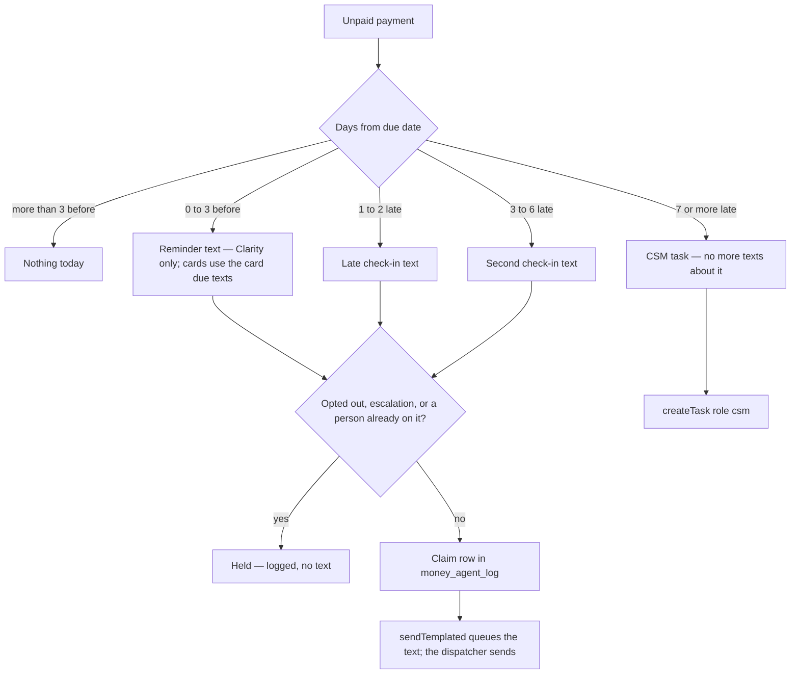
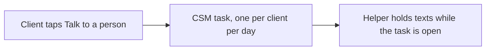
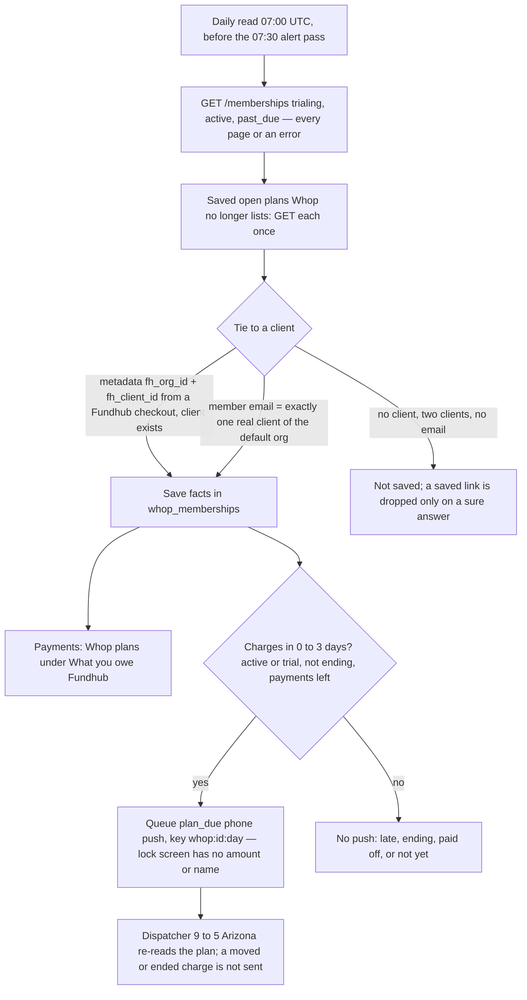

# Clarity Payments + the money helper — flow

Owner-set 2026-10-06: a Clarity Payment is any debt a client owes Fundhub LLC or
a subsidiary, including buy now, pay later (BNPL) plans. When a payment is late,
the money helper checks in first, then a person (the CSM) takes over.

Code: `db/migrations/443_clarity_payments.sql`, `src/finance/clarity-payments.mjs`,
`src/finance/money-agent.mjs`, `src/workflows/finance-os-money-agent.mjs`,
`api/money/payments.mjs`, `public/app/money-payments.html`.

## A plan

```mermaid
stateDiagram-v2
    [*] --> open: staff add_plan (plan + schedule in one statement; schedule must add up)
    open --> open: staff record_payment (oldest unpaid payment first)
    open --> settled: record_payment pays the last cent
    open --> settled: staff mark_settled
    settled --> [*]
```

## One unpaid payment (the helper runs daily at 16:30 UTC)

Every step is a row in `money_agent_log`. Caps live in the database: each rung
of each payment once ever; one helper text per client per day.

A plan linked to an invoice (`invoice_id`) is left to the AR ladder
(`src/workflows/ar-collections.mjs`) — the helper does nothing on it.

## Talk to a person

## Whop plans (Finance OS unit W, 2026-11-07)

Owner ask 2026-11-07: track the plans clients pay Fundhub on Whop "like the Clarity
plans", with a phone alert before each payment. A Clarity plan (kind `clarity`) shows
ClarityPay's own logo (`public/assets/lenders/claritypay.svg`, from claritypay.com); a
Whop plan shows Whop's (`public/assets/merchant-whop.svg`). Other kinds show a name only.

Code: `db/migrations/584_whop_memberships.sql`,
`src/messaging/providers/whop-memberships.mjs` (GET only),
`src/finance/whop-plans.mjs`, `src/pulse/beats/lib/whop-plan-push.mjs`,
`public/app/money-whop-plans.js`, check `payments:whop-plans-current`
(`src/pulse/coverage/gap-whop-plans.mjs`). The daily job, the Payments read, the
Payments screen and the phone-alert pass are wired by root's integration patch
(unit W report); until then the read runs only by hand.

No email, name, phone or card is stored. Money is integer cents; a price that is not
in US dollars is unknown, never 0. "Left to pay" on a split-pay plan is payments left
times the next charge, shown as an estimate.
