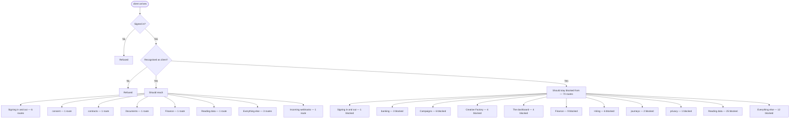

# client — intended

> ⚠️ **WRITTEN AFTER THE FACT, NOT BEFORE IT.** CLAUDE.md §4 calls this file the
> hand-authored source of truth, checked against the code — and says agents do
> not write it, because an agent writing it would be authoring the very thing
> its own work is supposed to be checked against. This one is an explicit,
> one-time exception: the owner directed it be created from current behavior
> because none existed at all (`docs/journeys/README.md` recorded that gap
> from 2026-07-31 to 2026-08-02). It was generated on 2026-08-02 from the same
> extracted route data as [`client-actual.md`](./client-actual.md) —
> not from a product spec, a ticket, or anyone's independent judgment of what
> *should* happen. A match against `-actual.md` right now proves only that
> this file was copied from it, not that either one is correct. Replace this
> page's judgment calls with a human's the next time this journey changes on
> purpose — that is the point of having two files at all.

What a principal of kind `client` should be able to do.

> **Who this is, in the code:** src/auth/account-session.mjs — PRINCIPAL_KINDS includes 'client'

## In one picture

## Should be able to reach

- **Signing in and out** (6 routes) — should be reachable.
- **consent** (1 route) — should be reachable.
- **contracts** (1 route) — should be reachable.
- **Documents** (1 route) — should be reachable.
- **Finance** (1 route) — should be reachable.
- **Reading data** (1 route) — should be reachable.
- **Everything else** (3 routes) — should be reachable.
- **Incoming webhooks** (1 route) — should be reachable.

## Should stay blocked from

- **Signing in and out** (1 route) — should stay blocked.
- **banking** (3 routes) — should stay blocked.
- **Campaigns** (6 routes) — should stay blocked.
- **Creative Factory** (4 routes) — should stay blocked.
- **The dashboard** (4 routes) — should stay blocked.
- **Finance** (9 routes) — should stay blocked.
- **Hiring** (6 routes) — should stay blocked.
- **journeys** (2 routes) — should stay blocked.
- **privacy** (1 route) — should stay blocked.
- **Reading data** (25 routes) — should stay blocked.
- **Everything else** (12 routes) — should stay blocked.

## Comparing this against reality

Run `npm run journeys` and read [`client-actual.md`](./client-actual.md). There is no automated
diff between the two files — CLAUDE.md §4 describes intended vs. actual as a human
comparison, and this repository has never built a machine check for it. Read both,
side by side, and treat any difference between them as a finding to report, not
something to silently fix in either file.

## Approved client Affiliate Dashboard extension — 2026-10-17

The owner approved client referral enrollment revealing a usable own Affiliate Dashboard. A successful real enrollment persists the client account affiliate link. The client stays kind=client and reads only that linked affiliate in the same organization, including own aggregate figures. Refresh and a fresh sign-in must retain this access. A failed request must not claim enrollment or expose another affiliate. The cloud board records source/mocked proof and the still-required real database acceptance.
