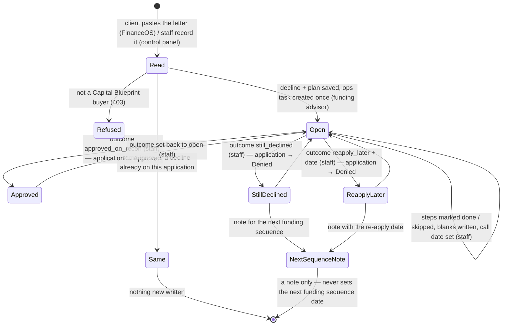
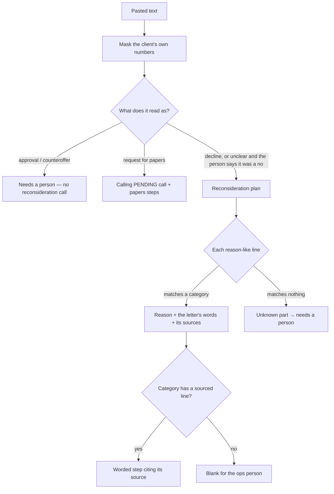
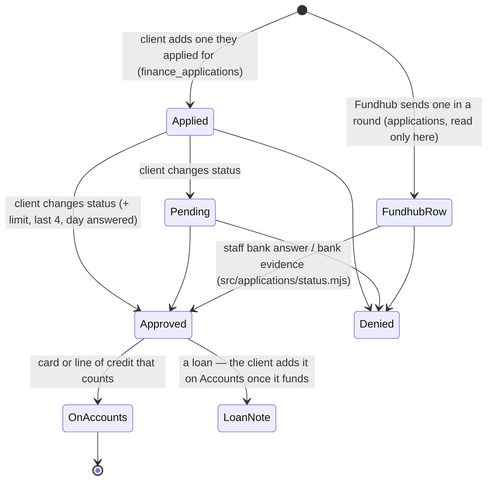
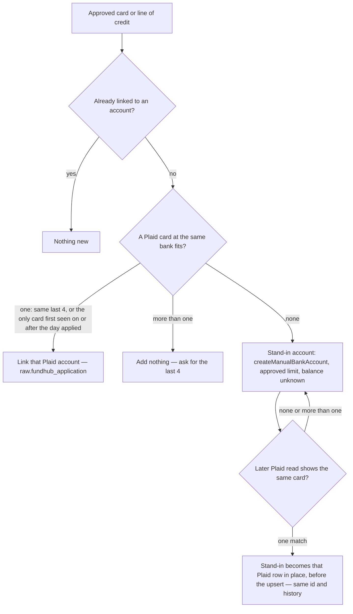

# Decline defense — flow

Capital Blueprint launch unit B1. How it works and the tool contract: `docs/finance/decline-defense.md`. Tables: `db/migrations/470_blueprint_decline_defense.sql`.

## A decline

## Reading a letter

## Events and writes

| Event | Who | Writes |
|---|---|---|
| `paste` | client or staff | `blueprint_declines` + `blueprint_decline_steps`; `tasks` (once) |
| `record` | staff | the same; linked application → Denied (`application_decisions` row) |
| `link_letter` | client or staff | `letter_document_id`; the send-the-letter step closes |
| `step` | staff | one step's status / written words |
| `schedule` | staff | `recon_on`; the open task's `due_at` |
| `outcome` | staff | outcome columns; linked application → Approved / Denied |

## Applications tracker (Finance OS wave 3, unit O, 2026-11-07)

The "Your bank applications" card on the same page (Finance OS → Applications), built from code: `src/finance/applications-tracker.mjs`, `public/app/money-applications.js`. Same door, no new route: `GET /api/blueprint/declines` carries `view.tracker`; `POST` takes `track_add`, `track_update`, `track_add_account` (client or staff, no Capital Blueprint needed). Table: `db/migrations/576_finance_applications.sql`.

| Event | Who | Writes |
|---|---|---|
| `track_add` | client or staff | one `finance_applications` row; if approved card/line, one `bank_accounts` row or a link on a Plaid row |
| `track_update` | client or staff, the client's own rows | status, approved amount, last 4, day answered; the same account step |
| `track_add_account` | client or staff | the same account step for an approval from before this shipped |
| staff bank answer `Approved` | staff / bank evidence | after the status save, the same account step (`syncApprovedApplication`, never throws) |
| Plaid account read | system | a matching stand-in turns into the Plaid row (`claimStandInsForPlaid` in `saveAccounts`) |

UNVERIFIED on a real database: the unique index `bank_accounts_fundhub_application_uq` and the savepoint path inside the bank-evidence transaction (no Postgres in the build session; the `.pg` tests skip).
