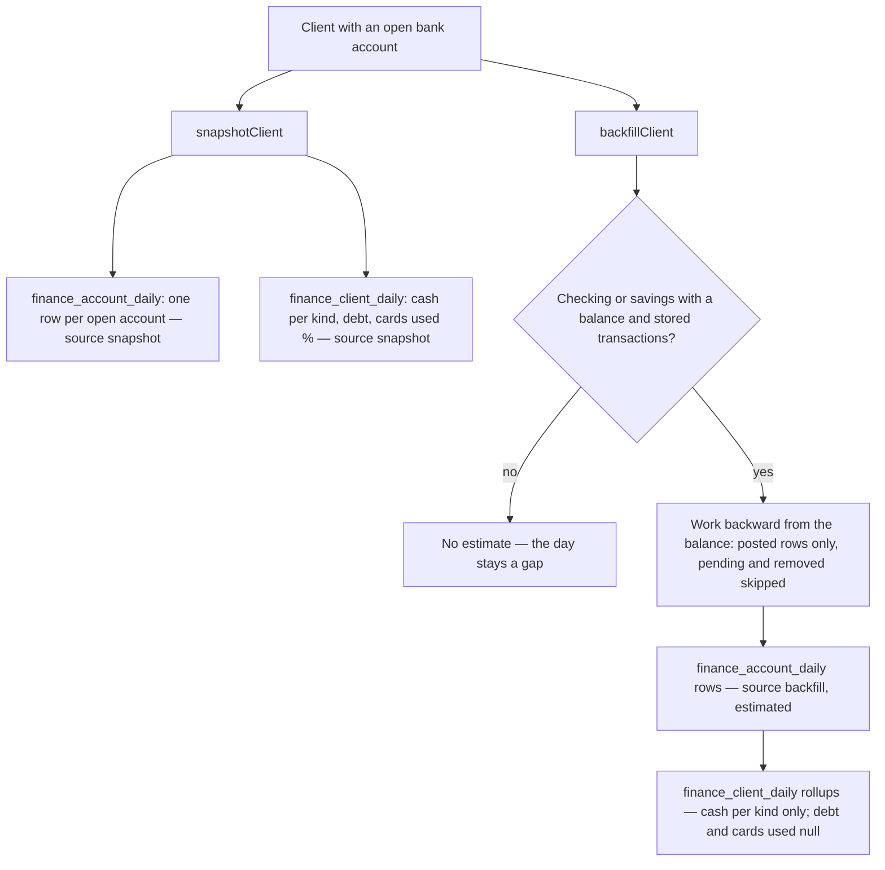
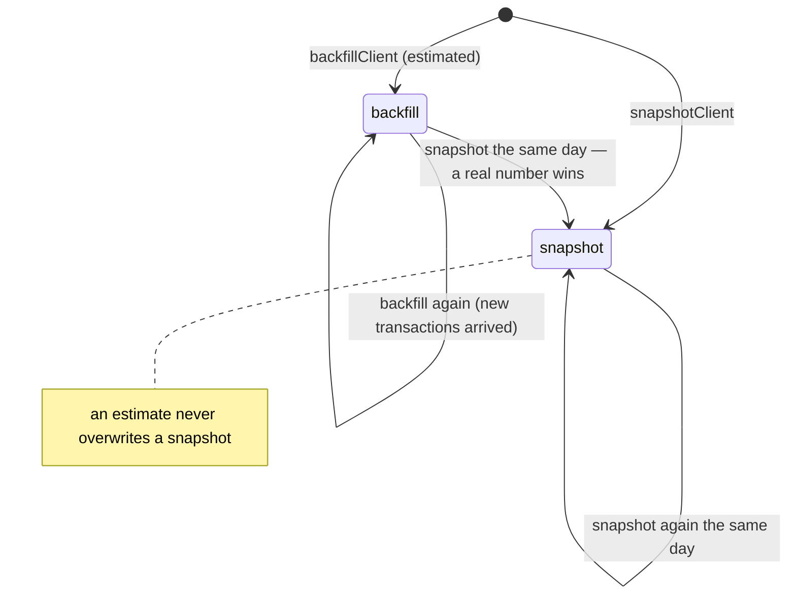
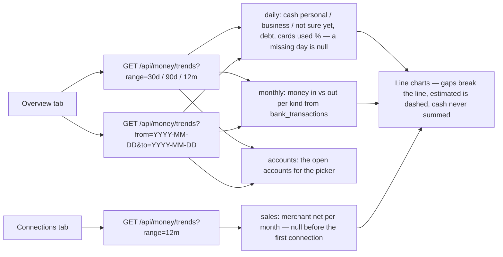
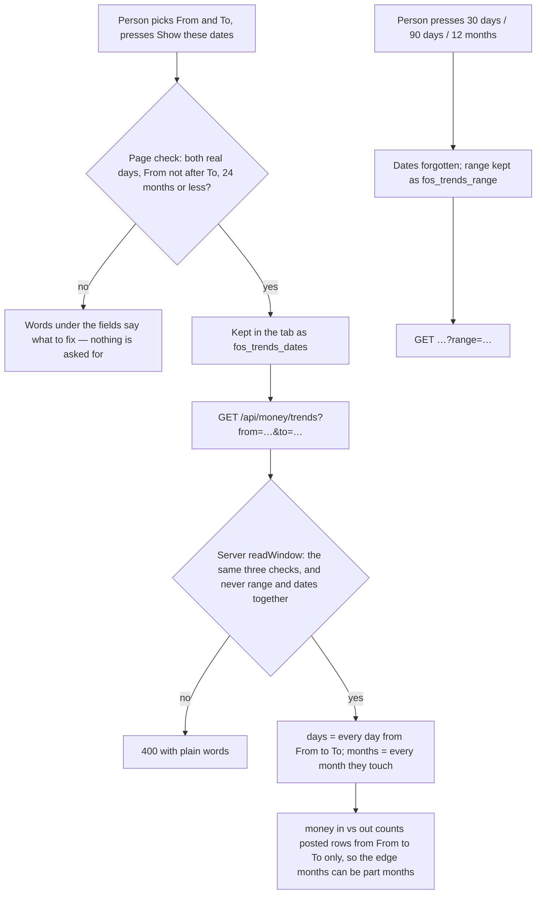
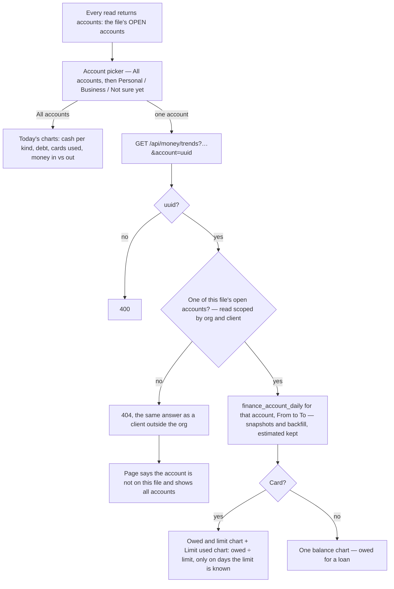
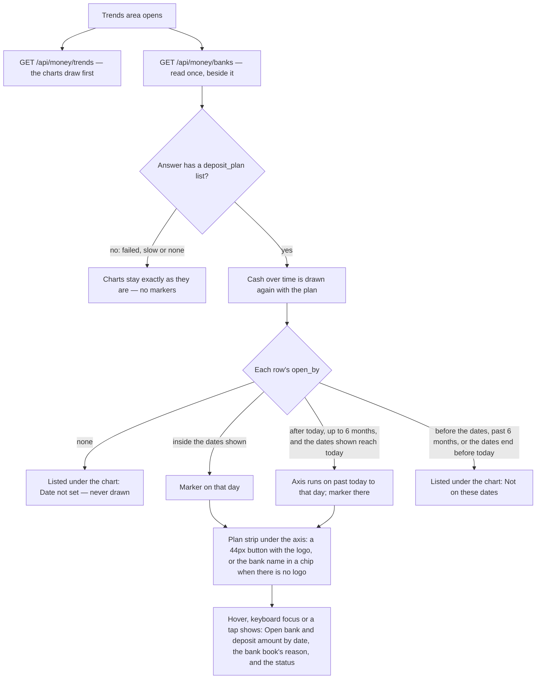

# FinanceOS trends — flow

## Fundhub owner company cash

The owner opens **Company cash** from the existing account menu. This is a separate company workspace; the client FinanceOS flow below keeps its existing scope. Admins and other staff do not inherit the company page or its two APIs.

`/app/company-cash.html` uses `/api/owner/company-bank` and `/api/owner/company-cash`, registered in the Netlify router. All reads and writes use the authenticated owner's org. Bank Link, exchange, selection, sync and an explicitly enabled balance refresh use the owner session without a separate staff MFA prompt. Consent confirms a Fundhub LLC business account and read-only data access. Only an eligible selected USD depository account supplies company cash. No action initiates a transfer.

The page shows the stored posted bank balance less unpaid CRS, approved ad funding and reviewed tech obligations. Missing bank data, unpriced pulls or unreviewed monthly costs leave the result unknown. A cached bank read does not claim a fresh balance. Processor receipts are not reconciled or added to bank cash. Observed recurring charges remain suggestions until the owner saves a real obligation.

An obligation becomes paid only after the owner matches the exact posted debit in the selected business account. Matching is scoped and keyset paged, so older valid payments remain reachable. Valid invoice coverage and its verification time prevent double reservation while later unpriced pulls remain uncovered. Blank prices do not become zero. The owner chooses real recipients and amounts; the build does not invent Colin's replenishment or commission rules.

Session changes and owner-role revocation clear bank data, forms, identifiers and the Plaid widget before another action. Production account/configuration activation remains distinct from source or fixture proof.

Owner (2026-10-06): "the whole Finance OS with line graphs … Finance OS tracking."
FinanceOS keeps one row per account per day and one rollup per client per day,
and the Overview draws them as lines.

Code: `db/migrations/458_finance_trend_snapshots.sql`, `src/finance/money-trends.mjs`,
`src/workflows/finance-os-trend-snapshots.mjs`, `api/money/trends.mjs`,
`public/app/money-trends.js` (drawn inside `public/app/financeos.html`),
`scripts/finance-os-backfill-trends.mjs` (one-off, dry run unless `--apply`).

## One day of history (the job runs daily at 07:30 UTC, after the 07:00 Plaid pull)

## Who may overwrite a row

One row per (account, day) and per (client, day) — unique keys in 458.

## The read and the page

Same gate as `/api/money/overview`: a client session reads its own file only;
staff need owner / admin / sales_manager and `?client_id=` in their org.

## Any dates (Finance OS CFO build, unit A, 2026-11-07)

The 30 days / 90 days / 12 months buttons stay. Beside them, a From and a To
date field and a **Show these dates** button ask for any window.

A custom read answers `range: null`, `custom: true`, and its own `from` / `to`;
no range button is pressed. A preset read answers `custom: false` as before.
A window longer than 120 days that crosses a year labels its axis with month
and year (Nov 2025), so two years never read as one.

## One account (Finance OS CFO build, unit A, 2026-11-07)

Names come from the overview's own rule (`buildMoneyOverview`): the name, else
the official name, then `••` and the last four when stored. The picker type is
card / checking / savings / loan, or other (money market, CD, investment).
Closed accounts are left out of the picker, as they are left out of the
overview. Limit used is the Cards used math (`cardsUsed`): an overpaid card is
0%, a $0 or unknown limit is a break. A day with no row is a break in every
line, never 0. The account choice is not kept between visits.

## Bank waypoints on the Cash chart (2026-11-07)

Chris: "we put a little waypoint with the bank logo ... you highlight over the
bank logo. It says, 'Oh, deposit money here at this time.'"

The money lines stop at today: the days after today carry no line, no dot and
no table row, and the chart says so in words. A thin dashed guide runs up from
each marker; a thin line marks today when the axis runs past it. A planned
row has a dashed ring; opened, deposited or seasoned has a solid ring, and the
status word is in the tip. Only the all-accounts Cash chart carries the plan.
Close markers move to a second row so none sits on another; a marker near an
end is pinned inside the chart, so nothing scrolls sideways at 390 or 320.
The `deposit_plan` list is unit E's addition to `/api/money/banks`; until it
ships, the read answers without it and no markers are drawn.

Code: `planLayout`, `planStrip`, `planNotes`, `layoutPlans` and the plan read in
`public/app/money-trends.js`; styles in the same marked block of
`public/app/money-workspace.css`.

Code: `readWindow`, `trendWindow`, `accountChoices`, `pickAccount`,
`buildAccountSeries` in `src/finance/money-trends.mjs`; the gate in
`api/money/trends.mjs`; the picker, date fields and account charts in
`public/app/money-trends.js`; the toolbar block in
`public/app/money-workspace.css` (marked TRENDS START / END).
Proof: `src/finance/money-trends.test.mjs`, `src/http/money-trends.test.mjs`,
`src/http/money-trends-screen.test.mjs`, `e2e/page_money_trends.spec.mjs`.
