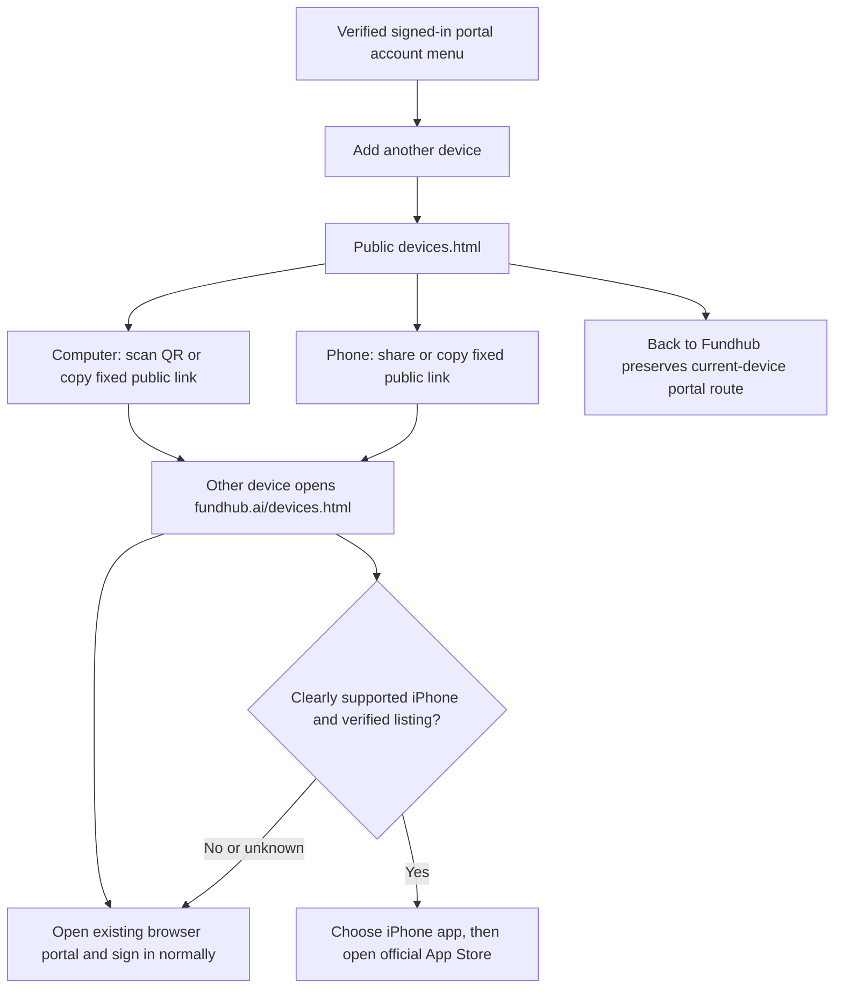

# Fundhub iOS app — actual push path (2026-10-17)

## Use Fundhub on another device (2026-11-06)

The verified client account menu in `public/app/client-ios.js` and verified
staff account menu in `public/app/shell.js` offer **Add another device**. The
same portal runs inside the existing native workspace views. The link opens
`/devices.html` without copying the current query, client identity or token.
No native login, entitlement, Keychain or navigation guard changes are made.

The share payload and QR contain only `https://fundhub.ai/devices.html`.
Android, Windows, iPad-like and contradictory/unknown browser signals get no
Apple download control. A Mac uses the browser portal until a separate public
native download is verified. Clipboard/share failures leave the public link
selectable; failed app settings leave the browser route working. No transfer
of a signed-in session is implemented or claimed.

This is traced source and controlled browser proof. Actual installed-app,
physical AirDrop and production deployment receipts remain separate. The
owner's requested new steps are recorded on the existing device-download
workflow board; the hand-authored intended journey was not silently changed.

## Saved sign-in (2026-11-04)

The native app stores its session in this iPhone's Keychain without a Face ID or
device-passcode challenge. On later opens it reads the saved token and verifies
the server session. It reads an older Face ID-protected item with interaction
disabled; if unreadable, the app clears it and asks for one normal sign-in.
While the phone is locked, it waits for protected data instead of clearing a
valid saved session.
Signing out still removes the saved token and revokes the server session.

The client Home calls the native push status route with its bearer session and this installation's
UUID. If the server lacks the Apple signing key or encryption key, the card says setup is not
ready and never spends the iOS permission prompt. If ready, the client may grant permission;
Apple returns an APNs device token, and the app registers it under the authenticated client,
account, and session. The token is encrypted at rest. Turning off notifications sends DELETE
for this installation and unregisters with iOS. Native sign-out attempts DELETE and logout,
then clears the local session even when the network is down. A server session that is revoked
or expired cannot pass the sender's device query.

The server's APNs sender only accepts bodies from the existing lock-screen whitelist. It has
automatic client workflow callers after a gated client email or text succeeds.

Staff sessions now register their own encrypted device rows through the same
native-device route. A staff lead, set, or upcoming push opens the relevant
setter or closer dashboard with `client_id` selected. The setter dashboard
selects the matching contact row and its existing Call action opens the phone
dialer. `src/push/native-send.mjs` claims each staff alert once in
`staff_apns_alerts` before the Apple send. Apple App ID capability, APNs key,
signed entitlement, and a delivered real-iPhone staff test have not been
verified. This is source behavior, not a live PASS.

Staff notification taps are bound to the saved bearer session when tapped. A
different sign-in cannot consume that queued contact link, and sign-out clears
both staff and client queued opens. A cold-start tap reads the saved sign-in
before queuing the link; without one, the tap fails closed. The queued link is
single-use and expires after five minutes. The workspace clears its selected
staff contact path when the token or signed-in identity changes.

Client portal notification taps are bound to the saved bearer at receipt and
again when dequeued. After the asynchronous session refresh, the app reloads
the portal only if the same bearer is still signed in as a client and the task
has not been cancelled. A tap for another account is consumed without opening
the portal. This is source behavior; a signed iPhone tap and APNs delivery are
still not verified.
