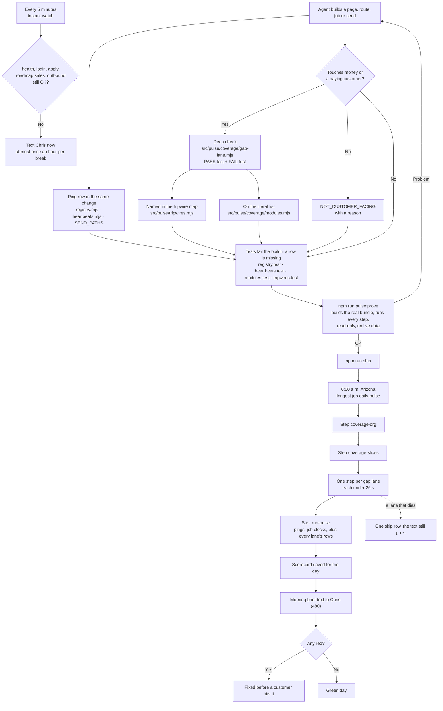
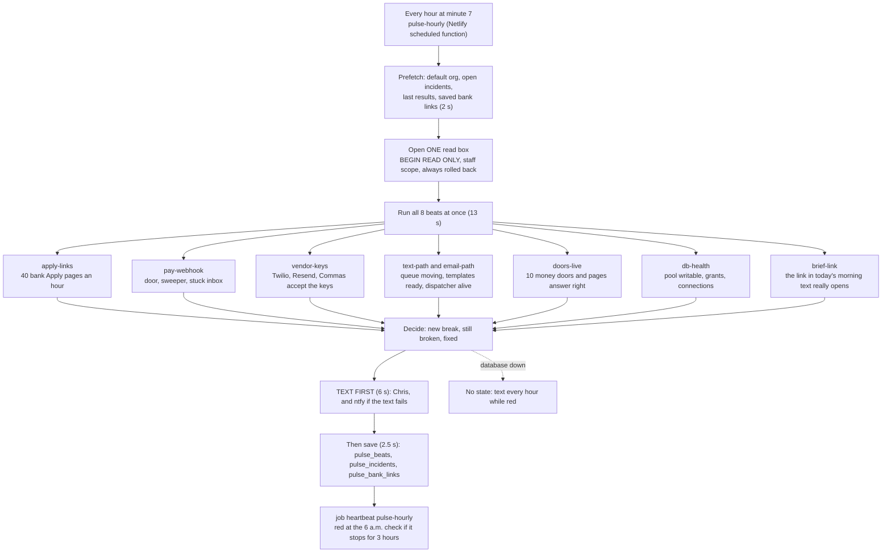
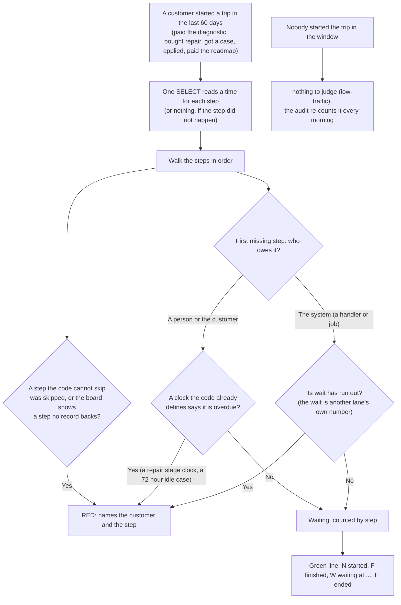
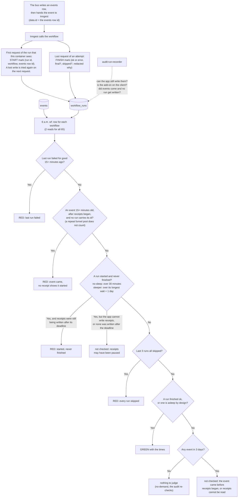
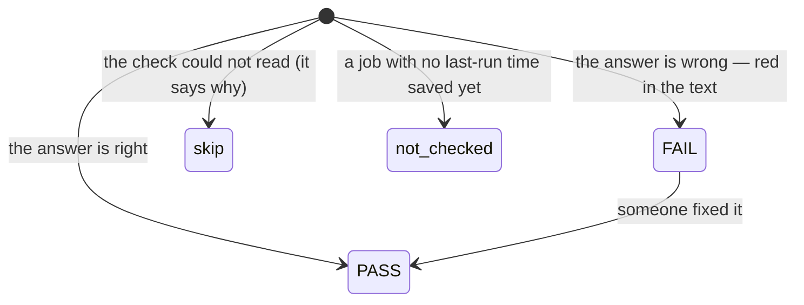

# Heartbeat — how a tripwire gets from code to Chris's phone

Traced from code on 2026-10-09: `src/workflows/daily-pulse.mjs`, `src/pulse/daily-pulse.mjs`, `src/pulse/coverage/run-slices.mjs`, `src/pulse/coverage/modules.mjs`, `src/pulse/instant-watch.mjs`, `src/ops/morning-brief.mjs`. The law is `.claude/rules/heartbeat-on-every-build.md`.

## In plain words

- A **check** asks one yes-or-no question about the company. "Does the login page answer?" "Did every paid client get the portal?"
- A **tripwire** is a check that goes red before a customer hits the break.
- Every morning at **6:00 a.m. Arizona**, one job runs about 970 checks. Every red one goes in the text to Chris.
- Every **5 minutes**, a small watch runs 5 checks (health, login, apply page, roadmap sales page, outbound sends). If one breaks, Chris gets a text right away. At most one text an hour for the same break.
- Most checks only run at 6 a.m. A break at noon shows up in the next morning's text, unless it is one of the 5.
- The pulse **only reports**. It never fixes anything. Chris, or an agent he asks, fixes reds.

## Kinds of check

| Kind | What it proves | Where it lives | Example |
|---|---|---|---|
| Ping | The door answers. Blind to wrong data. | `src/pulse/registry.mjs`, `src/pulse/heartbeats.mjs` | `reg:portal-login.html` answers 200 |
| Deep (the tripwire) | The customer's result is right. | `src/pulse/coverage/gap-*.mjs` | `payments:paid-no-entitlement`: a paid client has no portal access |
| Reminder lane (not a tripwire) | A person's setup step is late. No buyer is hurt. | `src/pulse/coverage/gap-closer-setup.mjs` | `closer-setup:calendar-late`: a closer was asked on Oct 7, the 3 days are over, and the booking page still lists no such host |

Anything that touches money or a paying customer needs a deep check. A ping alone is not enough.

A person's setup step (for example "connect your calendar so booked calls land on it") is a **reminder lane**, not a tripwire. It has no entry in the tripwire map and no hourly beat, because nobody gets the step done faster by the hour. The ask is one owner task per person (`scripts/closer-setup-ask.mjs`), with a due day. The 6 a.m. lane reads the open asks and the live booking page: green while waiting ("day 2 of 3"), red after the due day, green again once the person is a host on the page. A **skip** there (the page could not be read, or ClickFunnels changed its page code) is not a pass: it lands inside the red `audit:not-checked` line, so it is never hidden. ClickFunnels has no API call to invite a team member, connect a calendar or add a host, so a person clicks those steps and the pulse only watches that they happened.

The tripwire map (`src/pulse/tripwires.mjs`) is where every page, route, job and send is sorted: money or customer names its deep check, the rest says why it is not customer-facing. A new one fails the tests until it is sorted. That is what sews the tripwires into every build.

## The picture

## The hourly pulse (added 2026-10-09)

Every hour at minute 7 a small Netlify scheduled function (`netlify/functions/pulse-hourly.mjs`, outside Inngest, so it runs even if Inngest is down) tests the company on purpose. The pulse is the **read-only half** (8 beats): each beat reads data through a box where Postgres itself refuses writes, and reads the web with GET and HEAD only. A beat cannot save, send or call a vendor with a write.

- **`checkout-doors` (added 2026-10-10, coverage batch W2).** Every hour it asks three questions a buyer would feel, read only: does the funnel till (`GET /api/public/funnel-checkout`) say checkout is ready with a price and a live buy button for autopsy, board and trial; does the repair checkout door answer a GET with its own 405 (so the route is mounted); and do the newest waiting paid-service checkout links answer a HEAD. It never presses Pay and never charges a card. Its `damp` is 2. The morning twin is `src/pulse/coverage/gap-checkout.mjs`, and both judge with `src/pulse/beats/lib/checkout-doors.mjs`.
- A beat with `damp 2` (vendor keys, doors, bank links) must be red twice in a row before it texts, so one vendor blip does not wake Chris.
- A break texts at once, texts again every hour ("still broken, hour N") and texts once when fixed.
- **Texting hours (owner law 2026-10-09):** every text and buzz to Chris goes out only from 6:00 a.m. to 10:00 p.m. Arizona time (`inTextWindow` in `src/pulse/quiet-hours.mjs`). At night the hourly pulse still checks, opens the incident and damps, but sends nothing and claims nothing; the 6:07 a.m. run sends one text ("BROKEN since 2:07 a.m."). A break that opens and heals at night gets no "fixed" text. A break he WAS told about that heals at night stays open, and the 6:07 a.m. run sends its one FIXED text and closes it. The 5-minute watch skips the text and writes no alert row, so a door still down at 6:00 a.m. is texted on that run. The briefs, the finished-ad text, `/api/ops/notify-owner` (202 held) and the teleprompter text hold the same way. `src/pulse/quiet-hours.test.mjs` fails the build if a file that texts Chris's number skips the check.
- When the fix is done, the four learning fields on the incident and an entry in `docs/lessons/pulse-lessons.md` record what broke and what now guards it.
- **Not built yet (on purpose):** the write-through half, where a signed test signal travels through the doors that save data inside a rolled-back box. It needs locks inside the Node process that have never run on a real Postgres. It waits until proven on a scratch database and watched once. Also not built: GitHub issues and the Claude "pulse fixer" session (they wait on an owner decision about a private repo).

## Whole trips (L4, added 2026-10-10, coverage batch W8)

A deep check asks one question about one thing. A **trip check** follows one customer from the first step to the last and names the **first step that is missing**. There are five, one lane each, read only, at 6 a.m.: `trip:funding`, `trip:repair`, `trip:inquiry`, `trip:partner`, `trip:roadmap` (`src/pulse/coverage/gap-trip-*.mjs`, walked by `src/pulse/coverage/trip-kit.mjs`).

- **A waiting customer is never red.** Waiting on a person or on the customer is counted by step in the green line. A step goes red only when the company owes it and its wait is over, or when a clock the code already defines (the repair stage clocks in `src/repair/sla.mjs`, gap-inquiry's 72 hour idle case and call sweeper wait, the 72 hour portal sign-in wait) says it is overdue.
- **Every wait is another lane's own number.** The kit adds none. Each system step names where its wait comes from (the paid-to-card wait and the round wait are `gap-pipeline-facts.mjs`; the funded-to-bill wait is `gap-money-funding.mjs`; the pack's 2 hours is `gap-underwrite.mjs`).
- **The funded steps use the money lane's rule** (`roundProblems`), and the pack steps use the underwrite lane's judges (`judgePackFiles`, `judgePackEmail`), so a trip and its lane can never disagree.
- **"Nothing to judge" is re-counted every morning.** A trip nobody started says `nothing to judge` (code `low-traffic`). The audit asks again, and the five trips share one light read (`sharedCount`), because the audit gives all its re-checks 2.5 seconds together.
- Test clients, sim and e2e partners, demo rows and archived clients are left out. A trip that started more than 60 days ago is for a person to clean up by hand.

## Run receipts for event workflows (added 2026-10-09)

Crons leave a receipt in `job_heartbeats`. A workflow that an **event** starts used to leave none, so its `wf:` row could only say "nothing to judge" or "not checked". Now every run leaves two receipts in `workflow_runs` (migration 478), written by the **Run evidence** add-on on the shared Inngest client (`src/pulse/run-evidence.mjs`). The add-on never changes what a workflow returns and never throws into it. Every write has a timer (800 ms for the start mark; 500 ms to 5 s for the finish mark), and after 3 failed writes it stops for 10 minutes and logs one `[run-evidence]` line.

- A failure with a retry still coming is "retrying" (green, pending), never red. A run is final when it returned, threw its last attempt, threw a NonRetriableError, or a step already used up its retries. A failure saved as "retry coming" with no later attempt after a day is final too, so it cannot read "retrying" for ever.
- ClickFunnels sends one post per survey screen. The app stores a repeat post (same event name, address and funnel, inside 6 hours) and starts no run on purpose. Those repeats are left out of "event came, no receipt shows it started". Today that is `survey.submitted` and `entry.captured`.
- A lost finish write can look like a lost run. So a run with no finish mark is called lost only when receipts were still being written after its deadline. Otherwise the row says "not checked: receipts may have been paused".
- The times in these rows are Arizona time, the clock Chris reads.
- The 17 workflows that sleep are on the `SLEEPERS` list in `src/pulse/workflow-runs.mjs` with their longest wait. A test reads the bundled workflow files and fails when a sleeper is missing, or when a workflow with `cancelOn` is.
- An event that came **before** receipts began cannot be judged by receipts. Its workflow reads "not checked" until receipts are a day old or a new event comes. That is the honest answer, not a guess.
- **The switch-off with no deploy:** `REVOKE INSERT, UPDATE ON public.workflow_runs FROM fundhub_app;`. Writes then fail fast and quietly, every workflow keeps running, `audit:run-recorder` goes red, and the `wf:` rows say "receipts are switched off" (not checked) instead of "no receipt shows it started" or "started, never finished". Undo with the matching `GRANT`.

## The states of one check

`skip` is never a pass. A check that can only pass, or only skip, is not a tripwire.

## Traps already paid for (2026-10-08)

1. **A folder scan ships empty.** The live bundle carried 0 of 70 check files, and nothing said so. Now every file is a literal import in `modules.mjs`, and a test checks the list.
2. **26 seconds per step.** All the checks in one step took about 61 s. Netlify cuts at 26 s, so no text would have gone out. Now each lane is its own step.
3. **No repo files at run time.** Checks that read source files passed on a laptop and went red on the server. `npm run pulse:prove` runs from the real bundle to catch this.
