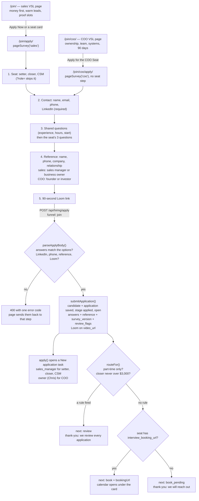

# hiring-funnel-flow — fundhub.ai/join/ and /join/coo/ (actual)

Owner-set 2026-10-13 (Chris, in chat): hiring funnels built like the book-a-call
funnel. VSL page, then an application survey, then qualified applicants book an
interview. Split the same day into two funnels:

| Funnel | VSL page | Application | Seats | Interview with |
|---|---|---|---|---|
| Sales | `/join/` | `/join/apply/` | setter, closer, CSM | the sales manager |
| COO | `/join/coo/` | `/join/coo/apply/` | COO | Chris |

LinkedIn, a phone number, a reference and a 90-second Loom are required on both.

Traced from the code on 2026-10-13:
`public/join/index.html`, `public/join/coo/index.html`,
`public/join/apply/index.html`, `public/join/coo/apply/index.html`,
`public/join/apply.js` (the survey both applications run), `public/join/vsl.js`,
`api/hiring/apply.mjs`, `src/hiring/apply-public.mjs`, `src/hiring/survey.mjs`,
`src/hiring/pipeline.mjs apply()`, `db/migrations/480_hiring_coo_req.sql`.

## The applicant's path

## What each state means for the record

| Screen the applicant sees | What is in the database | Who acts next |
|---|---|---|
| Calendar (`book`) | Application open in `applied`, `review_flags` empty | Applicant picks a time. The sales manager (or Chris for COO) already has the task. |
| "We will reach out" (`book_pending`) | Same as above | The seat has no booking link yet. The task owner reaches out by hand. |
| "We review every application" (`review`) | Application open in `applied`, `review_flags` lists the rule ids | The task owner reviews it. Nothing was rejected; a person decides. |

## Rules that hold

- No candidate is rejected by software. `review` only holds the calendar back. The
  application stays `open` and no `hiring_decisions` row is written
  (proved in `src/hiring/apply-public.pg.test.mjs`).
- The reply never says whether the email was already on file, and a honeypot bot
  gets the same reply a person with the same answers would get (same test file).
- Each application page's copy of the questions must match `pageSurvey()` for its
  funnel word for word (`src/hiring/survey.test.mjs`).
- The old `/careers.html` form is unchanged: it still cannot send answers.

## Open gaps

- `interview_booking_url` is not set for any seat in this repo. Until the sales
  manager's link (setter, closer, CSM) and Chris's link (COO) are saved on
  `hiring_roles`, every qualified applicant sees "we will reach out".
- Neither VSL is filmed. `/join/` plays `public/funnel/hiring-vsl.mp4` and
  `/join/coo/` plays `public/funnel/hiring-coo-vsl.mp4` once those files exist.
- Proof, earnings, revenue, comp and Chris's photo are dashed amber placeholders
  (class `ph`) on both VSL pages until the real ones are supplied.
- The calendar is an outside page in a frame, so this system is not told when an
  interview is booked. `hiring_interviews` is still only written by tests.
