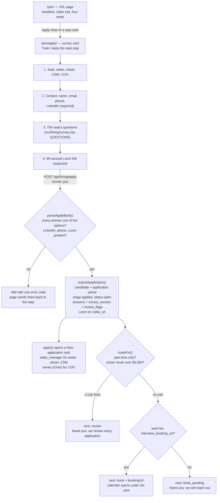

# hiring-funnel-flow — fundhub.ai/join/ (actual)

Owner-set 2026-10-13 (Chris, in chat): a hiring funnel for setters, closers, CSMs
and a COO, built like the book-a-call funnel. VSL page, then an application
survey, then qualified applicants book on the sales manager's calendar. The COO
books with Chris. LinkedIn is required.

Traced from the code on 2026-10-13:
`public/join/index.html`, `public/join/apply/index.html`,
`api/hiring/apply.mjs`, `src/hiring/apply-public.mjs`, `src/hiring/survey.mjs`,
`src/hiring/pipeline.mjs apply()`, `db/migrations/480_hiring_coo_req.sql`.

## The applicant's path

## What each state means for the record

| Screen the applicant sees | What is in the database | Who acts next |
|---|---|---|
| Calendar (`book`) | Application open in `applied`, `review_flags` empty | Applicant picks a time on the seat's calendar. Sales manager (or Chris for COO) already has the task. |
| "We will reach out" (`book_pending`) | Same as above | The seat has no booking link yet. The task owner reaches out by hand. |
| "We review every application" (`review`) | Application open in `applied`, `review_flags` lists the rule ids | The task owner reviews it. Nothing was rejected; a person decides. |

## Rules that hold

- No candidate is rejected by software. `review` only holds the calendar back. The
  application stays `open` and no `hiring_decisions` row is written
  (proved in `src/hiring/apply-public.pg.test.mjs`).
- The reply never says whether the email was already on file, and a honeypot bot
  gets the same reply a person with the same answers would get (same test file).
- The page's copy of the questions must match `pageSurvey()` word for word
  (`src/hiring/survey.test.mjs`).
- The old `/careers.html` form is unchanged: it still cannot send answers.

## Open gaps

- `interview_booking_url` is not set for any seat in this repo. Until the sales
  manager's link (setter, closer, CSM) and Chris's link (COO) are saved on
  `hiring_roles`, every qualified applicant sees "we will reach out".
- The VSL is not filmed. `/join/` shows a placeholder until
  `public/funnel/hiring-vsl.mp4` exists.
- The calendar is an outside page in a frame, so this system is not told when an
  interview is booked. `hiring_interviews` is still only written by tests.
