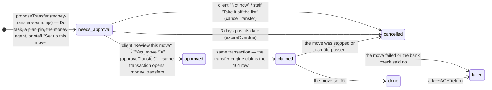
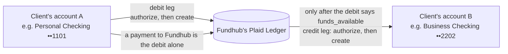
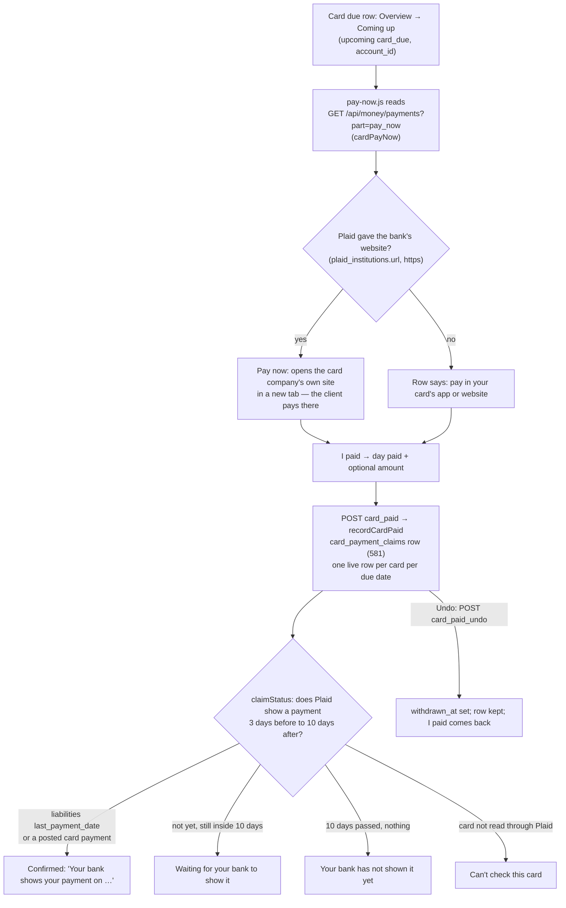

# money-transfers-flow — FinanceOS money moves

How one FinanceOS money move goes from "set up" to "landed", and what can stop
it. FinanceOS wave 5, unit W7 (`ops/workflows/finance-os-wave5-2026-10-06.md`).
Drawn by hand from the code on 2026-10-07 — every arrow names the function or
event that fires it. Plaid sandbox only until production is switched on.

**The hard rule:** nothing moves until the client says yes to that exact move —
the account it comes from, where it goes, the amount and the date. The money
agent, the rules helper and staff can only set a move up.

## Staff payout bank setup

This is a separate destination setup for a closer or sales manager. It records
where Fundhub may later pay that employee; it never sends money by itself.

1. The employee signs in with their own staff email and password. The server
   checks the session and employee role before opening the bank setup door.
2. Plaid Link asks the employee to choose their own bank account. The server
   saves only the resulting destination under that employee and company. The
   employee sees masked status; the owner sees masked staff status in People.
3. Bank linking stays unavailable until Fundhub's staff Plaid Transfer setup
   is enabled. A connected destination does not authorize a payout amount or
   initiate a transfer.

## 1. The proposal and the move — one record each, linked



The left column is the 464 row (`money_agent_tasks`, unit W5). Only the client's
own login can take it past `needs_approval`; the database refuses a money row
that skips the yes (`money_agent_tasks_money_needs_ok_ck`).

## 2. The move itself — `money_transfers` (466)

```mermaid
stateDiagram-v2
    direction TB
    [*] --> approved: approveTransfer — opened only if it matches the approved 464 row (money_transfers_guard)
    approved --> approved: not its day yet · over today's limit · bank login needs fixing · bank did not answer (waits; the 15-minute pass tries again)
    approved --> cancelled: client or staff stop it (cancelTransfer) · 3 days past its date (date_passed)
    approved --> declined: Plaid's bank check says no (/transfer/authorization/create → declined, e.g. NSF)
    approved --> failed: the account it comes from is gone · Plaid refuses the request
    approved --> authorized: Plaid's bank check says yes (debit authorization)
    authorized --> submitted: /transfer/create — the debit leg (idempotent on the authorization)
    authorized --> failed: Plaid refuses the create
    submitted --> submitted: Plaid events (/transfer/event/sync): debit pending → posted → settled → funds_available, then the credit leg starts: credit pending → posted
    submitted --> cancelled: stopped while Plaid still says "cancellable" (/transfer/cancel)
    submitted --> settled: credit settled (bank to bank) · debit settled (a payment to Fundhub)
    submitted --> failed: a leg failed or was returned
    settled --> failed: a late ACH return
    settled --> [*]
    failed --> [*]
    cancelled --> [*]
    declined --> [*]
```

## 3. Two legs, because Plaid moves money through Fundhub's Plaid Ledger



https://plaid.com/docs/transfer/flow-of-funds/ — a debit pulls money into the
Ledger; a credit pays it out. The engine never pays out before the debit's money
is available.

## What starts each step

| Step | Who or what | Code |
|---|---|---|
| Set up a move | Do task · plan pin · money agent · staff | `proposeTransfer` in `src/finance/money-transfer-seam.mjs` (writes the 464 row) |
| Say yes | The client's own login, never staff, never an authorized rep | `POST /api/money/transfers {action:"approve"}` → `approveTransfer` |
| Send a move dated today | Right after the yes | `api/money/transfers.mjs` → `executeTransfer` |
| Send later moves, read Plaid's events, start credit legs, expire stale ones | Every 15 minutes | `src/workflows/finance-os-money-transfers.mjs` → `runTransfersPass` |
| Stop a move | Client or staff | `POST {action:"cancel"}` → `cancelTransfer` |
| Every state change | The database | `money_transfers_ledger` trigger → `money_transfer_events` (append-only) |

## Switches (fail closed)

- `FINANCE_OS_TRANSFER_MAX_CENTS` and `FINANCE_OS_TRANSFER_DAILY_MAX_CENTS` — both
  must be whole numbers above 0, or nothing can be approved or sent and the pass
  does nothing.
- `PLAID_ENV=sandbox` — Plaid's test bank only.
- Real money needs `PLAID_ENV=production` **and** `FINANCE_OS_TRANSFERS_LIVE=1`.
  The wire (`src/banking/providers/plaid-http.mjs`) refuses the production host
  without both.

## Paying a card: "Pay now" and "I paid" (unit I6, 2026-11-07)

A card payment is **not** a money move. Plaid's own docs say a credit card
cannot receive a payment by bank transfer (Auth), and Plaid Transfer only moves
money between a checking or savings account and Fundhub's own ledger, never
between two of one person's accounts. So the engine above keeps refusing a card
as a destination (`blocked: "card_payment"`), and the card's due row does this
instead. Nothing here moves money. Drawn from the code on 2026-11-07.



| Step | Who or what | Code |
|---|---|---|
| Show the controls | The card's row in Overview → Coming up | `public/app/money.js` (slot) + `public/app/pay-now.js` |
| Read the card, its due date, the site, the claim | Client (own file) or FINANCE_OS staff | `GET /api/money/payments?part=pay_now` → `cardPayNow` in `src/finance/card-pay-now.mjs` |
| Say "I paid" / "Undo" | Client or staff | `POST /api/money/payments {action:"card_paid"}` / `{action:"card_paid_undo"}` |
| Confirm | Plaid's liabilities read and the card's own transactions | `paymentsSeen` + `claimStatus` (on every read; no job) |

Not built here: the Payments section's own Coming up list (unit D2's file)
mounts the same two calls when root applies the one-line patch from the I6
report.
