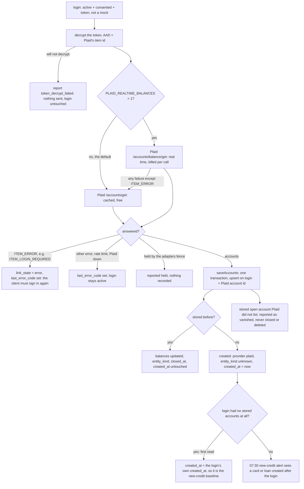
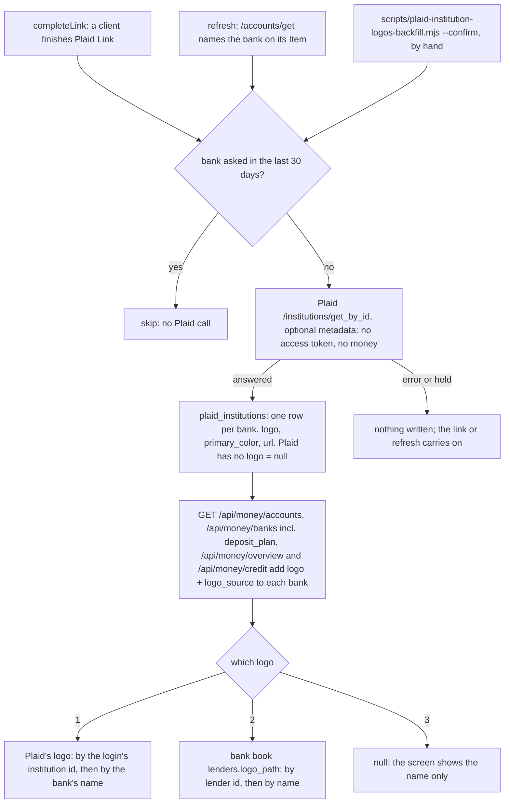

# Plaid account refresh — flow

Owner (2026-10-07): "make it work" for real banks, not just the sandbox. Before this,
nothing re-read a client's Plaid accounts after the day they linked: balances went stale
and a card opened later at the same bank never reached `bank_accounts`. The cash-cushion
and new-credit alerts (`docs/finance/file-protection-alerts.md`) read that table as it stands.

Code: `src/banking/plaid-refresh.mjs` (the refresh), `src/workflows/plaid-transactions-sweeper.mjs`
(runs it daily), `src/banking/accounts-sync.mjs` + `api/banking/sync-accounts.mjs` (staff: refresh one
client now), `src/banking/providers/plaid-http.mjs` (`fetchAccounts`, and `fetchBalances` for the opt-in).
No migration: it writes the columns that already exist.

## One daily pass (07:00 UTC) — accounts first, then transactions

```mermaid
flowchart TD
    S[plaid-transactions-sweeper 07:00 UTC] --> L[clientsWithPlaid: active, consented logins]
    L --> C[one step per client]
    C --> R[refreshClientAccounts: every readable login of the client]
    R --> T[syncClientTransactions: charges and deposits, then the bill detector]
    R -. a failed or thrown refresh is recorded under tally.accounts and never stops the sync .-> T
    R --> A[07:30 UTC: trend snapshots and file-protection alerts read the fresh rows]
    T --> A
```

A transaction is only stored for an account already in `bank_accounts`, so refreshing first also
means a new card's charges are no longer dropped as `account_not_saved`.

## One login



## Who may change what

```mermaid
stateDiagram-v2
    [*] --> active: completeLink (client finishes Plaid Link)
    active --> active: refresh succeeds, or fails for a reason that is not the login
    active --> error: Plaid says ITEM_ERROR (refresh or transactions sync)
    active --> [*]: the login is revoked (src/banking/revoke.mjs deletes the row, and its accounts with it)
    error --> [*]: not read again; a fresh Link makes a new login
```



Nothing in the refresh deletes a row, closes an account, sets `entity_kind`, or moves a stored
`created_at` (the one exception is the first-read baseline above, which only ever moves a row
the same read just created). An unknown balance is stored as null, never 0.

## Stored source environment (owner-directed 2026-11-04)

Successful Link and account refresh writes stamp `raw.plaid_environment` from the server's
actual Plaid transport configuration and `raw.plaid_environment_source = server_transport`.
Account payload flags are not accepted as that stamp. Refresh merges the new raw fields into
the existing JSON so unrelated stored evidence survives; no schema or provider setting changes.

The client account read joins the Item by row id, organization and client. Only a non-synthetic
Plaid Item association with recorded credential and consent plus the server stamp establishes production provenance. An exact legacy
`(Plaid sandbox — test data)` Item-name suffix establishes sandbox, including when it conflicts
with a claimed production stamp. Other legacy rows stay unknown; the current environment is
never used to backfill their source. Manual/imported raw flags cannot promote a record to Plaid.
The response exposes only derived source fields, never raw JSON or the Item credential.

The closer's saved-assets view keeps excluded records visible. Sandbox, development and mock
records are labelled test data; these and unknown-source Plaid rows are excluded from cash and
investment totals. Manual/imported evidence stays recorded, with currencies, ownership and
dates separate, and does not become bank-verified or a funding approval.

## Staff: refresh one client now

`POST /api/banking/sync-accounts` `{ client_id, provider: "plaid" }`, owner / admin / sales_manager.
`item_id` (a `plaid_items` uuid) refreshes just that login. The answer lists, per login, what was
created, what vanished, which balances moved, and `relink_needed`. A login that is not readable
(not this client's, or not active) is a 404.

## Bank logos (owner rule 2026-11-07)

Chris: "MAKE SURE THE BANKS HAVE THE CORRESPONDING BANK LOGO WITH IT, THATS A RULE. AND THEN YEAH
THATLL BE FROM PLAID." Code: `src/banking/institution-logos.mjs`, `getInstitutionById` in
`src/banking/providers/plaid-http.mjs`, table `plaid_institutions` (migration 575), helper
`public/app/bank-logo.js`.



Saving a logo never fails a link or a refresh. A bank name that matches two different logos
matches neither. The bank book's placeholder tile is not a logo.

Overview: each account by its login's institution id, then its bank name; a card or loan row takes
its account's logo. Credit: the report names only the lender, so a lender gets a logo only when
that name is a bank's own name. The bank plan (deposit_plan) keeps its bank-book file when the
logo read finds nothing.
