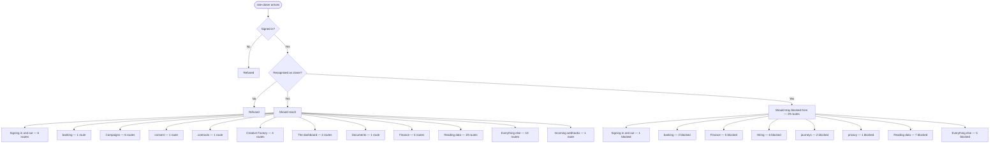

# role-closer — intended

> ⚠️ **WRITTEN AFTER THE FACT, NOT BEFORE IT.** CLAUDE.md §4 calls this file the
> hand-authored source of truth, checked against the code — and says agents do
> not write it, because an agent writing it would be authoring the very thing
> its own work is supposed to be checked against. This one is an explicit,
> one-time exception: the owner directed it be created from current behavior
> because none existed at all (`docs/journeys/README.md` recorded that gap
> from 2026-07-31 to 2026-08-02). It was generated on 2026-08-02 from the same
> extracted route data as [`role-closer-actual.md`](./role-closer-actual.md) —
> not from a product spec, a ticket, or anyone's independent judgment of what
> *should* happen. A match against `-actual.md` right now proves only that
> this file was copied from it, not that either one is correct. Replace this
> page's judgment calls with a human's the next time this journey changes on
> purpose — that is the point of having two files at all.

What a staff member with role `closer` should be able to do.

> **Who this is, in the code:** src/http/read-api.mjs — ROLE_SETS.STAFF includes 'closer'

## In one picture

## Should be able to reach

- **Signing in and out** (6 routes) — should be reachable.
- **banking** (1 route) — should be reachable.
- **Campaigns** (6 routes) — should be reachable.
- **consent** (1 route) — should be reachable.
- **contracts** (1 route) — should be reachable.
- **Creative Factory** (4 routes) — should be reachable.
- **The dashboard** (4 routes) — should be reachable.
- **Documents** (1 route) — should be reachable.
- **Finance** (5 routes) — should be reachable.
- **Reading data** (19 routes) — should be reachable.
- **Everything else** (10 routes) — should be reachable.
- **Incoming webhooks** (1 route) — should be reachable.

## Should stay blocked from

- **Signing in and out** (1 route) — should stay blocked.
- **banking** (2 routes) — should stay blocked.
- **Finance** (5 routes) — should stay blocked.
- **Hiring** (6 routes) — should stay blocked.
- **journeys** (2 routes) — should stay blocked.
- **privacy** (1 route) — should stay blocked.
- **Reading data** (7 routes) — should stay blocked.
- **Everything else** (5 routes) — should stay blocked.

## Comparing this against reality

Run `npm run journeys` and read [`role-closer-actual.md`](./role-closer-actual.md). There is no automated
diff between the two files — CLAUDE.md §4 describes intended vs. actual as a human
comparison, and this repository has never built a machine check for it. Read both,
side by side, and treat any difference between them as a finding to report, not
something to silently fix in either file.

## Actual Google Meet participation (owner-directed 2026-11-02)

The selected booked-call card may read `GET /api/read/meet-presence?client_id=<uuid>`. A primary or assigned closer must own the unfinished booked-call task; primary owner/admin/sales_manager may read an org call. The server binds org, client, latest booking and task before Google access. Arbitrary room URLs, Google user IDs and query tenancy are refused.

Presence comes only from the exact booked Meet room's active conference and a participant session with a start and no end. Booking time bounds which conference belongs to this call; time, calendar RSVP and link clicks never prove attendance. A real participant can be shown as “Participant joined Meet” with the provider display name, marked unidentified. `verifiedLeadJoined` stays null without a verified identity binding. Google authorization/API errors are unavailable, never “nobody joined.” Empty means the provider successfully returned no active scoped sessions. Source checkedAt is visible; reads cache for at most12 seconds per actor/org/call and recheck assignment on every request.

Only `GOOGLE_MEET_OAUTH_TOKEN_JSON` or `GOOGLE_MEET_OAUTH_TOKEN_PATH` supplies the separate readonly connection. Working Gmail/Drive/Calendar credentials are not fallbacks or overwritten. No provider setup/subscription creation or calendar/Meet mutation occurs through this endpoint. The route is registered for heartbeat door checks; `meet:readonly-connection` reports configuration separately and never claims joined/live proof. Root owns consent, real provider evidence and protected publication.

## Assigned day calendar and private presentation workspace (owner-directed 2026-11-02)

Every employee with a primary or active assigned closer role sees their personally assigned unfinished booked-call tasks for the complete Phoenix calendar day. The day boundary uses America/Phoenix; no unassigned/global fallback fills the calendar. The next upcoming call appears first and the remaining calls stay in start order, and each call expands individually to saved original survey words, clearly marked setter corrections, and the saved setter handoff. Missing data stays missing; saved facts are not invented or overwritten. The call countdown uses server time and never asserts that a guest joined.

Join Meet opens the selected call's validated Google Meet link. Present opens that selected client's separate audience-only tab directly, with no manual visibility toggle or resize. From its first render the audience DOM excludes private cockpit, handoff and coaching notes; the ordinary CRM/Dock private workspace and normal private Present controls remain available. The timer is bound to the selected task and viewer session, measures elapsed presentation time only, requires an explicit Stop before moving to a different call, and clears on logout/account changes. It does not record, start a meeting, or prove attendance.

Meet responses must match the expanded call's bookingId and fresh checkedAt before display. No matching booking, stale response, switched account, closed call or provider failure is unavailable. Empty is labelled No active Meet session for this call, never global absence. Only actual Google participant sessions can produce the unidentified participant count, with last-check time shown. The hourly Meet beat checks the real protected read door; separate connection configuration and real participant evidence remain distinct.

## Payout bank (owner-approved 2026-11-02)

A signed-in closer may see a masked payout bank and link or replace their own destination from the account menu when production Plaid Transfer is available. They cannot choose another employee's destination or send a payout. A paid commission event may send a fixed, amount-free iPhone alert to their registered device; the alert opens their workspace.

## Saved offer match (owner-directed 2026-11-04)

The existing private call workspace reads the selected client's saved OffersIQ result. It shows the overall offer match, optional returned score and financial attributes, and provider receipt without starting another check. Missing attributes stay missing. Sandbox results are labelled. A saved result for earlier name, phone or residential address details must show that it needs review and hide the old financial values. This result does not complete the separate full credit pull or claim a credit approval. The assigned setter's existing desk owns permission, the confirmed residential address and the single request; the closer view remains read-only.
