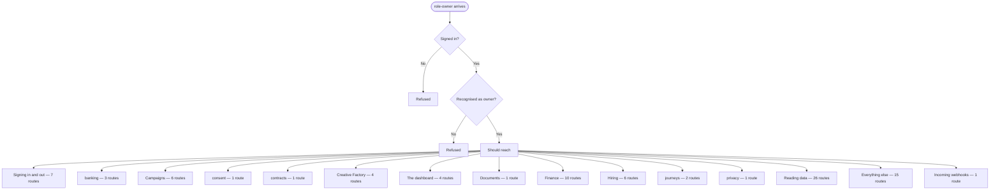

# role-owner — intended

> ⚠️ **WRITTEN AFTER THE FACT, NOT BEFORE IT.** CLAUDE.md §4 calls this file the
> hand-authored source of truth, checked against the code — and says agents do
> not write it, because an agent writing it would be authoring the very thing
> its own work is supposed to be checked against. This one is an explicit,
> one-time exception: the owner directed it be created from current behavior
> because none existed at all (`docs/journeys/README.md` recorded that gap
> from 2026-07-31 to 2026-08-02). It was generated on 2026-08-02 from the same
> extracted route data as [`role-owner-actual.md`](./role-owner-actual.md) —
> not from a product spec, a ticket, or anyone's independent judgment of what
> *should* happen. A match against `-actual.md` right now proves only that
> this file was copied from it, not that either one is correct. Replace this
> page's judgment calls with a human's the next time this journey changes on
> purpose — that is the point of having two files at all.

What a staff member with role `owner` should be able to do.

> **Who this is, in the code:** db/schema/001_init.sql — staff.role comment lists 'owner'

## In one picture

## Should be able to reach

- **Signing in and out** (7 routes) — should be reachable.
- **banking** (3 routes) — should be reachable.
- **Campaigns** (6 routes) — should be reachable.
- **consent** (1 route) — should be reachable.
- **contracts** (1 route) — should be reachable.
- **Creative Factory** (4 routes) — should be reachable.
- **The dashboard** (4 routes) — should be reachable.
- **Documents** (1 route) — should be reachable.
- **Finance** (10 routes) — should be reachable.
- **Hiring** (6 routes) — should be reachable.
- **journeys** (2 routes) — should be reachable.
- **privacy** (1 route) — should be reachable.
- **Reading data** (26 routes) — should be reachable.
- **Everything else** (15 routes) — should be reachable.
- **Incoming webhooks** (1 route) — should be reachable.

## Should stay blocked from

_Nothing — every route admitted this journey when this was written._

## Comparing this against reality

Run `npm run journeys` and read [`role-owner-actual.md`](./role-owner-actual.md). There is no automated
diff between the two files — CLAUDE.md §4 describes intended vs. actual as a human
comparison, and this repository has never built a machine check for it. Read both,
side by side, and treat any difference between them as a finding to report, not
something to silently fix in either file.

## Staff payout destinations (owner-approved 2026-11-02)

The People editor shows masked payout-bank status for an eligible closer or sales manager. Each employee links their own destination from their signed-in account menu. The owner view never shows Plaid credentials or changes the employee's bank. A bank link is not a money transfer, and the current commission Mark paid action only records a payout made outside Fundhub.

## Company cash workspace (owner-approved 2026-11-02)

Chris asked for his Fundhub LLC bank cash, exact CRS costs, reviewed ad replenishment and recurring tech expenses in one owner workspace, then directed the build and shared release. The owner opens Company cash from the account menu and returns through Team & payouts. Other staff, admins and clients cannot open company treasury or its APIs.

Bank connection is to the business account with explicit read-only consent and the owner session, without a separate Fundhub MFA prompt. The page keeps company bank data separate from client FinanceOS. Cash after tracked reserves stays unknown until the selected business bank and actual required costs are known. Exact posted-debit matching records a bill paid without moving money. Suggested recurring charges need owner review. No Colin recipient/rule, commission percentage or payout timing is invented. DOTS must use the business account; this build does not change its existing personal connection.

Loading, empty, failed and populated states must work on desktop and phone. The page must clear private data and stop callbacks when the owner session changes or loses access. Source, fixture tests and deployment are distinct from an actual connected bank or real payout.
