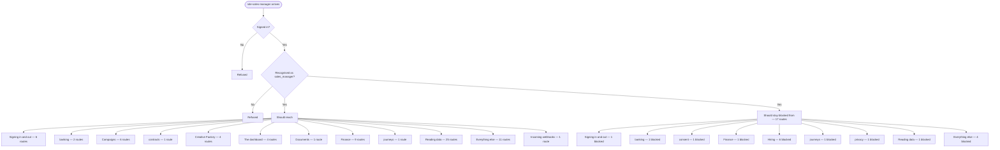

# role-sales-manager — intended

> ⚠️ **WRITTEN AFTER THE FACT, NOT BEFORE IT.** CLAUDE.md §4 calls this file the
> hand-authored source of truth, checked against the code — and says agents do
> not write it, because an agent writing it would be authoring the very thing
> its own work is supposed to be checked against. This one is an explicit,
> one-time exception: the owner directed it be created from current behavior
> because none existed at all (`docs/journeys/README.md` recorded that gap
> from 2026-07-31 to 2026-08-02). It was generated on 2026-08-02 from the same
> extracted route data as [`role-sales-manager-actual.md`](./role-sales-manager-actual.md) —
> not from a product spec, a ticket, or anyone's independent judgment of what
> *should* happen. A match against `-actual.md` right now proves only that
> this file was copied from it, not that either one is correct. Replace this
> page's judgment calls with a human's the next time this journey changes on
> purpose — that is the point of having two files at all.

What a staff member with role `sales_manager` should be able to do.

> **Who this is, in the code:** src/http/read-api.mjs — ROLE_SETS.STAFF and ROLE_SETS.FINANCE both include 'sales_manager'; the catalog row, the task-routing CHECK and the demo login come from db/migrations/112_sales_manager_role.sql. Built 2026-08-01 on the owner's instruction in Ticket 8, which supersedes the 2026-07-31 decision to defer it that this entry used to carry.

## In one picture

## Should be able to reach

- **Signing in and out** (6 routes) — should be reachable.
- **banking** (2 routes) — should be reachable.
- **Campaigns** (6 routes) — should be reachable.
- **contracts** (1 route) — should be reachable.
- **Creative Factory** (4 routes) — should be reachable.
- **The dashboard** (4 routes) — should be reachable.
- **Documents** (1 route) — should be reachable.
- **Finance** (9 routes) — should be reachable.
- **journeys** (1 route) — should be reachable.
- **Reading data** (25 routes) — should be reachable.
- **Everything else** (11 routes) — should be reachable.
- **Incoming webhooks** (1 route) — should be reachable.

## Should stay blocked from

- **Signing in and out** (1 route) — should stay blocked.
- **banking** (1 route) — should stay blocked.
- **consent** (1 route) — should stay blocked.
- **Finance** (1 route) — should stay blocked.
- **Hiring** (6 routes) — should stay blocked.
- **journeys** (1 route) — should stay blocked.
- **privacy** (1 route) — should stay blocked.
- **Reading data** (1 route) — should stay blocked.
- **Everything else** (4 routes) — should stay blocked.

## Comparing this against reality

Run `npm run journeys` and read [`role-sales-manager-actual.md`](./role-sales-manager-actual.md). There is no automated
diff between the two files — CLAUDE.md §4 describes intended vs. actual as a human
comparison, and this repository has never built a machine check for it. Read both,
side by side, and treat any difference between them as a finding to report, not
something to silently fix in either file.

## Payout bank (owner-approved 2026-11-02)

A signed-in sales manager may see and link only their own masked payout bank from the account menu when production Plaid Transfer is available. The owner sees bank-link status in People. A paid commission event may send a fixed, amount-free iPhone alert to the manager's registered device; the alert opens the sales workspace. Linking never sends money or changes a commission rate.
