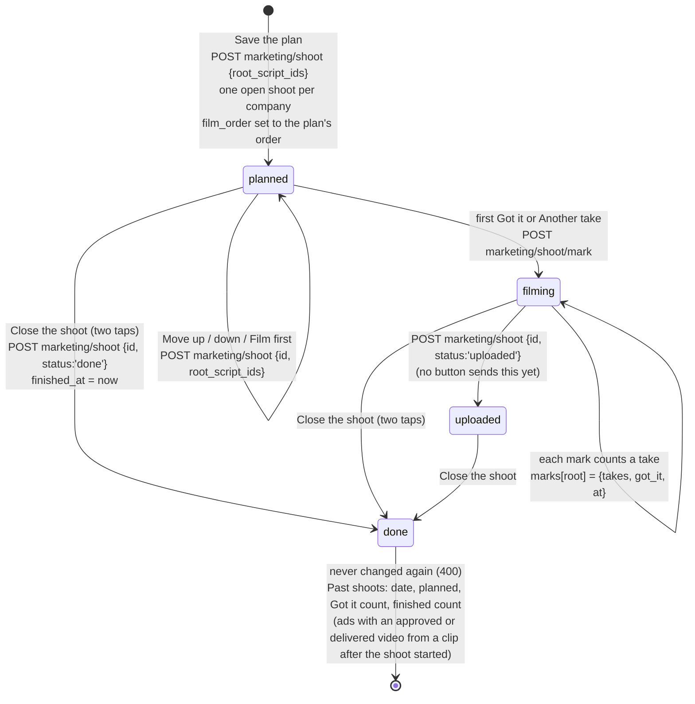
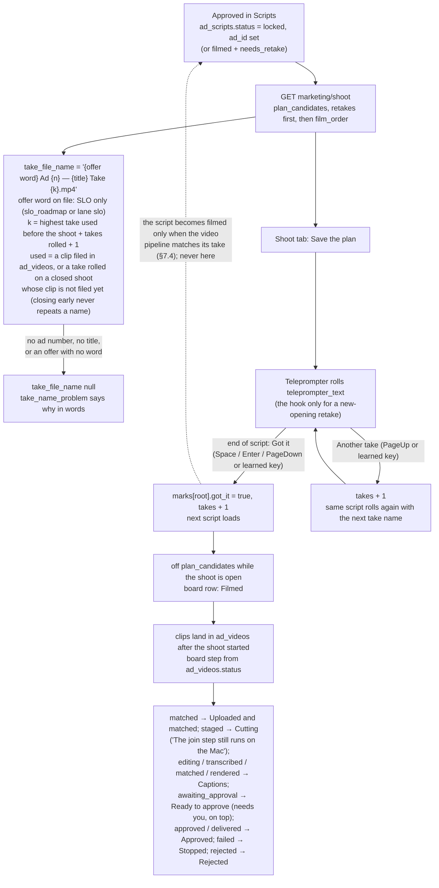
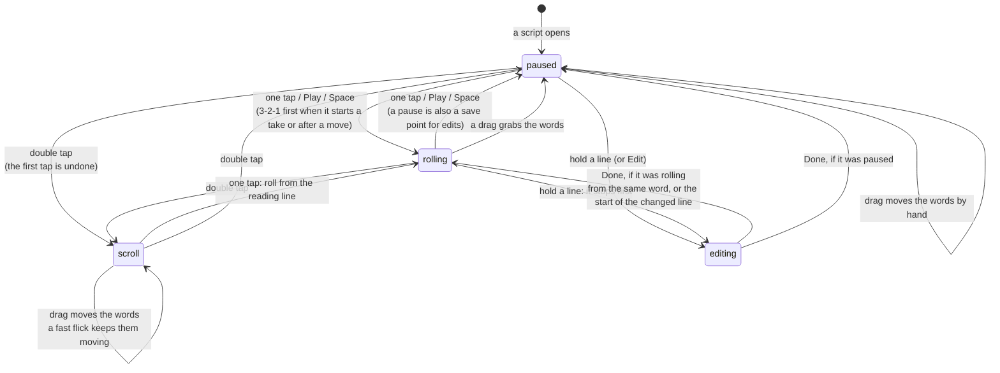
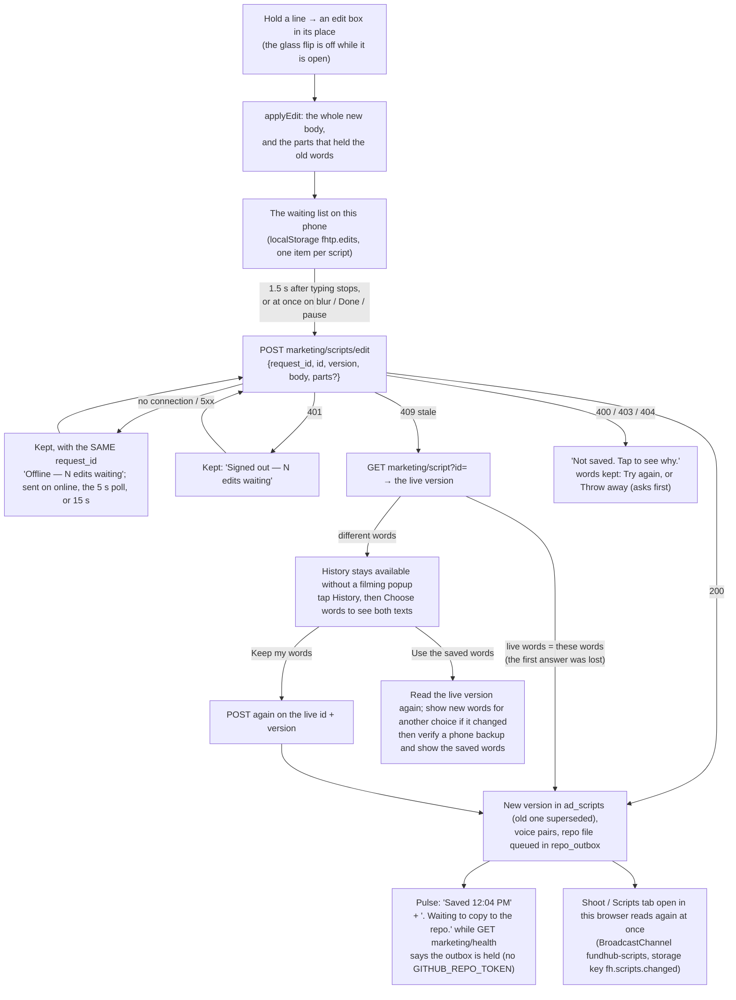

# Shoot Day flow (actual, from code)

Generated by hand from the code on branch `mm-x5-shoot-teleprompter` (unit X5), not from the spec, and extended on branch `mm-teleprompter-v2` (section 4). Files: `api/marketing/shoot.mjs`, `api/marketing/shoot/mark.mjs`, `src/marketing/shoot-store.mjs`, `src/marketing/shoot-plan.mjs`, `public/app/cc-tab-shoot.js`, `public/app/teleprompter.html` + `teleprompter.js` + `teleprompter-edits.js`, and the shipped edit route `api/marketing/scripts/edit.mjs` (`editScript` in `src/marketing/scripts-store.mjs`). Table: `marketing_shoots` (migration 411, U04).

Yardstick (the intended flow, per the plan's intended-journey note): spec `docs/specs/marketing-machine-2026-10-04.md` §1, §8.1, §8.2, the design `docs/specs/command-center-design-2026-10-05.md` §3.4, and the owner needs `docs/specs/teleprompter-requirements-2026-10-06.md`. No `-intended.md` file was read or changed.

Every arrow below is **UNVERIFIED on production**: proved in GitHub CI (scratch Postgres) and in a mocked browser only. Nothing is live until a ship.

## 1. A shoot, from plan to closed

## 2. One script on Shoot Day

## 3. Offline and repeats

- Every Save and every mark carries a fresh `request_id`. A repeated `request_id` answers the first save again and writes nothing (`withRequest`, `src/marketing/http.mjs`).
- The teleprompter keeps a mark it could not send (no connection, or signed out) in this phone's storage and sends it, with the same `request_id`, when the connection or the sign-in comes back. So a press is never counted twice and never lost.

## 4. The teleprompter v2: touch, edit on the fly, the change pulse

Owner needs, 2026-10-06. Same page, same routes: no route was added or changed. Proved in a mocked browser at iPhone (390 x 844, touch) and iPad (1024 x 1366, touch) sizes (`e2e/teleprompter-touch.spec.mjs`) and in unit tests (`src/ui/teleprompter.test.mjs`, `src/ui/teleprompter-edits.test.mjs`). **UNVERIFIED on a real iPhone or iPad and on production.**

### 4a. What a finger does (`gestureStep` in `teleprompter.js`)

Bluetooth remote and keyboard keys are unchanged (v1's keys, Learn remote). "Tap a word to start there" (spec §8.1, v1) is replaced by the owner's tap rule: drag the word to the reading line and tap.

### 4b. One edit, from the box to the repo

- The database version is the memory. The repo file follows through the outbox, which is held until `GITHUB_REPO_TOKEN` exists; the pulse says so.
- The save path does not filter by title or kind. Ads, VSLs, thank-you videos, and their variants all create the same next `ad_scripts` version and keep their stack fields.
- History (the History button, or tap the pulse): `GET marketing/script?id=` — every server version newest first, who (from `source`: Chris, The machine, An agent, Imported), when, the words out (red) and in (green), and "In the repo." / "Not in the repo yet." Edits still waiting on this phone and backups made when choosing saved words appear above the server versions. Choosing saved words reads the live version again; if it changed, the picker shows the new words and asks for another tap. If phone storage cannot verify the backup, the choice does not clear the phone edit.
- The 5-second shoot poll never redraws under the edit box, and an edit still waiting on this phone wins over what the server sends. Words changed elsewhere redraw only while nothing rolls, keeping the place.

### 4c. The rig

- iPad (wider than 700 and taller than 600): 64 px words by default, one row of controls, every sheet opens as a side drawer. Phone on its side: one slim row.
- Mirror left-right and the optional upside-down flip stay per device (localStorage `fhtp.settings`), with the new Line width setting.
- Dark glass: black, white words, a red reading line. The pulse row (take file name, save status) never hides, even while it rolls.
- Next script (in film order, no mark) sits beside Play.

### 4d. The tiny script button

The button on the thin line under the words (`#p-file`, left side). One tap does nothing. Two taps open `#qmenu`: the scripts still to film (`filmQueue`, no Got it). The list scrolls. A tap on a title loads that script with the camera still recording (`open(i, true)`). Opening the list does not call `markThis`. The script he left stays in the queue.

Owner change, 2026-10-12: each row uses the offer-stack label from `offer_word`, `stack_kind`, and `stack_no` (for example, `Direct Book VSL 1`) instead of the tracking ad id. The current row has a red inset mark, `Current` text, and `aria-current`. **Complete** names that exact current label and angle before the confirmation. Cancel leaves the script and recording alone. Confirm stops the words and recording, queues one `got_it` mark, and opens the next unfinished script (or the shoot-done card).

### 4e. The video decision after each recorded take

`onRecStop` collects the original recording bytes into a named File (`keepFile`) and opens the modal `#take-save`. The modal shows the captured take name, a local video player that does not autoplay, and **Save to phone**. That button gives the same File to the phone's share sheet or browser download. **Yes** commits the File to IndexedDB on this phone before the existing POST/PUT `/api/marketing/shoot/take` upload starts in the background. **No** drops the pending File from the app without queuing or uploading it; a copy the owner already chose to export remains with the phone. Uploads run one at a time; accepting a second take while the first saves keeps both Files in order. A restart callback waits for the decision. A pause or an edit still keeps the camera recording and opens no video decision.

After Yes, **Watch** in the pulse row opens the last accepted File for local playback or another phone export, even after its Drive upload cleans up the queue in this open page. Reopening the page offers Watch for the latest take still in the IndexedDB upload queue. A completed Drive upload is not retained in that queue, so Watch does not survive a later page reload for that take. Closing either player pauses it and releases its object URL. Viewing or exporting does not start, stop, or queue a take.

Video upload state now uses the small top-right `#video-save-status` chip. It says saving, saved, or that Drive failed while the file remains on the phone. It does not use the large bottom filming toast.

### 4f. Front and rear camera

The 44 px top-left camera button switches the live preview from the mirrored front camera to the normal rear camera, then back. It never starts recording. A take that is already recording keeps one stable canvas recording stream while the physical camera changes, so a front/rear/front take stays one file. The recording clock moves beside the camera button. In portrait, the preview shows the whole camera frame instead of enlarging and center-cropping a wide iPhone feed; the black glass fills any spare space.

Owner repair, 2026-10-13: full 4K output uses a WebGL surface when available; Ads and smaller output retain the existing 2D canvas path. The GPU painter fits the full source frame and mirrors only the front lens. It preserves the same recording track across camera switches and releases its shaders/texture when the take stops or recording fails. If GPU setup is unavailable, the existing 2D path remains. The saved diagnostic report includes bounded `capture_mode` (`webgl` or `2d`) so original Drive files can be compared. A real desktop WebKit encoder comparison is playable and faster; real iPhone cadence remains unverified.

Safari displays the live camera in screen orientation, so the camera layer stays unrotated on both lenses even when the reported camera frame is wide. The words and buttons stay in their normal positions. The page requests the camera's full wide frame and does not force tall constraints after opening it. The saved canvas separately chooses a tall or wide file from the phone's orientation angle at Record. It fits every source pixel inside that file without stretching or turning the person sideways. If Safari gives a wide frame for a portrait take, the file has black space above and below the full image and the page reports that the selected portrait detail is unavailable.

When iPhone Safari grants a requested lens but leaves `MediaTrackSettings.facingMode` blank, the page keeps the requested front/rear direction. It does not mistake the rear lens for the front lens and reopen the front camera.

Desktop first asks the live video track to change lenses. iPhone releases the current lens and makes a direct `facingMode: exact` request for the other lens, then tries its saved exact device id. A new preview gets three start tries while its metadata arrives. Safari rejecting those early `video.play()` calls never makes the app discard the working rear stream. The words and the same black glass stay above either camera view. The flip action runs on `pointerdown`; its later click is swallowed, and Record ignores any ghost click for 500 ms. Recording paints a mirrored front-camera file and an unmirrored rear-camera file into the same canvas during a lens flip. Front-camera Ads target native portrait 1080p at 60 fps; VSLs, thank-you videos, and testimonials target 4K at 60 fps. The recording canvas keeps every fresh frame from a granted 60 fps source in either mode. A lower granted or encoded rate fails the saved-file quality target. The canvas draws only new camera frames when the browser offers video-frame callbacks. The word speed and word position do not change when Record starts. Actual saved frame rate must be measured in a new iPhone take.

An upright Ad rejects a wide camera result before showing it. It tries the 1080p modes first and uses the earlier full-portrait 4K front-camera mode only if Safari gives no upright 1080p source; the Ad's saved canvas stays 1080p. Recording keeps each fresh camera callback when the recording budget can keep the granted source rate, so callback timing variation cannot halve a steady 60 fps source. When reducing a source faster than the 60 fps recording budget, it uses advancing presentation timestamps; it does not depend on a live stream's `mediaTime` advancing. After each successful paint, it explicitly requests canvas capture when supported, retaining timed capture as the fallback. An omitted camera frame-rate setting keeps the 60 fps recording request for both modes. After Stop, the camera line reports presented camera frames per second, copied frames per second, missed callbacks, and the longest callback gap. Presented-frame counts reveal camera frames whose JavaScript callbacks were missed; callback counts alone cannot prove a slow camera. The encoded frame rate still needs the saved file checked.

Each completed take also keeps its own recording measurements: elapsed time, granted start/end camera settings and preview size, lens changes, presented/copied frames, missed callbacks, frame-request support/count/failures, canvas size and target rate. These optional measurements travel with the accepted file in IndexedDB and the upload POST. The server allowlists bounded numeric, boolean and facing values into the Drive file's description; old takes and invalid reports still upload. The video chunks remain the original bytes. A new take must not overwrite an older queued take's measurements. This allows the agent to compare the phone's actual recording stages with the decoded Drive MP4.

If camera access fails, the retry notice stays in a small top-left box and never takes taps or drags away from the script. During a double-tap word edit, **Copy script** copies every current paragraph as one clipboard value, including words typed but not saved yet, so the full script can be pasted into Claude. It uses the browser clipboard first and an iPhone selection fallback when that API is unavailable.

The existing `counted` flag from merged PR #27 still limits 3-2-1 to the first play of an opened script. Pause, seek and resume do not reset it. `steadyPace`, cached reading-line measurements, and fractional `translate3d` scrolling are unchanged; checks now cover 200, 205, 210 and 215 WPM. The camera shade is `rgba(0, 0, 0, 0.558)`, 10% lighter than 0.62. These changes remain **UNVERIFIED on production** until deployed.

## 5. The film link (no login on the teleprompter)

The Shoot tab, while a staff owner or admin is signed in, gets `film.path` on `GET marketing/shoot`. That path is `/app/teleprompter.html?k=<token>`. Open the teleprompter and Roll it use it. The phone sends the key as the `x-shoot-film` header and does not send the staff session.

The key is an HMAC (`f1|org|shoot|exp`) over `DOCUMENT_URL_SECRET` (or `FILM_URL_SECRET`). It lasts 7 days. It dies sooner when that shoot is closed, because the read only returns the shoot the key names. It can `GET marketing/shoot`, `POST marketing/shoot/mark` for that shoot, `POST marketing/scripts/edit` for a script on that shoot, and save a video through `POST` and `PUT marketing/shoot/take`. That save puts the original file in the SLO Ads Drive folder. It cannot save the plan, close the shoot, or open any other route. A bad key is a not-found, not a login page.

## Gaps against the intended flow (findings, not fixed here)

1. **Offer word for Book a call.** `marketing/ads/NAMING.md` names only `SLO`. Scripts for the `funding_dfy` offer (the `book_call` funnel) show "file name unknown" until Chris names a word. Safe default: no word is made up.
2. **The board's Assign, Retry and Use this cut / Re-film** (design §3.4) need `POST marketing/videos/assign|retry|hold-choice`, which are the Videos unit's routes. The board says so in one sentence; `can_retry` is always false.
3. **Animations and Loaded** steps (spec §8.2 table) have no `ad_videos` state yet (9.1a states `cut`, `animated`, `loaded` are not in migration 389). No row can reach them.
4. **A merged take shows under its master** (spec §8.2): joined takes are left off the board, not drawn under the master.
5. **Teleprompter tabs** (spec §8.1: Inbox, Shoot Day, Videos, Ideas, Rules) are not on the teleprompter page; those jobs live in the Command Center tabs (design §3.0). The page links back to the Command Center.
6. **Service worker, `window.FH_API_BASE` and the app's own sign-in form** (spec §8.1, for the iPhone app) are not built: there is no app yet. The page keeps its last answer in this phone's storage and rolls from it when offline.
7. **The shared review module** `public/app/marketing-review.js` (design §3.0) does not exist yet; the tab and the teleprompter each write their own request ids and offline queue.
8. **The Shoot tab is not on the page yet.** `public/app/cc-tab-shoot.js` registers with `window.FundhubCC` (the tab contract, `docs/specs/command-center-tabs.md`); the integrator adds its `<script>` tag when the frame (U34) lands.
9. **Past shoots show no loaded count** (design §3.4 item 7). Date, planned, Got it and finished are shown; loaded waits for a loaded state in `ad_videos` (same cause as gap 3). No number is made up.
10. **Another device hears a saved edit late.** The Shoot and Scripts tabs read again at once only in the same browser. On another device they read again when the tab is shown, when the page comes back after a minute away, or on the 5-minute reload. There is no server push.
11. **Real iPhone camera proof.** The web page has the front camera, rear-camera switch, mirrored-front recording canvas, preview fade, and 4K request. Browser tests prove the switch and one-recorder flow. A real iPhone still decides the size and frame rate it grants, so that device proof remains open.
12. **Long press opens the keyboard on finger-up.** iPhone Safari opens the keyboard only inside a touch, so the edit box shows at once and the keyboard opens when the finger lifts (tapping the box also opens it). Not yet tried on a real iPhone.
