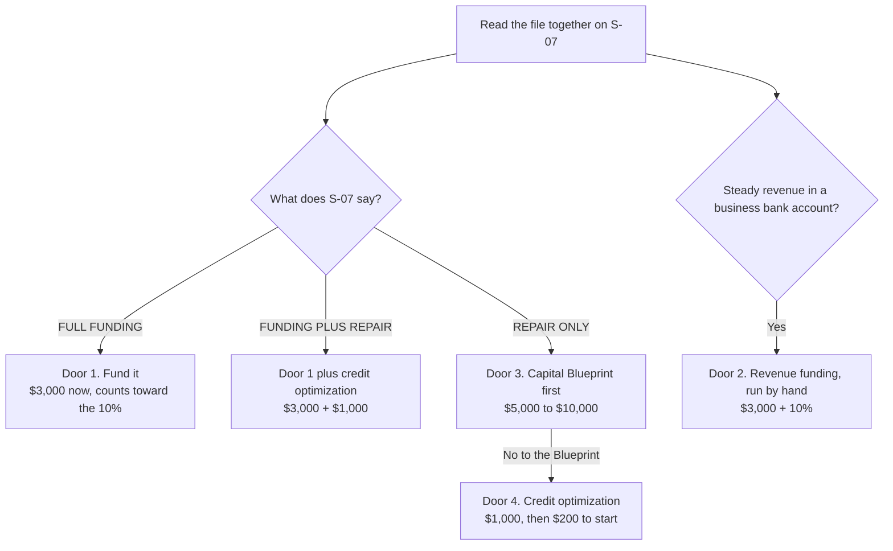

# Sales call operating notes — the branch close

**Read-aloud script:** [04-sales-call-script-spoken.txt](04-sales-call-script-spoken.txt). That file contains the words for the call and objection replies. This page is the staff reference behind it.

Drafted 2026-10-29. It rebuilds the sheet a Cursor chat compiled earlier the same day. It is built from three places: Cole Gordon's closer course, Fundhub's own sales files, and the live Present deck. The steps are Cole's. The words are Fundhub. Nothing from Cole's course is copied here, because this repository is public.

The setter part is `02-setter.md`. This page starts when the setter hands off.

**The idea:** find out where they are. Pull the file together. The file picks one door. Sell that door, and only that door.

The 2026-10-29 version is live on fundhub.ai. This 2026-11-01 rewrite remains on the sales-script branch until shipped. Chris's decisions are at the bottom, under **Open calls for Chris**.

## The call in spoken order

1. "What are you trying to fund, and what has stopped you?" Get the goal, amount, use, timing and who decides.
2. "What happened the last time you tried?" Get their actual cost of waiting and why they booked now.
3. "Let's pull your file together, so we're working from what is there today." Send the $32 soft pull and stay on the call.
4. "Here's what your file supports today, what is holding it back, and the order I'd work on it." Show the file, then pick one offer that fits.
5. "Does that plan make sense for the goal you gave me?" Resolve plan questions before the price.
6. State the price and agreement terms. Be quiet. If they hesitate, use section 9 for the concern they name.
7. If they start, read the agreement, send the matching pay link, confirm payment, and give the first step. If they wait, book a real follow-up.

## The call on one page

| Part | About | The job | Present |
|---|---|---|---|
| 0. Before the call | 5 min | Read the setter note and the survey. Guess the door. | Closer Dashboard, cockpit |
| 1. Open and frame | 3 min | Hello. How the call goes. The yes-or-no deal. | S-01, S-02 |
| 2. Stuck part and goal | 10 to 15 min | Six boxes, in their words. | S-03, S-04 |
| 3. Pull the file | 5 min | The first yes: the $32 pull. | S-05, S-06 |
| 4. Read the file | 10 min | How much they qualify for today, after the fixes, and what is left on the table. | S-07, L-01 (the money levers) |
| 5. Pick the door | 1 min | The file picks. They agree before any price. | S-08 (your path) |
| 6. Show the door | 5 to 10 min | The promise, three steps, how it runs. | S-09 to S-16 and C-01 (more companies), or B-01 to B-04 (B-03 is the Blueprint dashboard) |
| 7. The ask | 2 min | Check the plan. Then the price. Then quiet. | S-17 to S-22, or B-04 |
| 8. Money | if needed | Same offer, different pay terms. | — |
| 9. Objections | if needed | Lock the plan, isolate, answer, ask again. | — |
| 10. Paperwork | 5 min | Agreement, pay link, paid on the call, log it. | S-23, S-24 |

## The doors

| Door | Who | Offer | Price | How they pay |
|---|---|---|---|---|
| 1. Fund it | S-07 says FULL FUNDING | Funding, done for you | $3,000 today. It counts once toward 10% of confirmed approved limits or amounts. | Cash. No plan. |
| 1 plus repair | S-07 says FUNDING PLUS REPAIR | Funding plus credit optimization | $3,000 plus $1,000 | Cash. |
| 2. Revenue funding | Steady revenue, 6 months or more in business, 3 months of bank statements | Funding, done for you, run by hand | $3,000 today, credited once toward 10% of confirmed approved limits or amounts | Cash. |
| 3. Capital Blueprint | File not ready. Always offered first. | Capital Blueprint, 12 months | $5,000 to $10,000, whole dollars, default $5,000 | Paid in full, or financing through Whop |
| 4. Credit optimization | File not ready, and they said no to the Blueprint. | Up to six rounds, done for you | $1,000, or $200 for one round | Cash. Review a separate agreement and price before a later upgrade. |

**Chris's rule (2026-10-29):** always offer the most expensive product that fits their goal first. Step down only on a no.

## 0. Before the call — 5 minutes

1. Open the Closer Dashboard: https://fundhub.ai/app/closer-dashboard.html. Find the client.
2. Read the setter note: the stuck part in one sentence, the goal in one sentence, computer ready yes or no.
3. Read the survey on S-03: how much they want, what it is for, what it changes, the score they think they have, how old the business is (or "personal funding only"), the yearly revenue range, whether they can verify revenue (bank statements, tax returns), their income, and capital on hand.
4. Write down your first guess at the door. The file decides on the call. The guess only tells you what to listen for.
5. Open the call cockpit: https://fundhub.ai/app/closer-call.html. Read past texts and notes.
6. Open Present, the screen-share deck, on this client: https://fundhub.ai/app/present.html. Do not share the screen yet.
7. Reset for two minutes. Breathe. Let go of the result. Your job is to find the truth about their file and say it straight.
8. Have your note sheet open in call order: stuck part, numbers, why they can't fix it alone, cost of waiting, goal, who else decides, the door.

## 1. Open and frame — 3 minutes

Say it like a person. Keep your voice level. Do not let a line rise at the end unless it is a question.

1. **Hello.** "Hey, is this [Name]? Hey [Name], it's [your name] with Fundhub. Good to finally meet you."
2. **One light question.** "How's your week going?" Keep it short. No sports, no life stories.
3. **Time and setup.** "We've got about [length] together. You still good on time? Are you at a computer? Grab a pen and paper, and have a card handy for the file pull."
4. **Recording.** "Quick heads up: this call is recorded, so nothing gets missed."
5. **The frame.** "Here's how I run these, so this is worth your time. First, I want to hear what you're going for and what's been in the way. Then we pull your file together, right here on the call. It's a soft pull, so your score does not move. Then I show you what the file says: how much you qualify for based on where you're at right now, and what's holding the rest back. If we can help, I'll show you exactly how. If we can't, I'll tell you that too, and point you the right way. Sound fair?"
6. **The end-of-call deal.** "At the end, I'll ask if you want to move forward. A yes is great. A no is fine. Just tell me straight either way. Deal?"
7. **Who else decides.** "Is anyone else part of money decisions for you, like a spouse or a business partner? Are they around? It helps if they hear this too."
8. **The first real question.** "So tell me. What's the biggest thing that's been in the way of getting this funding?"

Get "sounds fair" before you move on. It stops them from jumping straight to the price later.

## 2. Find the stuck part and the goal — 10 to 15 minutes

By the end you know six things, in their words. Check each box on your sheet.

| Box | You know it when |
|---|---|
| Stuck part | They named the one thing in the way, and you dug into it. |
| Numbers | You have how much they want, what the business brings in each month, and what the stuck part costs each month. |
| Why not alone | They said why they have not fixed it themselves. |
| Cost of waiting | They said why now, and what happens if nothing changes. |
| Goal | You have the amount, why that amount, and what it changes for them. |
| Who decides | You know if a spouse or partner is part of it. If they are and they are not on, see "I need to talk to my spouse" in section 9. |

How to ask:

- One short question at a time. After they stop, wait 2 to 4 seconds. They will keep going.
- Do not coach. Do not fix it yet. That comes after the file.
- Ask even when you think you know. Their words beat yours.
- The setter already got the basics. Say them back and confirm. Do not make them tell the whole story again.
- Type the monthly cost into the cockpit's monthly-cost box. S-20 uses it. Put the incorporation date in its box too.

Pick the order:

- **Business owner who has been denied or stuck** (most calls): start with the stuck part.
- **New business, a startup, or "I don't know where to start"**: start with the goal.

**Start with the stuck part:**

1. "The note says [stuck part]. Tell me more about that."
2. "What happened the last time you applied? When was it? How many places?"
3. "What do you think is causing it?"
4. "Besides that, is anything else in the way?"
5. "How long has the business been open? What does it bring in a month, through the business bank account?"
6. "Is the business set up in its own name, with its own bank account?"
7. "Where do you think your score is right now? Any cards that are pretty full? Anything on there you know about, like a late payment or a collection?"
8. "What have you already tried to fix this? What happened?"
9. "What is this costing you each month? Jobs you can't take, ads you can't run, a hire you can't make?" Say it back: "So about [amount] a month. Does that feel right?"
10. "Has it hit anything outside the business? Stress at home?"
11. "Why now? What made you book this week?"
12. "If nothing changes, where are you a year from now?"
13. "If we got this handled, how much do you need? Why that amount? What does that money do, step by step? And what does that change for you?"
14. "Who else is part of a decision like this? Do they know you're on this call? What would they say?"

**Start with the goal:**

1. "The note says you're going for about [target] for [use]. Walk me through the plan."
2. "Why that amount? What does it change for you?"
3. "Where are you with it right now? Is the business open? Its own bank account? Any revenue yet?"
4. "What made you take action now?"
5. "What has stopped you from doing it already?"
6. "What have you tried so far?"
7. "Three things decide how much a bank gives you: your personal file, whether the business is set up so a bank sees it as established, and which banks you apply to, in what order. Where do you think you are on each one?"
8. "Who else is part of a decision like this? Do they know you're on this call?"

No business yet: "You do not need a business to work with us. Funding can come in your own name, a business name, or both."

If the goal is small next to what they need: "Is that what you need, or what you think you can get?" Do not assume a bigger loan is better. Ask how much they will use now, what they can repay, and whether unused credit would help them keep card use low. Use the small-target talk-off in section 9 only if the file supports more.

**Listen for the door.** Write these down when you hear them.

- Steady revenue through a business bank account: write the monthly amount and how long it has run (Door 2).
- Full cards, late payments, collections, a lot of recent applications: the file is not ready yet.
- "I want to learn how this works," "I want to do it right," more than one business: the Capital Blueprint fits well.
- "Just fix it for me," "I don't have time": still lead with the Blueprint. Expect to step down to the $1,000.
- "I need it in a few weeks": speed matters.

**Close the questions:**

"I'm out of questions. Is there anything else I should know before we look at your file?"

Then say it back: "So let me make sure I have it. You want [goal] so you can [what it changes]. What's in the way is [stuck part]. You tried [what they tried]. And waiting costs you [cost]. Did I get that right?"

Wait for the yes. If they fix something, write it down and say it back again.

## 3. Pull the file together — 5 minutes

This is the first yes of the call.

1. **The bridge.** "This is exactly what we work on. Right now, we're both guessing. Your file knows why [stuck part]. Let's go see what it says."
2. **The pre-frame.** "If the file shows a clear path, are you ready to move on it today, or are you still looking around?" Write down the answer. You will use it in section 7.
3. **What it is.** "I'm sending you a link right now. It's a soft look, not a bank application. Your score does not move, and no lender sees it. It's $32. It pulls your file from the bureaus, and our system reads it the way a bank does. Applications come later, on a plan."
4. **Send it.** In Present, on S-05, click **Send soft pull ($32 + approval form)**. They get a text and an email.
5. **Stay with them.** "Open the text I just sent. Approve it, then the $32. I'll stay right here." Stay quiet while they fill it in. S-06 shows while it runs.
6. **If they ask why it wants their details:** "That's what the bureau needs to find your file."
7. **If they push back on the $32:** "Fair question. Almost every application you send is a hard pull, and each one costs you. This is $32 to see exactly what a bank sees before you send another one. The reports are yours either way."

If they already did the pull before the call, skip to section 4.

## 4. Read the file together — 10 minutes

Share your screen in Present. Go to S-07.

The headline reads "How much you qualify for today." Lenders decide. Say it this way:

1. **Outcome first.**
   - Funding file: "Here's how much you qualify for based on where you're at right now: [amount on screen]."
   - Repair file: "Here's what's holding the file back: [the count on screen]. Cleaned up, the file shows [the amount on screen]."
   - Then: "The difference between today and the cleaned-up file is what's left on the table right now."
2. **The why.** Walk the three to five things the screen shows are holding the file back. For each one, say what it is in plain words, and what it costs, from the screen.
3. **Let them say it.** "What jumps out at you?" "Did you know about that one?" Wait. When they say the problem out loud, it is theirs, not yours.
4. **Tie it to the goal.** "You said you need [target] for [use]. Today the file shows [amount]. So there are three ways to go: fund what's there now, fix the file first, or both."

Read the amounts off the screen. Never round up. Never say they are approved. Never say a bank will give them an amount. Never name a bank as one that will approve them. If they ask if that means approved: "That's what your file supports today. The bank still decides."

## 5. Pick the door

The file picks first. Then what they told you about the business. You sell **one** door. Always lead with the most expensive door that fits their goal, and step down only on a no.

**Step 1. Read the tier on S-07.** The "Route the call" box beside the slide in Present says what the engine found.

| S-07 says | What the file shows | Door |
|---|---|---|
| FULL FUNDING or PREMIUM STACK | Every bureau clean. Cards under 30%. No open negatives. 3 or more accounts. | Door 1. Fund it. |
| FUNDING PLUS REPAIR | Part of the file is clean enough to fund now. The rest needs work. | Door 1, plus credit optimization. |
| REPAIR ONLY | A charge-off, a collection, an open bankruptcy or a 90-day late, and no clean bureau. | Door 3 or Door 4. |
| No tier, or a fraud hold | The engine did not find a score to read. | No funding. Use the repair screens. Tell Chris after the call. |

**Step 2. Add the business side** (from section 2 and S-03).

- Steady revenue through a business bank account, 6 months or more in business, and 3 months of bank statements: Door 2 fits. It runs by hand for now.
- A business under 12 months old: the engine cuts business card amounts in half. Check the incorporation date on the state record. Do not take their word for it.
- S-03 shows the survey's yearly revenue range. Ask the monthly amount out loud.

**Step 3. File not ready? Lead with the Blueprint.**

- Offer Door 3, the Capital Blueprint, first. It is the most expensive door that fits.
- If they say no, step down to Door 4: the $1,000 credit optimization, then the $200 round one.

**Name the door before any price.** "Based on what your file shows, here's where you are, and here's the path that fits." They have to agree with the door before they hear a price. If they push back on the door, handle it right there, on S-08. Never handle it at the price.

The system never blocks a sale by tier. So the door is on you. The route buttons on S-07 change it. Change it only when the file gives you a reason, and write the reason in your notes.

The **EDUCATION PATH** button on S-07 is Capital Academy. It is off until it is filmed (Chris, 2026-10-29). Do not use it.

## 6. Show the door

Every door has the same shape. First the promise: the steps that get them from where they are to what they want. Then each step: their problem in their words, what Fundhub does, and what it gets them. Then how it runs after they pay. Check in after each step: "Make sense?"

### Door 1. Fund it

**Who:** S-07 says FULL FUNDING, or FUNDING PLUS REPAIR.
**Offer:** Funding, done for you. **$3,000 today.** It counts once toward the 10% success fee. When funding is secured, the fee base is confirmed approved limits or amounts, including credit access the client has not drawn. The remaining fee is due as approved funds or credit access are received. If no funding is secured, no back-end success fee is due. Read the agreement's exact terms on the call.
**Slides:** L-01 (the money levers) and S-08 (your path), then S-09 to S-16 and C-01 (more companies, more funding), then S-17 to S-22.

1. **The promise.** "Here's the plan. Three steps to get you in front of the banks that match your file, in the right order. Want me to walk you through it?"
2. **Step one: clean before we apply.** "You told me you got [denied / stuck] last time. Here's why. You applied blind, and every application was a hard pull. So first we set your card balances to the targets your file shows. Between rounds, we dispute the new inquiries. Make sense?"
3. **Step two: the right banks, in the right order.** "Our system matches your file to the banks that fit it. We apply in rounds. One funding sequence is about six rounds. Your personal file first. Then each business, on its own. Make sense?"
4. **Step three: done for you.** "The Fundhub team runs every application and every follow-up. You run the business. Make sense?"
5. **How it runs.** "Once you sign, your funding advisor starts on your file within 24 business hours. Your first applications go out within 72 business hours."
6. **The menu, on S-16.** Take their order for what is live: business cards, personal cards and personal loans, plus lines of credit, term loans and revenue-based funding off bank statements or tax returns (Door 2, run by hand). SBA and equipment loans are not live yet.
7. **Say these, then check the boxes in the cockpit:**
   - "Business cards carry a personal guarantee. If the business can't pay, you're on the hook. The bank sets that rule."
   - "Intro rates end. Each card's terms show the month. We plan for that month before you spend."
   - "The bank decides, not us. We pick the banks and the order. They say yes or no."
   - Check the incorporation date on the state record.

**Funding plus credit optimization.** For FUNDING PLUS REPAIR files. "Part of your file is ready now. We fund from the clean side, and we clean up the rest at the same time, so your next round is bigger." $3,000 plus $1,000, cash. On S-23, send the $3,000 link, then the second button, **Send credit optimization pay link · $1,000**.

**The math, only with a real amount.** Read it off S-20 and the agreement. Example only, not a promise: $75,000 in confirmed approved limits or amounts, 10% is $7,500, $3,000 already paid, $4,500 remaining as approved funds or credit access are received. The fee is not limited to what the client draws. Do not promise a deposit refund when the success fee is smaller; read the signed terms.

### Door 2. Revenue funding (run by hand for now)

**Who:** steady revenue through a business bank account, 6 months or more in business, and 3 months of business bank statements. Credit not ready: fund the business now, and fix the file. Credit ready: fund it all, cards and revenue.
**Offer:** funding, done for you, on the same funding agreement. **$3,000 today plus a 10% success fee based on confirmed approved limits or amounts when funding is secured; the deposit counts toward that fee.**
**How it runs for now:** the client uploads bank statements or tax returns in the portal. The team packages the file and emails it to the lender. The lenders are in `FUNDING SHEET (business).xlsx`. The button that sends it automatically is on hold.

1. **The promise.** "Two moves at once. Funding based on your business revenue now, and your personal file fixed so your next funding sequence is bigger."
2. **Step one.** "Some lenders look at what hits your bank account first, not only your score. We match your business to them."
3. **Step two.** "At the same time, we fix your file." Lead with Door 3. Step down to Door 4.
4. **Step three.** "Then we fund off the clean file in your next funding sequence."
5. **Must say.** "Revenue funding costs more than a card. Read the rate and the payment schedule before you sign."
6. **What they need:** bank statements or tax returns (they upload them in the portal), time in business, and the EIN. The survey's "Can you verify revenue?" answer on S-03 tells you what they have.

### Door 3. Capital Blueprint

**Who:** every file that is not ready. Offer it first, because it is the most expensive door that fits.
**Offer:** Capital Blueprint. **$5,000 to $10,000**, a whole-dollar price you pick. You set the price; there is no rule (Chris, 2026-10-29). The default is $5,000. 12 months included. No renewal charge.
**Slides:** press Next from S-08. A file that is not ready walks B-01 to B-04, where B-03 is the Blueprint dashboard the client watches you click through. On S-19, **Capital Blueprint** is the first button. Then S-23.

1. **The promise.** "Here's what I'd do with this file. A 12-month plan, built from your own report. It tells you exactly what to do, step by step, until your file and your businesses are ready to fund."
2. **Why it's different.** "A course teaches you. The Blueprint makes the calls on your own file, and it keeps you moving."
3. **Step one: the personal file.** "Pay each card down to the target your file shows. For you, that's [card] from [balance] to [target]. Don't open new credit. Mail the dispute letters for the items on your file. Upload the proof. Then upload what the bureaus send back." Read the cards and the items off the roadmap. Never invent one.
4. **Step two: the businesses.** "File the LLC. Get the EIN. Open business checking. Each business is judged on its own, after your personal file is ready. Business one gets ready first, then business two."
5. **Step three: the money and the banks.** "Your bank and lender match list, from your file, and the order to apply. FinanceOS shows every account and every due date on one page."
6. **How it runs.** "It runs 12 months. Every step has a due date. An AI coach watches your open step. The Fundhub team does what a person has to do. When the system says your file is ready, we call you about funding."
7. **What they get, on B-02.** Credit analysis, the dispute letter pack, the roadmap, How Much You Qualify For, the bank and lender match list, and 12 months of FinanceOS. One spouse or partner file is included.
8. **The price, on B-04.** "That's the whole plan, for 12 months. It's [price]. Want to get started?" Financing is open through Whop.

Never promise an approval, an amount, a score or a removal. Never promise the date of the first monthly pull, or when the file will be ready. FinanceOS accounts are typed in for now, so do not promise a bank connection. Skip B-05. It has no checkout.

### Door 4. Credit optimization

**Who:** the file is not ready, and they said no to the Blueprint.
**Offer:** Credit optimization, done for you, up to six rounds. **$1,000 when signed.** Or **$200** for one round. A later full-program purchase uses a separate agreement and price; checkout has no automatic $200 credit.
**Slides:** the repair path, S-09 to S-16. S-15 is the six-round journey with their own items. On S-19, after **Capital Blueprint**, the buttons are **Onboard now: full done-for-you** and **Trial: first round done-for-you**.

1. **The work.** "We review the items on your file, prepare disputes the facts support, track the bureau replies, and use those replies to plan the next step. The full service covers up to six rounds."
2. **Step one: round one goes out today.** "The letters are built from the pull we just ran. You'll see them in your dashboard."
3. **Step two: each round builds.** "We read the bureau's answer before deciding the next supported step. A bureau round usually takes about 30 to 45 days."
4. **Step three: you watch it happen.** "Every dispute and every answer shows in your dashboard."
5. **The price.** "Up to six rounds, done for you, is $1,000 when you sign. Want to get started?" If no: "Then start with one round for $200. If you want the full program afterward, we'll review that agreement and price before you decide."

Describe the process only. Never promise a removal, a score or a result.

### No door today

They keep the $32 report. Go to **If they do not buy today**.

## 7. The ask

1. **Questions first.** "Before I show you how to start, what questions do you have?" If they ask one: "Good question. What made you ask?" Then answer.
2. **Check the plan, not the price (S-17, S-18).** "How do you feel about this plan for your file?" A sure answer in a sure voice: move on. Anything else: "On a scale of 1 to 10, how sure are you this is the right plan for your file?" Under 8: "What would make it a 10?" Handle that. Ask again.
3. **What happens next, before the price.** Say the first step of their door from section 6. They should picture day one before they hear a price.
4. **The guarantees (S-21).** Funding only: read G-01 and G-02 word for word. They are the two in the agreement in the CRM. Blueprint and credit optimization: no guarantees from S-21.
5. **The ask (S-19 to S-22).** One line that ties the price to their goal. Then: "Want to get started?"
   - Funding: "To get you in front of the right banks in the right order, it's $3,000 today. That counts toward the 10% success fee. The fee is based on the bank limits or amounts we confirm as approved, even if you don't draw the whole line. The rest comes due as that credit becomes available. Want to get started?"
   - Blueprint: "For the whole 12-month plan, built from your file, it's [price]. Want to get started?"
   - Credit optimization: "For all six rounds, done for you, it's $1,000. Want to get started?"
6. **Stop talking.** Count to four in your head. Let them talk first.
7. **A clear yes.** "Let's get you set up." Go to section 10.
8. **A soft yes** ("I guess," "yeah, ok"). "You sure? I want you in because you want this, not because I asked." Then section 10.
9. **Anything else.** Use section 8 if it is money. Use section 9 for the rest. If they said in section 3 that they were ready to move today, remind them: "Before the pull, you said if the file showed a clear path, you'd move today. Did it show one?"

Quiet buyer who will not say yes or no: "If we lay out every step to get you to [goal], will you do your part and ask for help when you need it?"

## 8. Money

**Lock the plan before you talk money.** Cole's order. Never skip it.

1. "Money aside, is this the right plan for your file?"
2. If yes: "What about the cost or payment still needs to work for you?"
3. "Is there anything else about the plan you want to clear up before we talk payment?"
4. "Can we talk openly about what fits your budget?"
5. "What do you have that you can use today?"

If they can pay it all: "Then let's take care of it today and start right now." Stop talking.

If they want it and the hit today is too big: same offer, different pay terms. Do not drop to a cheaper offer first. Walk these in order. Stop at the first yes.

1. **Pick the terms (Blueprint).** "Would you rather I pick the payment dates, or you pick them?" If they want to pick: "Then use a card, and you choose the plan that fits." Blueprint also has financing through Whop (ClarityPay and the others Whop shows).
2. **Half today, the rest later (Blueprint).** "When do you get paid next? Can you do half today and the rest that day?" If not: "What's the most you can put down today?" That today. The rest on payday.
3. **Want check.** "Money's tight, I hear you. On a scale of 1 to 10, how bad do you want to fix this?" 8, 9 or 10: "Then we'll find a way that works." 7 or less: "Why not a 10?" Listen. The answer tells you if a smaller first step fits better.
4. **Three pays (Blueprint).** One third today. One third next payday. One third the payday after.
5. **A smaller first step.** If the full offer does not fit, discuss the next service that fits their goal: Blueprint, then $1,000 credit optimization, then $200 for round one. Use its real agreement and price.

How each offer can be paid:

| Offer | How it can be paid |
|---|---|
| Funding, $3,000 | Cash, in full. No plan. No financing. |
| Funding plus credit optimization | Cash. |
| Capital Blueprint, $5,000 to $10,000 | In full through Commas, or financing through Whop. A payday split if they will not use financing. |
| Credit optimization, $1,000 | Cash. No financing. |
| Round one, $200 | Cash. A later full-program purchase has its own agreement and price. |

**Funding fee math, only after the actual offer.** The 10% is on confirmed approved limits or amounts, including available credit the buyer does not draw. The $3,000 deposit is credited once. For illustration only, if $200,000 of access is approved, the total Fundhub fee is $20,000 and $17,000 remains after the deposit. A separate 12-month payment of $17,000 would be about $1,417/month at 0% APR or $1,495/month at 10% APR, including principal. Those are financing examples, not Fundhub payment terms or a lender offer. Show the actual terms and when the fee comes due before any decision.

Never tell a client financing stays off their credit. The financing pre-check is soft. Taking the loan is a hard pull, and it can show on their credit.

**When they do not want to share a number.** "That's okay. I can show the payment choices and full cost, and you can tell me whether any fit." If none fits, set a follow-up or stop.

**Before they put it on a card.** "Card use is one of the things that sets how much you qualify for. A big new balance raises yours." Say it, then let them choose.

**Financing on the call (Blueprint only).** A lot of buyers pay over time. Walk them through it live. Never send the link and hang up.

1. Set the price and send the agreement (section 10, steps 2 and 3).
2. Make the Whop link and send it while you are both on the call.
3. "Open it now and pick the option to pay over time. Checking your options is a soft check."
4. "Read the rate, the monthly payment and the number of months before you accept. The lender sets them, not us." Never say a rate.
5. Stay on until Whop shows paid (section 10, step 5).

As of 2026-10-29, nobody has closed a financed sale yet (`05-claritypay-financing.md`). On the first one, stay on to the end and tell Chris what each screen said.

The money steps come from a payment-plan video that sits in Cole's folder. The speaker is Alex Hormozi: he says he ran those payments at Gym Launch, his company. Cole's own docs add the rule at the top of this section: lock the plan first, then talk money.

## 9. Objections

Read these aloud after you have shown the buyer their file and the right offer. Answer a question directly; for a true objection, ask about their past result, show the relevant work, and return to the decision.

### I Need To Think

Of course. What part needs thought? Is it the plan, whether we can do the work, the payment, or someone else who makes this decision with you? [Listen.]

You told me [their goal] has been held up by [their exact problem]. You've already tried [their prior effort], and it has gotten you [their actual result]. I don't want to fill the silence with another pitch. Tell me what you still need to see. If it's proof, I'll show it. If it's the price, we'll put the full cost on screen. If it's another person, let's include them. What is the one thing you need answered before you can make a clear decision? [Answer that thing, then listen.]

Now that we've answered it, is there anything else behind the pause? If the answer is still time, what specifically will be different on [date]? Let's set the next conversation around that.

### Too Expensive

I hear you. First, if the money worked, would this be the right plan for [their goal]? [Listen.] Okay. When you say expensive, do you mean the full price, the cash due today, or the monthly payment on a real financing offer? [Listen.]

Let's use your numbers. You told me [actual denial, delay, higher written quote, missed project, or time spent]. What has that cost you so far? [Listen.] Here is the work in the agreement, here is what you do, and here is what we do. Put that beside the cost of staying where you are or doing the work alone. I won't assign a dollar value you didn't give me. Looking at your own numbers, is the value still the concern, or do we need a way to make the payment fit?

### Spouse Or Partner

Of course. Do they need to make this decision with you, or do you want their opinion before you make it? What will they ask when you show them the file and price? [Listen.] Let's answer that now, and if it's a joint decision, put both of you on a call so nobody has to relay this secondhand.

### I Can Apply For Funding Myself

You can apply yourself. Anybody can open a bank site and fill out the form. How many applications have you sent so far? Which banks, how much did they approve in total, and what was the highest limit from one bank? After a no or a low offer, what did you change before the next application? [Listen.]

That's the result your approach has produced to this point. You came here because you still need [their stated amount and use]. The application is a button; the work is knowing what this file supports, which bank fits it, what that bank cares about, which bureau it reads, and what to do with its answer. We keep those bank criteria current, prepare the applications you authorize, sequence them, and handle the follow-up. This is not a generic list we send everybody. For your file, I would start with [actual bank or product and reason], hold [actual bank or product and reason], and fix [actual issue] before [next step]. [Show the file and sequence.]

You can still do that work yourself. The question is whether your last approach got you the access you came for. What part of this sequence would you run differently, and why? [Listen.] If you want our team to run it, let's put the full fee beside the access this file supports and decide from there.

### I Can Dispute My Credit Myself

You can, and disputing an inaccurate item yourself is free. Tell me what you've actually done: which item did you challenge, what fact did you say was wrong, what did the bureau answer, and what did you do with that answer? [Listen.]

Mailing a letter is not the hard part. The hard part is reading this file field by field, choosing a dispute the facts support, tracking which bureau said what, and deciding the next step instead of sending the same letter again. Our specialist prepares the agreed rounds, sends the work, follows the replies, and keeps each letter and response visible in your portal. You give us the true facts and signatures we need. We've built this process over years of working files, but I want you to judge it on this file: [show the exact item, the issue in the record, and the first supported step].

If you run the next round alone, what will you do differently from the last one? [Listen.] If the answer is that you need someone to read the response and carry the next step, that's the work you're buying. Do you want to own that process or have the specialist run the agreed rounds?

### Why Is Credit Work $1,000?

Let's put the $1,000 next to the problem on your actual file. You told me [their denial, higher written rate, deposit, or delayed goal]. What has that cost in money or time so far? [Listen.] I am using your result, not a national average that may have nothing to do with you.

The full price covers the specialist reviewing the report, planning the disputes the facts support, preparing and sending up to six rounds, tracking each bureau reply, and deciding the next step from that reply. You see the letters and responses in the portal. Here is the first item and exactly why it belongs in the plan: [actual finding]. The $200 option is one round if you want to start there; the full $1,000 program is paid when you sign. Which scope matches what you want handled?

### I Can Build The Blueprint Myself

You can learn it yourself. How many courses have you bought, how many communities have you joined, and how many hours have you spent trying to piece a plan together? What has actually changed on your file or in your funding options? [Listen.]

That's the opportunity cost I want you to see. Confidence doesn't come from hearing the same idea ten times. It comes from taking the right step, seeing the result, and knowing what to do next. People who work in funding still ask for guidance because knowledge and reference experience aren't the same thing. If doing it alone had already produced [their goal], we wouldn't be on this call.

Your Blueprint starts with [their actual file finding]. It puts [first task], [second task], and [third task] in order, then updates the route as the file changes. Think of it like sailing: you can know the destination, but you still need to read the weather and change course so you don't waste months going the wrong way. [Show the actual roadmap.] Which of these steps would you have done first on your own? [Listen.] If that order and support save you another cycle of guessing, is there anything else you need to see before deciding?

### Why Does The Blueprint Cost This Much?

Let's use the price actually on this agreement: [price]. Before you decide whether it is worth it, tell me what the do-it-yourself path has cost so far. How many courses have you bought, how many groups have you joined, and how long have you been trying to turn that information into a funding-ready file? What has changed? [Listen.]

The Blueprint is a twelve-month route built from your file, not another pile of lessons. It tells you which balance, report item, business detail, or bank prep step comes first. You do that step, show the proof, see the next one, and build the reference experience you did not have before. The system keeps the tasks moving and the Fundhub team answers what needs a person. [Show their first three steps.] That is what the price buys. You may not need help forever; the point is to stop wasting months figuring out the order now. Looking at your first step and the price together, is the value unclear, or is the payment the real issue?

### I Only Need $10,000 Or $20,000

Totally. $20,000 is real money. Is that what you need to spend right now, or is that all the room you want for the next six to twelve months? What happens after this first project? [Listen.]

If you spend $20,000 on a $20,000 line, that line is full. A full card leaves no room for the next bill and changes the utilization picture on your file. If your file actually supports $60,000 to $80,000 in total access, spending the same $20,000 leaves more room and a lower share used. That's why I look at three or four times the immediate need as a planning question for a business, not as an amount to chase no matter what. We still have to check what you qualify for, the cost, and whether your cash flow can carry it.

We also need to plan the bank sequence now. Applying again a couple of months after new accounts and inquiries is a different file; you may have less room to work with then. If you have more than one business, or a willing credit partner, we can review those paths separately with the right person authorizing their own obligation. More approved access also means a larger Fundhub fee. So let's put your $20,000 use, the full approved access, the lender payments, and our fee on one page. Which amount gives the business room without taking on more than you want?

### Why 10%?

Because filling out an application isn't what you're paying for. You are paying for the research and execution around your file: bank criteria we keep current, the details behind each application, the order, the bank communication, and the follow-up after each answer. We have people working those data points and applications every day. That's the work that a single person applying between everything else in their business usually hasn't done. [Show the actual file and bank sequence.]

Let me ask you the direct question. How many banks have you applied to, what was approved, and what was the strongest offer? What did you learn from each answer? [Listen.] On your file, the lever I see is [actual finding]. Our plan changes [actual application choice or timing] because of it. If we can't show you a concrete difference, you shouldn't pay us just to click Apply. Do you see the difference on this file?

The fee is 10% of confirmed approved access we help secure. The $3,000 to start counts once toward that fee; it isn't on top. If the banks approve [illustrative amount based on file], the fee would be [correct calculation] and the remaining balance after the deposit would be [correct calculation]. We can do that math together. Does the value of that work make sense, or is there another part of the fee bothering you?

### Is 10% On Unused Credit?

Yes. The fee is on confirmed approved access we help secure, not just the cash you spend today. If a bank makes a line available, that full limit is in the fee calculation. Your $3,000 deposit counts once toward it. We'll show the amount and fee together before you decide.

### How Do I Pay The Success Fee?

You can use a separate account or loan proceeds you choose to use. You don't have to take a cash advance from a card to pay Fundhub. Let's read the actual approved products and the fee due date before choosing how to pay it.

### Why Deposit Without A Guaranteed Approval?

The $3,000 starts the work and counts toward the success fee if funding is secured. The agreement commits us to starting your file within 24 business hours and sending your first authorized applications within 72 business hours. If we miss either deadline, you can request the deposit back. If we complete the work and lenders approve nothing, no back-end success fee is due, but the deposit is not returned for that reason alone. Is that clear?

### Approved For Less Than I Asked

We start by telling you what the file supports today, so the goal is grounded in your actual report and business. Our job is to work the bank sequence hard and get as much approved access as that file and the bank decisions allow. If the approvals come in below the amount you asked for, I don't want you guessing what happened. We put every answer beside the starting review and show you what changed: a new item, a balance, an inquiry, a bank rule, or a detail in the application. [Show the bank responses.]

Then we decide what the next sequence needs. Some issues can be worked before another round; some banks simply have a different limit on today's file. We use those answers to change the plan rather than sending the same file out again. The Fundhub fee is based on what was actually approved, not the amount you asked for. Which part of your project needs capital first, and what amount would make that first step possible? Let's plan from there.

### I Already Have A Lender Offer

Good. That's a real offer we can compare against. Put it on screen. How much cash do you actually receive, what is the total payback, how often is the payment taken, and is there a personal guarantee or collateral? [Read the actual terms.] A direct offer can be a merchant cash advance with daily or weekly withdrawals, or it can be a different product altogether. The word on the envelope doesn't tell us whether it is a good deal; those numbers do.

If it fits your business and no other path improves it, I'll say so. If the payback or withdrawal schedule is the problem, we can compare what your personal file, business file, and our lender network support. We work with more than one product; we can look at another revenue offer as well as bank credit where the file fits. I won't claim to beat a rate before seeing both offers. What part of the offer made you keep looking, and what would a better offer need to change?

### Rate Or Payment Is Too High

Let's separate the interest rate from the result you're buying with the money. I don't want to sell you on a headline like 0% if the real offer has fees or a payment your business cannot carry. Show me the actual lender terms: the amount available, every fee, the rate, the payment schedule, and the full payback. [Read the offer.]

Now tell me what the money does. If it's going into ads, which campaign already works, what does it cost to get a customer, and what margin comes back? If it's inventory or a new offer, what demand have you already proved? If the project reliably brings back more than the full cost of capital with room for a slow month, the rate is one part of a business decision. If the return is only a hope, taking on debt won't fix that. We can compare other offers your file supports, but we won't pretend a high payment is harmless.

What part is too high for this project: the total cost, the monthly payment, or the cash-flow timing? [Listen.] Let's see whether another real offer fixes that part. If none does, this is not the right funding move today.

### How Many Applications?

We choose the sequence from your file and review the applications you authorize. Each lender decides whether it makes a hard inquiry and whether it approves you. I can show you the planned order before we start. Is your concern the inquiries, the timing, or who sees your information?

### What If Nothing Comes Off My Report?

Then we don't pretend a letter went out and call that a win. We show you what the report actually says, which fact we challenged, the bureau's response, and what that response allows us to do next. Here is the first item I would put in the specialist's review: [actual item and supported issue]. [Show the report.]

The agreement covers up to six rounds in the full service. The specialist prepares the work and tracks the replies; you can see the letters and responses in the portal. If a bureau verifies an accurate item, we tell you. If its answer leaves an error or an incomplete record, we use that record to plan the next supported step. The agreement states the service steps we owe you. Tell me what happened the last time you tried so I can show you where this process changes the approach.

### What Can You Guarantee In Credit Work?

I can put the work in writing. The full agreement covers up to six rounds, says when the first one starts, and tells you where the letters and bureau replies will appear. If we miss the service steps named there, it gives you a way to request your fee back. Let's read that section together. The bureau decides what it changes on the report. What I want you to judge before paying is the first item, the work we plan to do on it, and the record you'll be able to inspect after each round. Which part do you want me to prove on screen?

### The Negative Item Is Accurate

If the item is accurate, a dispute alone won't erase it. Let's check the dates, amount, ownership and status against your records. If those facts are right, I'll tell you that. Then we focus on the parts of the file you can change, like card balances and what gets paid on time. Show me the item so we can decide whether a dispute belongs in your plan at all.

### A Removed Item Returns

If the same item came back after it was deleted, that's a reinsertion. We've handled those. We compare the old and new reports, get the bureau's notice, check the required certification and notice date, and challenge any error using that record. We don't use sweeps. Let's look at the item and the notices together.

### How Long Does Credit Work Take?

Round one starts when you sign. A bureau round usually takes about 30 to 45 days. The replies and your file tell us what comes next. I can show you the schedule for the work we control.

### Can I Start Credit Work For $200 Or Finance The $1,000?

Yes, the $200 offer covers one done-for-you round. The full credit service is $1,000 when you sign and covers up to six rounds. We do not have a financing option for credit work. Which option fits the work you want done now?

### Blueprint Is Just A Course Or Dashboard

I get why it looks that way until we open the actual plan. A course gives the same lesson to every person. Your dashboard is where you see a roadmap built from your file and your business goal. It tells you the next task, what proof to upload, what changed on the new report, and what comes after that. AI help keeps the checklist moving, and the Fundhub team handles questions that need a person. [Open their actual first step.]

Let me show you the difference instead of describing it. Your file shows [actual blocker]. Your first step is [task]. The proof you upload is [actual proof]. When that changes, the plan moves to [next step]. How many courses or groups have you been through already, and which one told you to do those steps in that order on this file? [Listen.] You're buying the order and support, then building your own reference experience as you do the work. Does that answer why this is more than a library of videos?

### Blueprint Doesn'T Get Me Funded

The Blueprint is the work that gets your file and business ready to go to a bank. It is twelve months of a file-specific plan, tasks, updates, AI help, and Fundhub team support. It is not a bank approval or the later done-for-you application service. Let me show you the first milestone on your file: [actual milestone], and the steps that get you there: [actual steps]. [Show the roadmap.]

As the file changes, the roadmap changes with it. We don't ask you to finish a generic course and then guess whether you're ready. When the file is ready, we review the funding paths available then. The bank makes the approval decision, and if you want us to apply for you, that's a separate funding agreement and fee. Is your concern the work required to get ready, or were you expecting the bank applications to be included in this price?

### What Can You Guarantee In The Blueprint?

Here is what the Blueprint agreement buys: twelve months of a roadmap built from your file, the next tasks and updates as the file changes, AI help with the checklist, and the Fundhub team for questions that need a person. [Open the agreement and first task.] That is a service we can show you step by step. A bank makes the later funding decision, and the done-for-you application service is separate. Which part of that twelve-month work do you need to see before the price makes sense?

### Is Done-For-You Funding Included After Blueprint?

No. The Blueprint includes the plan and its support. Having our team apply for you later is a separate funding service with a separate 10% fee on confirmed approved limits or amounts. We'll show you that agreement before you choose it.

### Who Helps In The First Month?

For funding, your funding advisor takes the file through the applications you authorize and bank follow-up. For credit work, a credit specialist reviews the items, prepares the rounds and tracks replies. For the Blueprint, AI agents help with the checklist and the Fundhub team handles questions that need a person. Here is your first step for the path we've picked.

### I Don'T Have Time

Tell me which part you think will fall on your calendar. [Listen.] Let me separate your work from ours for the offer we're discussing.

If it's funding, your advisor prepares the applications you authorize and follows up with the banks. You supply true information and approve the applications. If it's credit work, the specialist reviews the file, prepares the agreed rounds, sends the work and tracks the replies. You supply accurate facts and signatures when needed. If it's the Blueprint, the system shows the next task and reminders; you complete [actual task] and upload [actual proof], and the team handles [actual review or follow-up]. You aren't being sent off to watch hours of courses just to find the first step.

Here are your first task and our first task side by side. Which part of yours cannot get done this week? [Listen.] If there is a real time problem, let's plan around it. If the concern was that you'd have to run the whole process alone, you won't.

### I'Ve Been Burned Or You'Ll Disappear

Tell me what the last company promised and what it actually did. Did they send work you could see, or did you pay and then lose track of them? [Listen.] I understand why you would ask before paying anyone else.

Don't take my word for it. Here is your actual file, not a generic sales deck. Here is the agreement with the work, price, and our action deadlines. Here is the portal where the steps, letters, replies, or funding rounds appear. Here is the way to reach the person handling your path when something is stuck. I can also show client proof we have permission to share. [Show each real screen or document.]

Fundhub has a name and a reputation attached to this work. Chris has spent about a decade in this field, and the work is recorded step by step so you don't have to wonder whether anything happened. Which part of what went wrong last time have I not shown you an answer for yet? [Listen.] Let's open that part now.

### Send Me Something

I will send it. Before I do, what are you trying to verify? Is it proof of results, the work you'll receive, the full price, or who does the work? [Listen.]

Let's pull up that exact thing while we're together. If you want proof, I'll show the approved client example we actually have. If it's the agreement, we'll read the relevant section. If it's the portal, I'll show where your steps and replies live. I don't want to send a stack of links that leaves your real question untouched. [Show the actual material, then pause.]

Does that answer what you wanted to check? What is still missing? I'll send the same material after the call so you can review it, and if someone else makes this decision with you, let's make sure they get the answer too.

### I Want To Wait

Okay. What are you waiting to change: the file, the business, the cash you have available, or how you feel about this decision? [Listen.] You told me [their goal] matters because [their reason]. If the file needs a real change first, let's name it and set a date to review it. If the plan works today and the concern is still unanswered, tell me what I missed. What would waiting solve?

### I Want To Compare Another Company

You should compare. What have you looked at already, and what made you keep searching? Did the other company read your file and show the first step, or just quote you a price? [Listen.]

Let's compare the work in writing: who reviews your exact file, who sends applications or dispute rounds, how they choose the order, what you see afterward, how you reach the team, what you pay now, and what you pay later. [Review their offer if they have it.] I'm not going to tell you another company is bad without seeing it. On this file, our plan is [actual plan] and our price is [actual price]. Which difference matters to you? [Listen.] If the other offer handles that better, you should know it. If our plan does, what is left to decide?

### What Proof Do You Have?

Tell me which claim you want proved. Is it that we have real bank approvals, that we do the credit work, or that the Blueprint follows your file? [Listen.]

For funding, I can show an approved bank offer we have permission to share and the bank sequence we would use for your own file. For credit work, I can show the agreement, the actual first item, a sample of the letter-and-reply record, and approved client examples when available. For the Blueprint, I can open your first roadmap step and show what changes when the file changes. [Show only the proof actually available in the call.]

Which piece answers your concern? If none does, say exactly what proof you would need so I can tell you whether we have it.

### I Don'T Have A Business

We can work on your personal file first. If business setup is part of your goal, the Blueprint puts those steps in order. Funding in your own name is a separate bank decision.

### I Don'T Want Debt Or Already Have Cash

Then let's use this call to decide whether funding serves your plan at all. What made you book? [Listen.] If you want to keep your own cash available for [project], let's compare the actual cost of credit with using that cash. If you don't need funding or the payments don't fit, we don't apply. Which is true for you?

### Can I Use My Other Business Or A Credit Partner?

We can review each business and a willing partner separately. Each applicant needs to understand and authorize their own obligation. Let's start with who owns each business, who would apply, and who would sign.

### Can I Get Cash From A Credit Card?

A card is built for purchases. Cash advances have their own fees and rate. If you need cash in the bank, let's compare the loan or line-of-credit offers your file supports and the full cost of each. How much of your plan needs cash rather than purchase capacity?

### What Is The Total Cost?

Let's add every part before you sign: what the lender makes available, lender fees and interest, payment amount and schedule, full payback, early payoff terms, and Fundhub's fee on approved access. [Show actual offer and fee math.] Which part of that total needs to fit better?

### Will Applications Hurt My Credit Or Require A Personal Guarantee?

The $32 file review is a soft pull. A funding application can create a hard inquiry, and a new account or balance can change your file. A business-card application can require a personal guarantee; we'll read the terms of the one in front of us. I'll show the proposed applications before you authorize them. Which part concerns you most?

### Can You Guarantee An Amount Or Date?

The bank decides the amount, rate, approval and timing. What we commit to in writing is starting your file within 24 business hours and sending the first applications you authorize within 72 business hours. This is what your file supports today: [show actual review]. What part of your plan depends on a fixed amount or date?

### Will A Credit Dispute Affect My Open Loan Application?

Let's look at the loan application already in progress, the item you want reviewed, and when the lender will pull the file. A bureau investigates the dispute and reports its result; your lender decides how to treat the file. We can choose the work order with that timing in front of us. When is the lender making its decision?

### Will Credit Work Hurt My Score?

The specialist is working on information in your file, not applying for a loan in your name. Let's look at the exact item, what is wrong or incomplete about it, and the change we are asking the bureau to make. A score is calculated from the whole report after any change, so I'll show you the reporting facts we're working on instead of guessing at a score. What part of the item worries you?

### What Is The Blueprint Financing Rate Or Payment?

Let's pull up the lender's actual options. The lender sets the rate, payment and term, and this screen shows the full cost before you accept. [Read the displayed offer.] Which payment works with your monthly budget, and which part needs a closer look?

### Will Blueprint Financing Affect My Credit?

Checking the options is a soft pre-check. If you accept a financing offer, read the lender's terms with me: an accepted loan can create a hard inquiry and a new account. We can look at the payment and the file together before you decide. Are you asking about the pre-check, or about taking the loan itself?

### I Will Finance Blueprint Later; Send Me The Link

I'll send the link, but let me ask what makes later better. Is the plan still unclear, is the monthly payment too high, or do you need someone else here for the decision? [Listen.] We can answer the plan question now and read the real financing options while we're together. If the timing truly needs to change, let's name what will change and set a call for that date. I don't want a link to stand in for an unanswered question. What is it you still need?

### I Don'T Want A Loan For Blueprint

That's fine. The plan and the payment method are separate decisions. We can read the cash price and what the twelve months include, then decide whether paying cash fits. If a willing partner wants to help with payment, bring them into the conversation and make sure the agreement and any lender obligation are clear to that person. Is the concern taking on a loan, or the price of the plan itself?

### Blueprint Financing Is Declined Or Payment Is Too High

Let's stay on this screen. The plan has not changed; the lender has shown a payment option on today's file. Read the rate, term, monthly payment, and total cost with me. Which part doesn't fit your budget? [Listen.]

If another option is displayed, we'll compare it. If none fits, let's look at the cash price and whether a smaller service handles the immediate issue first. If a spouse, family member, or partner wants to help, bring them into the conversation; they need to understand and choose any obligation in their own name, and we follow the lender's rules. I'm not going to send you away with a link and pretend the payment question is solved. Of the real options on screen, which one fits? If none does, what would need to change before this plan becomes a responsible choice?

### I Was Denied Before

Which lender told you no, when, and what reason did they give? [Listen.] I know a no can make the next application feel like a waste. Our process was built by studying those answers and changing what we do next, not by sending the same file again.

Let's put that denial next to the file we have today. What was the balance, negative item, inquiry, business age, or bank rule at the time? What has changed since, and what still needs work? [Show actual comparison.] A past no does not decide what another bank will say, but it gives us information for the next sequence. Does this plan address the reason you were told no, or is there another reason you're hesitant to try again?

### No Today

Thanks for telling me straight. If a later date makes sense, let's set one based on what needs to change. One last thing: is there another business owner who would value seeing their file and options this clearly? If so, you can introduce us.

Credit accuracy and reinsertion: [CFPB on accurate negative information](https://www.consumerfinance.gov/ask-cfpb/is-it-possible-to-remove-accurate-negative-information-from-my-credit-report-en-1249/) and [15 U.S.C. § 1681i(a)(5)(B)](https://uscode.house.gov/us/usc/119-120/t15/s1681i/).

## 10. Paperwork

1. Check the five **Before you close** boxes in the cockpit: call is recorded, personal guarantee, month-14 cliff (intro rates end), bank decides, incorporation date verified.
2. Pick the offer and the price in Present, on S-23. For Blueprint you set the whole-dollar price, $5,000 to $10,000. The default is $5,000.
3. Send the matching agreement. It carries the same price as the pay link. For Blueprint, send the agreement first. The pay link is refused until an agreement at the same price is out.
4. Make the pay link. Commas for cash. Whop for Blueprint financing. For a Blueprint sale, Present shows a **Sale motion** box: Downsell or Upsell. Pick the true one. For a funding plus repair file, S-23 has a second button for the $1,000 credit optimization link.
5. Stay on until it's paid. "Tell me when you see the paid screen."
6. Log the result. Present logs a funding deposit, or a downsell for everything else (Blueprint too). A callback, a no-show or not a fit gets logged in the cockpit (keys 1 to 5), with the belief that failed.
7. Tell them what happens next, the first step for their door.
8. Remind them to get the Fundhub Portal app: https://apps.apple.com/us/app/fundhub-portal/id6823985032

Do not celebrate. Do not over-explain. Confirm the payment posted before you end the call.

## If they do not buy today

1. **Do not hang up without a next step.** Stay two or three more minutes. Book the next call while you're both on.
2. **The delay.** "Let's not decide today. Let's finish this tomorrow, [time] or [time]. Before then, do one thing: open your report in the dashboard and write down your top question." Send the invite while they're on.
3. **Two hours later**, text: "How are you feeling about everything we went over?" No reply: one "?" the next morning. Texts follow the texting hours.
4. **Log it.** Callback in the cockpit, with the belief that failed. The cockpit makes a follow-up task due in 24 hours.
5. **Follow-up lists.** Hot list: a date set, cleared every day. Everyone else: checked every week.
6. **Come back with a new way in.** In 2 to 4 weeks, reach out with a way in that fixes what stopped them, at a real price: round one for $200, or Blueprint financing.
7. **A clear no.** "Thanks for telling me straight. Is there another business owner who would value seeing their file and options this clearly? If so, you can introduce us." If no, thank them and end the call.

## Never say

**The lines that get a closer fired** (the Sept 1 floor sheet):

- "Your score will go up."
- "We will get you funded."
- A dollar amount a bank will give them.
- "A bad item will come off."
- "0% interest," "no damage to credit," or "we protect your score."
- A win, a client count, or a story Chris has not given you in writing.

**Also never** (the floor sheet's pocket card and the cockpit):

- "You're approved," "pre-approved," or "once we pull, you'll be approved."
- "Guaranteed," "won't affect credit," "this will not affect you at all," "it doesn't show on personal."
- "We have relationships" with banks. "0% forever."
- "$50K to $250K." "Negatives off in five days." "Overnight letters." "1 to 2 inquiries max." "Two weeks to funded."
- "This isn't really debt." "Business credit doesn't carry the same pressure."
- "You must have an LLC" or "an aged corp."
- "I can finance the deposit" or "the repair." "The deposit is extra on top of the 10%."
- The Social Security number, by name. It shows up only on the approve page.
- "We think," "we believe," "you might," "maybe," "could," "probably," "likely," "hopefully."
- "Round two." Say "next funding sequence." One funding sequence is about six rounds.
- "Funding gap" (say "left on the table"), "Funding Snapshot" (say "How Much You Qualify For"), or "your number."

## What the deck still shows

Present's closer lines and the client slides follow this page as of 2026-10-29. The slides walk this page's parts in order, the course is hidden until it is filmed, the Blueprint comes first for a file that is not ready, and the menu shows only what Fundhub runs today. One thing on the screen still needs a work-around:

| Slide | What it shows | Do this |
|---|---|---|
| S-21 | Three guarantee cards | Read G-01 and G-02, the two in the agreement. |

## Open calls for Chris

**Settled by Chris, 2026-10-29:**

- The agreement in the CRM is the truth. Funding is $3,000 today, filled into that agreement. The video's line stays as it is.
- Revenue funding runs by hand inside the funding agreement, at $3,000 plus 10%. The client uploads bank statements or tax returns in the portal, and the team emails the file to the lender. The automatic button is on hold.
- Always lead with the most expensive product that fits their goal.
- Capital Academy is off until it is filmed.
- Present's closer lines follow this page.
- The closer sets the Blueprint price. There is no rule for it. Present takes any whole-dollar price from $5,000 to $10,000 today.

**Settled by Chris, 2026-11-01:** A Blueprint graduate who later buys done-for-you funding pays a separate 10% success fee with no new deposit. Chris also wants a named success manager for Blueprint buyers. The current funding checkout still charges a $3,000 deposit, and the current Blueprint journey routes people through a team queue. The closer uses current terms and says "Fundhub team" until those product paths are changed. This is recorded in `ops/workflows/sales-script-objections-2026-11-01.txt`.

## Where this came from

- **Cole Gordon's closer course** (Drive folder "Sales Training For Closing And Setting," copied to `~/Desktop/closing stuff/cole-gordon-sales-training/`): the call order (introduction, information gathering, transition, pitch, commit, objections), the seven beliefs (pain, doubt, cost, desire, money, support, trust), the two question orders (stuck part first, or goal first), the pitch shape (a promise, three to five steps, how it runs), the plan check before money, isolating an objection, the delay, and follow-up. His deposit (a refundable hold when they are all in and only timing blocks them) and his risk backups (a next-day or 7-day refund) are not used here, because Fundhub has no such offer. The five "Week 5" sample docs in Sarah's folder are coaching samples from his course, not Fundhub facts.
- **The payment-plan video** in Cole's folder (`payment-plan-video/`): Alex Hormozi's ladder. Section 8.
- **Cole's financial objections doc** (`from-sarah-and-closer/4. Financial Objections Doc.docx`; doc 5 is the same file): tie down twice, ask what they can use today, treat a closed door on money as a trust worry, then terms. Sections 8 and 9. Adapted to Fundhub's real pay rules, not copied.
- **The Sept 1 floor sheet** (`FundhubObjectionsandFundingSheet.pdf`, emailed "Here, use these to role play w closer"): the fired lines, the pocket card, and the 18 approved objection answers in section 9.
- **The Oct 10 offers overview** (`Fundhub_Offers_Overview.pdf`, emailed with the affiliate kit on Oct 13): who the Blueprint is for and what is in it.
- **The old closer script** (`Fundhub_Closer_Script_FINAL`, newest copy is the 18-page PDF): the stacking close. Kept: the frame, the cost question, the pre-frame before the pull, reading the file like an underwriter, "should versus how," "respect versus permission." Dropped: the $50 pull, the $2,000 repair, the $1,000 do-it-yourself pack, "pre-approved," "0% introductory rates," "$25 million," and the three guarantees.
- **The live product, read 2026-10-29 from main:** `src/config/offers.mjs` (offers and prices), `public/app/present.js` (slides and built-in lines), `public/app/closer-call.js` and `closer-dashboard.html` (the five boxes), `src/sales/beliefs.mjs` (the seven beliefs), the engine tiers in `vendor/underwriteiq-full/api/lite/crs/route-outcome.js`, and the funding agreement text in `db/migrations/493_funding_and_repair_agreement_text.sql`.
- **What the lead heard before the call:** `marketing/vsl/direct-book-vsl-2026-10-15.md` (three paths, and the $32 with no score impact) and `marketing/vsl/direct-book-thank-you-2026-10-15.md` (bring the entity name, time in business and monthly revenue).
- **The Desktop close guide** `~/Desktop/closing stuff/HOW-I-CLOSE.txt` was the first pass at section 8. This page replaces it.

## Where the documents fight

Use the right-hand column on a call until Chris says otherwise.

| Topic | What the documents say | Use on a call |
|---|---|---|
| The pull | $50 (old script). $32 (floor sheet, VSL, thank-you, offers overview). | $32. |
| Funding deposit | Fixed $3,000 (code, old script). "A good start," up or down (floor sheet). $1,000 to $3,000 (offers overview). | $3,000. It counts toward the 10%. Chris, 2026-10-29: the agreement in the CRM. |
| Guarantees | Three on S-21 (old script). None (floor sheet). G-01 and G-02 (the agreement). | G-01 and G-02, from the agreement in the CRM. Chris, 2026-10-29. |
| Financing | Two courses only (floor sheet). Blueprint, credit optimization at 600+, the deposit (offers overview). | Blueprint only, through Whop. Whop's partners do not take credit repair. |
| Rounds | 12 (old script, S-12). 3 to 6 (offers overview, VSL). About six per funding sequence (owner). | About six. Credit optimization is up to six. |
| Timeline | "Two weeks," approvals in 72 hours (old script). No timeline (floor sheet). | No timeline. Only the 24 and 72 business hours in the agreement. |
| Blueprint after 12 months | A monthly member fee (offers overview, B-04). | No renewal charge. |
| Funding score | 700+ (floor sheet). 600+ (offers overview). | The S-07 tier decides, not a score line. |
| Proof | $25 million, hundreds of clients (old script). Only written wins (floor sheet). | Only wins Chris gave in writing. |
