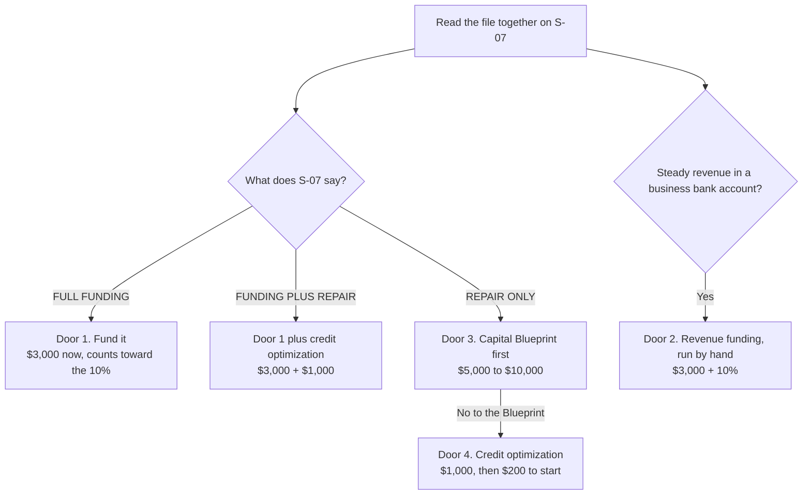

# Sales call script — the branch close

Drafted 2026-10-29. It rebuilds the sheet a Cursor chat compiled earlier the same day. It is built from three places: Cole Gordon's closer course, Fundhub's own sales files, and the live Present deck. The steps are Cole's. The words are Fundhub. Nothing from Cole's course is copied here, because this repository is public.

The setter part is `02-setter.md`. This page starts when the setter hands off.

**The idea:** find out where they are. Pull the file together. The file picks one door. Sell that door, and only that door.

The 2026-10-29 version is live on fundhub.ai. This 2026-11-01 rewrite remains on the sales-script branch until shipped. Chris's decisions are at the bottom, under **Open calls for Chris**.

## The call in spoken order

1. "What are you trying to fund, and what has stopped you?" Get the goal, amount, use, timing and who decides.
2. "What happened the last time you tried?" Get their actual cost of waiting and why they booked now.
3. "Let's pull your file together, so we're working from what is there today." Send the $32 soft pull and stay on the call.
4. "Here's what your file supports today, what is holding it back, and the order I'd work on it." Show the file, then pick one offer that fits.
5. "Does that plan make sense for the goal you gave me?" Resolve plan questions before the price.
6. State the price and agreement terms. Be quiet. If they hesitate, use section 9 for the concern they name.
7. If they start, read the agreement, send the matching pay link, confirm payment, and give the first step. If they wait, book a real follow-up.

## The call on one page

| Part | About | The job | Present |
|---|---|---|---|
| 0. Before the call | 5 min | Read the setter note and the survey. Guess the door. | Closer Dashboard, cockpit |
| 1. Open and frame | 3 min | Hello. How the call goes. The yes-or-no deal. | S-01, S-02 |
| 2. Stuck part and goal | 10 to 15 min | Six boxes, in their words. | S-03, S-04 |
| 3. Pull the file | 5 min | The first yes: the $32 pull. | S-05, S-06 |
| 4. Read the file | 10 min | How much they qualify for today, after the fixes, and what is left on the table. | S-07, L-01 (the money levers) |
| 5. Pick the door | 1 min | The file picks. They agree before any price. | S-08 (your path) |
| 6. Show the door | 5 to 10 min | The promise, three steps, how it runs. | S-09 to S-16 and C-01 (more companies), or B-01 to B-04 (B-03 is the Blueprint dashboard) |
| 7. The ask | 2 min | Check the plan. Then the price. Then quiet. | S-17 to S-22, or B-04 |
| 8. Money | if needed | Same offer, different pay terms. | — |
| 9. Objections | if needed | Lock the plan, isolate, answer, ask again. | — |
| 10. Paperwork | 5 min | Agreement, pay link, paid on the call, log it. | S-23, S-24 |

## The doors

| Door | Who | Offer | Price | How they pay |
|---|---|---|---|---|
| 1. Fund it | S-07 says FULL FUNDING | Funding, done for you | $3,000 today. It counts once toward 10% of confirmed approved limits or amounts. | Cash. No plan. |
| 1 plus repair | S-07 says FUNDING PLUS REPAIR | Funding plus credit optimization | $3,000 plus $1,000 | Cash. |
| 2. Revenue funding | Steady revenue, 6 months or more in business, 3 months of bank statements | Funding, done for you, run by hand | $3,000 today, credited once toward 10% of confirmed approved limits or amounts | Cash. |
| 3. Capital Blueprint | File not ready. Always offered first. | Capital Blueprint, 12 months | $5,000 to $10,000, whole dollars, default $5,000 | Paid in full, or financing through Whop |
| 4. Credit optimization | File not ready, and they said no to the Blueprint. | Up to six rounds, done for you | $1,000, or $200 for round one | Cash. The $200 counts toward the $1,000. |

**Chris's rule (2026-10-29):** always offer the most expensive product that fits their goal first. Step down only on a no.

## 0. Before the call — 5 minutes

1. Open the Closer Dashboard: https://fundhub.ai/app/closer-dashboard.html. Find the client.
2. Read the setter note: the stuck part in one sentence, the goal in one sentence, computer ready yes or no.
3. Read the survey on S-03: how much they want, what it is for, what it changes, the score they think they have, how old the business is (or "personal funding only"), the yearly revenue range, whether they can verify revenue (bank statements, tax returns), their income, and capital on hand.
4. Write down your first guess at the door. The file decides on the call. The guess only tells you what to listen for.
5. Open the call cockpit: https://fundhub.ai/app/closer-call.html. Read past texts and notes.
6. Open Present, the screen-share deck, on this client: https://fundhub.ai/app/present.html. Do not share the screen yet.
7. Reset for two minutes. Breathe. Let go of the result. Your job is to find the truth about their file and say it straight.
8. Have your note sheet open in call order: stuck part, numbers, why they can't fix it alone, cost of waiting, goal, who else decides, the door.

## 1. Open and frame — 3 minutes

Say it like a person. Keep your voice level. Do not let a line rise at the end unless it is a question.

1. **Hello.** "Hey, is this [Name]? Hey [Name], it's [your name] with Fundhub. Good to finally meet you."
2. **One light question.** "How's your week going?" Keep it short. No sports, no life stories.
3. **Time and setup.** "We've got about [length] together. You still good on time? Are you at a computer? Grab a pen and paper, and have a card handy for the file pull."
4. **Recording.** "Quick heads up: this call is recorded, so nothing gets missed."
5. **The frame.** "Here's how I run these, so this is worth your time. First, I want to hear what you're going for and what's been in the way. Then we pull your file together, right here on the call. It's a soft pull, so your score does not move. Then I show you what the file says: how much you qualify for based on where you're at right now, and what's holding the rest back. If we can help, I'll show you exactly how. If we can't, I'll tell you that too, and point you the right way. Sound fair?"
6. **The end-of-call deal.** "At the end, I'll ask if you want to move forward. A yes is great. A no is fine. Just tell me straight either way. Deal?"
7. **Who else decides.** "Is anyone else part of money decisions for you, like a spouse or a business partner? Are they around? It helps if they hear this too."
8. **The first real question.** "So tell me. What's the biggest thing that's been in the way of getting this funding?"

Get "sounds fair" before you move on. It stops them from jumping straight to the price later.

## 2. Find the stuck part and the goal — 10 to 15 minutes

By the end you know six things, in their words. Check each box on your sheet.

| Box | You know it when |
|---|---|
| Stuck part | They named the one thing in the way, and you dug into it. |
| Numbers | You have how much they want, what the business brings in each month, and what the stuck part costs each month. |
| Why not alone | They said why they have not fixed it themselves. |
| Cost of waiting | They said why now, and what happens if nothing changes. |
| Goal | You have the amount, why that amount, and what it changes for them. |
| Who decides | You know if a spouse or partner is part of it. If they are and they are not on, see "I need to talk to my spouse" in section 9. |

How to ask:

- One short question at a time. After they stop, wait 2 to 4 seconds. They will keep going.
- Do not coach. Do not fix it yet. That comes after the file.
- Ask even when you think you know. Their words beat yours.
- The setter already got the basics. Say them back and confirm. Do not make them tell the whole story again.
- Type the monthly cost into the cockpit's monthly-cost box. S-20 uses it. Put the incorporation date in its box too.

Pick the order:

- **Business owner who has been denied or stuck** (most calls): start with the stuck part.
- **New business, a startup, or "I don't know where to start"**: start with the goal.

**Start with the stuck part:**

1. "The note says [stuck part]. Tell me more about that."
2. "What happened the last time you applied? When was it? How many places?"
3. "What do you think is causing it?"
4. "Besides that, is anything else in the way?"
5. "How long has the business been open? What does it bring in a month, through the business bank account?"
6. "Is the business set up in its own name, with its own bank account?"
7. "Where do you think your score is right now? Any cards that are pretty full? Anything on there you know about, like a late payment or a collection?"
8. "What have you already tried to fix this? What happened?"
9. "What is this costing you each month? Jobs you can't take, ads you can't run, a hire you can't make?" Say it back: "So about [amount] a month. Does that feel right?"
10. "Has it hit anything outside the business? Stress at home?"
11. "Why now? What made you book this week?"
12. "If nothing changes, where are you a year from now?"
13. "If we got this handled, how much do you need? Why that amount? What does that money do, step by step? And what does that change for you?"
14. "Who else is part of a decision like this? Do they know you're on this call? What would they say?"

**Start with the goal:**

1. "The note says you're going for about [target] for [use]. Walk me through the plan."
2. "Why that amount? What does it change for you?"
3. "Where are you with it right now? Is the business open? Its own bank account? Any revenue yet?"
4. "What made you take action now?"
5. "What has stopped you from doing it already?"
6. "What have you tried so far?"
7. "Three things decide how much a bank gives you: your personal file, whether the business is set up so a bank sees it as established, and which banks you apply to, in what order. Where do you think you are on each one?"
8. "Who else is part of a decision like this? Do they know you're on this call?"

No business yet: "You do not need a business to work with us. Funding can come in your own name, a business name, or both."

If the goal is small next to what they need: "Is that what you need, or what you think you can get?" Do not assume a bigger loan is better. Ask how much they will use now, what they can repay, and whether unused credit would help them keep card use low. Use the small-target talk-off in section 9 only if the file supports more.

**Listen for the door.** Write these down when you hear them.

- Steady revenue through a business bank account: write the monthly amount and how long it has run (Door 2).
- Full cards, late payments, collections, a lot of recent applications: the file is not ready yet.
- "I want to learn how this works," "I want to do it right," more than one business: the Capital Blueprint fits well.
- "Just fix it for me," "I don't have time": still lead with the Blueprint. Expect to step down to the $1,000.
- "I need it in a few weeks": speed matters.

**Close the questions:**

"I'm out of questions. Is there anything else I should know before we look at your file?"

Then say it back: "So let me make sure I have it. You want [goal] so you can [what it changes]. What's in the way is [stuck part]. You tried [what they tried]. And waiting costs you [cost]. Did I get that right?"

Wait for the yes. If they fix something, write it down and say it back again.

## 3. Pull the file together — 5 minutes

This is the first yes of the call.

1. **The bridge.** "This is exactly what we work on. Right now, we're both guessing. Your file knows why [stuck part]. Let's go see what it says."
2. **The pre-frame.** "If the file shows a clear path, are you ready to move on it today, or are you still looking around?" Write down the answer. You will use it in section 7.
3. **What it is.** "I'm sending you a link right now. It's a soft look, not a bank application. Your score does not move, and no lender sees it. It's $32. It pulls your file from the bureaus, and our system reads it the way a bank does. Applications come later, on a plan."
4. **Send it.** In Present, on S-05, click **Send soft pull ($32 + approval form)**. They get a text and an email.
5. **Stay with them.** "Open the text I just sent. Approve it, then the $32. I'll stay right here." Stay quiet while they fill it in. S-06 shows while it runs.
6. **If they ask why it wants their details:** "That's what the bureau needs to find your file."
7. **If they push back on the $32:** "Fair question. Almost every application you send is a hard pull, and each one costs you. This is $32 to see exactly what a bank sees before you send another one. The reports are yours either way."

If they already did the pull before the call, skip to section 4.

## 4. Read the file together — 10 minutes

Share your screen in Present. Go to S-07.

The headline reads "How much you qualify for today." Lenders decide. Say it this way:

1. **Outcome first.**
   - Funding file: "Here's how much you qualify for based on where you're at right now: [amount on screen]."
   - Repair file: "Here's what's holding the file back: [the count on screen]. Cleaned up, the file shows [the amount on screen]."
   - Then: "The difference between today and the cleaned-up file is what's left on the table right now."
2. **The why.** Walk the three to five things the screen shows are holding the file back. For each one, say what it is in plain words, and what it costs, from the screen.
3. **Let them say it.** "What jumps out at you?" "Did you know about that one?" Wait. When they say the problem out loud, it is theirs, not yours.
4. **Tie it to the goal.** "You said you need [target] for [use]. Today the file shows [amount]. So there are three ways to go: fund what's there now, fix the file first, or both."

Read the amounts off the screen. Never round up. Never say they are approved. Never say a bank will give them an amount. Never name a bank as one that will approve them. If they ask if that means approved: "That's what your file supports today. The bank still decides."

## 5. Pick the door

The file picks first. Then what they told you about the business. You sell **one** door. Always lead with the most expensive door that fits their goal, and step down only on a no.

**Step 1. Read the tier on S-07.** The "Route the call" box beside the slide in Present says what the engine found.

| S-07 says | What the file shows | Door |
|---|---|---|
| FULL FUNDING or PREMIUM STACK | Every bureau clean. Cards under 30%. No open negatives. 3 or more accounts. | Door 1. Fund it. |
| FUNDING PLUS REPAIR | Part of the file is clean enough to fund now. The rest needs work. | Door 1, plus credit optimization. |
| REPAIR ONLY | A charge-off, a collection, an open bankruptcy or a 90-day late, and no clean bureau. | Door 3 or Door 4. |
| No tier, or a fraud hold | The engine did not find a score to read. | No funding. Use the repair screens. Tell Chris after the call. |

**Step 2. Add the business side** (from section 2 and S-03).

- Steady revenue through a business bank account, 6 months or more in business, and 3 months of bank statements: Door 2 fits. It runs by hand for now.
- A business under 12 months old: the engine cuts business card amounts in half. Check the incorporation date on the state record. Do not take their word for it.
- S-03 shows the survey's yearly revenue range. Ask the monthly amount out loud.

**Step 3. File not ready? Lead with the Blueprint.**

- Offer Door 3, the Capital Blueprint, first. It is the most expensive door that fits.
- If they say no, step down to Door 4: the $1,000 credit optimization, then the $200 round one.

**Name the door before any price.** "Based on what your file shows, here's where you are, and here's the path that fits." They have to agree with the door before they hear a price. If they push back on the door, handle it right there, on S-08. Never handle it at the price.

The system never blocks a sale by tier. So the door is on you. The route buttons on S-07 change it. Change it only when the file gives you a reason, and write the reason in your notes.

The **EDUCATION PATH** button on S-07 is Capital Academy. It is off until it is filmed (Chris, 2026-10-29). Do not use it.

## 6. Show the door

Every door has the same shape. First the promise: the steps that get them from where they are to what they want. Then each step: their problem in their words, what Fundhub does, and what it gets them. Then how it runs after they pay. Check in after each step: "Make sense?"

### Door 1. Fund it

**Who:** S-07 says FULL FUNDING, or FUNDING PLUS REPAIR.
**Offer:** Funding, done for you. **$3,000 today.** It counts once toward the 10% success fee. When funding is secured, the fee base is confirmed approved limits or amounts, including credit access the client has not drawn. The remaining fee is due as approved funds or credit access are received. If no funding is secured, no back-end success fee is due. Read the agreement's exact terms on the call.
**Slides:** L-01 (the money levers) and S-08 (your path), then S-09 to S-16 and C-01 (more companies, more funding), then S-17 to S-22.

1. **The promise.** "Here's the plan. Three steps to get you in front of the banks that match your file, in the right order. Want me to walk you through it?"
2. **Step one: clean before we apply.** "You told me you got [denied / stuck] last time. Here's why. You applied blind, and every application was a hard pull. So first we set your card balances to the targets your file shows. Between rounds, we dispute the new inquiries. Make sense?"
3. **Step two: the right banks, in the right order.** "Our system matches your file to the banks that fit it. We apply in rounds. One funding sequence is about six rounds. Your personal file first. Then each business, on its own. Make sense?"
4. **Step three: done for you.** "The Fundhub team runs every application and every follow-up. You run the business. Make sense?"
5. **How it runs.** "Once you sign, your funding advisor starts on your file within 24 business hours. Your first applications go out within 72 business hours."
6. **The menu, on S-16.** Take their order for what is live: business cards, personal cards and personal loans, plus lines of credit, term loans and revenue-based funding off bank statements or tax returns (Door 2, run by hand). SBA and equipment loans are not live yet.
7. **Say these, then check the boxes in the cockpit:**
   - "Business cards carry a personal guarantee. If the business can't pay, you're on the hook. The bank sets that rule."
   - "Intro rates end. Each card's terms show the month. We plan for that month before you spend."
   - "The bank decides, not us. We pick the banks and the order. They say yes or no."
   - Check the incorporation date on the state record.

**Funding plus credit optimization.** For FUNDING PLUS REPAIR files. "Part of your file is ready now. We fund from the clean side, and we clean up the rest at the same time, so your next round is bigger." $3,000 plus $1,000, cash. On S-23, send the $3,000 link, then the second button, **Send credit optimization pay link · $1,000**.

**The math, only with a real amount.** Read it off S-20 and the agreement. Example only, not a promise: $75,000 in confirmed approved limits or amounts, 10% is $7,500, $3,000 already paid, $4,500 remaining as approved funds or credit access are received. The fee is not limited to what the client draws. Do not promise a deposit refund when the success fee is smaller; read the signed terms.

### Door 2. Revenue funding (run by hand for now)

**Who:** steady revenue through a business bank account, 6 months or more in business, and 3 months of business bank statements. Credit not ready: fund the business now, and fix the file. Credit ready: fund it all, cards and revenue.
**Offer:** funding, done for you, on the same funding agreement. **$3,000 today plus a 10% success fee based on confirmed approved limits or amounts when funding is secured; the deposit counts toward that fee.**
**How it runs for now:** the client uploads bank statements or tax returns in the portal. The team packages the file and emails it to the lender. The lenders are in `FUNDING SHEET (business).xlsx`. The button that sends it automatically is on hold.

1. **The promise.** "Two moves at once. Funding based on your business revenue now, and your personal file fixed so your next funding sequence is bigger."
2. **Step one.** "Some lenders look at what hits your bank account first, not only your score. We match your business to them."
3. **Step two.** "At the same time, we fix your file." Lead with Door 3. Step down to Door 4.
4. **Step three.** "Then we fund off the clean file in your next funding sequence."
5. **Must say.** "Revenue funding costs more than a card. Read the rate and the payment schedule before you sign."
6. **What they need:** bank statements or tax returns (they upload them in the portal), time in business, and the EIN. The survey's "Can you verify revenue?" answer on S-03 tells you what they have.

### Door 3. Capital Blueprint

**Who:** every file that is not ready. Offer it first, because it is the most expensive door that fits.
**Offer:** Capital Blueprint. **$5,000 to $10,000**, a whole-dollar price you pick. You set the price; there is no rule (Chris, 2026-10-29). The default is $5,000. 12 months included. No renewal charge.
**Slides:** press Next from S-08. A file that is not ready walks B-01 to B-04, where B-03 is the Blueprint dashboard the client watches you click through. On S-19, **Capital Blueprint** is the first button. Then S-23.

1. **The promise.** "Here's what I'd do with this file. A 12-month plan, built from your own report. It tells you exactly what to do, step by step, until your file and your businesses are ready to fund."
2. **Why it's different.** "A course teaches you. The Blueprint makes the calls on your own file, and it keeps you moving."
3. **Step one: the personal file.** "Pay each card down to the target your file shows. For you, that's [card] from [balance] to [target]. Don't open new credit. Mail the dispute letters for the items on your file. Upload the proof. Then upload what the bureaus send back." Read the cards and the items off the roadmap. Never invent one.
4. **Step two: the businesses.** "File the LLC. Get the EIN. Open business checking. Each business is judged on its own, after your personal file is ready. Business one gets ready first, then business two."
5. **Step three: the money and the banks.** "Your bank and lender match list, from your file, and the order to apply. FinanceOS shows every account and every due date on one page."
6. **How it runs.** "It runs 12 months. Every step has a due date. An AI coach watches your open step. The Fundhub team does what a person has to do. When the system says your file is ready, we call you about funding."
7. **What they get, on B-02.** Credit analysis, the dispute letter pack, the roadmap, How Much You Qualify For, the bank and lender match list, and 12 months of FinanceOS. One spouse or partner file is included.
8. **The price, on B-04.** "That's the whole plan, for 12 months. It's [price]. Want to get started?" Financing is open through Whop.

Never promise an approval, an amount, a score or a removal. Never promise the date of the first monthly pull, or when the file will be ready. FinanceOS accounts are typed in for now, so do not promise a bank connection. Skip B-05. It has no checkout.

### Door 4. Credit optimization

**Who:** the file is not ready, and they said no to the Blueprint.
**Offer:** Credit optimization, done for you, up to six rounds. **$1,000.** Or **$200** for round one. The $200 counts toward the $1,000.
**Slides:** the repair path, S-09 to S-16. S-15 is the six-round journey with their own items. On S-19, after **Capital Blueprint**, the buttons are **Onboard now: full done-for-you** and **Trial: first round done-for-you**.

1. **The promise.** "We clean up the items that hold your funding back, in up to six rounds, built from your own file. Then you're ready for the funding side."
2. **Step one: round one goes out today.** "The letters are built from the pull we just ran. You'll see them in your dashboard."
3. **Step two: each round builds.** "Round one is the dispute. Then method of verification. Then a final notice. Then the CFPB. Then your state attorney general. Then the final notice again. The bureaus have 30 to 45 days to answer each round."
4. **Step three: you watch it happen.** "Every dispute and every answer shows in your dashboard."
5. **The price.** "All six rounds, done for you, is $1,000. Want to get started?" If no: "Then start with round one for $200. You see it work. The $200 counts toward the $1,000 if you keep going."

Describe the process only. Never promise a removal, a score or a result.

### No door today

They keep the $32 report. Go to **If they do not buy today**.

## 7. The ask

1. **Questions first.** "Before I show you how to start, what questions do you have?" If they ask one: "Good question. What made you ask?" Then answer.
2. **Check the plan, not the price (S-17, S-18).** "How do you feel about this plan for your file?" A sure answer in a sure voice: move on. Anything else: "On a scale of 1 to 10, how sure are you this is the right plan for your file?" Under 8: "What would make it a 10?" Handle that. Ask again.
3. **What happens next, before the price.** Say the first step of their door from section 6. They should picture day one before they hear a price.
4. **The guarantees (S-21).** Funding only: read G-01 and G-02 word for word. They are the two in the agreement in the CRM. Blueprint and credit optimization: no guarantees from S-21.
5. **The ask (S-19 to S-22).** One line that ties the price to their goal. Then: "Want to get started?"
   - Funding: "To get you in front of the right banks in the right order, it's $3,000 today. That counts toward the 10% success fee. The fee is based on the bank limits or amounts we confirm as approved, even if you don't draw the whole line. The rest comes due as that credit becomes available. Want to get started?"
   - Blueprint: "For the whole 12-month plan, built from your file, it's [price]. Want to get started?"
   - Credit optimization: "For all six rounds, done for you, it's $1,000. Want to get started?"
6. **Stop talking.** Count to four in your head. Let them talk first.
7. **A clear yes.** "Let's get you set up." Go to section 10.
8. **A soft yes** ("I guess," "yeah, ok"). "You sure? I want you in because you want this, not because I asked." Then section 10.
9. **Anything else.** Use section 8 if it is money. Use section 9 for the rest. If they said in section 3 that they were ready to move today, remind them: "Before the pull, you said if the file showed a clear path, you'd move today. Did it show one?"

Quiet buyer who will not say yes or no: "If we lay out every step to get you to [goal], will you do your part and ask for help when you need it?"

## 8. Money

**Lock the plan before you talk money.** Cole's order. Never skip it.

1. "Money aside, is this the right plan for your file?"
2. If yes: "What about the cost or payment still needs to work for you?"
3. "Is there anything else about the plan you want to clear up before we talk payment?"
4. "Can we talk openly about what fits your budget?"
5. "What do you have that you can use today?"

If they can pay it all: "Then let's take care of it today and start right now." Stop talking.

If they want it and the hit today is too big: same offer, different pay terms. Do not drop to a cheaper offer first. Walk these in order. Stop at the first yes.

1. **Pick the terms (Blueprint).** "Would you rather I pick the payment dates, or you pick them?" If they want to pick: "Then use a card, and you choose the plan that fits." Blueprint also has financing through Whop (ClarityPay and the others Whop shows).
2. **Half today, the rest later (Blueprint).** "When do you get paid next? Can you do half today and the rest that day?" If not: "What's the most you can put down today?" That today. The rest on payday.
3. **Want check.** "Money's tight, I hear you. On a scale of 1 to 10, how bad do you want to fix this?" 8, 9 or 10: "Then we'll find a way that works." 7 or less: "Why not a 10?" Listen. The answer tells you if a smaller first step fits better.
4. **Three pays (Blueprint).** One third today. One third next payday. One third the payday after.
5. **A smaller first step.** If the full offer does not fit, discuss the next service that fits their goal: Blueprint, then $1,000 credit optimization, then $200 for round one. Use its real agreement and price.

How each offer can be paid:

| Offer | How it can be paid |
|---|---|
| Funding, $3,000 | Cash, in full. No plan. No financing. |
| Funding plus credit optimization | Cash. |
| Capital Blueprint, $5,000 to $10,000 | In full through Commas, or financing through Whop. A payday split if they will not use financing. |
| Credit optimization, $1,000 | Cash. No financing. |
| Round one, $200 | Cash. It counts toward the $1,000. |

**Funding fee math, only after the actual offer.** The 10% is on confirmed approved limits or amounts, including available credit the buyer does not draw. The $3,000 deposit is credited once. For illustration only, if $200,000 of access is approved, the total Fundhub fee is $20,000 and $17,000 remains after the deposit. A separate 12-month payment of $17,000 would be about $1,417/month at 0% APR or $1,495/month at 10% APR, including principal. Those are financing examples, not Fundhub payment terms or a lender offer. Show the actual terms and when the fee comes due before any decision.

Never tell a client financing stays off their credit. The financing pre-check is soft. Taking the loan is a hard pull, and it can show on their credit.

**When they do not want to share a number.** "That's okay. I can show the payment choices and full cost, and you can tell me whether any fit." If none fits, set a follow-up or stop.

**Before they put it on a card.** "Card use is one of the things that sets how much you qualify for. A big new balance raises yours." Say it, then let them choose.

**Financing on the call (Blueprint only).** A lot of buyers pay over time. Walk them through it live. Never send the link and hang up.

1. Set the price and send the agreement (section 10, steps 2 and 3).
2. Make the Whop link and send it while you are both on the call.
3. "Open it now and pick the option to pay over time. Checking your options is a soft check."
4. "Read the rate, the monthly payment and the number of months before you accept. The lender sets them, not us." Never say a rate.
5. Stay on until Whop shows paid (section 10, step 5).

As of 2026-10-29, nobody has closed a financed sale yet (`05-claritypay-financing.md`). On the first one, stay on to the end and tell Chris what each screen said.

The money steps come from a payment-plan video that sits in Cole's folder. The speaker is Alex Hormozi: he says he ran those payments at Gym Launch, his company. Cole's own docs add the rule at the top of this section: lock the plan first, then talk money.

## 9. Objections

Use these as spoken lines. Name the offer and answer what the buyer actually asked. A fee, rate, timeline or agreement question needs a direct answer.

**When they hesitate.** "What part doesn't sit right yet?" Listen. "If we solve [their concern], does this plan get you toward [their goal]?" If no, fix the plan or stop. If yes, answer with their file, the agreement or a real screen. "What else would you need to know before deciding?" If nothing: "Do you want to start?" Use the cockpit beliefs to diagnose the call, not as words to recite.

### Concerns with every offer

**"I need to think about it."** "Of course. What part needs thought: the plan, what it costs, the work on your side, or whether you trust us?" Answer that part. "What do you still need to see to make a clear decision?" If they need time, set a real follow-up.

**"It's too expensive."** "Is the price outside your budget, or do you need to see why this is worth it?" For value, use the actual problem and cost they named. For cash flow, use section 8 and the real payment terms. "After seeing the work and price together, does it fit?"

**"I need to talk to my spouse or partner."** "Do you want their input, or do you need a joint decision? What will they want to know?" Answer what you can now. Book a call with both people.

**"I've been burned. How do I know you're real?"** "What happened?" Listen. "Here is your file and the work we propose. Here is the agreement with the price and steps. Here is where you see the work and reach us after you sign. Which part should I show you again?" Show approved, real client proof when available.

**"Will you disappear after I pay?"** "Let's open the portal and agreement together. The agreement names the work. The portal shows your next step and the work as it happens. Here's how you reach the team. What would you need to see to feel comfortable?"

**"Send me something" or "I want to compare options."** "What do you want to compare: the work, price, timing, or proof?" Show the relevant agreement, file or portal screen now and send the real material afterward. Compare actual scopes and set a follow-up if needed.

**"I don't have time" or "I'll wait."** "Which part of the work worries you, and what do you have time for?" Show their first task and the team's part. If waiting: "What will change, and when should we check it?" Set a check-in tied to that answer.

### Credit optimization

**"Why pay $1,000 when I can dispute this myself for free?"** "You can dispute inaccurate information yourself for free. You're paying us to review your exact file, put the work in order, prepare and track up to six rounds, and show you the letters and replies. You still give us accurate facts and sign where needed. Which part would you rather handle yourself?"

**"What if nothing comes off?"** "I can show you the service we commit to: round one on signing day, the agreed rounds on schedule, and a record of the work in your portal. If we miss those service steps, the agreement lets you request your fee back. Is your concern the work we do, or the bureau's result?"

**"Bad credit is already costing me. Why pay more?"** "Let's use your situation. You told me [real denial, higher quote, deposit, or missed opportunity]. What did that cost you? Here is what your report shows and what this work covers. Is that worth $1,000 to you?" Use only a cost the buyer confirms or a written quote.

**"I was scammed before. Prove this is different."** "Show me what they promised and delivered. I'll show you exactly what our agreement says, the work on your file, and where each round appears in your portal. What proof would help you judge the work itself?"

**"Will disputing hurt my score or affect a loan application?"** "A bureau investigates and reports its result. A lender decides how it treats your file. Let's look at the items we would work on and any application already in progress before choosing the timing."

**"What if the negative item is accurate, or a removed item comes back?"** "An accurate item isn't erased just because we dispute it. If a deleted item comes back, that's a reinsertion. We've handled those. We get the old and new reports and the bureau's notice, check the furnisher's accuracy certification and the notice date, then challenge any error with the record. We don't use sweeps. Show me the item you're worried about." The reinsertion steps are in [15 U.S.C. § 1681i(a)(5)(B)](https://uscode.house.gov/us/usc/119-120/t15/s1681i/).

**"How long will this take?"** "We start round one when you sign. Each bureau round takes about 30 to 45 days. Your file and the replies decide what comes next. I can show you the first step and round schedule."

**"Can I start with $200? Can I finance the $1,000?"** "Round one is $200 and counts toward the $1,000 if you continue. Credit optimization has no financing option."

### Funding

**"I only need $10,000 or $20,000."** "Is that what you need to spend now, or the total credit you want available?" Listen. "If your file supports more, extra available credit lets you use less of each card and leaves room for the next six to twelve months. One planned bank sequence also avoids applying again right after new accounts and inquiries. Let's put your immediate use, repayment, and available capacity side by side. What amount fits?"

**"Why do you get 10%? I can apply myself."** "You can. Our fee pays for reading your file, checking current bank criteria, choosing the banks and order, preparing authorized applications, and handling bank communication and follow-up. You told me [what happened when they tried or why they came to us]. Which part would you do on your own?"

**"Is the 10% on cash I use, or the full line?"** "It's on the approved access we help secure, including an available line you haven't used. Your $3,000 counts once toward the 10% fee, and the rest comes due as approved funds or credit access arrive. You can pay us from a separate account or loan proceeds you choose to use; you don't have to take a card cash advance to pay us. Let's put the actual approved amount and fee on the same page."

**"Why pay $3,000 if approval isn't guaranteed?"** "The deposit starts the work and counts toward the success fee if funding is secured. The agreement says an advisor starts your file within 24 business hours and we submit your first authorized applications within 72 business hours. If we miss either deadline, you can request the deposit back. If lenders approve nothing after we do the work, there is no back-end success fee, but the deposit isn't returned for that reason alone. Is that clear?"

**"What if the banks approve less than I asked for?"** "We keep it real from the first file review. If approval comes in below your goal, we show you what was approved, what changed in your file, and what a later funding sequence can address. A new negative item or lender rule can change the result. We review the 13 optimization points and plan the next sequence from what banks actually said. The fee follows confirmed approved amounts or limits, not the amount you asked for. Which part of your project needs funding first?"

**"I already have a lender offer. Why bring you in?"** "Good. Show me the offer. Let's read the amount, every fee, payment frequency, full payback, and any guarantee or collateral. Some direct offers are merchant cash advances with daily withdrawals; others may fit. If yours works at a cost your business can carry, use it. If there's a gap, our team can check other funding paths. What part of that offer doesn't work for your plan?"

**"The rate is too high" or "I only want 0%."** "Let's read the actual lender offer. What will this money pay for, what will it bring back, and can the business make every payment if that return is late? If the cost or payment doesn't fit, let's look at another real offer or stop."

**"What is the full cost, including lender fees or early payoff?"** "Let's add it up from the offer: amount available, every fee, payment schedule, total paid back, and what happens if you pay early. Then add our fee from the approved amount. If payments come out of your business account, let's read how often. Does that full cost fit your project?"

**"How many applications will you send?"** "We choose a sequence from your file and review the applications you authorize. Each lender decides its inquiry and approval. I'll show you the planned order and applications before we start. Is your concern the inquiries, timing, or who sees your information?"

**"I already have cards, my own cash, or don't want debt."** "Then let's check why you booked. Is there a project that needs credit, or are you looking to improve the file and keep options open? If you don't need or can't carry funding, we don't apply."

**"Will applications affect my credit? Do business cards have a personal guarantee?"** "The $32 file pull was soft. Funding applications can make hard inquiries, and new accounts or balances can change your file. Business cards carry a personal guarantee. That's why we review the order and each offer before you authorize an application."

**"Can you guarantee an amount or date?"** "The bank decides approval, amount, rate and timing. Our written action deadlines are 24 business hours to begin the file and 72 business hours for the first authorized applications. Here's what your file supports today and the next step we control."

**"Can we use my other business or a credit partner?"** "We can review each business and a willing partner separately. The person applying has to understand and authorize their own obligation. Let's start with who owns each business and who would sign."

### Capital Blueprint

**"Why is a plan $5,000? I can buy a course or watch free videos."** "A course gives everyone the same lessons. This is a 12-month roadmap built from your file and business goals, with next steps in order and a team to guide the work. What have you already tried? What question did it leave unanswered?" Open their roadmap and show that answer. "Is that difference worth [price on screen] to you?"

**"Is this just a dashboard? Who actually helps me?"** "The dashboard shows your plan and next step. AI agents help track the checklist, and the Fundhub team handles questions and anything that gets stuck. Let's open your first step and show who takes each action."

**"I can build the plan myself."** "You can. You came here with [their stated stuck point]. Here are the first steps your file calls for, in order, and what changes when a new report comes in. Which part would you want guidance on?"

**"What if I fall behind or don't have time?"** "Let's show your first step. You do [actual task or proof upload]; the coach and team do [actual review or follow-up]. You can see the next step in the dashboard. How much time can you set aside each week?"

**"What if the plan doesn't get me funded?"** "The Blueprint gives you the 12-month plan and support in its agreement. The bank still makes a later funding decision. Let's read the deliverables and your first milestone together. Is a guided plan what you want?"

**"Can I finance it, and will that affect my credit?"** "You can check financing options on screen with a soft pre-check. Before accepting one, read its rate, payment and term. Accepting a loan can create a hard inquiry and a new account. Do you want to see the actual options?"

**"The lender declined me, or the payment is too high."** "That's the option offered on today's file. Let's look at the other displayed plans. If none fits, we can review the real cash split or a smaller service that fits your goal. Which payment can you carry?"

**"I want to finance it later."** "That's your call. What do you still need to know before checking your options?" Answer. If they need time, set a real follow-up.

### Direct answers to process questions

**"When the Blueprint has me ready to fund, is the funding service included?"** "The Blueprint includes the 12-month plan and its support. Having our team apply for you later is a separate funding service with a separate 10% fee on confirmed approved limits or amounts. We would show you that agreement before you choose it." Chris's no-new-deposit rule for Blueprint graduates is a product change still to be wired; do not quote it as a current checkout term.

**"Who works with me in the first month?"** "For funding, your funding advisor takes the file through authorized applications and bank follow-up. For credit optimization, a credit specialist reviews items, prepares rounds and tracks replies. For the Blueprint, AI agents help with the checklist and the Fundhub team handles questions or blockers that need a person. Here's the first step for the offer we picked."

**"I don't have a business."** "You can work on your personal file first. The Blueprint also shows business setup steps if that's part of your goal. Funding in your own name is a separate lender decision."

**"Can I get cash from a credit card?"** "A card is useful for business purchases. Cash advances carry their own fees and rate, so let's read the card terms before using one. If your plan needs cash in the bank, let's compare the loan or line-of-credit offers your file supports."

**"I got denied before."** "What did the lender say, and when? Let's compare that file with what your report shows today. A past denial doesn't tell us the next lender's decision."

**"What proof do you have?"** "I can show real client work approved for sharing, the written service steps, and your own file. Which one do you want to see first?" If no approved proof is available, say so.

## 10. Paperwork

1. Check the five **Before you close** boxes in the cockpit: call is recorded, personal guarantee, month-14 cliff (intro rates end), bank decides, incorporation date verified.
2. Pick the offer and the price in Present, on S-23. For Blueprint you set the whole-dollar price, $5,000 to $10,000. The default is $5,000.
3. Send the matching agreement. It carries the same price as the pay link. For Blueprint, send the agreement first. The pay link is refused until an agreement at the same price is out.
4. Make the pay link. Commas for cash. Whop for Blueprint financing. For a Blueprint sale, Present shows a **Sale motion** box: Downsell or Upsell. Pick the true one. For a funding plus repair file, S-23 has a second button for the $1,000 credit optimization link.
5. Stay on until it's paid. "Tell me when you see the paid screen."
6. Log the result. Present logs a funding deposit, or a downsell for everything else (Blueprint too). A callback, a no-show or not a fit gets logged in the cockpit (keys 1 to 5), with the belief that failed.
7. Tell them what happens next, the first step for their door.
8. Remind them to get the Fundhub Portal app: https://apps.apple.com/us/app/fundhub-portal/id6823985032

Do not celebrate. Do not over-explain. Confirm the payment posted before you end the call.

## If they do not buy today

1. **Do not hang up without a next step.** Stay two or three more minutes. Book the next call while you're both on.
2. **The delay.** "Let's not decide today. Let's finish this tomorrow, [time] or [time]. Before then, do one thing: open your report in the dashboard and write down your top question." Send the invite while they're on.
3. **Two hours later**, text: "How are you feeling about everything we went over?" No reply: one "?" the next morning. Texts follow the texting hours.
4. **Log it.** Callback in the cockpit, with the belief that failed. The cockpit makes a follow-up task due in 24 hours.
5. **Follow-up lists.** Hot list: a date set, cleared every day. Everyone else: checked every week.
6. **Come back with a new way in.** In 2 to 4 weeks, reach out with a way in that fixes what stopped them, at a real price: round one for $200, or Blueprint financing.
7. **A clear no.** "Thanks for telling me straight. Is there another business owner who would value seeing their file and options this clearly? If so, you can introduce us." If no, thank them and end the call.

## Never say

**The lines that get a closer fired** (the Sept 1 floor sheet):

- "Your score will go up."
- "We will get you funded."
- A dollar amount a bank will give them.
- "A bad item will come off."
- "0% interest," "no damage to credit," or "we protect your score."
- A win, a client count, or a story Chris has not given you in writing.

**Also never** (the floor sheet's pocket card and the cockpit):

- "You're approved," "pre-approved," or "once we pull, you'll be approved."
- "Guaranteed," "won't affect credit," "this will not affect you at all," "it doesn't show on personal."
- "We have relationships" with banks. "0% forever."
- "$50K to $250K." "Negatives off in five days." "Overnight letters." "1 to 2 inquiries max." "Two weeks to funded."
- "This isn't really debt." "Business credit doesn't carry the same pressure."
- "You must have an LLC" or "an aged corp."
- "I can finance the deposit" or "the repair." "The deposit is extra on top of the 10%."
- The Social Security number, by name. It shows up only on the approve page.
- "We think," "we believe," "you might," "maybe," "could," "probably," "likely," "hopefully."
- "Round two." Say "next funding sequence." One funding sequence is about six rounds.
- "Funding gap" (say "left on the table"), "Funding Snapshot" (say "How Much You Qualify For"), or "your number."

## What the deck still shows

Present's closer lines and the client slides follow this page as of 2026-10-29. The slides walk this page's parts in order, the course is hidden until it is filmed, the Blueprint comes first for a file that is not ready, and the menu shows only what Fundhub runs today. One thing on the screen still needs a work-around:

| Slide | What it shows | Do this |
|---|---|---|
| S-21 | Three guarantee cards | Read G-01 and G-02, the two in the agreement. |

## Open calls for Chris

**Settled by Chris, 2026-10-29:**

- The agreement in the CRM is the truth. Funding is $3,000 today, filled into that agreement. The video's line stays as it is.
- Revenue funding runs by hand inside the funding agreement, at $3,000 plus 10%. The client uploads bank statements or tax returns in the portal, and the team emails the file to the lender. The automatic button is on hold.
- Always lead with the most expensive product that fits their goal.
- Capital Academy is off until it is filmed.
- Present's closer lines follow this page.
- The closer sets the Blueprint price. There is no rule for it. Present takes any whole-dollar price from $5,000 to $10,000 today.

**Settled by Chris, 2026-11-01:** A Blueprint graduate who later buys done-for-you funding pays a separate 10% success fee with no new deposit. Chris also wants a named success manager for Blueprint buyers. The current funding checkout still charges a $3,000 deposit, and the current Blueprint journey routes people through a team queue. The closer uses current terms and says "Fundhub team" until those product paths are changed. This is recorded in `ops/workflows/sales-script-objections-2026-11-01.txt`.

## Where this came from

- **Cole Gordon's closer course** (Drive folder "Sales Training For Closing And Setting," copied to `~/Desktop/closing stuff/cole-gordon-sales-training/`): the call order (introduction, information gathering, transition, pitch, commit, objections), the seven beliefs (pain, doubt, cost, desire, money, support, trust), the two question orders (stuck part first, or goal first), the pitch shape (a promise, three to five steps, how it runs), the plan check before money, isolating an objection, the delay, and follow-up. His deposit (a refundable hold when they are all in and only timing blocks them) and his risk backups (a next-day or 7-day refund) are not used here, because Fundhub has no such offer. The five "Week 5" sample docs in Sarah's folder are coaching samples from his course, not Fundhub facts.
- **The payment-plan video** in Cole's folder (`payment-plan-video/`): Alex Hormozi's ladder. Section 8.
- **Cole's financial objections doc** (`from-sarah-and-closer/4. Financial Objections Doc.docx`; doc 5 is the same file): tie down twice, ask what they can use today, treat a closed door on money as a trust worry, then terms. Sections 8 and 9. Adapted to Fundhub's real pay rules, not copied.
- **The Sept 1 floor sheet** (`FundhubObjectionsandFundingSheet.pdf`, emailed "Here, use these to role play w closer"): the fired lines, the pocket card, and the 18 approved objection answers in section 9.
- **The Oct 10 offers overview** (`Fundhub_Offers_Overview.pdf`, emailed with the affiliate kit on Oct 13): who the Blueprint is for and what is in it.
- **The old closer script** (`Fundhub_Closer_Script_FINAL`, newest copy is the 18-page PDF): the stacking close. Kept: the frame, the cost question, the pre-frame before the pull, reading the file like an underwriter, "should versus how," "respect versus permission." Dropped: the $50 pull, the $2,000 repair, the $1,000 do-it-yourself pack, "pre-approved," "0% introductory rates," "$25 million," and the three guarantees.
- **The live product, read 2026-10-29 from main:** `src/config/offers.mjs` (offers and prices), `public/app/present.js` (slides and built-in lines), `public/app/closer-call.js` and `closer-dashboard.html` (the five boxes), `src/sales/beliefs.mjs` (the seven beliefs), the engine tiers in `vendor/underwriteiq-full/api/lite/crs/route-outcome.js`, and the funding agreement text in `db/migrations/493_funding_and_repair_agreement_text.sql`.
- **What the lead heard before the call:** `marketing/vsl/direct-book-vsl-2026-10-15.md` (three paths, and the $32 with no score impact) and `marketing/vsl/direct-book-thank-you-2026-10-15.md` (bring the entity name, time in business and monthly revenue).
- **The Desktop close guide** `~/Desktop/closing stuff/HOW-I-CLOSE.txt` was the first pass at section 8. This page replaces it.

## Where the documents fight

Use the right-hand column on a call until Chris says otherwise.

| Topic | What the documents say | Use on a call |
|---|---|---|
| The pull | $50 (old script). $32 (floor sheet, VSL, thank-you, offers overview). | $32. |
| Funding deposit | Fixed $3,000 (code, old script). "A good start," up or down (floor sheet). $1,000 to $3,000 (offers overview). | $3,000. It counts toward the 10%. Chris, 2026-10-29: the agreement in the CRM. |
| Guarantees | Three on S-21 (old script). None (floor sheet). G-01 and G-02 (the agreement). | G-01 and G-02, from the agreement in the CRM. Chris, 2026-10-29. |
| Financing | Two courses only (floor sheet). Blueprint, credit optimization at 600+, the deposit (offers overview). | Blueprint only, through Whop. Whop's partners do not take credit repair. |
| Rounds | 12 (old script, S-12). 3 to 6 (offers overview, VSL). About six per funding sequence (owner). | About six. Credit optimization is up to six. |
| Timeline | "Two weeks," approvals in 72 hours (old script). No timeline (floor sheet). | No timeline. Only the 24 and 72 business hours in the agreement. |
| Blueprint after 12 months | A monthly member fee (offers overview, B-04). | No renewal charge. |
| Funding score | 700+ (floor sheet). 600+ (offers overview). | The S-07 tier decides, not a score line. |
| Proof | $25 million, hundreds of clients (old script). Only written wins (floor sheet). | Only wins Chris gave in writing. |
