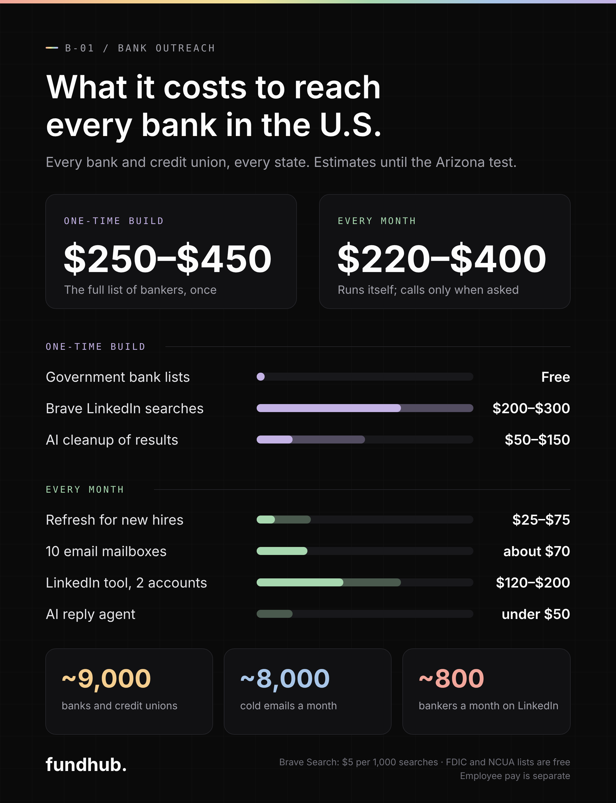
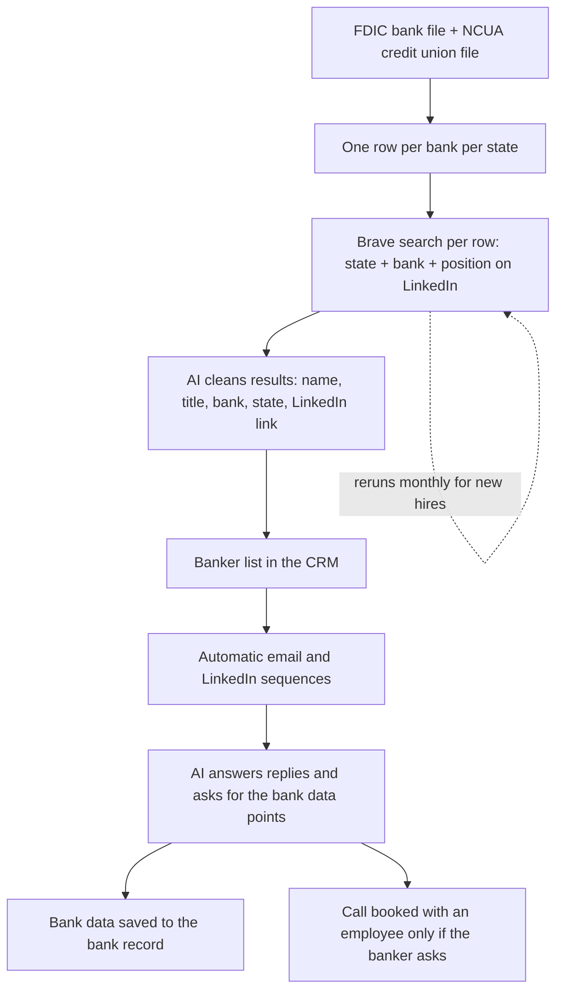

# Bank outreach plan — 2026-10-14

Status: plan only. Nothing is built yet. Next step is an Arizona test run.



Source picture: [`bank-outreach-cost-2026-10-14.svg`](./bank-outreach-cost-2026-10-14.svg)

## What it is

Fundhub warms up every bank in the U.S. on LinkedIn and email. We find the bankers, reach out, and send them deals.

- **Who we want:** relationship managers, business bankers, SVPs, and anyone else at a bank Chris wants to talk to.
- **The pitch (Chris's words, cleaned up):** we have a lot of clients and we want to send them to you. Every client is pre-verified with top-tier underwriting, so the bank is protected. We send deals for credit cards, lines of credit, and all loan products.
- **What we ask for:** the bank's data points. What they approve, how they approve, and where to apply.
- **Later:** once banks work, copy the same system to brokers, affiliates, and other partners.

## Owner decisions (Chris, 2026-10-14)

- Get a list of every bank in every state. Duplicates are fine. Chase in Arizona and Chase in Texas are two rows, because different bankers hold different data.
- Find the bankers by searching LinkedIn by **state + bank + position**.
- **No scraping bank websites or team pages.**
- Do it with an API, not by hand.
- A couple of employees can run the outreach all day, every day.
- The employee works from a dashboard in our CRM: takes calls, answers email from their work inbox, and the data they get lands in the system.
- Everything runs on its own, LinkedIn included. People hop on a call only when a banker wants one.
- Covers every bank product for clients, personal and business, except mortgages.
- Warm bankers move to one fundhub.ai inbox (for example relationships@fundhub.ai) with a monthly check-in for active partners and quarterly for quiet ones.
- Plan to sell this bank data as a recurring offer at $4,000–$5,000 a month. To revisit.
- Collect every piece of bank data we can: paper applications, application links, all of it.

## How it runs



Example search for one row:

```
site:linkedin.com/in "Chase" ("relationship manager" OR "business banker" OR "SVP" OR "vice president") "Arizona"
```

Where the lists come from (both free):

- Banks and branches: https://banks.data.fdic.gov/bankfind-suite/bulkData/bulkDataDownload (Institutions file and Locations file)
- Credit unions and branches: https://www.ncua.gov/analysis/Pages/call-report-data/quarterly-data.aspx (quarterly ZIP has a branch file)

Why Brave:

- LinkedIn's own people-search API is only for companies with an enterprise Sales Navigator or Recruiter contract.
- Google's search API is closed to new customers and shuts down January 1, 2027.
- Brave Search API: $5 per 1,000 searches, with about $5 of free credit each month.

## What it costs (estimates until the Arizona test)

| Part | Cost |
|---|---|
| FDIC and NCUA lists | Free |
| Brave searches, one full national pass | about $200–$300 |
| AI cleanup of results | about $50–$150 |
| **One-time total** | **about $250–$450** |
| Monthly refresh for new hires | about $25–$75 |
| 10 email mailboxes on separate domains | about $70 a month |
| LinkedIn automation tool, 2 accounts ($59–$100 per account) | about $120–$200 a month |
| AI reply agent | under $50 a month |
| **Monthly total** | **about $220–$400**, plus employee pay |

The search estimate assumes 15,000–25,000 searches for a basic pass, and more when big banks are split by city and title.

## Limits that set the pace

- About 4,400 banks plus 4,565 federally insured credit unions, so about 9,000 in all.
- Each LinkedIn account can send about 100–200 connection requests a week, automated or not. Two accounts reach about 800 bankers a month or more.
- LinkedIn automation runs from a cloud tool (for example Dripify, HeyReach or Expandi). LinkedIn's terms bar automation tools, so a team account can get restricted. Run it on team accounts at a slow daily pace, never on Chris's own profile. The tool we pick needs an API so the AI agent can read and answer LinkedIn replies.
- Each mailbox can safely send about 40 cold emails a day. 10 mailboxes send about 8,000 a month. More mailboxes, more reach.
- Cold email goes out from a separate domain (for example getfundhub.com), still branded Fundhub, so fundhub.ai client email keeps landing.

## Bank data to collect (same form for every bank)

- Products offered
- Minimum score
- Time in business and revenue needs
- Which credit bureau they pull
- How many inquiries they accept
- Whether they take stated income
- States they serve
- Online application link or paper application
- Banker contact info

## Background

- The first version of this idea is the Google Doc "LINKEDIN ORGANIC BANK SCRAPER / REACH OUT SYSTEM" (2025-10-15): https://docs.google.com/document/d/1JVRfm1XDxymqZ29VQoMzkx3ZqXdEAcML_7mlvGiAo4Q/edit
- The bank book already in this repo: `docs/legacy-strong/lenders-legacy-strong.csv` (313 banks), loaded by `scripts/lenders-import-alec.mjs`.

## Next

Pull the FDIC and NCUA files, build the Arizona rows, run the Brave search on Arizona only, and replace these estimates with real counts and cost.
