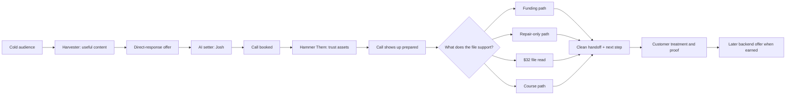
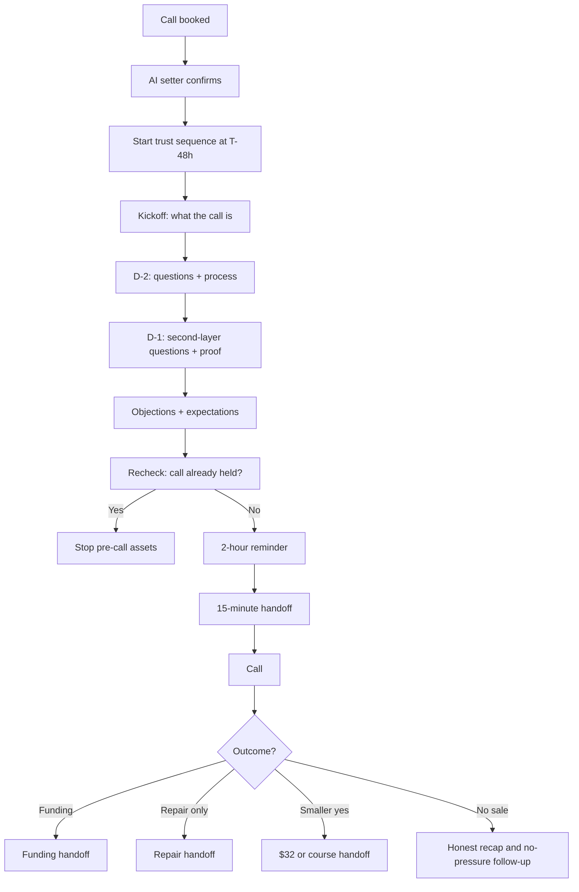

# Fundhub trust-asset flow and backend-selling system

Status: working system map, written 2026-10-11.

This is the Fundhub version of Jeremy Haynes' Harvester + Hammer Them model.
It uses our real AI setter, booking events, product paths, and BS-01 pre-call
launcher. It does not promise a result that the source file does not prove.

## The one-line system

The trust asset sells the next step, not the whole outcome. Before the call,
the next step is showing up with the right facts. On the call, the closer
learns the situation, picks one honest path, asks for the yes, and sends the
contract and pay link. After payment, the customer gets delivery and support
before any later offer.

## Flow by stage

| Stage | Trigger | Job | Trust assets | Channel |
|---|---|---|---|---|
| 1. Warm | Person watches or engages with useful content | Build familiarity and belief | Short teaching clips, proof, founder point of view, honest category education | Meta content / organic |
| 2. Ask | Person is warm enough for the offer | Give one clear next action | Direct-response video, landing page, what the call is and is not | Ad + page |
| 3. Set | Lead books | Confirm the person, time, and reason for the call | AI setter confirmation; no extra pitch | AI call / SMS |
| 4. Trust | `booking.created` | Remove fear before the call | Questions, second-layer questions, objections, expectations | Email, SMS, retargeting video |
| 5. Show | Call time arrives | Make the call feel safe and useful | 2-hour reminder, 15-minute handoff, meeting link or portal fallback | SMS / task |
| 6. Diagnose | Call is held | Find the real path | File facts, goal, cash fit, business or personal use, timing, negatives | Closer call |
| 7. Sell the path | Closer chooses one path | Ask for one clean yes | Plain offer, real price, real deposit, contract, pay link | Call + follow-up |
| 8. Deliver | Payment or smaller yes is complete | Make the first result real | Welcome, next-step checklist, progress proof, support | Portal / email |
| 9. Backend | Customer has received value | Earn the next offer | Results, usage, success stories, advanced education | Content + direct offer |

## The 72-hour trust asset set

The current Fundhub creative sheet has 30 post-booking concepts. Pick 15 for
the first live set. Keep the other 15 as the swap set. The four Jeremy pillars
are the order of the content, not four random buckets.

### Pillar 1 — First questions

These stop the person from wondering what the call is.

- What the call is and is not.
- Who Fundhub is good for.
- Why there is a call instead of only a form.
- What Fundhub looks at.
- Why Fundhub sometimes says no.

### Pillar 2 — Second-layer questions

These answer the question that appears after the first answer.

- What the $32 file read is and is not.
- What happens after the soft pull.
- Soft pull versus hard pull.
- What the three doors mean.
- What the deposit pays for.
- What happens after someone is not a fit.

### Pillar 3 — Objections

These lower the fear that causes a cancel or no-show.

- “Is this a scam?” — invite the person to check the proof.
- “Will this work for me?” — explain the decision process, not a promise.
- “I tried this before.” — respect the bad prior experience and explain the difference.
- “I do not have the cash.” — tell them to say that on the call; do not promise a path.
- “Can I use payments?” — be exact: only the two courses use the finance plan; the funding deposit is cash.
- “I need to talk to my spouse.” — invite the spouse onto the call.

### Pillar 4 — Expectations

These make the next step feel real.

- How long the call takes.
- What the person needs to bring.
- What “approved” does and does not mean.
- What the first week looks like after a yes.
- How much work is on the customer.
- What Fundhub will never do.

## Delivery sequence

The live BS-01 workflow is a 3-day, 18-cell grid. It starts 48 hours before
the appointment, splits email by funding or repair path, checks whether the
call already happened before later sends, and stops when the call is held.
The SMS pre-call touch also sits at T-48h. The 2-hour reminder belongs to the
booking reminder flow, and the 15-minute message belongs to the three-way
handoff flow.

## Backend selling after the call

The closer does not keep selling forever. The call has one clean job:

1. Listen and learn the facts.
2. Decide whether the person fits funding, repair-only, a file read, or a course.
3. Explain one path in plain words.
4. State the real price and deposit.
5. Ask for the yes.
6. Stay until payment, or set one clear next time.
7. Send the contract and pay link.
8. Hand the customer to the next seat.

If there is no sale, send a short recap that names the goal and the next step.
Do not send “just checking in,” invent a new price, or create fake urgency.

After payment, the backend has three lanes:

- **Activation:** welcome, access, what happens next, and the first action.
- **Proof of use:** help the customer use what they bought and capture the real result.
- **Earned next offer:** show advanced education and relevant next steps only after the first value is delivered.

## Asset rules

- One asset has one job: answer a question, handle an objection, set an expectation, or show proof.
- The call asset sells showing up. It does not promise funding.
- Proof comes from a real source image, real client, real quote, and real amount.
- Keep funding, repair, file-read, and course language separate when the path differs.
- Stop all pre-call material when the call is held, cancelled, or moved.
- Use the 15-post set first. Hold the other 15 for fatigue or a missing angle.

## What is live vs. what still needs asset production

### Live in the repository

- AI setter on `booking.created`: `src/workflows/ai-set-01-josh-setter.mjs`.
- Booking confirmations and reminders: `src/workflows/s-04b-booking-reminders.mjs`.
- 15-minute handoff: `src/workflows/ai-set-04-3way-handoff.mjs`.
- Backend launcher: `src/workflows/bs-01-precall-launcher.mjs`.
- 30 post-booking creative concepts: `marketing/ads/POST-BOOKING-15.md`.
- Closer call shape and honest path rules: `docs/sops/company-resources/closer-playbook-2026-08-24.md`.

### Asset work to produce

- Choose the first 15 concepts from `POST-BOOKING-15.md`.
- Record one short vertical video per concept, with no copyrighted music.
- Build one proof page from real source proof.
- Fill any empty BS-01 template cells with approved copy before relying on those cells.
- Build the post-payment activation and proof set before adding an upsell.

## Scorecard

Read the system in this order:

1. Book rate: did the offer create the next step?
2. Show rate: did the trust flow get them to the call?
3. Qualified show rate: did they show with the right facts?
4. Close rate: did the closer sell one honest path?
5. Cash collected: did the yes become payment?
6. First-value rate: did the customer use what they bought?
7. Backend take rate: did the next offer follow delivered value?

Do not fix a later number by hiding an earlier one. A weak show rate is a
trust-flow problem. A weak close rate after strong shows is a call or offer
problem. A weak backend take rate before first value is a delivery problem.
