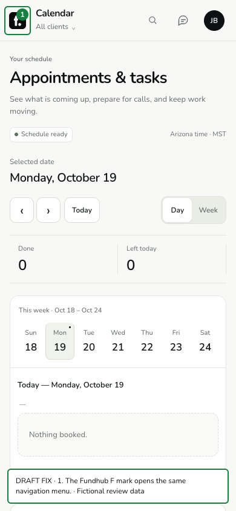
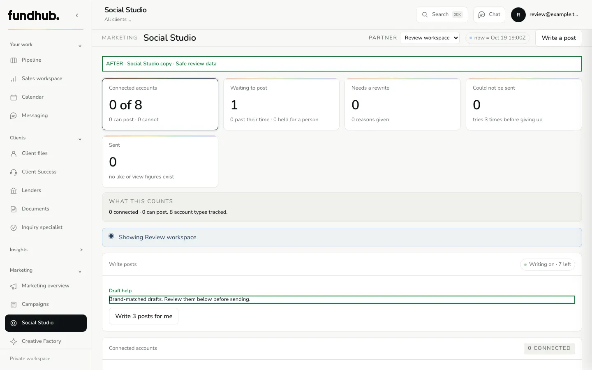

# Dashboard UX polish — review draft

These are the small changes requested after the professional CRM review. The existing 36-page checkpoint is live; this polish is a separate review draft.

## Branding

The sidebar uses Fundhub's pastel rainbow from the brand guide. The existing F asset replaces the phone menu's three lines beside Calendar and every other staff workspace title. The same button still opens the menu. Other companies retain their own logo and spectrum, including live Brand Studio updates.

| Screen | Before — red | Draft fix — green |
| --- | --- | --- |
| Desktop sidebar | [Before](evidence/desktop-before-MARKED.png) | [After](evidence/desktop-after-MARKED.png) |
| Phone navigation | [Before](evidence/phone-before-MARKED.png) | [After](evidence/phone-after-MARKED.png) |
| Social Studio, desktop | [Before](evidence/social-copy-before-1440-review.webp) | [After](evidence/social-copy-after-1440-review.webp) |
| Social Studio, phone | [Before](evidence/social-copy-before-390-review.webp) | [After](evidence/social-copy-after-390-review.webp) |

## Less explanation

Social Studio, Ideas, Scripts and Settings keep their existing controls and behavior with shorter helper text. Four measured Social blocks shrink from 365 to 123 words (66% less). Costs, send times and approval consequences remain clear. [Copy inventory and tests](copy.md).

## Kanban and completion scan

All 61 source pages and directly linked local assets exist. All 36 published page HTML responses match the recorded release. The full 61-page rebuild still has 25 unintegrated page results; [the scan](scan.md) lists them individually.

The Kanban read-error message is also simplified: “Sales — could not load the board. Refresh to try again.” Failed reads still show unknown counts, never false zeroes. Before evidence remains in the scan. [Desktop fix](evidence/kanban-error-after-1440-MARKED.png) · [Phone fix](evidence/kanban-error-after-390-MARKED.png).

No API contract, saved data, role gate, recording, payment or outbound-send behavior changed. Screenshot content is fictional local test data. New production publication and live verification follow the owner's marked-draft go-live choice.

## Verification

- Final Kanban and branding suite: **40 passed**; includes the F control's click/Escape/focus behavior, compact sidebar, 320/390px layout, brand overrides, custom live brand preview and failed-read unknown counts.
- Partner-brand and sidebar-role checks passed; **101 distinct marketing browser cases passed**, plus the controlled Teams/Social proof. [Exact copy run details](copy.md).
- Targeted source/handler/copy tests, TypeScript, lint and diff checks passed. Lint checked 4,005 files and inline scripts.
- These draft checks use controlled API data. They are separate from the fresh public source check of the existing 36-page release. New deployed proof remains pending publication.
